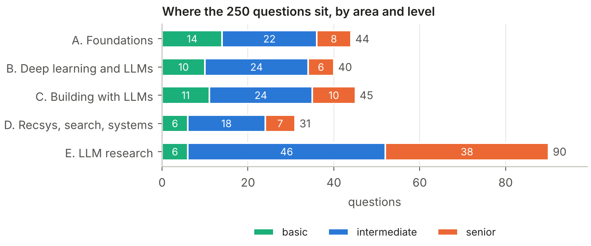

# 37 · ML depth question bank

Part X · Research craft and interviews. 250 questions with short model answers, grouped by area and marked by level: **[B]** basic, **[I]** intermediate, **[S]** senior. Each chapter's own interview section goes deeper; this bank is for rapid-fire practice in the last weeks.

## How to use this bank

Every topic in this bank is explained, with links to go deeper, in the **Key concepts** section of the chapter named in each heading. For a second, independent bank of questions, see [Chip Huyen's ML Interviews Book](https://huyenchip.com/ml-interviews-book/).

- **Rapid fire:** read only the question, answer aloud in under a minute, then open the answer and compare. On GitHub the answers are collapsed (click **Answer**); in the PDF, cover them. The same questions are available as flashcards in [`flashcards/`](../flashcards/) for spaced repetition. Mark the ones you fumbled and redo them two days later.
- **Mixed order** in the final week: interviews jump between topics.
- **Go deeper** where an answer feels thin: the chapter number in each section heading points to the full treatment.
- **Senior questions** usually have no single right answer; the model answer shows the structure a strong response follows.
- **Follow-up chains** (section G) and **graded answers** (section H) show what interviewers do after your first answer, and what separates a senior answer from an acceptable one.

*The bank by area and level. Research topics carry most of the senior questions. Foundations and applied LLM work are weighted towards basic and intermediate questions, which come early in most loops.*

**From short answer to strong answer.** The model answers below are deliberately short: they are the skeleton you should be able to produce in a few seconds. In an interview, a senior question deserves one to two minutes, and the extra time should go on structure, not on more facts. Section F at the end of the chapter expands five senior questions into full answers, to show what the extra time is for:

- **Order.** Go from the most likely cause, or the cheapest check, to the least.
- **Numbers.** Put rough magnitudes where they exist.
- **Decisions.** Say what you would do with each finding.

## A. Foundations (Chapters 1–4 and 40)

### Maths and probability

**1. [B] What does cosine similarity measure, and when does it equal the dot product?**

Answer

The angle between two vectors, ignoring their length. It equals the dot product when both vectors are L2-normalised.

**2. [B] What is the SVD and why does it matter for ML?**

Answer

Any matrix factors as UΣVᵀ; keeping the top k singular values gives the best rank-k approximation. It underlies PCA, matrix factorisation and the low-rank idea behind LoRA.

**3. [B] State Bayes' rule and give an ML use.**

Answer

P(A|B) = P(B|A)P(A)/P(B). Naive Bayes classifiers; turning a test's sensitivity and base rate into the probability of fraud given a flag.

**4. [I] MLE vs MAP?**

Answer

MLE picks parameters maximising the likelihood of the data; MAP adds a prior and maximises the posterior. L2 regularisation is MAP with a Gaussian prior; L1 with a Laplace prior.

**5. [I] Why is cross-entropy the loss for classification?**

Answer

It is the negative log-likelihood of the labels under the model's predicted distribution, so minimising it is maximum likelihood; it also gives well-behaved gradients (p − y) with softmax or sigmoid.

**6. [I] What is KL divergence and where does it appear in LLM work?**

Answer

A non-symmetric measure of how one distribution differs from another. It appears in RLHF (penalty keeping the policy close to the reference model), distillation (matching teacher distributions), and variational methods.

**7. [B] Explain the chain rule's role in training neural networks.**

Answer

Backpropagation applies the chain rule to compute the gradient of the loss with respect to every parameter, layer by layer from the output back.

**8. [I] What is entropy, intuitively?**

Answer

The average surprise of a distribution: high when outcomes are uncertain, zero when one outcome is certain. Decision trees use it to measure impurity.

### Statistics and experimentation (Chapter 2)

**9. [B] Define a 95% confidence interval correctly.**

Answer

A procedure that, over repeated samples, produces intervals containing the true value 95% of the time; not a 95% probability for this specific interval.

**10. [B] What is the difference between type I and type II errors?**

Answer

Type I: a false positive (claiming an effect that is not there), probability α. Type II: a false negative, probability β; power is 1 − β.

**11. [B] How does sample size depend on the minimum detectable effect?**

Answer

Inversely with its square: halving the MDE needs four times the sample.

**12. [I] What is CUPED?**

Answer

Variance reduction using a pre-experiment covariate: Y − θ(X − mean X) with θ = cov(Y,X)/var(X); variance falls by 1 − ρ² without bias.

**13. [I] Why is peeking at A/B results a problem?**

Answer

Repeated significance checks inflate the false positive rate far above α; use a fixed horizon or a sequential method built for interim looks.

**14. [I] What is sample ratio mismatch and what do you do?**

Answer

The observed traffic split differs significantly from the design; stop interpreting results and find the assignment or logging bug.

**15. [I] Bonferroni vs Benjamini-Hochberg?**

Answer

Bonferroni controls the chance of any false positive (strict); BH controls the expected share of false discoveries (more power), better for many metrics or segments.

**16. [S] How do you test a change to courier dispatch?**

Answer

Not by user randomisation, because arms share couriers. Switchbacks over city × time slots, or geo experiments, analysed at the slot level with clustered errors and carryover buffers.

**17. [S] An A/B test shows +4% but leadership doubts it. What do you check?**

Answer

SRM, data quality, novelty over time, segment consistency, power and the winner's curse, interference, guardrails, and whether the effect replicates in a holdout or follow-up test.

**18. [I] What assumption does difference-in-differences rely on?**

Answer

Parallel trends: without treatment, treated and control groups would have changed alike; check pre-period trends.

### ML fundamentals (Chapter 3)

**19. [B] Bias vs variance?**

Answer

Bias: error from too simple a model (underfitting). Variance: error from sensitivity to the training sample (overfitting). Regularisation, data and model choice trade them.

**20. [B] Why can't you use the test set to choose hyperparameters?**

Answer

It then becomes part of training decisions and no longer gives an unbiased estimate.

**21. [B] L1 or L2 regularisation for feature selection?**

Answer

L1, because it drives some weights exactly to zero.

**22. [I] Name four types of leakage.**

Answer

Target-derived features, future information in time-based features, preprocessing fitted on all data, and the same entity across train and test.

**23. [I] How would you cross-validate a model predicting next week's demand?**

Answer

Walk-forward (time-based) folds with a gap equal to the horizon and point-in-time features.

**24. [I] How does Adam differ from SGD with momentum?**

Answer

Adam adds per-parameter adaptive step sizes from a running average of squared gradients, with bias correction.

**25. [I] How do you handle a categorical feature with 50,000 values?**

Answer

Out-of-fold smoothed target encoding, hashing, frequency encoding, or learned embeddings in a neural network; CatBoost handles it natively.

**26. [I] What do you do first with heavy class imbalance?**

Answer

Choose the right metric (PR-AUC, recall at a precision), then class weights and threshold tuning; resample only training folds; correct probabilities afterwards.

**27. [S] Offline AUC 0.99. Your reaction?**

Answer

Suspect leakage: inspect top features, timestamps, splits and duplicates; compare with simple baselines.

**28. [S] When should a problem not be solved with ML?**

Answer

When rules suffice, labels or feedback do not exist, errors are unacceptable and unexplainable, or nobody will act on predictions.

### Classic models (Chapter 40)

**29. [B] How does a decision tree choose a split?**

Answer

It tries features and thresholds and picks the split with the largest reduction in impurity (Gini, entropy or variance).

**30. [B] Random forest vs gradient boosting?**

Answer

Forests average deep, decorrelated trees in parallel (variance reduction); boosting adds shallow trees sequentially fitting the gradient (bias reduction), usually more accurate when tuned.

**31. [I] Why does a small learning rate help gradient boosting?**

Answer

Shrinkage regularises: each tree corrects a little, and with early stopping the ensemble generalises better at the cost of more trees.

**32. [I] Which models need feature scaling?**

Answer

Linear and logistic regression with regularisation, SVMs, kNN, k-means, PCA and neural networks; trees do not.

**33. [I] What is the kernel trick?**

Answer

Computing dot products in a high-dimensional feature space via a kernel function, so linear methods learn non-linear boundaries.

**34. [I] How do you choose k in k-means?**

Answer

Elbow, silhouette, stability, and usefulness for the task; with k-means++ initialisation and restarts.

**35. [S] When would you choose logistic regression over LightGBM in production?**

Answer

Interpretability or regulation, very small data, critical calibration, extreme latency limits, or when the accuracy gain does not justify complexity.

**36. [S] Why do trees still beat deep learning on most tabular data?**

Answer

They handle heterogeneous, irregular features and uninformative features well, need little tuning, and deep nets' smoothness bias fits tabular targets poorly; deep models win with huge data, sequences or high-cardinality IDs.

### Evaluation and metrics (Chapter 4)

**37. [B] Precision vs recall?**

Answer

Precision: share of flagged that are positive. Recall: share of positives that are flagged.

**38. [B] What does ROC-AUC mean?**

Answer

The probability a random positive scores above a random negative.

**39. [I] Why prefer PR-AUC for rare positives?**

Answer

ROC-AUC stays high when false positives are many but small relative to the huge negative class; PR-AUC exposes poor precision.

**40. [I] What is calibration and how do you fix it?**

Answer

Predicted probabilities matching observed rates; fix with Platt scaling, isotonic regression or temperature scaling on held-out data.

**41. [I] MAE, RMSE or WAPE for demand forecasting?**

Answer

WAPE for aggregate accuracy across items of different volumes; MAE for interpretability; RMSE when large misses are costly; always report bias.

**42. [I] Micro vs macro F1?**

Answer

Micro pools all decisions (dominated by frequent classes); macro averages per-class F1 (rare classes count equally).

**43. [S] How do you compare two models' AUCs fairly?**

Answer

Paired bootstrap over the independent unit (users, queries) on the same test set, or DeLong's test; report the interval of the difference.

**44. [S] Offline metric up, online flat: list causes.**

Answer

Proxy mismatch, different candidate sets, leakage, train-serve skew, feedback-loop bias in logs, low power, or opposing segment effects.

## B. Deep learning, transformers and LLMs (Chapters 5–21)

### Neural networks and PyTorch (Chapters 5–6)

**45. [B] Why do neural networks need non-linear activations?**

Answer

Without them, stacked layers collapse into one linear function.

**46. [B] Why ReLU (or GELU) instead of sigmoid in hidden layers?**

Answer

Sigmoid saturates, making gradients vanish in deep networks; ReLU-family activations keep gradients alive and are cheap.

**47. [I] Why does initialisation matter? Name a scheme.**

Answer

Bad scales make activations and gradients explode or vanish through layers. Xavier/Glorot for tanh, He/Kaiming for ReLU keep variance roughly constant.

**48. [I] Batch norm vs layer norm?**

Answer

Batch norm normalises each feature across the batch (CNNs, stable large batches); layer norm normalises across features per example (transformers, variable lengths, small batches).

**49. [I] What does dropout do?**

Answer

Randomly zeroes activations in training, preventing co-adaptation; acts like an ensemble; disabled at inference (with scaling handled in training).

**50. [I] Your loss is NaN after a few steps. What do you check?**

Answer

Learning rate too high, missing gradient clipping, log of zero or division by zero, fp16 overflow (use bf16 or loss scaling), bad input data.

**51. [I] The model does not learn at all. How do you debug?**

Answer

Overfit a single batch first; check labels and inputs line up; verify loss and output shapes; check the learning rate; confirm `optimizer.zero_grad()`, `model.train()` and that gradients flow (no detached tensors).

**52. [B] What does**

Answer

`model.eval()` **change?** Disables dropout and makes batch norm use running statistics; it does not turn off gradients (use `torch.no_grad()` for that).

**53. [I] What is mixed-precision training?**

Answer

Computing in bf16 or fp16 while keeping critical values (master weights, reductions) in fp32; faster and smaller with near-identical results.

**54. [I] What is a learning-rate warm-up and why use it?**

Answer

Start with a small learning rate and increase it over the first steps, avoiding unstable early updates when Adam's statistics are poor; standard for transformers.

### Text, embeddings and sequence models (Chapters 8–9)

**55. [B] How does word2vec learn embeddings?**

Answer

Predicting context words from a word (skip-gram) or the reverse, with negative sampling; words in similar contexts get similar vectors.

**56. [I] Why did LSTMs replace vanilla RNNs, and why did transformers replace LSTMs?**

Answer

LSTM gates ease vanishing gradients over long sequences; transformers removed sequential computation, allowing parallel training and direct long-range attention.

**57. [B] What is BPE tokenisation?**

Answer

Start from characters or bytes and repeatedly merge the most frequent pair into a new token, giving a sub-word vocabulary that handles rare words.

**58. [I] Why do tokenisers matter for cost and multilingual quality?**

Answer

Cost and context are counted in tokens; languages under-represented in the tokeniser's training (often Arabic, among others) need more tokens per word, so they are slower, costlier and often lower quality.

### The transformer (Chapter 10)

**59. [B] Write the attention formula.**

Answer

softmax(QKᵀ/√dₖ + mask)V.

**60. [B] Why the √dₖ?**

Answer

Keeps dot products from growing with dimension and saturating softmax.

**61. [I] What does each part of a transformer block do?**

Answer

Attention mixes information across positions; the feed-forward network transforms each position; residuals and normalisation keep deep training stable.

**62. [I] What is RoPE?**

Answer

Rotary position embeddings rotate queries and keys by position-dependent angles so attention depends on relative distance.

**63. [I] What is the KV cache?**

Answer

Stored keys and values of previous tokens per layer so each new token only computes its own; memory grows with layers × KV heads × head dim × tokens.

**64. [I] MQA and GQA?**

Answer

Query heads share key/value heads (all in MQA, in groups in GQA), shrinking the KV cache and speeding decoding.

**65. [S] Why is attention quadratic, and what are the main ways around it?**

Answer

Every token attends to every other: O(T²). FlashAttention reduces memory traffic (still exact); sliding-window, sparse or linear attention and state-space models reduce the computation itself.

### Model families and training (Chapters 12, 15)

**66. [B] Encoder vs decoder models: which for what?**

Answer

Encoders (BERT) for classification, extraction and embeddings; decoders (GPT) for generation and general LLM use.

**67. [I] What is a mixture-of-experts model?**

Answer

Each token is routed to a few expert feed-forward networks, so total parameters are large but compute per token is small; needs load balancing.

**68. [I] What do scaling laws say?**

Answer

Loss falls predictably as a power law in parameters, data and compute; Chinchilla showed compute-optimal training uses roughly 20 tokens per parameter, so many earlier models were under-trained.

**69. [B] What are the stages of training a chat LLM?**

Answer

Pre-training on large text corpora (next-token prediction), supervised fine-tuning on instructions and conversations, then preference optimisation (RLHF or DPO), often followed by reinforcement learning for reasoning.

**70. [I] How does RLHF work?**

Answer

Collect human preference pairs, train a reward model on them, then optimise the policy with RL (classically PPO) to maximise reward with a KL penalty to stay close to the SFT model.

**71. [I] What does DPO change?**

Answer

It optimises the policy directly on preference pairs with a classification-style loss derived from the RLHF objective, with no separate reward model or RL loop.

**72. [S] What are reasoning models and how are they trained?**

Answer

Models that generate long reasoning before answering, trained largely with reinforcement learning on tasks with verifiable rewards (maths, code tests), so they learn to search, check and correct; controlled at inference with a reasoning budget.

**73. [I] What is distillation?**

Answer

Training a smaller student to imitate a larger teacher's outputs (labels, soft probabilities or generated text), keeping much of the quality at lower cost.

**74. [S] Small fine-tuned model or large general model for a production task?**

Answer

Compare on your evaluation set with cost and latency: large models for broad, changing or low-volume tasks; small fine-tuned models for narrow, high-volume, latency-sensitive tasks, often distilled from the large one.

### Inference and serving (Chapter 21)

**75. [B] Temperature, top-k and top-p?**

Answer

Temperature scales logits (lower is more deterministic); top-k samples from the k most likely tokens; top-p from the smallest set whose probability mass reaches p.

**76. [I] Greedy decoding vs beam search for chat models?**

Answer

Beam search finds high-likelihood sequences but tends to be bland and repetitive for open-ended text; chat uses sampling; beam search suits translation-like tasks.

**77. [I] What is continuous batching?**

Answer

Adding new requests to the running batch at each decoding step instead of waiting for the whole batch to finish, keeping GPUs busy and raising throughput (vLLM, TGI).

**78. [I] What is speculative decoding?**

Answer

A small draft model proposes several tokens; the large model verifies them in one forward pass and accepts the matching prefix; same output distribution, lower latency.

**79. [I] What does quantisation trade off?**

Answer

Lower precision (int8, int4: GPTQ, AWQ) cuts memory and raises speed, with some quality loss that grows at lower bits and for smaller models; measure on your tasks.

**80. [I] Why is decoding memory-bandwidth-bound?**

Answer

Each step generates one token per sequence but must read all weights and the KV cache; batching amortises the reads.

**81. [I] What are time to first token and tokens per second, and what drives each?**

Answer

TTFT is dominated by prefill (prompt length, queueing); tokens per second by decode speed (model size, batching, bandwidth, speculative decoding).

**82. [S] Estimate the monthly cost of an LLM feature.**

Answer

Calls per month × (input tokens × input price + output tokens × output price), minus caching and batch discounts; compare with self-hosting (GPU hours at the needed throughput and utilisation).

**83. [S] Your offline LLM classification job is too expensive. Options?**

Answer

Batch API (often around half price), prompt caching, shorter prompts, a smaller model or a cascade, and distilling into a small model; a before-and-after cost figure from your own work is the strongest answer.

**84. [S] When would you self-host an open model instead of using an API?**

Answer

High, steady volume where GPUs stay busy; data residency or privacy requirements; need for fine-tuning or custom decoding; latency control. Against: operational cost, scaling, and keeping up with model releases.

## C. Building with LLMs (Chapters 20–33)

### Prompting and context (Chapter 22)

**85. [B] Zero-shot vs few-shot?**

Answer

Instructions only vs instructions plus examples; add examples when format or boundary cases are ambiguous.

**86. [B] How do you get reliable JSON?**

Answer

Structured-output or tool-calling modes with a schema, validation with Pydantic, one retry with the error, and a fallback.

**87. [I] When does chain of thought help?**

Answer

Multi-step reasoning; not simple extraction. Reasoning models do it internally under a budget.

**88. [I] How do you version and test prompts?**

Answer

Version template, model and parameters together; run a labelled evaluation set on each change; log versions with outputs.

**89. [I] How do you design a prompt for caching?**

Answer

Stable content first (system prompt, instructions, examples, tools), byte-identical across calls; per-request content last.

**90. [S] What is indirect prompt injection and how do you defend?**

Answer

Instructions hidden in content the model reads (documents, emails, tool output). Least privilege, policies in code, human approval for risky actions, untrusted content handled by a tool-less reader, filtering and red-teaming.

### Fine-tuning (Chapter 20)

**91. [B] Prompt, RAG or fine-tune?**

Answer

Prompt first; RAG for knowledge that changes or must be cited; fine-tune for consistent format or style, narrow high-volume tasks, or domain language.

**92. [B] Explain LoRA in one sentence.**

Answer

Freeze W and learn a low-rank update BA (scaled by α/r), training well under 1% of parameters and merging afterwards at no latency cost.

**93. [I] Why is B initialised to zero in LoRA?**

Answer

So the update starts at zero and training begins exactly from the pretrained model.

**94. [I] What makes QLoRA possible?**

Answer

4-bit NF4 quantisation of the frozen base, double quantisation and paged optimisers, with bf16 LoRA adapters receiving gradients.

**95. [I] How do you limit catastrophic forgetting?**

Answer

PEFT, low learning rate, few epochs, replay of general data, and a regression suite.

**96. [S] How would you evaluate whether a fine-tune was worth it?**

Answer

Against the best prompted baseline on a held-out set, plus format reliability, a general-ability and safety regression suite, and cost and latency; include maintenance cost when the base model changes.

### Embeddings (Chapter 29)

**97. [B] How are sentence embeddings trained?**

Answer

Contrastively: pairs that should match are pulled together and in-batch negatives pushed apart (InfoNCE).

**98. [I] What does the temperature do in InfoNCE?**

Answer

Sharpens or softens the softmax over similarities; low temperature focuses on hard negatives.

**99. [I] What are false negatives in hard-negative mining?**

Answer

Mined "negatives" that are actually relevant; filter them with a cross-encoder or margin, or skip top ranks.

**100. [I] What are Matryoshka embeddings?**

Answer

Embeddings trained so that prefixes (first 64, 128, … dimensions) are good embeddings too, allowing cheap truncated search.

**101. [S] How do you choose an embedding model?**

Answer

Shortlist from MTEB for your task and languages, evaluate on your own labelled queries, compare latency, dimension, cost and licence, consider fine-tuning.

### Retrieval (Chapter 30)

**102. [B] BM25 in one sentence.**

Answer

Keyword scoring summing IDF-weighted, saturating, length-normalised term frequencies.

**103. [B] Why hybrid search?**

Answer

Keyword search catches exact names and codes; embeddings catch paraphrases; fused (RRF) they cover each other's misses.

**104. [I] How does HNSW work?**

Answer

A layered proximity graph searched greedily from sparse top layers down to the full bottom layer; efSearch trades recall for latency.

**105. [I] What is product quantisation?**

Answer

Splitting vectors into sub-vectors, each stored as the id of its nearest of 256 centroids; scored with lookup tables; compressed and approximate.

**106. [I] Bi-encoder vs cross-encoder?**

Answer

Bi-encoders embed separately (fast, indexable, for retrieval); cross-encoders read query and document together (accurate, slow, for re-ranking).

**107. [S] How would you handle per-user permissions in vector search?**

Answer

Filter in retrieval (pre-filtering or a partition per tenant), never by prompt instructions; test that restricted documents never reach the context.

### RAG (Chapter 31)

**108. [B] Draw the RAG pipeline.**

Answer

Offline: load, parse, chunk, embed and index. Online: rewrite query, hybrid retrieval with filters, re-rank, assemble context, generate with citations, verify.

**109. [I] How do you choose chunk size?**

Answer

Empirically: structure-aware chunks with headings, two or three sizes compared on retrieval recall and answer quality.

**110. [I] What is HyDE?**

Answer

Embedding an LLM-written hypothetical answer to search with, because it resembles documents more than a short question does.

**111. [I] What is contextual retrieval?**

Answer

Prepending a short LLM-written description of each chunk's place in its document before embedding and BM25 indexing, so chunks are self-explanatory.

**112. [S] RAG answers are wrong 20% of the time. How do you find the cause?**

Answer

For a sample of failures, check whether the right passage was retrieved, whether it reached the final context, and whether the answer used it; fix the dominant stage.

**113. [S] When would you use GraphRAG or agentic RAG?**

Answer

GraphRAG for global or multi-hop questions over a stable entity-rich corpus; agentic RAG for multi-part questions mixing documents and live data. Both cost more; start with a fixed pipeline.

### Agents (Chapter 33)

**114. [B] Workflow or agent?**

Answer

Workflow when steps are known; agent when the path depends on findings. Prefer the simplest that works.

**115. [I] What makes a good tool for an agent?**

Answer

Clear description with units and limits, strict schema, concise output, actionable errors, idempotency, and policy checks inside the tool.

**116. [I] Why do multi-step agents fail more often?**

Answer

Errors compound: per-step success p gives roughly pⁿ over n steps.

**117. [I] What is MCP?**

Answer

An open protocol exposing tools, resources and prompts from servers to AI applications through a standard interface.

**118. [S] How do you take an agent to production safely?**

Answer

Sandbox evaluation on real cases over repeated runs, guardrails and budgets, audit logs, shadow mode against humans, gradual automation by risk tier, monitoring of success, cost and overrides.

### Evaluation (Chapters 24–25)

**119. [B] Why are public benchmarks insufficient?**

Answer

They do not reflect your inputs, criteria or failure costs, and can be contaminated.

**120. [I] Where do you start evaluating a new LLM feature?**

Answer

Error analysis: read 50–100 traces, write notes, group into failure modes, build an evaluation per frequent mode.

**121. [I] How do you validate an LLM judge?**

Answer

Against expert labels: Cohen's kappa, true positive and true negative rates, compared with human-human agreement, on a held-out set.

**122. [I] Name three LLM-judge biases.**

Answer

Position, verbosity, self-preference.

**123. [I] Faithfulness vs correctness?**

Answer

Faithfulness: claims supported by the retrieved context. Correctness: claims true against a reference. A faithful answer from a wrong document is still wrong.

**124. [S] How many examples do you need to compare two prompts?**

Answer

Depends on the difference: use paired comparisons on the same cases (McNemar); 100 cases give about ±7 points on a single rate near 85% (±10 near 50%), small differences need hundreds.

**125. [S] How do you evaluate an agent?**

Answer

End-state task success, trajectory checks, efficiency, robustness to tool failures, repeated runs (pass^k), safety tests.

### Safety and responsible AI (Chapter 28)

**126. [B] What is hallucination, and how do you reduce it in products?**

Answer

Confident, unsupported output. Ground on retrieved sources with citations, allow abstention, verify claims, constrain outputs, and hand off when unsure.

**127. [I] How do you handle PII in an LLM pipeline?**

Answer

Minimise what is sent, redact or pseudonymise before calls, contractual and regional controls with providers, no PII in logs or training data without consent, output filters.

**128. [I] How would you moderate user reviews with ML?**

Answer

Policy definitions first; a fast classifier for clear cases, an LLM for nuanced ones, human review for borderline and appeals; precision and recall per policy category, per language; monitoring for new abuse patterns.

**129. [S] What does the EU AI Act mean for a practitioner?**

Answer

A risk-based framework: prohibited practices, high-risk systems with obligations (risk management, data governance, documentation, human oversight, accuracy and robustness), transparency duties (for example disclosing AI interaction and AI-generated content), and obligations for general-purpose AI model providers. Know which tier your system falls into and document accordingly.

## D. Recommendation, search, marketplace and systems (Chapters 43–48)

### Recommender systems (Chapter 43)

**130. [B] Why multi-stage recommenders?**

Answer

Cheap high-recall retrieval over the catalogue, then filtering, then a heavy ranker on hundreds, then page-level re-ranking, to meet latency and cost.

**131. [B] Implicit vs explicit feedback?**

Answer

Explicit ratings are rare and biased; implicit behaviour (impressions, clicks, orders) is abundant but has no explicit negatives.

**132. [I] How does a two-tower model train and serve?**

Answer

User and item towers trained with in-batch softmax (plus logQ correction); item vectors precomputed into an ANN index; the user vector computed per request.

**133. [I] What is position bias and how do you correct it?**

Answer

Items shown higher get more clicks regardless of relevance; use position as a training feature removed at serving, or inverse propensity weighting with propensities from randomisation.

**134. [I] How do you handle cold start for a new restaurant?**

Answer

Content features in the item tower, ID dropout in training, exploration impressions, borrowing from similar restaurants.

**135. [I] Explain Thompson sampling.**

Answer

Keep a posterior per option (Beta for click rates); sample once from each; pick the highest; update with the outcome.

**136. [S] Offline NDCG up 3%, A/B flat. Why?**

Answer

Candidate set mismatch, label vs goal mismatch, leakage, position bias in test labels, re-ranking rules overriding, low power, or segment effects.

**137. [S] Where would you use LLMs in a recommender?**

Answer

Offline item enrichment and cold-start features, calibrated LLM judges for offline evaluation, conversational surfaces, semantic IDs; not for scoring thousands of candidates per request.

### Search and learning to rank (Chapter 44)

**138. [B] Pointwise, pairwise and listwise?**

Answer

Per document, per pair, per list; the last two optimise order directly.

**139. [I] Explain LambdaMART.**

Answer

RankNet's pairwise gradients scaled by the |ΔNDCG| of swapping each pair (LambdaRank), fitted by gradient-boosted trees.

**140. [I] Why must ideal DCG use all relevant documents?**

Answer

Otherwise a system that retrieves few documents is not penalised for what it missed.

**141. [I] How do you handle a navigational query for a closed restaurant?**

Answer

Show it first, labelled closed with opening time, then similar open alternatives.

**142. [I] What is team-draft interleaving?**

Answer

Alternately drafting results from two rankers into one list and crediting clicks to the ranker that supplied them; a sensitive comparison.

**143. [S] Search conversion dropped 2%. Debugging plan?**

Answer

Instrumentation and traffic mix first, then segment by query type, language, city and platform; zero-result and reformulation spikes; supply changes; recent ranking and index changes; compare with browse conversion.

### Marketplace and logistics (Chapter 45)

**144. [B] Why is seasonal naive a strong forecasting baseline?**

Answer

Delivery demand has strong weekly patterns; the same hour last week captures them for free.

**145. [I] How do you forecast with stock-outs in the history?**

Answer

Treat sales during stock-outs as censored: exclude or impute those periods and model unconstrained demand.

**146. [I] What quantile should a staffing forecast target?**

Answer

The newsvendor quantile q = cost of under-forecasting / (cost of under + cost of over).

**147. [I] Decompose an ETA prediction.**

Answer

Accept, prep time, courier assignment and travel to the restaurant, wait, travel to the customer, hand-over; pickup is the later of food ready and courier arrival.

**148. [S] How would you rebalance courier supply?**

Answer

Forecast need per zone, solve a min-cost transport LP from surplus to deficit, turn moves into incentives or suggestions, evaluate with switchbacks.

### System design and MLOps (Chapters 46–47)

**149. [B] Name the eight steps of the ML system design framework.**

Answer

Clarify, frame, data, features, model, evaluation, serving, monitoring.

**150. [I] What is train-serve skew and how do you prevent it?**

Answer

Features computed differently in training and serving; prevent with a feature store or shared code paths, logging online features, and comparing with offline recomputations.

**151. [I] Shadow, canary or A/B: when each?**

Answer

Shadow to validate behaviour and latency without user impact; canary to limit blast radius; A/B to measure effect.

**152. [I] What is data drift vs concept drift?**

Answer

Data drift: input distribution changes. Concept drift: the relationship between inputs and target changes. Monitor inputs, predictions and delayed labels.

**153. [I] What do you monitor for an LLM feature?**

Answer

Traces of chained calls, token usage and cost, latency, error and refusal rates, sampled judged quality, user feedback, and drift in input topics.

**154. [S] Back-of-the-envelope: 5M daily users, 4 feed loads each. Peak QPS?**

Answer

5M × 4 / 86,400 ≈ 230 average; with a peak factor of 3, about 700 QPS.

**155. [S] How would you roll out a new ranking model safely?**

Answer

Offline evaluation, shadow traffic for latency and sanity, a small canary with guardrails, an A/B or interleaving test, gradual ramp, monitoring and a rollback switch.

### Data for ML (Chapter 48)

**156. [B] What is a point-in-time join?**

Answer

Joining each training row only with feature values known at its timestamp (for example `merge_asof` backward), preventing leakage.

**157. [I] How do you sessionise events in SQL?**

Answer

Flag events whose gap from the previous event (LAG) exceeds a threshold, then take a running sum of the flags per user.

**158. [I] How do you measure label quality?**

Answer

Inter-annotator agreement (Cohen's or Fleiss' kappa), expert audits of samples, and checking confidently disagreeing model predictions.

**159. [I] When does pandas stop being enough?**

Answer

When data no longer fits comfortably in memory or jobs take too long: push work to SQL, use Polars or DuckDB, or Spark for distributed processing.

**160. [S] How would you set up data contracts for an ML pipeline?**

Answer

Agreed schemas, types, freshness and quality rules between producers and consumers, enforced by automated checks that fail the pipeline or alert before bad data reaches training or serving.

## E. LLM research (Chapters 7, 11, 13–19, 23, 26–27, 34)

### Pretraining data and scaling (Chapters 13, 16)

**161. [I] What are the main steps of a web pretraining-data pipeline?**

Answer

URL filtering, HTML extraction, language ID, heuristic filters, deduplication, model-based quality filtering, PII and toxicity removal, decontamination, tokenisation and sharding with provenance metadata.

**162. [I] How does MinHash estimate document similarity?**

Answer

Hash each shingle with many hash functions and keep the minimum per function; the fraction of matching minima estimates the Jaccard similarity.

**163. [S] How do you choose the LSH bands and rows?**

Answer

The candidate probability 1 − (1 − sʳ)ᵇ is an S-curve with its threshold near (1/b)^(1/r); choose b and r to place it at the similarity you want, balancing missed duplicates against false candidates.

**164. [S] Why might global deduplication across all crawl snapshots hurt?**

Answer

It removes good documents that recur across years and leaves a higher share of low-quality unique pages; per-snapshot deduplication performed better in FineWeb's ablations.

**165. [I] What does a quality classifier like DCLM's or FineWeb-Edu's do, and what is the risk?**

Answer

Scores documents by similarity to a high-quality reference (or LLM-rated educational value); risk of narrowing style and topics and of biases against dialects and regions.

**166. [S] How would you choose a data mixture?**

Answer

Proxy-model ablations, learned weights (DoReMi) or fitted mixing laws, constrained by epochs per source; validate per domain and at two scales.

**167. [I] What is annealing on high-quality data?**

Answer

Switching to a curated mixture during the final learning-rate decay; also a cheap way to measure a data source's value.

**168. [S] What are the risks of synthetic pretraining data?**

Answer

Narrowed distribution, inherited errors, contamination via the generator, and collapse when models repeatedly train on their own outputs without fresh data.

**169. [I] Derive the compute-optimal allocation from L = E + A/N^α + B/D^β with C = 6ND.**

Answer

Substitute D = C/6N, differentiate, set to zero: N_opt ∝ C^(β/(α+β)), D_opt ∝ C^(α/(α+β)).

**170. [I] Why are small open models trained far past 20 tokens per parameter?**

Answer

Inference cost: minimising training plus lifetime serving compute favours smaller models trained longer.

**171. [S] How much is repeated data worth?**

Answer

Nearly as good as fresh data up to about 4 epochs, sharply diminishing beyond about 16 (Muennighoff et al.).

**172. [S] Are emergent abilities real?**

Answer

Many apparent jumps come from discontinuous metrics like exact match; continuous metrics usually show smooth improvement, though some multi-step tasks still appear abruptly.

### Optimisation and training at scale (Chapters 7, 17)

**173. [B] Write the AdamW update.**

Answer

m = β₁m + (1−β₁)g; v = β₂v + (1−β₂)g²; bias-correct both; p ← p(1 − ηλ) − η m̂/(√v̂ + ε).

**174. [I] Why does Adam need warm-up?**

Answer

Early second-moment estimates are poor, so every coordinate moves by about the full learning rate in a noisy direction.

**175. [I] What is the WSD schedule's advantage?**

Answer

Any checkpoint in the constant phase can be decayed into a good model, so runs can be extended and branched cheaply for experiments.

**176. [S] What does the gradient noise scale tell you?**

Answer

Roughly the critical batch size: below it, larger batches save steps almost linearly; it grows as the loss falls.

**177. [S] What does Muon do?**

Answer

Orthogonalises the momentum of each hidden weight matrix with Newton–Schulz iterations, equalising update size across directions; embeddings and heads stay on AdamW.

**178. [S] What problem does µP solve?**

Answer

Under the standard parametrisation the optimal learning rate shifts with width; µP scales initialisation and per-layer learning rates so hyperparameters tuned on small models transfer.

**179. [I] Why keep fp32 master weights in bf16 training?**

Answer

bf16 has 8 bits of precision, so small updates to weights near 1 round away; accumulating in fp32 preserves them.

**180. [S] What makes fp8 training hard?**

Answer

Tiny dynamic range requiring fine-grained scaling, sensitive operations kept in higher precision, and silent quality loss that appears late.

**181. [I] What do z-loss and QK-norm prevent?**

Answer

Growth of output logits and of attention logits respectively, common causes of late-training instability.

**182. [B] How much memory does Adam training need per parameter in mixed precision?**

Answer

About 16 bytes: bf16 weights and gradients plus fp32 master weights and two moments.

**183. [I] Compare ZeRO stages 1, 2 and 3.**

Answer

Shard optimiser states; plus gradients; plus weights. Stages 1–2 add no communication; stage 3 gathers weights per layer, about 1.5× DDP traffic.

**184. [I] Why is tensor parallelism kept inside a node?**

Answer

It all-reduces activations in every layer, needing NVLink-class bandwidth.

**185. [I] What is the pipeline bubble?**

Answer

Idle time at batch start and end, (p − 1)/(m + p − 1); reduced by more micro-batches and interleaved or zero-bubble schedules.

**186. [S] How does context parallelism compute attention?**

Answer

Each GPU holds a sequence block; key–value blocks circulate around a ring while each GPU attends its queries, with load balancing for causal masks.

**187. [B] How do you estimate training time?**

Answer

6ND FLOPs divided by GPUs × peak FLOP/s × MFU.

**188. [S] Your training throughput fell 20% overnight. What do you check?**

Answer

Per-rank step times for stragglers, node and network health, data-loader I/O, checkpoint timing, recent configuration changes.

### Architectures (Chapters 10, 11, 14)

**189. [I] How does a top-k MoE layer change compute and memory?**

Answer

Compute per token scales with k active experts; memory with all experts.

**190. [I] Why do MoEs need load balancing, and what are two methods?**

Answer

Routers collapse onto few experts; the Switch auxiliary loss E·Σ f_e P_e, or auxiliary-loss-free per-expert selection biases.

**191. [S] What are fine-grained and shared experts?**

Answer

Many small experts with more active per token, plus always-on experts for common knowledge.

**192. [S] Explain MLA and why it needs decoupled RoPE.**

Answer

Cache a low-rank latent per token and reconstruct keys and values; absorbing up-projections into other matrices fails with position-dependent rotations, so position uses separate rotary dimensions.

**193. [I] Show that causal linear attention is an RNN.**

Answer

Replace exp(q·k) with φ(q)·φ(k); the running sums of φ(k)vᵀ and φ(k) form a fixed-size state updated per token.

**194. [S] What is the weakness of SSMs and linear attention, and how do hybrids fix it?**

Answer

Fixed-size state limits precise recall from long context; hybrids keep a minority of full-attention layers.

**195. [S] What does the delta rule change in linear attention?**

Answer

It overwrites the value stored for a key instead of adding to it, reducing interference.

**196. [I] What is multi-token prediction for?**

Answer

Extra training signal and built-in draft heads for speculative decoding.

**197. [S] How do position interpolation, NTK scaling and YaRN extend RoPE context?**

Answer

PI scales all positions down; NTK raises the base, stretching low frequencies; YaRN interpolates only low-frequency dimensions with an attention temperature fix.

**198. [I] How do VLMs turn images into tokens, and what limits resolution?**

Answer

Patch features from a vision encoder, projected into the LLM; token count grows with the square of image side, managed by tiling, native resolution and token merging.

### Post-training (Chapters 18, 20)

**199. [B] Why mask prompt tokens in the SFT loss?**

Answer

The model should learn to produce responses, not to predict user and system text.

**200. [I] What goes wrong with naive sequence packing?**

Answer

Examples attend to each other and positions continue across boundaries; reset position IDs and use block-diagonal masks.

**201. [I] Write the Bradley–Terry reward-model loss.**

Answer

−log σ(r(x, y_chosen) − r(x, y_rejected)).

**202. [S] What limits reward-model accuracy?**

Answer

Human label noise (inter-annotator agreement often 60–70%), distribution shift to policy outputs, spurious features such as length.

**203. [I] Explain GAE.**

Answer

δ_t = r_t + γV(s_(t+1)) − V(s_t), A_t = δ_t + γλA_(t+1): a λ-weighted mix of multi-step advantage estimates trading bias for variance.

**204. [I] Why does PPO clip the ratio?**

Answer

To stop updates from moving the policy far from the one that sampled the data, where advantage estimates are invalid.

**205. [S] Compare the k1, k2 and k3 KL estimators.**

Answer

k1 = −log r is unbiased but high-variance; k2 = (log r)²/2 low-variance but biased; k3 = r − 1 − log r unbiased, non-negative, low-variance.

**206. [S] Derive DPO.**

Answer

The KL-regularised optimum is π_ref·exp(r/β)/Z; solve for r, substitute into Bradley–Terry; Z cancels.

**207. [S] Why does offline DPO underperform PPO in practice?**

Answer

Fixed off-policy data, no exploration, likelihood displacement; on-policy iterative DPO narrows the gap.

**208. [I] What is likelihood displacement?**

Answer

In DPO, chosen and rejected log-probabilities both fall while their gap grows, moving mass to other responses.

**209. [I] When would you use KTO, IPO or SimPO?**

Answer

KTO for unpaired binary feedback; IPO for near-deterministic preferences; SimPO to remove length bias and the reference model.

**210. [S] Describe reward over-optimisation and its defences.**

Answer

Proxy reward keeps rising while gold quality peaks and falls; KL budgets, early stopping, bigger or ensembled reward models, length control, gold evaluations.

**211. [I] What is the KL of best-of-n sampling from the base policy?**

Answer

log n − (n − 1)/n.

**212. [I] How does model merging work?**

Answer

Average fine-tunes of the same base, or add scaled task vectors (fine-tuned minus base), with TIES or DARE to reduce interference.

### Reasoning and RL (Chapters 19, 13)

**213. [I] Explain GRPO.**

Answer

Sample a group per prompt; advantage = reward minus group mean (often divided by its std); PPO-style clipped token-level updates; no value model.

**214. [S] What is GRPO's length bias?**

Answer

Averaging the loss within each response gives tokens weight A/|o|, so long wrong answers are penalised less per token; use a token-level mean.

**215. [S] What does DAPO change?**

Answer

Clip-higher, dynamic sampling of groups with mixed rewards, token-level loss, overlong shaping, no KL term.

**216. [I] Why filter prompts by difficulty in RLVR?**

Answer

Groups that are all right or all wrong have zero advantage and teach nothing.

**217. [S] Does RL create new reasoning or sharpen existing ability?**

Answer

pass@1 rises but pass@k at large k often falls relative to the base model, suggesting sharpening and narrowing; longer, exploratory RL and distillation may extend the frontier. Measure pass@k curves.

**218. [I] PRM versus ORM?**

Answer

Process reward models score steps (denser signal, better for search and reranking, harder to label, hackable); outcome models or verifiers score final answers.

**219. [I] When does self-consistency fail?**

Answer

When a wrong answer is more probable than the right one, voting amplifies it.

**220. [I] What is budget forcing?**

Answer

Controlling thinking length at inference by forcing the end of thinking or appending "Wait" to extend it.

**221. [B] Why distil reasoning into small models rather than run RL on them?**

Answer

Distillation from a stronger model's verified traces is cheaper and often better for small models.

**222. [S] What is the training–inference mismatch problem in RL systems?**

Answer

The inference engine and trainer compute slightly different probabilities, corrupting importance ratios; recompute log-probabilities or apply importance corrections.

### Evaluation (Chapter 23)

**223. [I] What is the standard error of a 500-question benchmark at 70% accuracy?**

Answer

√(0.7 × 0.3 / 500) ≈ 2 points.

**224. [I] Why use paired comparisons between models?**

Answer

Shared question difficulty cancels, making the standard error of the difference smaller.

**225. [S] How many questions detect a 2-point improvement?**

Answer

About 7.84 × d / 0.02² for disagreement rate d: roughly 2,000 at d = 10%.

**226. [I] Why compare models in bits per byte rather than per-token perplexity?**

Answer

Tokenizers differ in token length; bits per byte normalises by text.

**227. [S] How would you detect contamination in a closed model?**

Answer

Perturbation gaps with significance tests, guided completion, likelihood tests such as Min-K% Prob, time-split items.

**228. [I] What biases affect LLM judges and how do you control them?**

Answer

Position (swap and average), length (length control), self-preference (different family, several judges); validate against humans.

**229. [S] What are arena leaderboards' known problems?**

Answer

Style and length bias, selection from testing private variants, unequal sampling, prompt distribution mismatch, overlapping intervals.

**230. [I] What is IRT used for in LLM evaluation?**

Answer

Modelling item difficulty and discrimination to select informative subsets, find bad items and compare models on a common scale.

### Interpretability and alignment (Chapters 26, 27)

**231. [I] What is an induction head?**

Answer

A head that attends from token A to the token following an earlier A and copies it, composed with a previous-token head.

**232. [I] How does activation patching work?**

Answer

Run a corrupted input, replace one component's activation with its clean-run value, and see whether the behaviour returns.

**233. [S] What is superposition, and how do SAEs address it?**

Answer

More sparse features than dimensions stored as overlapping directions; SAEs learn an over-complete sparse dictionary to recover them.

**234. [S] How do you evaluate an SAE?**

Answer

Sparsity, reconstruction, downstream loss with the SAE spliced in, interpretability of features, usefulness against simple baselines.

**235. [I] What is a steering vector?**

Answer

A direction (for example a mean activation difference between contrasting prompts) added to the residual stream to change behaviour.

**236. [I] How would you measure sycophancy?**

Answer

Answer flips under pushback, with flip asymmetry tested by McNemar, plus opinion-tailoring and feedback-bias probes.

**237. [S] What is weak-to-strong generalisation and PGR?**

Answer

Training a strong model on a weak supervisor's labels; PGR is the fraction of the weak-to-ceiling gap recovered.

**238. [S] Why is chain-of-thought monitoring useful and fragile?**

Answer

Reasoning often reveals intent, so monitors catch misbehaviour; optimisation pressure on the reasoning can teach concealment.

**239. [I] Zero of 100 dangerous-capability attempts succeeded. What can you claim?**

Answer

The per-attempt rate is below about 3% at 95% confidence under that elicitation, not that the capability is absent.

**240. [S] What would convince you that a safety mitigation works?**

Answer

Measured on held-out attacks or environments, against adaptive adversaries, with intervals, without having trained on the evaluation, and robust when the model is optimised against it.

### RL foundations and 2025–26 developments (Chapters 7, 11, 18, 19)

**241. [B] Write the REINFORCE estimator. Why doesn't the reward need to be differentiable?**

Answer

∇J ≈ (1/N) Σ_i (R_i − b) ∇log π(y_i). The gradient flows through log π of the sampled response, not through R, so a unit-test runner or string match works as the reward.

**242. [I] Why does a baseline leave the policy gradient unbiased, and which baselines do PPO, GRPO and RLOO use?**

Answer

E[b ∇log π(y)] = b ∇Σ π(y) = 0. PPO: a learned value per token; GRPO: the group mean (shrinks the gradient by (N − 1)/N); RLOO: the mean of the other samples (exactly unbiased).

**243. [I] Why are full-sequence importance weights impractical for reasoning-length responses?**

Answer

The weight is a product of per-token ratios; with per-token log-ratio std σ its variance is exp(Tσ²) − 1. At σ = 0.03 and 4,000 tokens that is about 36, an effective sample size near 3%.

**244. [S] What is the training–inference mismatch in RL, and how do you handle it?**

Answer

The rollout engine and the trainer give different probabilities for the same tokens, so on-policy data is quietly off-policy. Recompute log-probabilities in the trainer, apply truncated importance weights, keep the output head in fp32, monitor the per-token gap, or use batch-invariant kernels.

**245. [S] How do GSPO and CISPO differ from GRPO?**

Answer

GSPO replaces per-token ratios with one length-normalised sequence ratio and clips whole responses (stable for MoE, tolerant of numerical noise). CISPO clips the importance weight but keeps every token's gradient, so rare high-ratio tokens still learn.

**246. [I] What is on-policy distillation, and why is it cheaper than RL?**

Answer

Sample from the student; the teacher scores every token (reverse KL as a dense reward). Many bits of signal per episode instead of one; Qwen3 reported better AIME results than RL at about a tenth of the GPU hours.

**247. [S] How would you run RL on a task with no verifier?**

Answer

Per-prompt weighted rubrics scored by an LLM judge, or a generative reward model; validate the judge against experts, audit high-reward samples, control for length, and keep a held-out human evaluation.

**248. [S] How should you compare two RL recipes?**

Answer

Same model, prompts, verifier and budget; fit reward against compute with a saturating (sigmoid) curve and compare the asymptote and efficiency. Many details change speed, not the ceiling, and the early leader can plateau lower.

**249. [I] What does QK-Clip do, and why not just use QK-norm?**

Answer

After each update it rescales a head's query and key weights when its maximum attention logit exceeds a threshold, preventing logit blow-up under Muon. QK-norm needs materialised keys, which MLA avoids at inference.

**250. [I] How do you turn a dense-attention model into a sparse-attention one?**

Answer

DeepSeek-V3.2: add a small fp8 indexer, train it to match the dense attention distribution (KL) with the model frozen, then switch to top-k sparse attention and continue training all weights.

## F. Five senior answers in full

Each starts from the bank's short answer and shows the spoken version: about two minutes, in an order an interviewer can follow.

**Question 17. An A/B test shows +4% but leadership doubts it. What do you check?**

> "I'd treat their doubt as a hypothesis and check the things that most often produce a false +4%, cheapest first.
>
> **The assignment.** A sample-ratio mismatch test: if the split is 50.6/49.4 on a million users, something filtered users differently, and the result is void until that is fixed.
>
> **The metric pipeline.** Did logging change with the feature, so the treatment counts events the control does not?
>
> **The effect over time.** If it was +7% in week one and +1% in week three, it is mostly novelty.
>
> **Consistency.** Is the gain present across platforms, cities and new versus returning users? Or is it driven by one segment, or a few heavy users?
>
> **Statistics.** Was the test powered for 4%, or is this a lucky draw from an underpowered test? How many metrics and variants were looked at? The winner of many comparisons is biased upwards.
>
> **Interference.** In a marketplace, treatment users may take couriers or stock from control users, which inflates the difference.
>
> **Guardrails.** Are cancellations, latency and complaints flat?
>
> If all of that holds, I would propose a holdback: keep 5% of users on the old experience for a month after launch. That measures the long-run effect and answers the doubt with data rather than argument."

**Question 65. Why is attention quadratic, and what are the main ways around it?**

> "Each of T queries computes a score with each of T keys, so the score matrix is T × T. Compute grows as T², and naive memory does too.
>
> At 128k tokens that is 16 billion scores per head per layer, which is why long context is expensive. There are two different costs, and the fixes address different ones.
>
> **Memory traffic.** FlashAttention keeps the computation exact but never materialises the T × T matrix: it tiles the computation in on-chip memory. Memory becomes linear in T and it is much faster, but the FLOPs are still quadratic.
>
> **The computation itself.**
> - Sliding-window and sparse attention restrict which keys each query sees.
> - Linear attention and state-space models replace the softmax over all keys with a fixed-size state, which makes them linear in T but weaker at exact recall of distant tokens.
> - Hybrids keep a few full-attention layers among many linear or local ones to get the recall back.
>
> **Decoding.** During generation the quadratic cost becomes a KV cache that grows linearly per token. So for serving, the levers are fewer KV heads (GQA), compressed caches (MLA) and cache quantisation.
>
> In practice, frontier models use FlashAttention everywhere, plus some mix of local and global layers, plus GQA or MLA for the cache."

**Question 82. Estimate the monthly cost of an LLM feature.**

> "I'd write the formula, plug in rough numbers aloud, then name the levers.
>
> **Formula:** cost = calls × (input tokens × input price + output tokens × output price).
>
> **Example.** Say 3 million calls a month, 3,000 tokens of fixed instructions plus 500 of user input, 150 tokens out, at $3 and $15 per million. That is about $38,000 a month, of which $27,000 is the fixed prefix.
>
> **The levers.**
> - Prompt caching for the prefix brings it to about $16,000.
> - Shorter outputs are the next lever after that.
> - A batch API halves the price if the feature can wait.
> - A smaller model for easy cases, with escalation, cuts it again.
>
> **Self-hosting.** Compare with GPU-hours at realistic utilisation, often 30–50%, plus engineering and on-call time.
>
> **What I'd ask.** Is the cost per call small relative to the value of the action it supports? A €0.01 call that saves a €4 support contact is cheap at any volume."

**Question 136. Offline NDCG up 3%, A/B flat. Why?**

> "I'd go through the gap between what we measured offline and what users experience.
>
> **Candidates.** Offline we re-rank logged candidates; online the new ranker sees a different candidate set, or a retrieval change made the logged set unrepresentative.
>
> **Labels against the goal.** NDCG on clicks can improve while orders do not, for example if the model learned to promote clickable thumbnails.
>
> **Position bias in the evaluation labels.** Clicks logged by the old ranker favour what it put on top. A new ranker that agrees more with the old one looks better offline for that reason alone, so I'd use IPS-weighted or human-judged labels.
>
> **The page.** Re-ranking rules and ads may override most of the change on the actual page. I'd check how many slots actually differ between arms.
>
> **Power.** A 3% NDCG gain may translate to a 0.2% conversion change, which the test cannot detect. I'd look at interleaving, which is far more sensitive.
>
> **Segments.** Gains for heavy users and losses for new users can cancel out.
>
> Then I'd fix the offline evaluation so it predicts online results, because that is the lasting problem."

**Question 188. Your training throughput fell 20% overnight. What do you check?**

> "First, is it everywhere or one rank? In a synchronous run one slow GPU slows everyone, so I'd look at per-rank step times. A straggler points to a node: thermal throttling, a degraded GPU, ECC errors, or a bad network link, which shows in NCCL timings. The fix is to cordon the node and restart from the last checkpoint.
>
> If all ranks slowed equally, check what changed:
>
> - **Configuration.** A config or code deploy, a new data shard with longer sequences or different packing, a library or driver update.
> - **Data loading.** The loader falling behind: GPU utilisation dips between steps, and storage or network I/O are saturated.
> - **Checkpoints.** Checkpoint saves taking longer, or happening more often.
> - **Cluster.** Other jobs sharing the network fabric.
>
> I'd compare MFU and the step-time breakdown (compute, communication, data wait) with yesterday's profile, since that usually localises it within minutes. Afterwards I'd add alerts on per-rank step-time spread and data-wait time, so the next one is caught in an hour, not overnight."

**What these answers have in common:**

- **Hypotheses in a deliberate order.** Each starts by naming its structure, then goes through the likely causes, cheapest or most likely first.
- **Numbers.** Each puts magnitudes on the claims.
- **A next step.** Each ends with a decision or a change that prevents the problem from recurring.

Practise turning five short answers a day into this shape, aloud, and record yourself once a week.

## G. Follow-up chains

Real interviews are decided by the third follow-up, not the first question. An interviewer who hears a good first answer keeps pushing until you reach the edge of what you know; the signal is how far you get and how you behave there. Each chain below starts from a bank question and goes four levels deep. Practise them with a partner who reads the follow-ups in order and stops you after 90 seconds at each level.

**At the edge of what you know**, say so and reason from first principles: "I haven't measured that, but I'd expect X because Y, and I'd check it by Z." Guessing confidently is worse than a clear "I don't know, here's how I'd find out".

### Chain 1 · Attention scaling (from question 60)

1. **"Why divide attention scores by √d_k?"** Unit-variance queries and keys give q·k variance d_k; scaling keeps the logits near unit variance so the softmax does not saturate.
2. **"What actually happens without it at d_k = 128?"** Logit standard deviation ≈ √128 ≈ 11: the softmax is nearly one-hot from initialisation, gradients through it are tiny, and attention behaves like hard argmax lookup that learns slowly.
3. **"Large models still see attention logits blow up late in training. Why, if we scale?"** The scaling fixes initialisation, not training: query and key weights can grow, so logits grow with ‖W_q‖‖W_k‖. QK-norm (normalise q and k before the dot product), logit soft-capping or QK-Clip (rescale W_q and W_k when the max logit passes a threshold) bound it.
4. **"How would you catch it in a live run?"** Log the maximum attention logit per layer and head, plus output-logit norms; alert on growth before the loss spikes. If it fires: lower the learning rate on those parameters, add QK-norm for the next run, and restart from the last healthy checkpoint rather than pushing through.

### Chain 2 · DPO in practice (from questions 206–208)

1. **"Explain DPO."** The KL-regularised RL optimum is π_ref · exp(r/β)/Z; substituting the implied reward into Bradley–Terry cancels Z, giving a classification loss on the difference of policy-to-reference log-ratios for chosen and rejected responses.
2. **"During training the log-probability of the *chosen* responses goes down. Is that a bug?"** Not necessarily ("likelihood displacement"): the loss depends only on the margin, so both log-probabilities can fall as long as the rejected one falls faster. It becomes a problem when probability mass moves to responses outside the data; watch for it with held-out generations, and consider an SFT term on chosen responses or a smaller learning rate.
3. **"Is DPO equivalent to RLHF?"** At the optimum, under the same data and β, in theory. In practice no: DPO learns only from fixed pairs (off-policy), never samples its own outputs, and can exploit features of the pair data; online or iterative DPO, with fresh pairs from the current policy, closes much of the gap.
4. **"After DPO the model is longer and more sycophantic. What do you do?"** Check the data first: are chosen responses systematically longer or more agreeable? Balance or control for length (length-normalised variants, length-matched pairs), add pairs where the honest answer is chosen over the flattering one, evaluate with a length-controlled judge, and tune β.

### Chain 3 · Is the checkpoint better? (from question 223)

1. **"Accuracy went from 71.2% to 72.0% on 1,000 items. Ship it?"** One model's SE is about 1.4 points; the unpaired difference SE about 2 points. 0.8 points is noise unless a paired analysis says otherwise.
2. **"The items are the same for both. Does that help?"** Yes: a paired test uses only the items where the models disagree. If 10% of items flip in each direction, the paired SE is about 1.4 points instead of 2. Still not enough here.
3. **"How many items would you need to detect a 1-point gain?"** At 80% power and α = 0.05: about 31,600 items per model unpaired, or about 15,700 paired if 10% of items flip each way. Usually you cannot get that, so use several benchmarks, sample several generations per item to cut generation noise, and pre-register which comparison decides.
4. **"Leadership wants one number."** Give the difference with its interval ("+0.8 points, paired 95% interval −2.0 to +3.6") and the decision it supports ("no measurable change; ship only if the other gains justify it"). One number without an interval invites a decision the data cannot support.

### Chain 4 · A RAG system after launch (from question 108)

1. **"Design RAG over internal policy documents."** Ingestion and chunking with metadata (owner, version, date), hybrid retrieval with a re-ranker, generation with citations, evaluation of retrieval recall and answer faithfulness, permissions enforced at retrieval time.
2. **"Users say answers cite policies that were replaced last month."** Retrieval returns stale versions: filter by status and effective date in metadata, de-index superseded documents, boost recent versions, and add "superseded policy" cases to the evaluation set.
3. **"How do you check citations automatically?"** For each cited claim, check the cited chunk supports it (an entailment model or LLM judge calibrated against labelled examples), and check that the citation points to a retrieved chunk at all. Report both citation precision and the share of claims with any support.
4. **"Costs doubled after launch with the same traffic."** Look at tokens per request: longer retrieved contexts (top-k raised, larger chunks), agentic retries or tool loops, longer outputs, prompt-cache hit rate dropping after a template change. Cap context, restore caching, route easy questions to a smaller model.

### Chain 5 · GRPO in a live run (from questions 213–214)

1. **"Explain GRPO."** Sample a group of responses per prompt, score them with a verifier, use the reward relative to the group mean (often divided by the std) as every token's advantage, and update with a PPO-style clipped objective; no value model.
2. **"Response length keeps growing. Good or bad?"** It depends where. Growing on hard prompts with rising accuracy is the expected effect of RL on reasoning. Growing everywhere, including easy prompts, suggests the per-response length normalisation bias (long wrong answers penalised less per token) or a verifier that rewards hedging. Switch to token-level averaging and check easy-prompt lengths.
3. **"At step 1,200 the training reward jumps from 0.45 to 0.8 in fifty steps."** Assume a verifier exploit until proven otherwise: read 20 of the newly high-reward samples. Typical culprits: printing the expected output, special-casing tests, listing several answers for a lenient matcher. Check held-out accuracy with a stricter verifier; if it did not move, fix the verifier and roll back.
4. **"Held-out pass@1 is up 12 points but pass@64 is down 5. Ship it?"** RL sharpened the distribution and lost coverage. Fine for a product that samples once; bad if the model will be used with search, voting or further RL, which need diversity. Check entropy, consider clip-higher and higher temperature in the next run, and report both numbers.

### Chain 6 · Fine-tuning decisions (from questions 92–94)

1. **"How does LoRA work?"** Freeze W and learn a low-rank update BA (rank r ≪ d), scaled by α/r; B starts at zero so training starts from the base model. Trainable parameters fall by orders of magnitude and adapters can be swapped per task.
2. **"Which rank and which layers?"** Start with all linear layers (attention and MLP) at rank 8–32; applying it to all layers matters more than the rank. Raise the rank for tasks that need new knowledge or long training; tune the learning rate, which is about 10× a full fine-tune's.
3. **"The fine-tuned model is great on the task but worse at everything else."** Catastrophic forgetting: mix in general instruction data, lower the learning rate or epochs, use a smaller rank, and evaluate general capabilities after every run; or keep the base model for general traffic and route only task traffic to the adapter.
4. **"When would you not fine-tune at all?"** When the gap is knowledge that changes (use retrieval), when a better prompt or few-shot examples close it (measure first), when you have fewer than a few hundred good examples, or when the base model will be replaced in months and the fine-tune would need redoing.

## H. One question, three answers

The same knowledge can earn a weak, an acceptable or a strong score. The difference is rarely more facts; it is structure, numbers and a decision. Two examples, one research and one applied.

### "Your RL run's response length doubled in 500 steps. What's going on?"

**Weak (mid-level or below).** "The model is learning to reason more, which is what we want with reasoning models. Longer chains of thought give better answers." One hypothesis, stated as fact, no check.

**Acceptable.** "It could be good, longer reasoning on hard problems, or bad, like padding or a length bias in the loss. I'd look at accuracy and at some samples." Right hypotheses, but no order, no numbers and no decision.

**Strong (senior).** "Three explanations, and I'd separate them with data I already log. First, is the growth on hard prompts only, with accuracy rising there? Then it's the intended effect. Second, if length grows on easy prompts too, or on wrong answers more than right ones, I'd suspect the per-response normalisation bias in the GRPO loss, where a 2,000-token wrong answer is penalised about a seventh as much per token as a 300-token one; switching to token-level averaging fixes it. Third, if accuracy is flat, I'd read 20 long samples for repetition or hedging that a lenient verifier rewards. In the meantime I'd plot length by difficulty bucket and by correctness, and if it's the second or third case, I'd stop the run and fix the loss or verifier before spending more compute."

**What lifts it:** the hypotheses are ordered and each has a test; there is a magnitude; it ends with what to do and when to stop.

### "We have a recommendation model with good offline metrics. How do we know it's ready to launch?"

**Weak.** "Run an A/B test and launch if it's significant."

**Acceptable.** "Check offline metrics on a time-based holdout, then A/B test on the main metric with guardrails like latency and cancellations."

**Strong.** "Three gates. Offline: a time-based holdout, metrics sliced by new versus returning users and by market, and a comparison of offline gains with past launches, because our offline NDCG has historically over-predicted online gains. Shadow: run it on live traffic without serving to check latency (p99 under budget), feature parity with training, and score distributions. Then an A/B test sized for the effect we care about, say a 0.5% order-rate lift at 80% power, which tells us the duration up front; guardrails on cancellations, delivery time and restaurant concentration; and a pre-agreed decision rule, including what we do if the primary is flat but guardrails improve. After launch, a 5% holdback for a month to measure the long-run effect."

**What lifts it:** it names concrete gates, ties them to known failure modes of this team's offline metrics, sizes the test before running it, and defines the decision in advance.

---

[← 36 · Research interviews](36-research-interviews.md) · [Contents](../README.md#contents) · [38 · Behavioural interviews →](38-behavioural-interviews.md)
