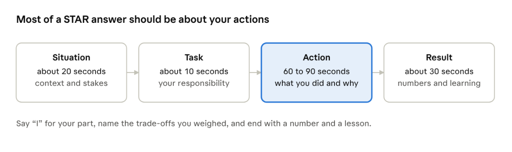

# 38 · Behavioural interviews

Part X · Research craft and interviews. No prerequisites. Chapter 39 covers the senior mindset these stories should show.

## Why it matters

Technical rounds show whether you can do the work; the behavioural round decides whether you will do it well with other people, and at what level. Many hiring decisions at the senior level turn on this round, and it is the easiest one to improve with preparation: candidates who write five strong stories and practise them aloud do markedly better than those who improvise.

## Key concepts

- **Behavioural question**: "Tell me about a time when…". It assumes past behaviour predicts future behaviour, so it asks for a specific real event, not a hypothetical. [More on the format](https://www.techinterviewhandbook.org/behavioral-interview/).
- **STAR**: Situation, Task, Action, Result, the standard structure for answering. [Overview](https://en.wikipedia.org/wiki/Situation,_task,_action,_result).
- **Competencies or values**: most companies score answers against a published list (ownership, customer focus, bias for action and so on). Amazon's [leadership principles](https://www.amazon.jobs/content/en/our-workplace/leadership-principles) are the best-known example and a useful practice checklist even if you never interview there.
- **Level signals**: what separates mid-level from senior answers: scope, ambiguity handled, influence beyond your team. Will Larson's [StaffEng](https://staffeng.com/) site describes these well.

## 38.1 What the round tests

Behavioural interviewers listen for evidence, in your past behaviour, of:

- **Ownership:** you took responsibility for outcomes, not just tasks, and followed through.
- **Impact:** measurable results that mattered to the business.
- **Judgement:** sensible trade-offs, simple solutions first, knowing when to stop.
- **Collaboration and influence:** working across teams, handling disagreement, persuading without authority.
- **Learning and growth:** what you learned from failure and changed afterwards.
- **Communication:** explaining technical work clearly to non-technical people.
- **Customer and business focus:** connecting models to users and money.

Read the target company's values or competencies page before the interview and map each of your stories to one or two of them.

## 38.2 The STAR structure

*STAR · a 2–3 minute answer*

- **Situation:** just enough context for the story to make sense: team, product, problem, why it mattered. Two or three sentences.
- **Task:** your specific responsibility and the goal.
- **Action:** the bulk of the answer: what *you* did, the options you considered, why you chose one, how you dealt with obstacles and people. This is where seniority shows.
- **Result:** concrete outcomes with numbers (quality, cost, time, revenue, adoption), plus what you learned or would do differently.

**Rules that make answers strong:** say "I" for your part and "we" only for the team's; quantify ("cut labelling cost by 60%", not "made it cheaper"); name a trade-off and a decision; keep each story to 2–3 minutes and let the interviewer pull for more; finish with a lesson. Prepare follow-up depth: interviewers often ask "why that approach?", "what would you do differently?", "what did your manager think?".

## 38.3 Build a story bank: five archetypes

Five well-prepared stories cover nearly every behavioural question, because each can be told from several angles. Below are the five archetypes almost every ML candidate needs, each with a fill-in template and an example from a food-delivery setting. Replace the example with your own real story; never use an invented one.

### Story 1: A technical decision with business impact

**Shows:** technical ownership, judgement about cost and quality, impact. **Use for:** "your proudest project", "a technical decision you made", "how you balanced cost and quality".

- **S:** [Product, team and the problem.] *Example: merchants needed classifying into ~40* *categories; existing labels were incomplete, which hurt search filters.*
- **T:** [What you owned.] *Example: designing, evaluating and shipping the classifier.*
- **A:** [Baseline, options considered, the choice and why, how you measured, obstacles.] *Example: built a TF-IDF baseline; moved to an LLM with label definitions for rare* *categories; built a 500-item expert test set; moved the weekly job to a batch API and* *trimmed the prompt.*
- **R:** [Quality vs baseline, cost, adoption.] *Example: macro-F1 up from 0.70 to 0.86; cost* *per run down several-fold; three teams use the output.* **Lesson:** [For example: match the serving mode to the latency the business actually needs.]

### Story 2: Quality and risk in a user-facing system

**Shows:** handling risk, stakeholder management, defining "good". **Use for:** "a time quality mattered more than speed", "working with non-technical stakeholders", "handling ambiguity".

- **S:** [A system where errors hurt users or the business.] *Example: automated* *moderation and summaries of restaurant reviews.*
- **T:** [Your role.]
- **A:** [How you agreed what "good" means with stakeholders; the evaluation you built; how you traded false positives against false negatives; what stayed with humans.]
- **R:** [Volume, precision/recall, time saved, incidents avoided.] **Lesson:** [For example: agree the error trade-off with the business before tuning.]

Chapter 28.7 has a full reference design for this kind of system.

### Story 3: Influence across teams

**Shows:** collaboration and influence without authority. **Use for:** "working with another team", "a disagreement and how you resolved it", "getting buy-in".

- **S:** [Two or more teams that needed to agree on something: a shared taxonomy, a metric definition, an API.]
- **T:** [Your part.]
- **A:** [How you aligned definitions; a concrete disagreement and how you settled it with data or a small experiment; how you kept momentum across time zones or priorities.]
- **R:** [What was delivered and adopted.] **Lesson:** [For example: write definitions down early; a small shared evaluation set settles debates faster than meetings.]

### Story 4: Learning fast in a new area

**Shows:** learning speed, handling change, delivering under uncertainty. **Use for:** "a time you had to learn something quickly", "dealing with change", "unclear requirements".

- **S:** [You moved to a new domain, for example from NLP to recommendations, or took over an unfamiliar system.]
- **T:** [What you had to deliver, by when.]
- **A:** [How you got up to speed: reading, pairing, small experiments; your first concrete contribution; a decision you influenced, such as fixing an evaluation flaw.]
- **R:** [Outcome.] **Lesson:** [For example: start with the evaluation and the logs, not the model.]

### Story 5: A failure, mistake or disagreement

**Shows:** honesty, learning, maturity. Every loop includes a version of "tell me about a failure". Choose a real one with a clear lesson and a change in your behaviour afterwards; avoid fake failures ("I work too hard") and stories that blame others.

- Common good candidates: a model that looked good offline and disappointed online; an estimate that was badly wrong; a disagreement on approach where you were wrong, or right but handled it poorly.
- Structure: what happened, your part in it, what you did to fix it, what you do differently now, and evidence that you did it differently next time.

**Optional sixth story: depth.** A piece of research, a hard debugging session or a technical deep dive you can discuss at length. It is useful for "tell me about a technical challenge" and lets you show depth on the topics the role cares about.

## 38.4 Mapping common questions to stories

| Question | Best story |
|---|---|
| Tell me about yourself | Not a story: a 90-second summary (below) |
| Your proudest project / biggest impact | 1 |
| A difficult technical decision or trade-off | 1 or 2 |
| Working with another team; influencing without authority | 3 |
| A disagreement with a colleague or stakeholder | 3 or 5 |
| Learning something new quickly; handling change | 4 |
| A failure or mistake | 5 |
| Ambiguous requirements | 2 or 4 |
| Explaining something technical to a non-technical audience | 2 |
| Prioritising under pressure; saying no | 1, 2 or 4 (add what you deprioritised) |
| Why this company, why this role | Prepared answer (38.6) |

**"Tell me about yourself" (about 90 seconds):** present, past, future. *Now:* your current role and the two or three kinds of problems you work on. *Before:* the path that led here, in two sentences (studies, previous roles, research). *The thread:* what connects it all, for example building applied ML and LLM systems that ship. *Next:* why this role is the natural next step. Write it, time it, and cut it until it fits.

## 38.5 Senior signals interviewers listen for

- **Scope:** problems that span teams or systems, not single tickets.
- **Judgement:** you chose a simple solution first, measured, and added complexity only when needed; you can say what you decided *not* to do.
- **Business framing:** results in user and business terms, not only model metrics.
- **Influence:** you changed what others did through data, prototypes and clear writing.
- **Ownership of outcomes:** you followed the model into production and cared whether it worked there.
- **Raising others:** mentoring, reviews, documentation, sharing tools.
- **Self-awareness:** honest about mistakes and limits; specific about what you learned.

Whatever level you are aiming for, show one or two of these clearly in each story.

## 38.6 Tricky questions

**"Why do you want to leave your current team?"** Never criticise your manager, team or company. Frame it as moving *towards* something: the problems, the scale, the stage of the company, a location change. Keep it short and positive.

**"Why this company?"** Three specific reasons: something about its products or market, something about the team's technical work (read its engineering blog and recent talks), and something about you that fits (a skill you bring, a problem you want to work on). Generic praise sounds unprepared.

**"What is your biggest weakness?"** A real, job-relevant weakness you are actively fixing, with evidence. For example: speed in live coding interviews, which you are addressing with a daily practice plan (Chapter 35). Honest, bounded, improving.

**"Tell me about a conflict with your manager."** Choose a disagreement about approach, not personality; show that you raised it with data, listened, and committed once a decision was made ("disagree and commit").

**"Where do you see yourself in a few years?"** Growing into someone who owns systems end to end and helps others do the same. Tie it to what the role offers.

**Level and compensation:** know which level you are applying for and why; if asked, say you are confident at that level and keen to grow through impact. Discuss package details with the recruiter at the offer stage, not in technical rounds.

## 38.7 Questions to ask them

Ask two or three; they signal what you care about.

- "What would success look like for this role in the first six months?"
- "Which problems is the team most excited about this year, and where does GenAI fit?"
- "How does the team decide what to build: who brings the problems, and how are projects prioritised?"
- "How do you evaluate LLM features before and after launch?"
- "What does the path to the next level look like here, and what distinguished people who got there quickly?"
- "How does the team share models and data with other teams in the company?"

## Pitfalls

- **"We" all the way through,** so the interviewer cannot tell what you did.
- **Long situations, short actions.**
- **No numbers** in the result.
- **Fake failures** or failures that blame others.
- **Criticising your current employer, manager or colleagues.**
- **Improvising** instead of practising stories aloud.
- **One story told the same way for every question,** instead of the angle the question asks for.
- **Forgetting the lesson** at the end.

## Practice

1. **Write all five stories in full** in a private document, with real numbers. Then cut each to a 2–3 minute spoken version.
2. **Record yourself** answering "tell me about yourself" and two story questions; listen for "we", filler words and missing numbers.
3. **Angle drill:** tell story 1 three times: as a technical decision, as a cost trade-off, and as a stakeholder story.
4. **Mock round:** ask a friend or colleague to run 30 minutes of questions from the table in 38.4, with follow-ups.
5. **Values mapping:** read the target company's values page and map each story to one or two values.
6. **Questions:** write three questions for each interviewer type (hiring manager, peer, skip-level).

## Go deeper

- [Tech Interview Handbook: behavioural interviews](https://www.techinterviewhandbook.org/behavioral-interview/): question bank and answer structure.
- [Amazon leadership principles](https://www.amazon.jobs/content/en/our-workplace/leadership-principles): a widely used competency list to practise against.
- [StaffEng](https://staffeng.com/) by Will Larson: what senior and staff behaviour looks like in practice.
- Tanya Reilly, *The Staff Engineer's Path* (O'Reilly, 2022): chapters on influence and project leadership.
- Gayle Laakmann McDowell, *Cracking the Coding Interview*: the behavioural chapter, for structure.
- Chapter 39 of this guide, for the senior mindset your stories should demonstrate.

## Done when

All five stories are written with real numbers and fit in 2–3 minutes spoken.

You can tell each story from at least two angles. Your 90-second "tell me about yourself" is rehearsed. Your answers to "why leave", "why this company" and "biggest weakness" are positive, honest and short.

You have three questions ready for each interviewer.

You have done at least one full mock behavioural round.

---

[← 32 · ML depth question bank](32-ml-depth-question-bank.md) · [Contents](../README.md#contents) · [34 · Thinking like a senior →](34-thinking-like-a-senior.md)
