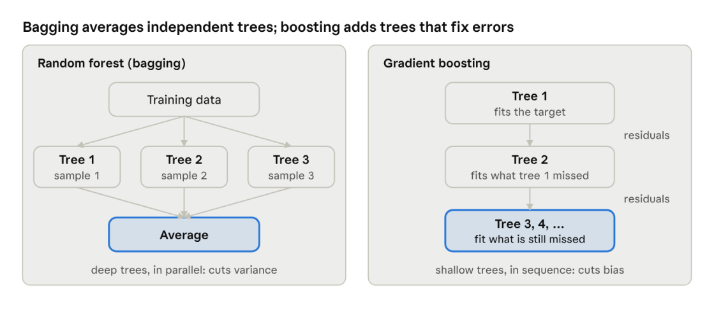

# 40 · Classic models

Part XI · Applied ML systems (optional track). Assumes Chapter 3 (losses, regularisation, optimisation). Every model here comes with intuition, the maths you need, a from-scratch implementation checked against scikit-learn, and when to use it. These implementations are also the "implement X from scratch" problems of the coding round (Chapter 35).

## Why it matters

Most production ML on tabular data still runs on these models: logistic regression and gradient boosting rank, score fraud, forecast and classify at every delivery company. Interviewers use them to test depth ("how does a tree choose a split?", "why does boosting overfit less with a small learning rate?") and coding ("implement k-means", "implement logistic regression"). Knowing them well also makes you better at judging when a deep model or an LLM is worth its cost.

Each section follows the same pattern, so the models are easy to compare: the intuition in a sentence or two, the maths that matters, a from-scratch implementation where it is short enough to write in an interview, and when to use the model. The order runs from linear models (40.1, 40.2), through trees and their ensembles (40.3 to 40.5), to distance-based, margin-based and probabilistic models (40.6 to 40.8), and two unsupervised methods (40.9, 40.10). Section 40.11 turns it into a decision table.

The models differ mainly in their assumptions about what the decision boundary looks like: linear, axis-aligned boxes, local neighbourhoods, or a maximum-margin surface. Knowing those assumptions is what lets you predict which model will do well on a dataset before trying it, and explain why a gradient-boosted tree is still the default for most tabular problems.

## Key concepts

- **Linear regression**: predicts a number as a weighted sum of features, fitted by least squares. [Linear regression](https://en.wikipedia.org/wiki/Linear_regression).
- **Logistic regression**: predicts a probability by passing a weighted sum through a sigmoid; the standard baseline classifier. [Logistic regression](https://en.wikipedia.org/wiki/Logistic_regression).
- **Decision tree**: a sequence of if/else splits learned from data; interpretable but unstable alone. [Decision tree learning](https://en.wikipedia.org/wiki/Decision_tree_learning).
- **Random forest**: many trees on bootstrapped data and random feature subsets, averaged. [Random forest](https://en.wikipedia.org/wiki/Random_forest).
- **Gradient boosting (XGBoost, LightGBM, CatBoost)**: trees added one at a time, each correcting the errors of the ensemble so far; usually the strongest model for tabular data. [Introduction to boosted trees](https://xgboost.readthedocs.io/en/stable/tutorials/model.html).
- **Support vector machine**: finds the boundary with the widest margin between classes. [SVM](https://en.wikipedia.org/wiki/Support_vector_machine).
- **k-means and naive Bayes**: the simplest clustering algorithm and the simplest probabilistic text classifier, both still useful baselines. [k-means](https://en.wikipedia.org/wiki/K-means_clustering), [naive Bayes](https://en.wikipedia.org/wiki/Naive_Bayes_classifier).
- **Feature importance and SHAP**: explaining which features drive a prediction. [SHAP documentation](https://shap.readthedocs.io/en/latest/).
- **Reference**: the [scikit-learn user guide](https://scikit-learn.org/stable/user_guide.html) explains every classic model with examples.

## 40.1 Linear regression

**Intuition.** Predict a number as a weighted sum of features: ŷ = w·x + b. Fit the weights that minimise squared error.

**Maths.** With a column of ones for the bias, the least-squares solution is the **normal equation**

$$
w = \left(X^{\top}X\right)^{-1}X^{\top}y
$$

Ridge adds λI inside the inverse, which also makes it stable when features are correlated. For large data, use gradient descent instead (Chapter 3.5).

```python
import numpy as np

def linreg_normal_eq(X, y, l2=0.0):
    Xb = np.c_[np.ones(len(X)), X]                    # bias column
    I = np.eye(Xb.shape[1]); I[0, 0] = 0               # do not penalise the bias
    return np.linalg.solve(Xb.T @ Xb + l2 * I, Xb.T @ y)   # solve, never invert explicitly
```

This matches scikit-learn's `LinearRegression` exactly on a test set.

**Assumptions worth naming:** a roughly linear relationship (after feature transforms), independent errors, constant error variance, no extreme multicollinearity if you want to interpret coefficients. For prediction, violations matter less than for inference.

**When to use:** baselines, interpretable models, when relationships are close to linear, as the final layer of many systems. Feature engineering (logs, interactions, splines) extends it a long way.

## 40.2 Logistic regression

**Intuition.** A linear score passed through the sigmoid gives a probability: p = σ(w·x + b) = 1 / (1 + e^−(w·x+b)). Equivalently, the log-odds are linear in the features.

**Maths.** Train by minimising log loss; the gradient is beautifully simple, Xᵀ(p − y)/n, the same form as linear regression. The loss is convex, so there is one optimum. Implementation with SGD, momentum and Adam: Chapter 3.5.

**Interpreting coefficients:** a one-unit increase in feature j multiplies the odds by e^wⱼ, holding the others fixed (only meaningful with scaled, not strongly correlated features).

**Multi-class:** softmax regression generalises it to k classes with a weight vector per class.

**When to use:** the first baseline for any classification; when calibrated probabilities matter (it is usually well calibrated); when you need explainability; with high-dimensional sparse features such as TF-IDF text (Chapter 41.2); in large-scale click prediction with hashed feature crosses, historically.

## 40.3 Decision trees

**Intuition.** Ask a sequence of yes/no questions about features ("distance ≤ 3 km?") until the remaining examples are mostly one class or have similar values; predict the majority class or the mean.

**How a split is chosen (CART).** For every feature and every threshold, measure how pure the two child groups would be, and keep the best. Purity for classification is **Gini impurity**, 1 − Σpₖ² (or entropy); for regression, variance (squared error). Greedy and local: each split is the best one now, not the best possible tree.

```python
import numpy as np
from collections import Counter

def gini(y):
    _, counts = np.unique(y, return_counts=True)
    p = counts / counts.sum()
    return 1 - np.sum(p ** 2)

def best_split(X, y, min_leaf=5):
    best = (None, None, gini(y))                         # (feature, threshold, weighted impurity)
    n = len(y)
    for j in range(X.shape[1]):
        order = np.argsort(X[:, j]); xs, ys = X[order, j], y[order]
        for i in range(min_leaf, n - min_leaf):
            if xs[i] == xs[i - 1]:
                continue
            left, right = ys[:i], ys[i:]
            score = (len(left) * gini(left) + len(right) * gini(right)) / n
            if score < best[2]:
                best = (j, (xs[i] + xs[i - 1]) / 2, score)
    return best

class Node:
    def __init__(self, pred=None, feature=None, threshold=None, left=None, right=None):
        self.pred, self.feature, self.threshold, self.left, self.right = pred, feature, threshold, left, right

def build_tree(X, y, depth=0, max_depth=4, min_leaf=5):
    pred = Counter(y).most_common(1)[0][0]
    if depth >= max_depth or len(set(y)) == 1 or len(y) < 2 * min_leaf:
        return Node(pred=pred)
    j, t, _ = best_split(X, y, min_leaf)
    if j is None:                                         # no split improves purity
        return Node(pred=pred)
    mask = X[:, j] <= t
    return Node(feature=j, threshold=t,
                left=build_tree(X[mask], y[mask], depth + 1, max_depth, min_leaf),
                right=build_tree(X[~mask], y[~mask], depth + 1, max_depth, min_leaf))

def predict_one(node, x):
    while node.pred is None:
        node = node.left if x[node.feature] <= node.threshold else node.right
    return node.pred
```

On a synthetic classification set this scores the same test accuracy (0.906) as scikit-learn's tree with the same depth and leaf size. This version re-computes Gini for every threshold (O(n²) per feature); real implementations update class counts incrementally while sweeping the sorted values, which is a good follow-up to mention.

**Properties:** no scaling needed; handles mixed feature types and interactions; interpretable when shallow; unstable (small data changes give different trees) and overfits when deep. Control with max depth, minimum samples per leaf and pruning.

## 40.4 Random forests

**Intuition.** Many deep, different trees each overfit in different ways; averaging them cancels much of the noise. Two sources of difference: each tree is trained on a **bootstrap sample** (rows drawn with replacement: bagging), and each split considers only a **random subset of features** (typically √d for classification), which decorrelates the trees.



*bagging vs boosting · parallel averaging vs sequential correction*

```python
from sklearn.tree import DecisionTreeClassifier

class SimpleForest:
    def __init__(self, n_trees=100, max_features="sqrt", seed=0):
        self.n_trees, self.max_features, self.seed = n_trees, max_features, seed

    def fit(self, X, y):
        rng = np.random.default_rng(self.seed)
        self.trees = []
        for i in range(self.n_trees):
            idx = rng.integers(0, len(X), len(X))                 # bootstrap sample
            tree = DecisionTreeClassifier(max_features=self.max_features, random_state=i)
            self.trees.append(tree.fit(X[idx], y[idx]))
        return self

    def predict_proba(self, X):
        return np.mean([t.predict_proba(X)[:, 1] for t in self.trees], axis=0)
```

This reaches 0.983 test accuracy on the same data where one tree gets 0.906 (scikit-learn's forest: 0.978). **Out-of-bag (OOB) error:** each tree never saw about 37% of rows, which gives a free validation estimate.

**When to use:** a strong, low-tuning baseline for tabular data; robust to noisy features; parallel training. Usually beaten by well-tuned gradient boosting, but harder to get badly wrong. Impurity-based feature importances are biased towards high-cardinality features; prefer permutation importance or SHAP.

## 40.5 Gradient boosting

**Intuition.** Build trees one after another, each fitting the errors the ensemble still makes, and add each with a small weight (the learning rate). Bagging reduces variance with deep trees in parallel; boosting reduces bias with shallow trees in sequence.

**Maths.** Boosting is gradient descent in function space: at each step, fit a tree to the **negative gradient of the loss** with respect to the current predictions, then step in that direction:

$$
F_m(x) = F_{m-1}(x) + \eta\,h_m(x),\qquad h_m \approx -\dfrac{\partial L\left(y, F_{m-1}(x)\right)}{\partial F_{m-1}(x)}
$$

For squared loss, the negative gradient is simply the residual y − F(x). For log loss it is y − p, and so on, so any differentiable loss works (including ranking losses: LambdaMART, Chapter 44).

```python
from sklearn.tree import DecisionTreeRegressor

class SimpleGBM:
    """Gradient boosting for squared loss: each tree fits the current residuals."""
    def __init__(self, n_trees=200, lr=0.1, max_depth=3):
        self.n_trees, self.lr, self.max_depth = n_trees, lr, max_depth

    def fit(self, X, y):
        self.base = y.mean()
        pred = np.full(len(y), self.base)
        self.trees = []
        for _ in range(self.n_trees):
            residual = y - pred                                   # negative gradient of squared loss
            tree = DecisionTreeRegressor(max_depth=self.max_depth).fit(X, residual)
            pred += self.lr * tree.predict(X)
            self.trees.append(tree)
        return self

    def predict(self, X):
        return self.base + self.lr * np.sum([t.predict(X) for t in self.trees], axis=0)
```

On a regression test set this reaches RMSE 25.1, the same as scikit-learn's `GradientBoostingRegressor` with matching settings.

**Key hyperparameters:** learning rate and number of trees (smaller rate needs more trees and usually generalises better; use early stopping on validation), tree depth or number of leaves, minimum samples or hessian per leaf, row and column subsampling, L1 and L2 penalties on leaf values.

**The libraries:**

| Library | Distinctive ideas | Notes |
|---|---|---|
| XGBoost | Second-order (gradient and hessian) split finding, regularised objective, sparsity-aware splits for missing values | The one that made boosting dominant on Kaggle; robust default |
| LightGBM | Histogram-based splits, leaf-wise growth, gradient-based sampling (GOSS), exclusive feature bundling | Usually fastest on large data; leaf-wise trees overfit small data unless you limit leaves |
| CatBoost | Ordered boosting and ordered target statistics for categoricals, symmetric trees | Best out of the box with many categorical features; less tuning |


*Test RMSE against the number of trees for three learning rates (depth-3 trees, 1,500 training rows of a nonlinear regression problem with noise). At 0.5 the error bottoms out at 1.57 after 73 trees and then creeps up; at 0.1 it reaches 1.30 after about 470 trees; at 0.02 it is still improving at 1,000 trees.*

**How to tune it in practice.** Fix a moderate learning rate (0.05–0.1) and let early stopping on a validation set choose the number of trees. Tune depth (or leaves), the minimum samples per leaf and subsampling. Then lower the learning rate and raise the tree cap for the final model if the extra training time is affordable. The curve shows why a fixed number of trees across learning rates is a mistake: the best number varies by more than ten times.

**When to use:** the default first serious model for tabular data: ranking, fraud, ETA, demand, churn. On tabular benchmarks, tuned gradient boosting still usually matches or beats deep learning. Deep models win with very large data, raw text, images, sequences, or very high-cardinality IDs that need embeddings.

## 40.6 k-nearest neighbours (kNN)

**Intuition.** Predict from the k most similar training examples: majority vote for classification, mean for regression. No training, all work at prediction time.

```python
from collections import Counter

def knn_predict(X_train, y_train, X_query, k=5):
    d = ((X_query[:, None, :] - X_train[None]) ** 2).sum(-1)    # squared distances, (q, n)
    nn = np.argsort(d, axis=1)[:, :k]
    return np.array([Counter(y_train[row]).most_common(1)[0][0] for row in nn])
```

**Must-knows:** scale features first (distances are dominated by large-range features); k trades variance (small k) against bias (large k); it degrades in high dimensions where all points become roughly equidistant (the curse of dimensionality); prediction is expensive without an index, which is exactly the ANN problem of Chapter 30.4. In modern systems kNN lives on as nearest-neighbour search over embeddings: item-to-item recommendations, dynamic few-shot examples, retrieval.

## 40.7 Support vector machines (SVMs)

**Intuition.** Among all lines (hyperplanes) that separate the classes, choose the one with the widest margin to the nearest points, the support vectors. A soft margin allows some violations, traded off by C.

**Maths.** Minimise

$$
\dfrac{1}{2}\Vert w\Vert^2 + C\sum_{i=1}^{n}\max\left(0,\ 1 - y_i\,(w\cdot x_i + b)\right)
$$

L2 regularisation plus the hinge loss. The **kernel trick** replaces dot products with a kernel function (RBF, polynomial), giving non-linear boundaries without computing the high-dimensional features explicitly.

```python
def linear_svm(X, y, lam=0.01, epochs=20, seed=0):
    """Pegasos: SGD on the L2-regularised hinge loss. y in {0, 1}."""
    rng = np.random.default_rng(seed)
    X = np.c_[X, np.ones(len(X))]                 # bias as an extra feature
    y_pm = np.where(y == 1, 1.0, -1.0)
    w, t = np.zeros(X.shape[1]), 0
    for _ in range(epochs):
        for i in rng.permutation(len(y)):
            t += 1
            eta = 1.0 / (lam * t)
            margin = y_pm[i] * (X[i] @ w)
            w *= (1 - eta * lam)                  # shrink: the regulariser
            if margin < 1:                        # inside the margin or wrong side: hinge gradient
                w += eta * y_pm[i] * X[i]
    return w
```

On the same non-linear synthetic data, this linear SVM scores 0.73 (scikit-learn's `LinearSVC`: 0.68), while kNN reaches 0.96 and a random forest 0.98: a reminder that model families encode assumptions, and a linear boundary was the wrong one here.

**When to use:** small to medium datasets with clear margins, high-dimensional sparse text (linear SVMs were the text-classification standard before transformers). Kernel SVMs scale poorly beyond tens of thousands of rows and give no native probabilities (Platt scaling was invented for them).

## 40.8 Naive Bayes

**Intuition.** Apply Bayes' rule assuming features are independent given the class: P(class | x) ∝ P(class) ∏ P(xⱼ | class). The assumption is almost always false, yet the ranking of classes is often good enough.

```python
class MultinomialNaiveBayes:
    """For count features such as word counts."""
    def fit(self, X, y, alpha=1.0):
        self.classes = np.unique(y)
        self.log_prior = np.log(np.array([np.mean(y == c) for c in self.classes]))
        counts = np.array([X[y == c].sum(0) for c in self.classes]) + alpha  # Laplace smoothing
        self.log_lik = np.log(counts / counts.sum(1, keepdims=True))
        return self

    def predict(self, X):
        return self.classes[np.argmax(X @ self.log_lik.T + self.log_prior, axis=1)]   # sums of logs
```

Predictions match scikit-learn's `MultinomialNB` exactly on a test set. Work in log space to avoid underflow; smoothing avoids zero probabilities for unseen words.

**When to use:** very fast text baselines, tiny training sets, streaming updates. Probabilities are badly calibrated (pushed towards 0 and 1) because of the independence assumption.

## 40.9 k-means clustering

**Intuition.** Place k centres; assign each point to its nearest centre; move each centre to the mean of its points; repeat until nothing changes. It minimises the within-cluster sum of squared distances, to a local optimum.

```python
def kmeans(X, k, iters=50, seed=0):
    rng = np.random.default_rng(seed)
    C = X[rng.choice(len(X), k, replace=False)]
    for _ in range(iters):
        labels = np.argmin(((X[:, None] - C[None]) ** 2).sum(-1), axis=1)  # assign
        new_C = np.array([X[labels == j].mean(0) if np.any(labels == j) else C[j] for j in range(k)])
        if np.allclose(new_C, C):  # converged
            break
        C = new_C  # update
    return C, labels
```

**Must-knows:** results depend on initialisation (use k-means++ and several restarts); choose k with the elbow method, silhouette scores, or, best, by whether the clusters are useful for the business; assumes roughly spherical, similar-sized clusters; scale features first. Alternatives: DBSCAN and HDBSCAN for arbitrary shapes and noise (used in BERTopic, Chapter 41.6), Gaussian mixtures for soft assignments. It also powers IVF indexes and product quantisation (Chapter 30.4).

## 40.10 PCA

**Intuition.** Find the directions along which the data varies most, and project onto the top few. The first principal component is the direction of maximum variance; each next one is orthogonal to the previous ones.

**Maths.** Centre the data; the principal components are the right singular vectors of the centred data matrix (equivalently, eigenvectors of the covariance matrix). The share of variance each explains is its squared singular value over the total. The link to SVD and low-rank approximation is the same idea behind matrix factorisation (Chapter 43.2) and LoRA (Chapter 20).

```python
def pca(X, k):
    Xc = X - X.mean(0)                                   # centring is essential
    U, S, Vt = np.linalg.svd(Xc, full_matrices=False)
    explained = S ** 2 / np.sum(S ** 2)
    return Xc @ Vt[:k].T, Vt[:k], explained[:k]          # projections, components, variance ratios
```

Components and explained-variance ratios match scikit-learn's `PCA` (up to sign, which is arbitrary).

**When to use:** compress correlated features, visualise, denoise, speed up downstream models. Scale features first. PCA is linear and unsupervised: the directions of most variance are not necessarily the most predictive. For visualising embeddings, UMAP or t-SNE show local structure better, but their distances are not to be read literally.

## 40.11 Choosing a model

| Situation | Start with | Then try |
|---|---|---|
| Tabular classification or regression | Logistic or linear regression baseline | LightGBM / XGBoost / CatBoost |
| Ranking with tabular features | GBDT with LambdaMART | Deep ranker if very large data (Chapter 43) |
| Short text classification | TF-IDF + logistic regression | Fine-tuned encoder, LLM labelling (Chapter 41) |
| Few hundred rows | Regularised linear model, small forest | Careful cross-validation over model choice |
| Need explanations for each decision | Logistic regression, shallow tree, GBDT with SHAP | Monotonic constraints in GBDT |
| Similarity search, recommendations from embeddings | kNN / ANN | Two-tower models (Chapter 43) |
| Grouping without labels | k-means after scaling | HDBSCAN, Gaussian mixtures |
| Too many correlated features | PCA or L1 regularisation | Feature selection by permutation importance |

**No free lunch.** No model is best for every problem; each encodes assumptions (linearity, axis-aligned splits, local similarity, independence). Pick the model whose assumptions match the data, and confirm on validation data.

## Pitfalls

- **Not scaling** for linear models, SVMs, kNN, k-means and PCA (trees do not care).
- **Interpreting coefficients** of correlated, unscaled features.
- **Trusting impurity-based feature importance** from trees; use permutation importance or SHAP.
- **Deep single trees** in production: unstable and overfit.
- **Boosting without early stopping,** or with too high a learning rate.
- **LightGBM with default leaves on small data:** leaf-wise growth overfits quickly.
- **Using naive Bayes or SVM scores as probabilities** without calibration.
- **k-means on unscaled or categorical data,** or with one random initialisation.
- **PCA before a tree model** by habit: it destroys the axis-aligned structure trees exploit and rarely helps.
- **Choosing the fanciest model first** instead of the strongest simple baseline.

## Interview questions

Questions 1–5 basic, 6–11 intermediate, 12–15 senior.

**1. How does a decision tree choose a split?** For each feature and threshold, it computes the weighted impurity (Gini or entropy for classification, variance for regression) of the two children and picks the split that reduces impurity most. Greedy, one level at a time.

**2. Random forest vs gradient boosting?** Forest: deep trees on bootstrap samples with random feature subsets, averaged in parallel, reducing variance; robust with little tuning. Boosting: shallow trees added sequentially to fit the loss gradient, reducing bias; usually more accurate when tuned, more sensitive to hyperparameters.

**3. Why is logistic regression a linear model if the sigmoid is non-linear?** The decision boundary is linear: the log-odds are a linear function of the features; the sigmoid only maps them to probabilities.

**4. What does k control in kNN?** Small k: flexible, noisy boundaries (high variance). Large k: smoother, possibly underfit (high bias). Choose by validation.

**5. What is PCA and when would you use it?** Projection onto the orthogonal directions of maximum variance, computed by SVD of centred data. For compression, visualisation, denoising and decorrelating features for linear models.

**6. Why does a smaller learning rate in boosting often generalise better?** Each tree contributes a small correction, so the ensemble approaches the fit gradually, acting like regularisation (shrinkage); combined with early stopping, it finds a better point at the cost of more trees.

**7. How do XGBoost, LightGBM and CatBoost differ?** XGBoost: second-order split finding with a regularised objective and native missing-value handling. LightGBM: histogram binning, leaf-wise growth and sampling tricks for speed. CatBoost: ordered target statistics for categoricals and symmetric trees, strong defaults.

**8. What is the kernel trick?** Replacing dot products with a kernel function lets a linear algorithm (SVM) learn non-linear boundaries as if features were mapped to a high-dimensional space, without computing that mapping.

**9. Why is naive Bayes "naive", and why does it still work?** It assumes features are independent given the class. Probabilities are poorly calibrated, but the argmax class is often right because errors in the assumption affect classes similarly.

**10. How do you choose k in k-means?** Elbow of within-cluster error, silhouette score, stability across runs, and above all usefulness of the clusters for the purpose. Use k-means++ initialisation and several restarts.

**11. How do trees handle missing values and categorical features?** CART needs imputation, but XGBoost and LightGBM learn a default direction for missing values at each split; LightGBM and CatBoost handle categoricals natively (CatBoost with ordered target statistics, avoiding target leakage).

**12. When would you choose logistic regression over gradient boosting in production?** When interpretability or regulatory explanation is required, data is small, features are already well engineered and roughly linear, calibrated probabilities are critical, latency or memory is extremely tight, or the gain from boosting is too small to justify complexity.

**13. Deep learning or gradient boosting for a tabular ETA problem?** Gradient boosting first: it handles heterogeneous features well, trains fast, and is hard to beat on tabular data. Consider deep models when you have very large data, sequences (route traces), high-cardinality IDs needing embeddings, or want multi-task learning; often the best production system combines both.

**14. How would you explain an individual prediction of a boosted model to an operations team?** SHAP values: additive per-feature contributions to the prediction relative to a baseline, with clear caveats that they explain the model, not causality; use monotonic constraints where the business expects a direction.

**15. Implement gradient boosting for log loss. What changes from squared loss?** The initial prediction is the log-odds of the base rate; each tree fits the negative gradient y − p (not y − log-odds); leaf values are better set with a Newton step (sum of gradients over sum of hessians p(1−p)), which is what XGBoost does; predictions pass through the sigmoid.

## Practice

All from scratch in NumPy, checked against scikit-learn, autocomplete off:

1. Linear regression with the normal equation and with gradient descent (15 minutes).
2. A decision tree classifier with Gini, max depth and min leaf (40 minutes), then make split search O(n log n) per feature with running counts.
3. Random forest from your own tree; compute out-of-bag accuracy.
4. Gradient boosting for squared loss, then for log loss (question 15).
5. kNN, k-means with k-means++ initialisation, and PCA via SVD (15 minutes each).
6. Multinomial naive Bayes on a small text dataset with CountVectorizer.
7. **Model comparison:** on two Kaggle tabular datasets, compare logistic regression, random forest, LightGBM and CatBoost with the same time-based or stratified CV; report metric, training time and tuning effort.

## Read next

- *An Introduction to Statistical Learning* (free PDF): chapters 3 (linear regression), 4 (classification), 8 (tree-based methods), 9 (SVMs), 12 (unsupervised learning, including PCA and clustering).
- Chen and Guestrin, *XGBoost: A Scalable Tree Boosting System* (KDD 2016); Ke et al., *LightGBM* (NeurIPS 2017); Prokhorenkova et al., *CatBoost: Unbiased Boosting with* *Categorical Features* (NeurIPS 2018).
- Friedman, *Greedy Function Approximation: A Gradient Boosting Machine* (2001).
- Grinsztajn, Oyallon and Varoquaux, *Why Do Tree-Based Models Still Outperform Deep* *Learning on Tabular Data?* (NeurIPS 2022).
- Lundberg and Lee, *A Unified Approach to Interpreting Model Predictions* (SHAP, 2017).
- StatQuest videos on gradient boosting and XGBoost, for intuition.

**Links:** [scikit-learn user guide](https://scikit-learn.org/stable/user_guide.html) · [XGBoost: introduction to boosted trees](https://xgboost.readthedocs.io/en/stable/tutorials/model.html) · [SHAP documentation](https://shap.readthedocs.io/en/latest/). Other titles above can be found by searching their title.

## Done when

You can implement every model in this chapter from scratch in under 30 minutes each. You can explain how a tree splits and how bagging and boosting reduce error differently. You can explain boosting as gradient descent in function space, including for log loss. You can compare XGBoost, LightGBM and CatBoost.

You know which models need scaling, which give calibrated probabilities, and which handle missing values. You can choose a model for a given problem with the table in 40.11 and defend it.

---

[← 39 · Thinking like a senior](39-thinking-like-a-senior.md) · [Contents](../README.md#contents) · [41 · NLP tasks with modern tools →](41-nlp-tasks-with-modern-tools.md)
