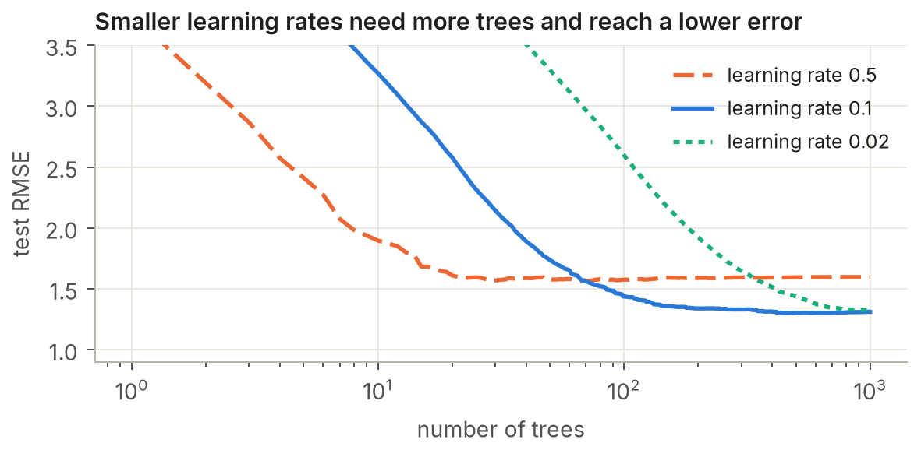

# 40 · Classic models

Part XI · Applied ML systems (optional track). Assumes Chapter 3 (losses, regularisation, optimisation). Every model here comes with intuition, the maths you need, a from-scratch implementation checked against scikit-learn, and when to use it. These implementations are also the "implement X from scratch" problems of the coding round (Chapter 35).

## Why it matters

Most production ML on tabular data still runs on these models: logistic regression and gradient boosting rank ads and feed items, score fraud, forecast demand and classify at every large company, from e-commerce to delivery marketplaces. Interviewers use them to test depth ("how does a tree choose a split?", "why does boosting overfit less with a small learning rate?", "derive the XGBoost leaf weight") and coding ("implement k-means", "implement logistic regression"). Knowing them well also makes you better at judging when a deep model or an LLM is worth its cost.

Each section follows the same pattern, so the models are easy to compare: the intuition in a sentence or two, the maths that matters with a small example you can check by hand, a from-scratch implementation where it is short enough to write in an interview, and when to use the model. The order runs from linear models (40.1, 40.2), through trees and their ensembles (40.3 to 40.5), to distance-based, margin-based and probabilistic models (40.6 to 40.8), and two unsupervised methods (40.9, with Gaussian mixtures and EM, and 40.10). Section 40.11 turns it into a decision table; 40.12 and 40.13 cover the two questions every tabular model raises in production: how to explain it, and whether its probabilities can be trusted.

The models differ mainly in their assumptions about what the decision boundary looks like: linear, axis-aligned boxes, local neighbourhoods, or a maximum-margin surface. Knowing those assumptions is what lets you predict which model will do well on a dataset before trying it, and explain why a gradient-boosted tree is still the default for most tabular problems.

What a senior interviewer is really testing is whether you can go one level below the API. "Random forests decorrelate trees" is the keyword answer; the strong answer writes Var = ρσ² + (1 − ρ)σ²/B and says which term the feature subsampling attacks. "XGBoost uses second-order information" becomes the leaf weight −G/(H + λ) and the split gain. This chapter gives each of those derivations in a few lines, with numbers you can recompute on a whiteboard.

## Key concepts

- **Linear regression**: predicts a number as a weighted sum of features, fitted by least squares. [Linear regression](https://en.wikipedia.org/wiki/Linear_regression).
- **Logistic regression**: predicts a probability by passing a weighted sum through a sigmoid; the standard baseline classifier. [Logistic regression](https://en.wikipedia.org/wiki/Logistic_regression).
- **L1 and L2 regularisation**: penalties on the weights; L1 sets some exactly to zero (soft-thresholding), L2 shrinks all of them.
- **Decision tree**: a sequence of if/else splits learned from data; interpretable but unstable alone. [Decision tree learning](https://en.wikipedia.org/wiki/Decision_tree_learning).
- **Random forest**: many trees on bootstrapped data and random feature subsets, averaged. [Random forest](https://en.wikipedia.org/wiki/Random_forest).
- **Gradient boosting (XGBoost, LightGBM, CatBoost)**: trees added one at a time, each correcting the errors of the ensemble so far; usually the strongest model for tabular data. [Introduction to boosted trees](https://xgboost.readthedocs.io/en/stable/tutorials/model.html).
- **Support vector machine**: finds the boundary with the widest margin between classes; its dual form depends on the data only through dot products, which is what makes kernels possible. [SVM](https://en.wikipedia.org/wiki/Support_vector_machine).
- **k-means, Gaussian mixtures and naive Bayes**: the simplest clustering algorithm, its soft probabilistic version fitted by EM, and the simplest probabilistic text classifier. [k-means](https://en.wikipedia.org/wiki/K-means_clustering), [EM algorithm](https://en.wikipedia.org/wiki/Expectation%E2%80%93maximization_algorithm), [naive Bayes](https://en.wikipedia.org/wiki/Naive_Bayes_classifier).
- **Feature importance and SHAP**: explaining which features drive a prediction; SHAP values are Shapley values from game theory (40.12). [SHAP documentation](https://shap.readthedocs.io/en/latest/).
- **Reference**: the [scikit-learn user guide](https://scikit-learn.org/stable/user_guide.html) explains every classic model with examples.

## 40.1 Linear regression

Linear regression is the model every other model in this chapter is compared against, and the one whose maths you are most likely to be asked to derive at a whiteboard. The question it answers is: if the target is (roughly) a weighted sum of the features, which weights fit the data best, and how do you find them in closed form?

**Intuition.** Predict a number as a weighted sum of features: ŷ = w·x + b. Fit the weights that minimise squared error.

**Maths.** With a column of ones for the bias, the least-squares solution is the **normal equation**

$$
w = \left(X^{\top}X\right)^{-1}X^{\top}y
$$

Here X is the n × (d + 1) design matrix (one row per example, a leading column of ones), y the vector of n targets and w the d + 1 weights including the bias.

### Deriving the normal equation as a projection

The fitted values Xw always lie in the column space of X: every possible prediction vector is some combination of the feature columns. Least squares picks the point in that space closest to y, and the closest point is the orthogonal projection. Orthogonality means the residual r = y − Xw is perpendicular to every column of X:

$$
X^{\top}\left(y - Xw\right) = 0
$$

Rearranging gives XᵀXw = Xᵀy, the normal equation. The same result comes from setting the gradient of ‖y − Xw‖² to zero, since that gradient is −2Xᵀ(y − Xw). The projection reading explains two facts worth stating in an interview: the residuals of a model with an intercept sum to zero (the ones column is one of the columns they are orthogonal to), and XᵀX is singular exactly when a column is a combination of others (perfect multicollinearity), so the solution is not unique.

**Worked example on three points.** Fit x = [0, 1, 2], y = [1, 3, 4]. With the ones column, XᵀX = [[3, 3], [3, 5]] and Xᵀy = [8, 11]. The determinant is 3·5 − 3·3 = 6, so (XᵀX)⁻¹ = (1/6)[[5, −3], [−3, 3]] and w = (1/6)[5·8 − 3·11, −3·8 + 3·11] = [7/6, 9/6] = [1.167, 1.5]. The fitted values are 1.167, 2.667 and 4.167, the residuals −0.167, +0.333 and −0.167. They sum to zero, and 0·(−0.167) + 1·0.333 + 2·(−0.167) = 0: the residual is orthogonal to both columns, as the projection argument requires.

Ridge adds λI inside the inverse, which also makes it stable when features are correlated. For large data, use gradient descent instead (Chapter 3.5).

```python
import numpy as np

def linreg_normal_eq(X, y, l2=0.0):
    Xb = np.c_[np.ones(len(X)), X]                    # bias column
    I = np.eye(Xb.shape[1]); I[0, 0] = 0               # do not penalise the bias
    return np.linalg.solve(Xb.T @ Xb + l2 * I, Xb.T @ y)   # solve, never invert explicitly
```

This matches scikit-learn's `LinearRegression` exactly on a test set.

### L1 vs L2: why the lasso gives exact zeros

Regularisation adds a penalty on the weights (Chapter 3.4 covers the Bayesian reading). The classic question is why an L1 penalty (lasso, λΣ|wⱼ|) sets weights to exactly zero while an L2 penalty (ridge, λΣwⱼ²) only shrinks them. The cleanest derivation uses an orthonormal design, XᵀX/n = I, where the problem separates into one scalar problem per weight. If z is the unpenalised least-squares weight, the lasso minimises ½(w − z)² + λ|w| for each coordinate, and the solution is **soft-thresholding**:

$$
w_{\mathrm{lasso}} = \mathrm{sign}(z)\,\max\left(|z| - \lambda,\ 0\right)
$$

Ridge, minimising ½(w − z)² + ½λw², gives w = z/(1 + λ), a proportional shrink that never reaches zero.

Why the difference: the L1 penalty has slope ±λ right up to zero, so if the data's pull on the weight (|z|) is smaller than λ, moving away from zero costs more than it gains and the weight stays exactly at zero. The L2 penalty's slope λw vanishes at zero, so any non-zero pull moves the weight off zero. Geometrically this is the diamond-versus-circle picture of Chapter 3.4: the L1 ball has corners on the axes, and the loss contours usually touch it first at a corner.

**Worked example.** With z = [3, 0.5, −1.2] and λ = 1, the lasso gives [2, 0, −0.2]: every weight moves 1 towards zero and the small one stops at zero. Ridge gives [1.5, 0.25, −0.6]: everything halves and nothing is removed. scikit-learn's `Lasso(alpha=1)` on an orthonormal design returns [2, 0, −0.2] (`code/ch40_check.py`).

**Consequences.** The lasso does feature selection, but with correlated features it picks one of a group somewhat arbitrarily and can swap between them across resamples. Ridge spreads weight across the group. **Elastic net** (penalty λ₁Σ|w| + λ₂Σw²) keeps the sparsity and adds the grouping behaviour, which is why it is the usual choice for many correlated features such as text n-grams or genomics. The L1 penalty is also not differentiable at zero, so it is fitted by coordinate descent or proximal gradient (soft-thresholding after each gradient step), not plain gradient descent.

**Assumptions worth naming:** a roughly linear relationship (after feature transforms), independent errors, constant error variance, no extreme multicollinearity if you want to interpret coefficients. For prediction, violations matter less than for inference.

**When to use:** baselines, interpretable models, when relationships are close to linear, as the final layer of many systems. Feature engineering (logs, interactions, splines) extends it a long way. Unlike trees, a linear model extrapolates: that is a strength when the trend continues beyond the training range and a danger when it does not.

## 40.2 Logistic regression

Logistic regression is the default first classifier, and the one interviewers use to check that you can go from a probabilistic model to a loss to a gradient without hand-waving. The question it answers: how do you get a probability, not just a score, out of a linear model?

**Intuition.** A linear score passed through the sigmoid gives a probability: p = σ(w·x + b) = 1 / (1 + e^−(w·x+b)). Equivalently, the log-odds are linear in the features.

### Deriving the gradient from the likelihood

Each label is a Bernoulli draw with probability pᵢ = σ(w·xᵢ). The likelihood of the data is Πpᵢ^yᵢ(1 − pᵢ)^(1−yᵢ), and the average negative log-likelihood is the log loss:

$$
L(w) = -\dfrac{1}{n}\sum_{i=1}^{n}\left[y_i\log p_i + (1-y_i)\log(1-p_i)\right]
$$

Two facts make the gradient short. The sigmoid satisfies σ′(s) = σ(s)(1 − σ(s)), so ∂pᵢ/∂w = pᵢ(1 − pᵢ)xᵢ. And the derivative of the bracket with respect to pᵢ is yᵢ/pᵢ − (1 − yᵢ)/(1 − pᵢ) = (yᵢ − pᵢ)/(pᵢ(1 − pᵢ)). Multiplying, the pᵢ(1 − pᵢ) cancels:

$$
\nabla_w L = \dfrac{1}{n}\sum_{i=1}^{n}\left(p_i - y_i\right)x_i = \dfrac{1}{n}X^{\top}(p - y)
$$

This is the same form as linear regression's gradient Xᵀ(Xw − y)/n, with the prediction p in place of Xw: "prediction minus target, times the input". The cancellation is not luck: the sigmoid is the canonical link of the Bernoulli distribution, and every generalised linear model with its canonical link has this gradient. `code/ch40_check.py` checks it against finite differences. The Hessian is XᵀSX/n with S = diag(pᵢ(1 − pᵢ)), positive semi-definite, so the loss is convex and there is one optimum. Implementation with SGD, momentum and Adam: Chapter 3.5.

**Interpreting coefficients:** a one-unit increase in feature j multiplies the odds by e^wⱼ, holding the others fixed (only meaningful with scaled, not strongly correlated features).

**Multi-class:** softmax regression generalises it to k classes with a weight vector per class.

**Calibration, with its conditions.** Logistic regression is often called "well calibrated", and there is a reason: at the unregularised optimum the gradient with respect to the intercept is Σ(pᵢ − yᵢ) = 0, so the average predicted probability equals the base rate exactly, and the same holds within any group defined by a one-hot feature in the model. That guarantee holds only when the model is roughly well specified and lightly regularised. Strong L2 pulls the probabilities towards the base rate (under-confident). Class weights or resampling move them: on a dataset with a 10.4% base rate, `class_weight="balanced"` raises the mean predicted probability to 18.5% (`code/ch40_check.py`). If you weight or resample, recalibrate on held-out data before using the outputs as probabilities (40.13, Chapter 4.3; Chapter 41.2 hits exactly this).

**When to use:** the first baseline for any classification; when calibrated probabilities matter; when you need explainability; with high-dimensional sparse features such as TF-IDF text (Chapter 41.2); in large-scale click prediction with hashed feature crosses, historically.

## 40.3 Decision trees

Trees answer a different question from linear models: what if the effect of a feature depends on the value of another, or changes abruptly at a threshold? A tree models such interactions and thresholds directly, at the cost of stability.

**Intuition.** Ask a sequence of yes/no questions about features ("distance ≤ 3 km?") until the remaining examples are mostly one class or have similar values; predict the majority class or the mean.

**How a split is chosen (CART).** For every feature and every threshold, measure how pure the two child groups would be, and keep the best. Purity for classification is **Gini impurity**:

$$
G = 1 - \sum_{k} p_k^{2}
$$

where pₖ is the share of class k in the node. Gini is the probability that two examples drawn at random from the node (with replacement) have different classes: 0 for a pure node, 0.5 for a 50/50 binary node. Entropy works almost identically. For regression the impurity is the variance (squared error). The split score is the size-weighted average impurity of the two children. Greedy and local: each split is the best one now, not the best possible tree.

**Worked example.** A node has 10 examples, 5 positive and 5 negative: G = 1 − 0.5² − 0.5² = 0.5. A candidate split sends 4 positives and 1 negative left, 1 positive and 4 negatives right. Each child has G = 1 − 0.8² − 0.2² = 0.32, so the weighted child impurity is (5/10)·0.32 + (5/10)·0.32 = 0.32 and the impurity decrease is 0.5 − 0.32 = 0.18. A split that only separated 3/2 from 2/3 would leave each child at 1 − 0.36 − 0.16 = 0.48, a decrease of only 0.02; the tree prefers the first.

```python
import numpy as np
from collections import Counter

def gini(y):
    _, counts = np.unique(y, return_counts=True)
    p = counts / counts.sum()
    return 1 - np.sum(p ** 2)

def best_split(X, y, min_leaf=5):
    best = (None, None, gini(y))                         # (feature, threshold, weighted impurity)
    n = len(y)
    for j in range(X.shape[1]):
        order = np.argsort(X[:, j]); xs, ys = X[order, j], y[order]
        for i in range(min_leaf, n - min_leaf):
            if xs[i] == xs[i - 1]:
                continue
            left, right = ys[:i], ys[i:]
            score = (len(left) * gini(left) + len(right) * gini(right)) / n
            if score < best[2]:
                best = (j, (xs[i] + xs[i - 1]) / 2, score)
    return best

class Node:
    def __init__(self, pred=None, feature=None, threshold=None, left=None, right=None):
        self.pred, self.feature, self.threshold, self.left, self.right = pred, feature, threshold, left, right

def build_tree(X, y, depth=0, max_depth=4, min_leaf=5):
    pred = Counter(y).most_common(1)[0][0]
    if depth >= max_depth or len(set(y)) == 1 or len(y) < 2 * min_leaf:
        return Node(pred=pred)
    j, t, _ = best_split(X, y, min_leaf)
    if j is None:                                         # no split improves purity
        return Node(pred=pred)
    mask = X[:, j] <= t
    return Node(feature=j, threshold=t,
                left=build_tree(X[mask], y[mask], depth + 1, max_depth, min_leaf),
                right=build_tree(X[~mask], y[~mask], depth + 1, max_depth, min_leaf))

def predict_one(node, x):
    while node.pred is None:
        node = node.left if x[node.feature] <= node.threshold else node.right
    return node.pred
```

On a synthetic classification set this scores the same test accuracy (0.906) as scikit-learn's tree with the same depth and leaf size. This version re-computes Gini for every threshold (O(n²) per feature); real implementations update class counts incrementally while sweeping the sorted values, which is a good follow-up to mention.

**Properties:** no scaling needed; handles mixed feature types and interactions; interpretable when shallow; unstable (small data changes give different trees) and overfits when deep. Control with max depth, minimum samples per leaf and pruning. **Trees cannot extrapolate:** a leaf predicts a constant, so outside the training range the prediction is flat. A boosted model trained on x ∈ [0, 10] with y = 2x predicts 20.0 at x = 20, where the truth is 40 (`code/ch40_check.py`). This is a classic trap in forecasting and ETA problems where a trend or a new range appears after training.

## 40.4 Random forests

A single deep tree has low bias but high variance: retrain it on a slightly different sample and it changes a lot. The question a random forest answers is how to keep the low bias while removing most of that variance, and the answer turns out to depend on one number, the correlation between trees.

**Intuition.** Many deep, different trees each overfit in different ways; averaging them cancels much of the noise. Two sources of difference: each tree is trained on a **bootstrap sample** (rows drawn with replacement: bagging), and each split considers only a **random subset of features** (typically √d for classification), which decorrelates the trees.


*bagging vs boosting · parallel averaging vs sequential correction*

### Why decorrelation, not more trees, is the lever

Let each tree's prediction at a point be a random variable with variance σ², and let any two trees have correlation ρ (they are identically distributed because they are built by the same randomised procedure). The variance of the average of B trees is (1/B²) times the sum of all B² covariances: B variances σ² and B(B − 1) covariances ρσ². Dividing:

$$
\mathrm{Var}\left(\dfrac{1}{B}\sum_{b=1}^{B}T_b\right) = \rho\,\sigma^{2} + \dfrac{1-\rho}{B}\,\sigma^{2}
$$

The second term vanishes as B grows; the first does not. With σ² = 1 and ρ = 0.5, 10 trees give 0.55, 100 trees 0.505 and 1,000 trees 0.5005: after a hundred trees, more trees buy almost nothing, and the floor is ρσ² = 0.5. Lowering ρ to 0.2 drops 100 trees to 0.208. That is the job of the random feature subset: forcing different trees to split on different features lowers ρ, at the cost of a small rise in each tree's own bias and variance. It is why `max_features` is the forest hyperparameter that matters, and the number of trees mostly is not (more trees never hurt accuracy; they only cost time). Bagging does not reduce bias at all: the average of B trees has the same expected value as one tree.

```python
from sklearn.tree import DecisionTreeClassifier

class SimpleForest:
    def __init__(self, n_trees=100, max_features="sqrt", seed=0):
        self.n_trees, self.max_features, self.seed = n_trees, max_features, seed

    def fit(self, X, y):
        rng = np.random.default_rng(self.seed)
        self.trees = []
        for i in range(self.n_trees):
            idx = rng.integers(0, len(X), len(X))                 # bootstrap sample
            tree = DecisionTreeClassifier(max_features=self.max_features, random_state=i)
            self.trees.append(tree.fit(X[idx], y[idx]))
        return self

    def predict_proba(self, X):
        return np.mean([t.predict_proba(X)[:, 1] for t in self.trees], axis=0)
```

This reaches 0.983 test accuracy on the same data where one tree gets 0.906 (scikit-learn's forest: 0.978).

### Out-of-bag error and the 37%

A bootstrap sample draws n rows with replacement from n. A given row is missed by one draw with probability 1 − 1/n, and by all n draws with probability

$$
\left(1-\dfrac{1}{n}\right)^{n} \to e^{-1} \approx 0.368
$$

For n = 100 it is already 0.366. So each tree never sees about 37% of the rows, and each row is out-of-bag for about 37% of the trees. Predicting each row with only those trees gives the **out-of-bag (OOB) error**, a free validation estimate that needs no held-out split. On the training set above, OOB accuracy is 0.952 (`code/ch40_check.py`), a little below the 0.983 test accuracy because each OOB prediction uses only about 37 of the 100 trees.

**When to use:** a strong, low-tuning baseline for tabular data; robust to noisy features; parallel training. Usually beaten by well-tuned gradient boosting, but harder to get badly wrong. Impurity-based feature importances are biased towards high-cardinality features; prefer permutation importance or SHAP (40.12).

## 40.5 Gradient boosting

Forests reduce variance by averaging independent deep trees. Boosting asks the opposite question: can a sequence of weak, shallow trees, each fixing what the previous ones got wrong, reduce bias instead? Gradient boosting answers it by treating the model as a sum of functions and running gradient descent on that sum, and XGBoost sharpened it into a Newton method with a regularised, closed-form split criterion.

**Intuition.** Build trees one after another, each fitting the errors the ensemble still makes, and add each with a small weight (the learning rate). Bagging reduces variance with deep trees in parallel; boosting reduces bias with shallow trees in sequence.

**Maths.** Boosting is gradient descent in function space: at each step, fit a tree to the **negative gradient of the loss** with respect to the current predictions, then step in that direction:

$$
F_m(x) = F_{m-1}(x) + \eta\,h_m(x),\qquad h_m \approx -\dfrac{\partial L\left(y, F_{m-1}(x)\right)}{\partial F_{m-1}(x)}
$$

For squared loss, the negative gradient is simply the residual y − F(x). For log loss it is y − p, and so on, so any differentiable loss works (including ranking losses: LambdaMART, Chapter 44).

```python
from sklearn.tree import DecisionTreeRegressor

class SimpleGBM:
    """Gradient boosting for squared loss: each tree fits the current residuals."""
    def __init__(self, n_trees=200, lr=0.1, max_depth=3):
        self.n_trees, self.lr, self.max_depth = n_trees, lr, max_depth

    def fit(self, X, y):
        self.base = y.mean()
        pred = np.full(len(y), self.base)
        self.trees = []
        for _ in range(self.n_trees):
            residual = y - pred                                   # negative gradient of squared loss
            tree = DecisionTreeRegressor(max_depth=self.max_depth).fit(X, residual)
            pred += self.lr * tree.predict(X)
            self.trees.append(tree)
        return self

    def predict(self, X):
        return self.base + self.lr * np.sum([t.predict(X) for t in self.trees], axis=0)
```

On a regression test set this reaches RMSE 25.1, the same as scikit-learn's `GradientBoostingRegressor` with matching settings.

### XGBoost: the second-order objective, leaf weight and split gain

Plain gradient boosting fits the tree's shape to the gradient and then sets leaf values separately. XGBoost (Chen and Guestrin, 2016) derives both from one regularised objective, using second-order information. At step m, the new tree f adds f(xᵢ) to each prediction. Expand the loss to second order around the current prediction:

$$
L^{(m)} \approx \sum_{i}\left[g_i f(x_i) + \dfrac{1}{2}h_i f(x_i)^{2}\right] + \gamma T + \dfrac{\lambda}{2}\sum_{j=1}^{T}w_j^{2}
$$

Here gᵢ and hᵢ are the first and second derivatives of the loss for row i with respect to its current prediction (for log loss, gᵢ = pᵢ − yᵢ and hᵢ = pᵢ(1 − pᵢ); for squared loss, gᵢ = F − yᵢ and hᵢ = 1), T is the number of leaves, wⱼ the value of leaf j, γ a cost per leaf and λ an L2 penalty on leaf values. Terms that do not depend on f are dropped.

A tree assigns every row in leaf j the same value wⱼ, so the sum regroups by leaf. Writing Gⱼ and Hⱼ for the sums of gᵢ and hᵢ over the rows in leaf j, each leaf contributes Gⱼwⱼ + ½(Hⱼ + λ)wⱼ², a parabola in wⱼ. Setting its derivative to zero:

$$
w_j^{*} = -\dfrac{G_j}{H_j + \lambda}
$$

This is one Newton step (gradient over curvature), with λ added to the curvature to shrink small leaves. Substituting back, the best value of the objective for a fixed tree structure is −½ Σⱼ Gⱼ²/(Hⱼ + λ) + γT. A split turns one leaf into two, so its improvement is

$$
\mathrm{Gain} = \dfrac{1}{2}\left[\dfrac{G_L^{2}}{H_L+\lambda} + \dfrac{G_R^{2}}{H_R+\lambda} - \dfrac{(G_L+G_R)^{2}}{H_L+H_R+\lambda}\right] - \gamma
$$

and a split is kept only if the gain is positive. Every candidate split needs only the running sums of g and h on each side, which is why histogram methods are so fast: one pass over the sorted bins gives every threshold's G_L and H_L.

**Worked example (four rows).** Log loss, labels y = [1, 1, 1, 0] in order of a feature x = [1, 2, 3, 4], starting prediction p = 0.5 for all, λ = 1, γ = 0. Then g = p − y = [−0.5, −0.5, −0.5, +0.5] and h = 0.25 each. The parent has G = −1, H = 1, score G²/(H + λ) = 1/2 = 0.5.

| Split | G_L, H_L | G_R, H_R | Left score | Right score | Gain | w_L, w_R |
|---|---|---|---|---|---|---|
| x ≤ 1 | −0.5, 0.25 | −0.5, 0.75 | 0.200 | 0.143 | −0.079 | 0.400, 0.286 |
| x ≤ 2 | −1.0, 0.50 | 0.0, 0.50 | 0.667 | 0.000 | 0.083 | 0.667, 0.000 |
| x ≤ 3 | −1.5, 0.75 | +0.5, 0.25 | 1.286 | 0.200 | 0.493 | 0.857, −0.400 |

The best split is x ≤ 3, which isolates the one negative; its leaves move the log-odds of the left rows up by 0.857 and of the right row down by 0.400 (before the learning rate). The split x ≤ 1 has *negative* gain even with γ = 0: λ penalises tiny leaves, so a split that barely separates anything is rejected. Without λ, the left leaf of x ≤ 3 would get −G/H = 1.5/0.75 = 2.0; λ = 1 shrinks it to 0.857. That is the regularisation the plain algorithm lacks (`code/ch40_check.py` reproduces the table).

What the derivation explains: `min_child_weight` is a lower bound on H in a leaf (for log loss, a leaf of confident predictions has small H, so this stops splits on near-certain rows); γ is a minimum gain per split, a form of pre-pruning; and the learning rate multiplies w* after the fact. Question 15 is this derivation for log loss.

**Key hyperparameters:** learning rate and number of trees (smaller rate needs more trees and usually generalises better; use early stopping on validation), tree depth or number of leaves, minimum samples or hessian per leaf, row and column subsampling, L1 and L2 penalties on leaf values.

**The libraries:**

| Library | Distinctive ideas | Notes |
|---|---|---|
| XGBoost | Second-order (gradient and hessian) split finding, regularised objective, sparsity-aware splits for missing values | The one that made boosting dominant on Kaggle; robust default |
| LightGBM | Histogram-based splits, leaf-wise growth, gradient-based sampling (GOSS), exclusive feature bundling | Usually fastest on large data; leaf-wise trees overfit small data unless you limit leaves |
| CatBoost | Ordered boosting and ordered target statistics for categoricals, symmetric trees | Best out of the box with many categorical features; less tuning |



*Test RMSE against the number of trees for three learning rates (depth-3 trees, 1,500 training rows of a nonlinear regression problem with noise). At 0.5 the error bottoms out at 1.57 after 73 trees and then creeps up; at 0.1 it reaches 1.30 after about 470 trees; at 0.02 it is still improving at 1,000 trees.*

**How to tune it in practice.** Fix a moderate learning rate (0.05–0.1) and let early stopping on a validation set choose the number of trees. Tune depth (or leaves), the minimum samples per leaf and subsampling. Then lower the learning rate and raise the tree cap for the final model if the extra training time is affordable. The curve shows why a fixed number of trees across learning rates is a mistake: the best number varies by more than ten times.

**When to use:** the default first serious model for tabular data: ranking, ads click prediction features, fraud, ETA, demand, churn. On tabular benchmarks with thousands of rows or more, tuned gradient boosting still usually matches or beats deep learning (Grinsztajn et al., 2022). Deep models win with very large data, raw text, images, sequences, or very high-cardinality IDs that need embeddings. On *small* tables the picture changed in 2025: tabular foundation models such as TabPFN v2 (Hollmann et al., *Nature* 2025), a transformer pre-trained on synthetic tables that predicts in one forward pass with the training set in context, beat tuned GBDTs on many datasets of up to about 10,000 rows. They are worth a try on small data; their cost grows with the training set, so they are not a replacement at scale.

**When not to boost:** very noisy labels (boosting keeps fitting the noise that later trees chase); tiny datasets with leaf-wise growth; problems that need extrapolation beyond the training range (40.3); and cases where monotonicity or a simple explanation is a hard requirement and you cannot use monotonic constraints.

## 40.6 k-nearest neighbours (kNN)

kNN asks the simplest possible question: if similar inputs have similar outputs, why fit a model at all? Answer from the neighbours directly.

**Intuition.** Predict from the k most similar training examples: majority vote for classification, mean for regression. No training, all work at prediction time.

```python
from collections import Counter

def knn_predict(X_train, y_train, X_query, k=5):
    d = ((X_query[:, None, :] - X_train[None]) ** 2).sum(-1)    # squared distances, (q, n)
    nn = np.argsort(d, axis=1)[:, :k]
    return np.array([Counter(y_train[row]).most_common(1)[0][0] for row in nn])
```

**Must-knows:** scale features first (distances are dominated by large-range features); k trades variance (small k) against bias (large k); it degrades in high dimensions where all points become roughly equidistant (the curse of dimensionality); prediction is expensive without an index, which is exactly the ANN problem of Chapter 30.4. In modern systems kNN lives on as nearest-neighbour search over embeddings: item-to-item recommendations, dynamic few-shot examples, retrieval.

## 40.7 Support vector machines (SVMs)

The SVM answers the question "if many hyperplanes separate the data, which one should I pick?" with "the one farthest from both classes", and then, through its dual form, a second one: "how can a linear method draw a curved boundary?" Both answers are interview staples, and the second is where most candidates stop at one sentence.

**Intuition.** Among all lines (hyperplanes) that separate the classes, choose the one with the widest margin to the nearest points, the support vectors. A soft margin allows some violations, traded off by C.

**Maths.** Minimise

$$
\dfrac{1}{2}\Vert w\Vert^2 + C\sum_{i=1}^{n}\max\left(0,\ 1 - y_i\,(w\cdot x_i + b)\right)
$$

L2 regularisation plus the hinge loss, with labels yᵢ ∈ {−1, +1}. Why ‖w‖ measures the margin: the constraint yᵢ(w·xᵢ + b) ≥ 1 fixes the scale so that the closest points have score ±1, and the distance from the hyperplane to a point with score 1 is 1/‖w‖. The margin width is 2/‖w‖, so minimising ‖w‖² maximises it.

```python
def linear_svm(X, y, lam=0.01, epochs=20, seed=0):
    """Pegasos: SGD on the L2-regularised hinge loss. y in {0, 1}."""
    rng = np.random.default_rng(seed)
    X = np.c_[X, np.ones(len(X))]                 # bias as an extra feature
    y_pm = np.where(y == 1, 1.0, -1.0)
    w, t = np.zeros(X.shape[1]), 0
    for _ in range(epochs):
        for i in rng.permutation(len(y)):
            t += 1
            eta = 1.0 / (lam * t)
            margin = y_pm[i] * (X[i] @ w)
            w *= (1 - eta * lam)                  # shrink: the regulariser
            if margin < 1:                        # inside the margin or wrong side: hinge gradient
                w += eta * y_pm[i] * X[i]
    return w
```

On the same non-linear synthetic data, this linear SVM scores 0.73 (scikit-learn's `LinearSVC`: 0.68), while kNN reaches 0.96 and a random forest 0.98: a reminder that model families encode assumptions, and a linear boundary was the wrong one here.

### The dual, and why only support vectors matter

Introduce a Lagrange multiplier αᵢ ≥ 0 for each margin constraint. Setting the derivatives of the Lagrangian with respect to w and b to zero gives w = Σᵢ αᵢyᵢxᵢ and Σᵢ αᵢyᵢ = 0. Substituting w back eliminates it and leaves a problem in the αs only:

$$
\max_{\alpha}\ \sum_{i}\alpha_i - \dfrac{1}{2}\sum_{i}\sum_{j}\alpha_i\alpha_j\,y_i y_j\,\left(x_i\cdot x_j\right)
$$

subject to 0 ≤ αᵢ ≤ C and Σαᵢyᵢ = 0 (the upper bound C comes from the soft margin). Two consequences follow. First, the complementary-slackness condition of the KKT conditions says αᵢ > 0 only for points on or inside the margin: every other point has αᵢ = 0 and does not appear in w = Σαᵢyᵢxᵢ at all. Those points with αᵢ > 0 are the **support vectors**; you could delete every other training point and get the same boundary. Second, the data enter only through dot products xᵢ·xⱼ, and a prediction is f(x) = Σᵢ αᵢyᵢ(xᵢ·x) + b, again only dot products.

**Worked example.** Three points: (1, 1) labelled +1, (−1, −1) labelled −1 and (2, 2) labelled +1. The widest margin separates the first two, so w = (0.5, 0.5), b = 0, and the margin width 2/‖w‖ = 2/0.707 = 2.83 equals the distance between the two closest points. From w = Σαᵢyᵢxᵢ: α₁(1, 1) + α₂(1, 1) = (0.5, 0.5) with α₁ = α₂ (from Σαᵢyᵢ = 0), so α₁ = α₂ = 0.25. The point (2, 2) has score 2 > 1, so α₃ = 0: moving it anywhere outside the margin changes nothing. scikit-learn's `SVC(kernel="linear")` returns the same w, b and support set (`code/ch40_check.py`).

### Kernels

Because only dot products appear, you can replace xᵢ·xⱼ with any function k(xᵢ, xⱼ) that equals φ(xᵢ)·φ(xⱼ) for some feature map φ, and the SVM becomes linear in φ-space, curved in the original space, without ever computing φ. That substitution is the **kernel trick**. In two dimensions, the polynomial kernel k(x, z) = (x·z)² equals the dot product of the explicit map φ(x) = (x₁², √2·x₁x₂, x₂²). For x = (1, 2) and z = (3, 1): x·z = 5, so k = 25; and φ(x) = (1, 2√2, 4), φ(z) = (9, 3√2, 1), whose dot product is 9 + 12 + 4 = 25. For degree p in d dimensions the explicit map has O(dᵖ) features, while the kernel costs one d-dimensional dot product.

Which functions are valid kernels? **Mercer's condition**: k must be symmetric and give a positive semi-definite Gram matrix Kᵢⱼ = k(xᵢ, xⱼ) for every finite set of points. Then a feature map φ exists (possibly infinite-dimensional) and the dual stays a convex problem.

The workhorse is the **RBF (Gaussian) kernel**, k(x, z) = exp(−γ‖x − z‖²), whose feature space is infinite-dimensional. The decision function is a weighted sum of Gaussian bumps centred on the support vectors. γ sets the width of each bump: large γ gives narrow bumps and a wiggly boundary that can wrap individual points (low bias, high variance); small γ gives broad bumps and a nearly linear boundary. C sets how much margin violations cost: large C fits the training data hard, small C allows a smoother boundary with more support vectors. The two interact, so tune them together on a log grid (for example γ and C each over 10⁻³ to 10³).

**When to use:** small to medium datasets with clear margins, high-dimensional sparse text (linear SVMs were the text-classification standard before transformers). Kernel SVMs scale poorly beyond tens of thousands of rows (the Gram matrix is n × n and training is roughly O(n²) to O(n³)) and give no native probabilities (Platt scaling was invented for them). Kernels did not die with SVMs: attention can be read as a kernel smoother, and the Gaussian-process and kernel-regression views come back in theoretical work on wide networks.

## 40.8 Naive Bayes

Naive Bayes answers: what is the cheapest classifier that uses Bayes' rule properly? It makes the strongest possible simplifying assumption, and the interesting interview question is why it works anyway.

**Intuition.** Apply Bayes' rule assuming features are independent given the class: P(class | x) ∝ P(class) ∏ P(xⱼ | class). The assumption is almost always false, yet the ranking of classes is often good enough.

```python
class MultinomialNaiveBayes:
    """For count features such as word counts."""
    def fit(self, X, y, alpha=1.0):
        self.classes = np.unique(y)
        self.log_prior = np.log(np.array([np.mean(y == c) for c in self.classes]))
        counts = np.array([X[y == c].sum(0) for c in self.classes]) + alpha  # Laplace smoothing
        self.log_lik = np.log(counts / counts.sum(1, keepdims=True))
        return self

    def predict(self, X):
        return self.classes[np.argmax(X @ self.log_lik.T + self.log_prior, axis=1)]   # sums of logs
```

Predictions match scikit-learn's `MultinomialNB` exactly on a test set. Work in log space to avoid underflow; smoothing avoids zero probabilities for unseen words.

**Why it is miscalibrated, in one example.** Suppose one feature has a likelihood ratio of 3 between the classes and the prior is 50/50: the posterior is 3/(1 + 3) = 0.75. Now copy that feature twice more, as correlated words in text effectively do. Naive Bayes multiplies the evidence three times: 27/28 = 0.964, although no new information arrived. Correlated features are double-counted, which pushes probabilities towards 0 and 1.

**When to use:** very fast text baselines, tiny training sets, streaming updates. Probabilities are badly calibrated (pushed towards 0 and 1) because of the independence assumption.

## 40.9 k-means clustering

Clustering asks: without labels, what groups does the data fall into? k-means gives the simplest answer, and Gaussian mixtures (below) give the probabilistic version that explains what k-means is secretly doing.

**Intuition.** Place k centres; assign each point to its nearest centre; move each centre to the mean of its points; repeat until nothing changes. It minimises the within-cluster sum of squared distances, to a local optimum. Each of the two steps can only lower that sum (assignment picks the closest centre; the mean is the point that minimises squared distance to a set), so the algorithm always converges, though not necessarily to the global optimum.

```python
def kmeans(X, k, iters=50, seed=0):
    rng = np.random.default_rng(seed)
    C = X[rng.choice(len(X), k, replace=False)]
    for _ in range(iters):
        labels = np.argmin(((X[:, None] - C[None]) ** 2).sum(-1), axis=1)  # assign
        new_C = np.array([X[labels == j].mean(0) if np.any(labels == j) else C[j] for j in range(k)])
        if np.allclose(new_C, C):  # converged
            break
        C = new_C  # update
    return C, labels
```

**Must-knows:** results depend on initialisation (use k-means++ and several restarts); choose k with the elbow method, silhouette scores, or, best, by whether the clusters are useful for the business; assumes roughly spherical, similar-sized clusters; scale features first. Alternatives: DBSCAN and HDBSCAN for arbitrary shapes and noise (used in BERTopic, Chapter 41.6), Gaussian mixtures for soft assignments. It also powers IVF indexes and product quantisation (Chapter 30.4).

### Gaussian mixtures and EM: soft k-means

k-means makes a hard decision for every point, even one exactly between two centres, and it cannot model clusters of different shapes or sizes. A **Gaussian mixture model (GMM)** replaces the hard assignment with a probability: the data are generated by first picking a component k with probability πₖ, then drawing x from a Gaussian N(μₖ, Σₖ). The density is

$$
p(x) = \sum_{k=1}^{K}\pi_k\,\mathcal{N}\left(x\mid\mu_k,\Sigma_k\right)
$$

with mixing weights πₖ summing to 1, means μₖ and covariances Σₖ. Maximising the log-likelihood directly is awkward, because the log of a sum does not separate. **Expectation–maximisation (EM)** alternates two easy steps. The **E-step** computes each component's *responsibility* for each point, its posterior probability given the current parameters:

$$
r_{ik} = \dfrac{\pi_k\,\mathcal{N}\left(x_i\mid\mu_k,\Sigma_k\right)}{\sum_{j}\pi_j\,\mathcal{N}\left(x_i\mid\mu_j,\Sigma_j\right)}
$$

The **M-step** refits each component as a weighted Gaussian: with Nₖ = Σᵢrᵢₖ, set πₖ = Nₖ/n, μₖ = Σᵢrᵢₖxᵢ/Nₖ and Σₖ the responsibility-weighted covariance. Each iteration never decreases the log-likelihood (EM maximises a lower bound that touches the likelihood at the current parameters), so it converges, again to a local optimum that depends on initialisation.

**Worked example.** Two one-dimensional components with means 0 and 4, unit variance and equal weights. A point at x = 1 has responsibility 1/(1 + e^−4) = 0.982 for the first component; x = 2, exactly halfway, has 0.5; x = 3 has 0.018. k-means would assign x = 2 to one cluster arbitrarily; the GMM says it is a coin flip. On 500 points drawn from these two components (300 and 200), EM from a poor start recovers means −0.07 and 4.01 and weights 0.6 and 0.4, with the log-likelihood rising at every step (`code/ch40_check.py`).

**k-means is hard EM.** Fix every covariance to σ²I with the same σ and equal weights, and let σ → 0. The responsibilities become 1 for the nearest mean and 0 elsewhere (the E-step becomes "assign to the nearest centre"), and the M-step becomes "move each centre to the mean of its points". That is k-means exactly. The follow-up interviewers like: EM is a general recipe for latent-variable models (it reappears in HMMs, topic models such as LDA in Chapter 41.6, and the variational ELBO of VAEs), and a GMM's covariances let it fit elongated or differently sized clusters that k-means splits wrongly. Its weaknesses: a component can collapse onto a single point (variance → 0, likelihood → ∞), so implementations add a small floor to the covariance; and full covariances cost O(d²) parameters per component.

## 40.10 PCA

PCA answers: if many features move together, how few directions capture most of what is going on? It is the bridge from classic ML to the low-rank ideas behind matrix factorisation and LoRA.

**Intuition.** Find the directions along which the data varies most, and project onto the top few. The first principal component is the direction of maximum variance; each next one is orthogonal to the previous ones.

**Maths.** Centre the data; the principal components are the right singular vectors of the centred data matrix (equivalently, eigenvectors of the covariance matrix). The share of variance each explains is its squared singular value over the total. The link to SVD and low-rank approximation is the same idea behind matrix factorisation (Chapter 43.2) and LoRA (Chapter 20).

**Why eigenvectors.** The variance of the data projected onto a unit vector u is uᵀΣu, where Σ is the covariance matrix. Maximising uᵀΣu subject to uᵀu = 1 with a Lagrange multiplier gives Σu = λu: the stationary points are eigenvectors, the variance along each is its eigenvalue λ, and the maximum is the largest one.

**Worked example.** Two standardised features with correlation 0.5 scaled to covariance Σ = [[2, 1], [1, 2]]. The eigenvalues solve (2 − λ)² − 1 = 0, so λ = 3 and 1. The first component is (1, 1)/√2 = (0.707, 0.707), the direction where the two features move together, and it explains 3/(3 + 1) = 75% of the variance; the second, (1, −1)/√2, explains 25%.

```python
def pca(X, k):
    Xc = X - X.mean(0)                                   # centring is essential
    U, S, Vt = np.linalg.svd(Xc, full_matrices=False)
    explained = S ** 2 / np.sum(S ** 2)
    return Xc @ Vt[:k].T, Vt[:k], explained[:k]          # projections, components, variance ratios
```

Components and explained-variance ratios match scikit-learn's `PCA` (up to sign, which is arbitrary).

**When to use:** compress correlated features, visualise, denoise, speed up downstream models. Scale features first. PCA is linear and unsupervised: the directions of most variance are not necessarily the most predictive. For visualising embeddings, UMAP or t-SNE show local structure better, but their distances are not to be read literally.

## 40.11 Choosing a model

| Situation | Start with | Then try |
|---|---|---|
| Tabular classification or regression | Logistic or linear regression baseline | LightGBM / XGBoost / CatBoost |
| Ranking with tabular features | GBDT with LambdaMART | Deep ranker if very large data (Chapter 43) |
| Short text classification | TF-IDF + logistic regression | Fine-tuned encoder, LLM labelling (Chapter 41) |
| Few hundred rows | Regularised linear model, small forest | TabPFN-style tabular foundation model; careful cross-validation over model choice |
| Need explanations for each decision | Logistic regression, shallow tree, GBDT with SHAP | Monotonic constraints in GBDT |
| Similarity search, recommendations from embeddings | kNN / ANN | Two-tower models (Chapter 43) |
| Grouping without labels | k-means after scaling | HDBSCAN, Gaussian mixtures |
| Too many correlated features | PCA or L1 regularisation | Feature selection by permutation importance |
| Target must be extrapolated beyond the training range | Linear model on well-chosen features | GBDT on a detrended target (predict the residual from a linear trend) |

**No free lunch.** No model is best for every problem; each encodes assumptions (linearity, axis-aligned splits, local similarity, independence). Pick the model whose assumptions match the data, and confirm on validation data.

## 40.12 Explaining a model: permutation importance and SHAP

Once a boosted model is in production, someone will ask why it made a decision: a merchant whose ad was not shown, a customer whose order was flagged as fraud, a regulator. The question this section answers is what a per-feature attribution actually means, and which method gives one you can defend.

**Global importance.** Tree libraries report *impurity-based* importance (total split gain per feature), which is biased towards features with many possible split points and is computed on training data. **Permutation importance** shuffles one feature's column on validation data and measures how much the metric drops; it is model-agnostic and measured out of sample. Its weakness is correlated features: shuffling one of two near-copies barely hurts, so both look unimportant.

**Local attribution: Shapley values.** SHAP (Lundberg and Lee, 2017) borrows the Shapley value from cooperative game theory. Treat the features as players and define v(S) as the model's expected prediction when only the features in subset S are known. Feature j's attribution is its marginal contribution, averaged over every order in which features could be added:

$$
\phi_j = \sum_{S \subseteq F \setminus \{j\}} \dfrac{|S|!\,(|F|-|S|-1)!}{|F|!}\left[v(S \cup \{j\}) - v(S)\right]
$$

Here F is the set of all features and the weight is the fraction of orderings in which exactly the features in S come before j. The property that makes SHAP the default is **efficiency**: the attributions sum exactly to the prediction minus the baseline, f(x) − E[f(X)], so they form a complete additive explanation.

**Worked example (two features).** Baseline v(∅) = 10; knowing feature 1 alone gives 14, feature 2 alone gives 11, both give 19. Feature 1 adds 4 when it comes first and 19 − 11 = 8 when it comes second, so φ₁ = (4 + 8)/2 = 6. Feature 2 adds 1 first and 19 − 14 = 5 second, so φ₂ = 3. The sum 6 + 3 = 9 equals 19 − 10: the interaction (the extra 4 that appears only when both are known) is split evenly between the two.

**Computing it.** The sum has 2^|F| terms. **TreeSHAP** computes exact Shapley values for tree ensembles in polynomial time by walking the trees; it is what you use for GBDTs. **KernelSHAP** is model-agnostic and estimates the values by sampling subsets and fitting a weighted linear model; it is slower and noisier.

**The caveat interviewers probe.** What does "only the features in S are known" mean for the others? *Interventional* SHAP fills them in from the marginal background distribution, which explains the model's function but evaluates it on impossible inputs when features are correlated (a 2 km delivery that takes 90 minutes). *Conditional* SHAP samples them given the known features, which stays on the data manifold but spreads credit to correlated features the model never uses. Neither is causal: SHAP explains the model, not the world. For operations teams, pair it with monotonic constraints where the direction of an effect is known.

## 40.13 Class imbalance and calibration for classic models

Most production classifiers face rare positives (fraud, conversions, churn), and most downstream uses of their scores treat them as probabilities (expected value, bids, thresholds set from costs). This section collects what changes for the models in this chapter; the general treatment is in Chapters 3.9, 3.10 and 4.3.

**Imbalance.** Start with the right metric (PR-AUC, precision and recall at the operating point) and threshold tuning, which often fixes the problem without touching training. Class weights (`class_weight="balanced"`, or `scale_pos_weight` in XGBoost) and resampling change what the model optimises, and both shift the predicted probabilities, as 40.2 showed (a 10.4% base rate became a mean prediction of 18.5%).

**Calibration.** If you sample negatives at rate w (keep a fraction w of them), a calibrated model of the sampled data predicts q, and the probability on the original data is p = q/(q + (1 − q)/w); Chapter 43.5 derives it. Otherwise, fit a calibrator on held-out data: **Platt scaling** fits a logistic regression on the model's score (two parameters, good for SVM-like sigmoid distortions, little data needed); **isotonic regression** fits any monotone step function (more flexible, needs a few thousand held-out points, can overfit). Which models need it: naive Bayes and SVMs always; random forests usually (averaging pulls probabilities away from 0 and 1); boosted trees with log loss are often close but drift with early stopping, weighting and subsampling; logistic regression only after weighting, resampling or heavy regularisation.

## Pitfalls

- **Not scaling** for linear models, SVMs, kNN, k-means and PCA (trees do not care).
- **Interpreting coefficients** of correlated, unscaled features.
- **Trusting impurity-based feature importance** from trees; use permutation importance or SHAP.
- **Deep single trees** in production: unstable and overfit.
- **Boosting without early stopping,** or with too high a learning rate.
- **LightGBM with default leaves on small data:** leaf-wise growth overfits quickly.
- **Using naive Bayes or SVM scores as probabilities** without calibration.
- **Using class-weighted or resampled models' outputs as probabilities** without recalibrating (40.13).
- **Expecting trees to extrapolate** a trend beyond the training range (40.3).
- **k-means on unscaled or categorical data,** or with one random initialisation.
- **PCA before a tree model** by habit: it destroys the axis-aligned structure trees exploit and rarely helps.
- **Choosing the fanciest model first** instead of the strongest simple baseline.

## Interview questions

Questions 1–5 basic, 6–11 intermediate, 12–18 senior.

**1. How does a decision tree choose a split?** For each feature and threshold, it computes the weighted impurity (Gini or entropy for classification, variance for regression) of the two children and picks the split that reduces impurity most. Greedy, one level at a time. Number: a 5/5 node has Gini 0.5; a split into 4/1 and 1/4 leaves weighted Gini 0.32, a decrease of 0.18. Follow-up: "how do you make it fast?" Sort each feature once and sweep thresholds while updating class counts, O(n log n) per feature, or bin features into histograms as LightGBM does.

**2. Random forest vs gradient boosting?** Forest: deep trees on bootstrap samples with random feature subsets, averaged in parallel, reducing variance; robust with little tuning. Boosting: shallow trees added sequentially to fit the loss gradient, reducing bias; usually more accurate when tuned, more sensitive to hyperparameters. In numbers: averaging B trees with correlation ρ leaves variance ρσ² + (1 − ρ)σ²/B, so with ρ = 0.5 a forest can never get below half a single tree's variance, and lowering ρ matters more than adding trees. When not to boost: very noisy labels, very small data with leaf-wise growth, or a need to extrapolate. Follow-up: "can a forest overfit by adding trees?" No; more trees only reduce the second term. It overfits through tree depth and leaf size.

**3. Why is logistic regression a linear model if the sigmoid is non-linear?** The decision boundary is linear: the log-odds are a linear function of the features; the sigmoid only maps them to probabilities. The boundary p = 0.5 is the hyperplane w·x + b = 0, and any other threshold t is the parallel hyperplane w·x + b = log(t/(1 − t)). Follow-up: "how do you get a non-linear boundary?" Add features (interactions, splines, kernels); the model stays linear in its parameters, so the loss stays convex.

**4. What does k control in kNN?** Small k: flexible, noisy boundaries (high variance). Large k: smoother, possibly underfit (high bias). Choose by validation. At k = 1 the training error is zero (each point is its own neighbour), which is the clearest sign that training error is useless for choosing k. Follow-up: "what breaks in high dimensions?" Distances concentrate, so the nearest and farthest neighbours are almost equally far; use a learned embedding and an ANN index (Chapter 30.4).

**5. What is PCA and when would you use it?** Projection onto the orthogonal directions of maximum variance, computed by SVD of centred data. For compression, visualisation, denoising and decorrelating features for linear models. Number: covariance [[2, 1], [1, 2]] has eigenvalues 3 and 1, so the first component (1, 1)/√2 explains 75%. When not to: before tree models, or when the predictive signal lies in a low-variance direction. Follow-up: "why centre?" Without centring, the first component points at the mean, not along the spread.

**6. Why does a smaller learning rate in boosting often generalise better?** Each tree contributes a small correction, so the ensemble approaches the fit gradually, acting like regularisation (shrinkage); combined with early stopping, it finds a better point at the cost of more trees. In the chapter's figure, learning rate 0.5 bottoms out at RMSE 1.57 after 73 trees; 0.1 reaches 1.30 after about 470. Trade-off: training and inference time grow roughly in proportion to the number of trees. Follow-up: "why not tune the number of trees with a fixed rate?" The optimal count varies by more than ten times with the rate, so let early stopping pick it.

**7. How do XGBoost, LightGBM and CatBoost differ?** XGBoost: second-order split finding with a regularised objective and native missing-value handling. LightGBM: histogram binning, leaf-wise growth and sampling tricks (GOSS, feature bundling) for speed. CatBoost: ordered target statistics for categoricals and symmetric (oblivious) trees, strong defaults. Trade-off: leaf-wise growth reaches a lower loss with the same number of leaves but overfits small data unless you cap leaves; symmetric trees are fast at inference and regularise, but each is less expressive. Follow-up: "why does CatBoost order its target statistics?" Encoding a category by its mean target over the same rows leaks the label; computing it only from rows earlier in a random order removes the leak.

**8. What is the kernel trick?** Replacing dot products with a kernel function lets a linear algorithm (SVM) learn non-linear boundaries as if features were mapped to a high-dimensional space, without computing that mapping. It works because the SVM dual depends on the data only through xᵢ·xⱼ. Number: (x·z)² for x = (1, 2), z = (3, 1) is 25, equal to φ(x)·φ(z) with φ = (x₁², √2x₁x₂, x₂²). Trade-off: the Gram matrix is n × n, so kernel SVMs stall beyond tens of thousands of rows. Follow-up: "what makes a function a valid kernel?" Mercer: symmetric, with a positive semi-definite Gram matrix on every finite set of points.

**9. Why is naive Bayes "naive", and why does it still work?** It assumes features are independent given the class. Classification under zero-one loss only needs the argmax right, not the probabilities, and Domingos and Pazzani (1997) showed naive Bayes can be optimal under zero-one loss even when independence is badly violated, as long as the violations do not flip the ranking of classes. What breaks is calibration: correlated features are double-counted. Number: a feature with likelihood ratio 3 gives posterior 0.75 from a 50/50 prior; three copies of it give 0.964. When it fails: strongly redundant features whose double-counting overwhelms the other evidence, or when you need probabilities. Follow-up: "how would you fix the probabilities?" Calibrate on held-out data, or use logistic regression on the same features, which learns to discount correlated evidence.

**10. How do you choose k in k-means?** Elbow of within-cluster error, silhouette score, stability across runs, and above all usefulness of the clusters for the purpose. Use k-means++ initialisation and several restarts. Trade-off: within-cluster error always falls as k grows (at k = n it is zero), so it cannot choose k alone. Follow-up: "what if the clusters are elongated or of different sizes?" Use a Gaussian mixture with full covariances, choosing the number of components by BIC, or HDBSCAN.

**11. How do trees handle missing values and categorical features?** CART needs imputation, but XGBoost and LightGBM learn a default direction for missing values at each split (they try sending the missing rows left and right and keep the higher gain); LightGBM and CatBoost handle categoricals natively (CatBoost with ordered target statistics, avoiding target leakage). Trade-off: a learned default direction treats "missing" as informative, which is right when missingness carries signal and wrong when it is a logging bug that changes at serving time. Follow-up: "one-hot or target encoding for a 50k-level category?" Not one-hot; use target encoding with out-of-fold statistics, or an embedding in a deep model.

**12. When would you choose logistic regression over gradient boosting in production?** When interpretability or regulatory explanation is required, data is small, features are already well engineered and roughly linear, calibrated probabilities are critical, latency or memory is extremely tight, or the gain from boosting is too small to justify complexity. Number: a logistic model with 200 features is 200 multiply-adds per prediction; 500 depth-6 trees are 3,000 node comparisons plus 500 memory-scattered lookups. Trade-off: the linear model needs hand-built interactions that a GBDT finds by itself. Follow-up: "how big must the gain be?" Compare it to the online effect you need and the noise of offline metrics; a 0.002 AUC gain is often invisible online.

**13. Deep learning or gradient boosting for a tabular ETA problem?** Gradient boosting first: it handles heterogeneous features well, trains fast, and is hard to beat on tabular data. Consider deep models when you have very large data, sequences (route traces), high-cardinality IDs needing embeddings, or want multi-task learning; often the best production system combines both (GBDT on top of learned embeddings). Two caveats: trees cannot extrapolate, so a model trained before a city's average trip lengthened will cap its predictions at the old range (predict a residual from a simple baseline instead); and on small tables, tabular foundation models such as TabPFN v2 now beat tuned GBDTs on many datasets of up to about 10k rows. Follow-up: "how would you validate?" A time-based split, never random, because ETA drifts with season and supply.

**14. How would you explain an individual prediction of a boosted model to an operations team?** SHAP values: additive per-feature contributions that sum exactly to the prediction minus the average prediction, each feature's Shapley value averaged over every order in which features could be added; TreeSHAP computes them exactly for tree ensembles in polynomial time. Example: a baseline of 10 minutes, feature contributions +6 and +3, prediction 19. Caveats: they explain the model, not causality; with correlated features, interventional SHAP evaluates the model on impossible inputs while conditional SHAP credits features the model does not use. Use monotonic constraints where the business expects a direction. Follow-up: "SHAP vs permutation importance?" Permutation importance is global and measured on validation data; SHAP is local and additive.

**15. Implement gradient boosting for log loss. What changes from squared loss?** The initial prediction is the log-odds of the base rate; each tree fits the negative gradient y − p (not y − log-odds); leaf values are better set with a Newton step (sum of gradients over sum of hessians p(1−p)), which is what XGBoost does; predictions pass through the sigmoid. The XGBoost version: expand the loss to second order, so leaf j contributes Gⱼw + ½(Hⱼ + λ)w², giving w* = −G/(H + λ) and split gain ½[G_L²/(H_L + λ) + G_R²/(H_R + λ) − G²/(H + λ)] − γ. Number: four rows at p = 0.5 with labels 1, 1, 1, 0 and λ = 1; splitting off the negative gives gain 0.493 and leaf values 0.857 and −0.400. Follow-up: "why add λ to H?" When all predictions in a leaf are confident, H is tiny and the Newton step explodes; λ caps it.

**16. Derive the variance of a bagged ensemble. Why does random feature selection help?** With B identically distributed trees of variance σ² and pairwise correlation ρ, the variance of the average is (1/B²)[Bσ² + B(B − 1)ρσ²] = ρσ² + (1 − ρ)σ²/B. The second term vanishes with more trees; the first is a floor. Random feature subsets lower ρ by forcing different trees to use different features. Number: σ² = 1, B = 100: ρ = 0.5 gives 0.505, ρ = 0.2 gives 0.208. Trade-off: fewer candidate features per split raise each tree's bias, so `max_features` has an optimum, usually near √d for classification. Follow-up: "where does the 37% out-of-bag figure come from?" A row is missed by all n bootstrap draws with probability (1 − 1/n)ⁿ → 1/e ≈ 0.368.

**17. Write the SVM dual. Why do only support vectors matter?** The dual maximises Σαᵢ − ½ΣᵢΣⱼαᵢαⱼyᵢyⱼ(xᵢ·xⱼ) subject to 0 ≤ αᵢ ≤ C and Σαᵢyᵢ = 0, with w = Σαᵢyᵢxᵢ. Complementary slackness forces αᵢ = 0 for every point strictly outside the margin, so only points on or inside it (support vectors) contribute to w. Number: for (1, 1) labelled +1 and (−1, −1) labelled −1, w = (0.5, 0.5), α = 0.25 each, margin width 2/‖w‖ = 2.83; adding (2, 2) labelled +1 leaves everything unchanged with α = 0. Trade-off: the number of support vectors drives prediction cost for kernel SVMs, and it grows with noise and with small C. Follow-up: "what do γ and C do in an RBF SVM?" γ sets the width of each Gaussian bump (large γ gives a wiggly boundary), C sets the price of margin violations; tune them together on a log grid.

**18. Why does L1 regularisation give sparse weights and L2 does not?** With an orthonormal design each weight solves ½(w − z)² + λ|w|, whose solution is soft-thresholding: sign(z)·max(|z| − λ, 0). The L1 penalty's slope stays at ±λ right up to zero, so any weight whose data pull |z| is below λ stays exactly zero; the L2 penalty's slope λw vanishes at zero, so ridge gives z/(1 + λ), never zero. Number: z = [3, 0.5, −1.2], λ = 1: lasso [2, 0, −0.2], ridge [1.5, 0.25, −0.6]. Trade-off: with correlated features the lasso picks one arbitrarily and is unstable across resamples; elastic net adds an L2 term to keep groups together. Follow-up: "how do you optimise a non-differentiable penalty?" Coordinate descent or proximal gradient, which applies soft-thresholding after each gradient step.

## Practice

All from scratch in NumPy, checked against scikit-learn, autocomplete off. `code/ch40_check.py` is the oracle for the numbers below.

1. Linear regression with the normal equation and with gradient descent (15 minutes).

<details><summary>Hint and expected result</summary>

On x = [0, 1, 2], y = [1, 3, 4] you should get intercept 7/6 ≈ 1.167 and slope 1.5. On `make_regression(500, 5, noise=10, random_state=0)` your weights should match `LinearRegression` to `np.allclose`. For gradient descent, standardise features and use a step below 2/λ_max(XᵀX/n), or it diverges.

</details>

2. A decision tree classifier with Gini, max depth and min leaf (40 minutes), then make split search O(n log n) per feature with running counts.

<details><summary>Hint and expected result</summary>

On `make_classification(600, 6, n_informative=4, random_state=0)` with a 70/30 split, depth 4 and min leaf 5, test accuracy should be 0.906, the same as scikit-learn's tree. For the fast version, sort once per feature and keep running counts of each class on the left; the Gini of each side then costs O(classes) per threshold.

</details>

3. Random forest from your own tree; compute out-of-bag accuracy.

<details><summary>Hint and expected result</summary>

For each tree, record which rows were not in its bootstrap sample and accumulate those trees' predicted probabilities per row. On the training split above with 100 trees, OOB accuracy is about 0.95 and test accuracy about 0.98. About 37% of rows are out of bag for each tree.

</details>

4. Gradient boosting for squared loss, then for log loss (question 15), with XGBoost-style leaf values −G/(H + λ).

<details><summary>Hint and expected result</summary>

Squared loss with 200 depth-3 trees at rate 0.1 should give test RMSE about 25.1 on the regression set, matching `GradientBoostingRegressor`. For log loss, start at the log-odds of the base rate, fit each tree to y − p, then overwrite each leaf with −G/(H + λ). Check your gain function on the four-row table in 40.5: gains −0.079, 0.083 and 0.493.

</details>

5. kNN, k-means with k-means++ initialisation, and PCA via SVD (15 minutes each).

<details><summary>Hint and expected result</summary>

kNN with k = 5 on standardised features scores about 0.96 on the classification set. k-means++ picks each new centre with probability proportional to the squared distance to the nearest existing centre. PCA components should match scikit-learn up to sign; on the classification set the first two explain 0.676 and 0.136 of the variance.

</details>

6. Multinomial naive Bayes on a small text dataset with CountVectorizer.

<details><summary>Hint and expected result</summary>

Predictions should match `MultinomialNB(alpha=1)` exactly. Duplicate one informative column three times and watch the predicted probabilities move towards 0 and 1 while accuracy barely changes.

</details>

7. EM for a one-dimensional Gaussian mixture with two components; print the log-likelihood each iteration.

<details><summary>Hint and expected result</summary>

On 300 points from N(0, 1) and 200 from N(4, 1), starting from means −1 and 1, EM should reach means about 0 and 4 and weights about 0.6 and 0.4. The log-likelihood must never decrease; if it does, your M-step is wrong. Add a variance floor such as 10⁻⁶.

</details>

8. **Model comparison:** on two Kaggle tabular datasets, compare logistic regression, random forest, LightGBM and CatBoost with the same time-based or stratified CV; report metric, training time and tuning effort.

<details><summary>Hint and expected result</summary>

Expect the GBDTs to lead on most metrics by a modest margin, with the forest close behind and logistic regression competitive only when features are well engineered. Report the spread across folds: differences smaller than the fold-to-fold standard deviation are not real.

</details>

9. **Research exercise: measure the bagging variance formula.** On a regression dataset, train 60 bootstrap trees for each `max_features` in {1.0, 0.5, 0.3, 0.1}. On a fixed query set, estimate the average per-tree variance σ² and the average pairwise correlation ρ between trees' predictions. Check that the variance of the 60-tree average matches ρσ² + (1 − ρ)σ²/60, then repeat over 5 seeds and plot test MSE against ρ.

<details><summary>Hint and expected result</summary>

On `make_regression(400, 10, noise=20, random_state=1)`, lowering `max_features` from 1.0 to 0.3 drops ρ from about 0.43 to 0.34 while the per-tree variance rises slightly (`code/ch40_check.py`). The predicted ensemble variance falls. Too small a value (0.1) raises bias enough that test MSE gets worse again: expect a U-shape in test MSE against `max_features`, with seed-to-seed spread you should report as error bars.

</details>

## Read next

- *An Introduction to Statistical Learning* (free PDF): chapters 3 (linear regression), 4 (classification), 8 (tree-based methods), 9 (SVMs), 12 (unsupervised learning, including PCA and clustering).
- Chen and Guestrin, *XGBoost: A Scalable Tree Boosting System* (KDD 2016); Ke et al., *LightGBM* (NeurIPS 2017); Prokhorenkova et al., *CatBoost: Unbiased Boosting with* *Categorical Features* (NeurIPS 2018).
- Friedman, *Greedy Function Approximation: A Gradient Boosting Machine* (2001).
- Grinsztajn, Oyallon and Varoquaux, *Why Do Tree-Based Models Still Outperform Deep* *Learning on Tabular Data?* (NeurIPS 2022).
- Hollmann et al., *Accurate predictions on small data with a tabular foundation model* (TabPFN v2, *Nature*, 2025).
- Lundberg and Lee, *A Unified Approach to Interpreting Model Predictions* (SHAP, 2017).
- Domingos and Pazzani, *On the Optimality of the Simple Bayesian Classifier under Zero-One Loss* (Machine Learning, 1997).
- Bishop, *Pattern Recognition and Machine Learning*, chapter 9 (mixture models and EM) and chapter 7 (SVMs and the dual).
- StatQuest videos on gradient boosting and XGBoost, for intuition.

**Links:** [scikit-learn user guide](https://scikit-learn.org/stable/user_guide.html) · [XGBoost: introduction to boosted trees](https://xgboost.readthedocs.io/en/stable/tutorials/model.html) · [SHAP documentation](https://shap.readthedocs.io/en/latest/). Other titles above can be found by searching their title.

## Done when

- Without notes, you can implement linear regression, logistic regression, a Gini tree, k-means, kNN, naive Bayes and PCA in under 30 minutes each, and your outputs match `code/ch40_check.py` (tree 0.906, forest about 0.98, GBM RMSE about 25.1).
- In 5 minutes, you can derive the normal equation as a projection and the logistic gradient Xᵀ(p − y)/n from the Bernoulli likelihood.
- You can compute by hand the lasso and ridge solutions for z = [3, 0.5, −1.2], λ = 1: answer [2, 0, −0.2] and [1.5, 0.25, −0.6].
- In 3 minutes, you can derive Var = ρσ² + (1 − ρ)σ²/B and the OOB fraction (1 − 1/n)ⁿ → 0.368, and compute 100 trees at ρ = 0.5: answer 0.505.
- In 5 minutes, you can derive the XGBoost leaf weight −G/(H + λ) and split gain, and reproduce the 0.493 gain of the four-row example.
- You can write the SVM dual, explain why only support vectors have α > 0, and verify (x·z)² = φ(x)·φ(z) for x = (1, 2), z = (3, 1): answer 25.
- You can write the E and M steps of a GMM, compute the responsibility of x = 1 between unit Gaussians at 0 and 4 (answer 0.982), and show that k-means is the σ → 0 limit.
- You can compute two-feature Shapley values from v(∅) = 10, v({1}) = 14, v({2}) = 11, v({1, 2}) = 19 (answer 6 and 3), and state the interventional-vs-conditional caveat.
- You can say which models in this chapter need scaling, which give calibrated probabilities (and when they stop doing so), and which handle missing values, and choose a model for a given problem with the table in 40.11.

---

[← 39 · Thinking like a senior](39-thinking-like-a-senior.md) · [Contents](../README.md#contents) · [41 · NLP tasks with modern tools →](41-nlp-tasks-with-modern-tools.md)
