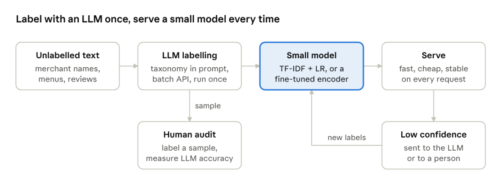

# 41 · NLP tasks with modern tools

Part XI · Applied ML systems (optional track). Assumes Chapter 4 (metrics). Chapters 10 and 12 explain the transformer models used here; this chapter is about applying them to real tasks. Worked designs that build on it: E.3 LLM taxonomy classifier and E.5 Review moderation and summarisation.

## Why it matters

Most applied NLP in companies is not research: it is classifying merchants, tickets and reviews, extracting attributes from menus, summarising feedback, and translating catalogues, reliably and cheaply at scale. LLMs changed how these tasks are done, but not what good looks like: clear labels, a measured baseline, the right metric, and a cost you can defend.

Interviewers for LLM-focused roles probe exactly this judgement: when an LLM is the right tool, when a TF-IDF model is, and how to combine them. Section 41.3 works through a typical case, an LLM-based merchant classifier made cheap with a batch API, in the structure interviewers want.

## Key concepts

- **TF-IDF + linear model**: weight words by how specific they are to a document, then fit logistic regression; still the fastest strong baseline for text classification. [Tf–idf](https://en.wikipedia.org/wiki/Tf%E2%80%93idf).
- **Fine-tuning a pre-trained encoder (BERT-style)**: add a small classification head and train the whole model on labelled examples. [Hugging Face LLM course](https://huggingface.co/learn/llm-course/chapter1/1).
- **Zero- and few-shot classification with LLMs**: describe the labels (and give a few examples) in the prompt instead of training (Chapter 22).
- **Named entity recognition (NER) and BIO tagging**: labelling spans of text such as dishes, brands or quantities. [Named-entity recognition](https://en.wikipedia.org/wiki/Named-entity_recognition).
- **Sentiment and aspect-based sentiment**: overall polarity vs polarity per topic (food, delivery, price).
- **Topic modelling (LDA, BERTopic)**: discovering themes in a corpus without labels. [LDA](https://en.wikipedia.org/wiki/Latent_Dirichlet_allocation), [BERTopic](https://maartengr.github.io/BERTopic/).
- **Summarisation (extractive vs abstractive) and faithfulness**: copying key sentences vs writing new text, and checking that every claim is supported.
- **Overlap metrics (ROUGE, BLEU)**: n-gram overlap with references; cheap but blind to meaning. [ROUGE](https://en.wikipedia.org/wiki/ROUGE_(metric)), [BLEU](https://en.wikipedia.org/wiki/BLEU).

## 41.1 Choosing an approach

For almost any text task there is a ladder of options. Climb only as far as quality requires.

| Approach | Labelled data needed | Cost per prediction | Typical use |
|---|---|---|---|
| Rules, keywords, regex | None | ~0 | Clear patterns (phone numbers, units, brand lists); guardrails |
| TF-IDF + linear model | Hundreds to thousands | ~0 | Strong baseline for classification; often good enough |
| Embeddings + linear model | Hundreds | Low | Semantic tasks with few labels; multilingual |
| Fine-tuned encoder (BERT-family) | Thousands | Low (CPU or small GPU) | High-volume classification and extraction |
| LLM zero- or few-shot | Tens, for the prompt and evaluation | High per call | Low volume, fast iteration, many classes, changing taxonomies |
| LLM labels, then distil into a small model | A small human-audited sample | High once, low after | High volume where an LLM's quality is needed |

The last pattern deserves a picture, because it is the default answer for high-volume tasks today:



*LLM labelling and distillation · with audit and fallback*

An LLM labels a large unlabelled set once (cheaply with a batch API), people audit a sample to measure label quality, a small model learns from the LLM's labels and serves every request, and uncertain cases go back to the LLM or a person, creating new labels for the next training round. You get most of the LLM's quality at a small fraction of the cost and latency, plus a model you can version and monitor.

**Questions that decide the approach:** How many predictions per day? What latency? How often does the label set change? How much does an error cost? Is there labelled data, and how good is it? What languages?

## 41.2 Text classification

**Baseline first: TF-IDF + logistic regression.** Word n-grams catch meaningful words; character n-grams catch misspellings, morphology and transliterations ("farmasi", "pizeria"), which matters a lot for short texts like merchant names.

```python
from sklearn.feature_extraction.text import TfidfVectorizer
from sklearn.linear_model import LogisticRegression
from sklearn.pipeline import make_pipeline, make_union
from sklearn.metrics import classification_report

clf = make_pipeline(
    make_union(
        TfidfVectorizer(ngram_range=(1, 2), sublinear_tf=True),  # words
        TfidfVectorizer(analyzer="char_wb", ngram_range=(3, 5), sublinear_tf=True),  # character n-grams
    ),
    LogisticRegression(max_iter=2000, class_weight="balanced"),
)
clf.fit(X_train, y_train)
print(classification_report(y_test, clf.predict(X_test)))
```

This trains in seconds, is easy to inspect (the largest coefficients per class are its "reasons"), and is often within a few points of much bigger models on short-text classification. Always build it first: it is your yardstick.

**Embeddings + linear model.** Encode each text with a sentence-embedding model (Chapter 29) and train logistic regression on the vectors. Works well with few labels and across languages.

**Fine-tuning an encoder** (DistilBERT, a multilingual model such as XLM-R, or a modern encoder) gives the best accuracy per unit of serving cost when you have thousands of labels. With Hugging Face (API as of 2025–26; check current docs):

```python
from transformers import AutoTokenizer, AutoModelForSequenceClassification, TrainingArguments, Trainer

name = "xlm-roberta-base"
tok = AutoTokenizer.from_pretrained(name)
model = AutoModelForSequenceClassification.from_pretrained(name, num_labels=len(label_list))
ds = ds.map(lambda b: tok(b["text"], truncation=True, max_length=128), batched=True)
args = TrainingArguments("out", learning_rate=2e-5, per_device_train_batch_size=32,
                         num_train_epochs=3, eval_strategy="epoch")
# Older versions take tokenizer=tok instead of processing_class=tok
Trainer(model=model, args=args, train_dataset=ds["train"], eval_dataset=ds["validation"],
        processing_class=tok).train()
```

**LLM zero- or few-shot classification.** Put the label definitions (not just names) in the prompt, add a few examples of hard cases, and force structured output: a JSON field restricted to the label list, plus an optional "other" or "unsure". Chapter 22 covers prompting; worked design E.3 covers a full LLM taxonomy classifier.

**Practical issues that decide real-world quality:**

- **Label definitions.** Most "model errors" in taxonomy work are ambiguous labels. Write a one-line definition and an example for each class, and resolve overlaps before modelling.
- **Imbalance.** Use class weights or resampling, report macro-F1 and per-class metrics (Chapter 4.4).
- **Hierarchical taxonomies.** Predict the top level first, or predict the leaf and derive parents; evaluate at each level.
- **Label noise.** Find likely mislabels by training with cross-validation and reviewing confidently wrong predictions (the idea behind confident learning and the cleanlab library).
- **Abstaining.** Use calibrated probabilities (Chapter 4.3) and send low-confidence cases to review rather than forcing a guess.

## 41.3 Worked case: an LLM merchant classifier

A food-delivery platform needs every merchant (restaurant, grocery, pharmacy, flower shop) placed in one of about 40 categories. Labels exist for only some merchants and are inconsistent. The case below shows the reasoning an interviewer wants to hear; use the same skeleton to present a project of your own.

**The story in five parts (about 3 minutes):**

1. **Problem and why it matters.** Search filters, analytics and recommendations all depend on the category; wrong or missing categories hide merchants from customers.
2. **Baseline first.** A TF-IDF + logistic regression model on merchant name, description and menu item names, trained on the existing labels. It sets the bar (say macro-F1 0.70) and shows where it fails: rare categories and merchants with short, ambiguous names.
3. **Approach and why.** An LLM with a prompt containing the category definitions and a few examples per confusing pair, output constrained to the label set. On a 500-merchant expert-labelled test set it closes most of the gap on rare categories. The job runs weekly over all merchants, so nothing needs a real-time answer: moving it to the provider's batch API (about half price), shortening the prompt and skipping merchants whose text has not changed cuts cost several-fold (Chapter 21 shows the arithmetic).
4. **Quality control.** Low-confidence predictions (or disagreement between two prompts) go to a human review queue; a monthly sample is re-labelled by experts to track drift.
5. **Results to report.** Accuracy and macro-F1 against the baseline, coverage, cost per 1,000 merchants before and after, reviewer hours, and which teams use the output. Name the next step: distilling into a small fine-tuned model once enough LLM labels have been checked.

**Decisions to be ready to defend:**

| Decision | Questions you will get | Strong answer covers |
|---|---|---|
| Taxonomy | Who owns it? What if classes overlap? | Definitions with examples, an "other" class, versioning |
| Inputs | Name only, or menu items and description too? | Short names are ambiguous; menu items add strong signal; measure each input's contribution |
| Labels | Where did ground truth come from? | Expert-labelled evaluation set; agreement between labellers; LLM vs human agreement |
| Model | Why an LLM and not TF-IDF or a fine-tuned encoder? | The baseline's numbers; the quality gap; volume and cost; how often labels change |
| Cost | What did it cost per 1,000 merchants? | Tokens per call × calls × price; batch discount; caching of repeated prompt prefixes |
| Quality control | How do you know it keeps working? | A fixed evaluation set re-run on every prompt or model change; sampling of production outputs; drift alerts on class distribution |
| Failure handling | What happens when it is unsure or wrong? | Confidence or "unsure" output, review queue, feedback into the evaluation set |

**Follow-up questions to rehearse:**

- "How would you scale this to 10× the merchants and three new countries?" Distillation, multilingual evaluation, per-country label review.
- "The taxonomy team adds 20 new classes. What changes?" Prompt and definitions update, re-label affected classes only, re-run the evaluation set, version the outputs.
- "How did you choose the prompt?" Iterated against the evaluation set, not by eye; tracked versions and scores (Chapter 22).
- "What was the hardest error category?" Have a real one ready, with an example.

## 41.4 NER and information extraction

**Named entity recognition (NER)** finds spans of text and labels them: in "Spicy chicken burger with vegan mayo, 330 ml", the dish, ingredients, dietary tag and size. In e-commerce and food delivery, this is attribute extraction from menus and product titles, feeding search filters, taxonomy and allergen information.

**BIO tagging.** Token classification with tags B-X (beginning of an entity of type X), I-X (inside) and O (outside). Historically solved with CRFs and BiLSTM-CRFs; today with a fine-tuned encoder (`AutoModelForTokenClassification`), spaCy pipelines, or an LLM.

**Evaluate at the entity level, not the token level.** A prediction counts only if span boundaries and type both match exactly. Token accuracy looks high because most tokens are O.

```python
def bio_to_spans(tags):
    """['B-DISH','I-DISH','O'] -> {(0, 2, 'DISH')} with end exclusive."""
    spans, start, label = [], None, None
    for i, tag in enumerate(tags + ["O"]):
        if tag.startswith("B-") or tag == "O" or (tag.startswith("I-") and tag[2:] != label):
            if start is not None:
                spans.append((start, i, label))
                start, label = None, None
            if tag.startswith("B-") or tag.startswith("I-"):   # a stray I- starts a new span
                start, label = i, tag[2:]
    return set(spans)

def entity_f1(true_tags, pred_tags):
    tp = fp = fn = 0
    for t, p in zip(true_tags, pred_tags):
        ts, ps = bio_to_spans(t), bio_to_spans(p)
        tp += len(ts & ps); fp += len(ps - ts); fn += len(ts - ps)
    prec = tp / (tp + fp) if tp + fp else 0.0
    rec = tp / (tp + fn) if tp + fn else 0.0
    return prec, rec, (2 * prec * rec / (prec + rec) if prec + rec else 0.0)

# tokens: Spicy chicken burger with vegan mayo 330 ml
true = [["B-ATTR", "B-ING", "B-DISH", "O", "B-DIET", "B-ING", "B-SIZE", "I-SIZE"]]
pred = [["B-ATTR", "B-DISH", "I-DISH", "O", "B-DIET", "B-ING", "B-SIZE", "I-SIZE"]]
entity_f1(true, pred)   # (0.8, 0.67, 0.73): "chicken burger" as one dish costs one FP and two FNs
```

The library `seqeval` implements the standard version; report partial-match scores too if near-misses matter for the use case.

**LLM extraction with a schema** is now the fastest way to start, especially with many attribute types or messy text. Define the output as a schema and validate it:

```python
from pydantic import BaseModel
from typing import Literal

class DishAttributes(BaseModel):
    dish_type: str                         # normalised later against the taxonomy
    main_ingredients: list[str]
    dietary: list[Literal["vegan", "vegetarian", "gluten_free", "halal", "spicy"]]
    size_value: float | None
    size_unit: Literal["ml", "l", "g", "kg", "pieces"] | None

# Pass DishAttributes' JSON schema to the LLM's structured-output mode, then:
# attrs = DishAttributes.model_validate_json(llm_output)
```

Then **normalise and link**: map "veggie", "vegetarian" and "نباتي" to one canonical value, and match extracted dish types to taxonomy nodes. Extraction without normalisation produces strings nobody can filter on. Never let an LLM invent allergen information: if the menu does not state it, the output must be null.

## 41.5 Sentiment and aspect-based sentiment

**Document-level sentiment** (positive, negative, neutral) is rarely enough for a marketplace. A review saying "food was amazing, delivery took 90 minutes" is mixed, and the restaurant and the logistics team need different halves of it.

**Aspect-based sentiment analysis (ABSA)** extracts (aspect, sentiment, evidence) triples. For food delivery the useful aspects are fixed and known: food quality, portion size, price or value, temperature, packaging, delivery time, courier behaviour, order accuracy (missing or wrong items), app or payment. An LLM with a schema does this well:

```python
from pydantic import BaseModel
from typing import Literal

Aspect = Literal["food_quality", "portion", "value", "temperature", "packaging",
                 "delivery_time", "courier", "order_accuracy", "app_payment"]

class AspectSentiment(BaseModel):
    aspect: Aspect
    sentiment: Literal["positive", "negative", "neutral"]
    evidence: str        # the exact phrase from the review: makes errors auditable

class ReviewAnalysis(BaseModel):
    aspects: list[AspectSentiment]
```

**Weak labels from ratings.** Star ratings are free sentiment labels, but noisy: a 3-star review can be angry, and the rating often reflects delivery while the text is about food. Use them for pre-training or sanity checks, not as ground truth for aspects.

**Hard cases to test explicitly:** sarcasm ("great, cold pizza again"), negation ("not bad at all"), code-switching (Arabic and English in one review), emojis, and reviews about the platform rather than the restaurant. Evaluate per aspect with precision and recall; the business uses are routing complaints to the right team, quality scores per restaurant, and input to summaries (worked design E.5).

## 41.6 Topic modelling: from LDA to BERTopic

Topic modelling finds recurring themes in a large text collection without labels: what are customers complaining about this month? What do support tickets cluster into?

**LDA (latent Dirichlet allocation)** models each document as a mixture of topics and each topic as a distribution over words, learned from word counts. It is classic, interpretable and cheap, but works on bags of words, so it struggles with short texts and synonyms.

```python
from sklearn.feature_extraction.text import CountVectorizer
from sklearn.decomposition import LatentDirichletAllocation

cv = CountVectorizer(stop_words="english", min_df=2)
X = cv.fit_transform(reviews)
lda = LatentDirichletAllocation(n_components=10, random_state=0).fit(X)
vocab = cv.get_feature_names_out()
for k, comp in enumerate(lda.components_):
    print(k, vocab[comp.argsort()[::-1][:8]])     # top words per topic
```

**BERTopic** is the modern default pipeline: embed each document with a sentence-embedding model, reduce dimensions with UMAP, cluster with HDBSCAN (which also marks outliers as noise rather than forcing them into a topic), and describe each cluster with **class-based TF-IDF**: treat each cluster as one big document and find words frequent in it but rare across clusters.

```python
import numpy as np, pandas as pd
from sklearn.feature_extraction.text import CountVectorizer

def c_tf_idf(docs, cluster_ids, top_n=5):
    joined = pd.DataFrame({"doc": docs, "c": cluster_ids}).groupby("c")["doc"].apply(" ".join)
    cv = CountVectorizer(stop_words="english")
    counts = cv.fit_transform(joined).toarray().astype(float)
    tf = counts / counts.sum(axis=1, keepdims=True)                 # term frequency per cluster
    idf = np.log(1 + (counts.sum() / len(joined)) / counts.sum(axis=0))
    vocab = cv.get_feature_names_out()
    return {c: [vocab[i] for i in np.argsort(-row)[:top_n]] for c, row in zip(joined.index, tf * idf)}
```

On a small set of delivery reviews, this labels clusters as "late, cold, courier", "fresh, sushi, fish", "sauce, bag, leaked, packaging" and "fast, friendly, rider".

**LLMs in topic work.** Name each cluster from its top words and a few sample documents (much better than word lists for stakeholders); merge near-duplicate topics; or classify documents directly into a fixed, LLM-proposed set of themes once the themes are known.

**Evaluation is mostly human:** do the topics make sense, are they distinct, are they stable when you re-run? Coherence scores help compare settings but do not replace reading samples from each topic.

## 41.7 Summarisation

**Extractive** summarisation selects existing sentences (safe, cannot invent facts, can read choppy). **Abstractive** summarisation writes new text (fluent, but can state things the source never said). LLMs made abstractive summarisation the default, so the central risk is **faithfulness**.

**Patterns for real tasks:**

- **Many short texts** (all reviews of a restaurant): first extract structured facts per review (aspects and sentiment, 41.5), aggregate them with code (counts, shares, trends), then ask the LLM to write the summary *from the aggregates plus a few* *quoted examples*. The numbers come from code, not from the model's impression.
- **One long document** larger than the context window, or too long to read reliably: map-reduce. Summarise chunks, then summarise the summaries. Keep chunk summaries for traceability.
- **Summaries that must be checkable**: ask for each claim with a citation to its source sentence or review id, and verify citations automatically.

**Evaluating summaries.** ROUGE (41.9) measures word overlap with a reference summary and is weak for abstractive outputs. In practice, evaluate four properties with an LLM judge calibrated on human ratings (Chapter 24): **faithfulness** (every claim supported by the source), **coverage** (the important points present), **conciseness**, and **usefulness for the reader's decision**. Faithfulness can also be checked claim by claim: split the summary into claims and test each against the source with an entailment model or a judge.

Worked design E.5 applies this to review summaries shown to customers, where an unfaithful negative claim about a restaurant is a real business and legal risk.

## 41.8 Translation

In a multi-country marketplace, translation shows up in catalogues (menus in Arabic and English), search (a query in one language, items described in another), support, and reviews.

**Options.** Dedicated machine translation models or APIs are fast, cheap and consistent at high volume. LLMs translate very well, handle context and tone, can follow a glossary, and can translate and normalise in one step ("translate this menu item and map it to the taxonomy"), at a higher cost per call.

**What matters in production:**

- **Terminology.** Dish names often should *not* be translated ("shawarma", "paella"), and brand names never. Give a glossary and a do-not-translate list, and test them.
- **Consistency.** The same item must translate the same way every time: cache translations by source text and version them.
- **Transliteration vs translation.** Users search for "machboos" in Latin script as often as for its Arabic name; keep both forms for search (Chapter 44.7).
- **Human review** for customer-facing high-traffic text; automated metrics plus sampling for the long tail.

**Evaluation.** BLEU and chrF compare n-gram or character overlap with a reference translation; COMET is a learned metric trained on human quality judgements and correlates much better with human ratings. For your own use case, have bilingual reviewers rate a sample, and use an LLM judge for scale once it agrees with them.

## 41.9 Task metrics and their limits

| Metric | How it works | Used for | Main limit |
|---|---|---|---|
| BLEU | N-gram precision against references, with a brevity penalty | Machine translation | Ignores meaning; one reference misses valid alternatives; poor at sentence level |
| ROUGE-N, ROUGE-L | N-gram recall / F1, or longest common subsequence, against references | Summarisation | Rewards copying words; blind to factual errors |
| chrF | Character n-gram F-score | Translation, especially morphologically rich languages | Still surface overlap |
| BERTScore | Matches tokens by contextual embedding similarity | Paraphrase-tolerant overlap | Still compares with a reference; weak on factual consistency |
| COMET | A model trained to predict human translation scores | Translation | Needs a trained model per task; can be gamed |
| LLM judge | An LLM scores outputs against a rubric | Summaries, answers, open-ended text | Must be calibrated against humans; biases (length, position, self-preference) |

**ROUGE from scratch** (the coding-round version):

```python
from collections import Counter

def rouge_n(candidate, reference, n=1):
    grams = lambda t: Counter(tuple(t[i:i + n]) for i in range(len(t) - n + 1))
    c, r = grams(candidate.lower().split()), grams(reference.lower().split())
    overlap = sum((c & r).values())
    prec, rec = overlap / max(sum(c.values()), 1), overlap / max(sum(r.values()), 1)
    return 2 * prec * rec / (prec + rec) if prec + rec else 0.0
def lcs_len(a, b):
    dp = [[0] * (len(b) + 1) for _ in range(len(a) + 1)]
    for i in range(1, len(a) + 1):
        for j in range(1, len(b) + 1):
            dp[i][j] = dp[i-1][j-1] + 1 if a[i-1] == b[j-1] else max(dp[i-1][j], dp[i][j-1])
    return dp[-1][-1]

def rouge_l(candidate, reference):
    c, r = candidate.lower().split(), reference.lower().split()
    lcs = lcs_len(c, r)
    prec, rec = lcs / max(len(c), 1), lcs / max(len(r), 1)
    return 2 * prec * rec / (prec + rec) if prec + rec else 0.0
```

**The limit, in one example.** Reference: *"customers praise the fresh sushi but complain* *about late delivery"*.

| Candidate | Meaning | ROUGE-1 | ROUGE-2 | ROUGE-L |
|---|---|---|---|---|
| "reviews like the fresh sushi but say delivery is often late" | Correct | 0.57 | 0.32 | 0.48 |
| "customers praise the late delivery but complain about the fresh sushi" | Reversed | 0.95 | 0.74 | 0.57 |

The summary that says the opposite scores higher on every ROUGE variant. That is why overlap metrics are, at most, a cheap regression check, and why faithfulness needs claim-level checks or calibrated judges. Use `sacrebleu` and `rouge-score` for standard implementations when you report numbers.

## Pitfalls

- **Skipping the baseline.** Without TF-IDF + logistic regression numbers, you cannot justify an LLM's cost.
- **Ambiguous label definitions.** Most taxonomy "model errors" are label disagreements. Measure human agreement first.
- **Evaluating an LLM classifier by eye.** Use a fixed labelled set and re-run it on every prompt or model change.
- **Token-level accuracy for NER.** Use entity-level F1.
- **Extraction without normalisation.** Free-text attributes are useless for filters.
- **LLMs filling in facts not in the text,** especially allergens, prices and sizes. Require null when absent, and test for it.
- **Ratings as sentiment ground truth.** They are noisy and often about a different aspect than the text.
- **Topic models nobody reads.** Name and review topics with samples; check stability across runs.
- **ROUGE or BLEU as proof of quality.** They miss factual errors; the example in 41.9 shows a reversed meaning scoring higher.
- **Ignoring languages.** A model good in English may be poor in Arabic; evaluate each language separately.
- **No confidence or abstain path.** Forced guesses on hard cases create silent errors.

## Interview questions

Questions 1–5 are basic, 6–11 intermediate, 12–15 senior.

**1. How would you build a text classifier for 30 categories with 5,000 labelled examples?** TF-IDF (word and character n-grams) + logistic regression as a baseline, then embeddings + logistic regression and a fine-tuned encoder; compare macro-F1 and per-class results on a held-out set; choose by quality, latency and cost. Check label quality and class balance first.

**2. Why character n-grams?** They capture misspellings, morphology, transliterations and sub-word cues, which matter in short noisy texts like merchant names and queries.

**3. What is BIO tagging?** Token labels marking the beginning (B-X), inside (I-X) and outside (O) of entity spans, turning span extraction into token classification.

**4. Why is ROUGE a weak metric for LLM summaries?** It measures word overlap with a reference, so it rewards copying and is blind to factual errors and paraphrase: a summary reversing the meaning can score higher than a faithful paraphrase.

**5. LDA vs BERTopic?** LDA models documents as mixtures of word-distribution topics from bag-of-words counts: cheap and interpretable, weak on short texts and synonyms. BERTopic clusters sentence embeddings and describes clusters with class-based TF-IDF: better semantics, handles short texts, flags outliers.

**6. When would you use an LLM instead of a fine-tuned classifier?** Low or moderate volume, many or frequently changing classes, little labelled data, or tasks needing reasoning over long context. At high volume with stable labels, use the LLM to label data and distil into a small model.

**7. How do you evaluate an LLM-based classifier before launch?** A fixed, expert-labelled evaluation set covering all classes and known hard cases; macro-F1, per-class metrics and confusion pairs; human vs LLM agreement compared with human vs human agreement; re-run on every prompt or model version.

**8. Design attribute extraction from 2 million menu items.** Define the schema and allowed values; LLM extraction with structured output on a sample, audited by people; normalisation to canonical values and taxonomy nodes; distil into a token-classification or seq2seq model for the full volume (or batch LLM calls if affordable); entity-level metrics per attribute; nulls when absent, never invented.

**9. How would you analyse customer reviews for restaurants?** Aspect-based sentiment with a fixed aspect list and evidence spans; aggregate per restaurant and aspect over time with code; route negative aspects to the right team; summaries generated from aggregates plus quotes; evaluate extraction per aspect.

**10. You have noisy labels. What do you do?** Measure noise on a re-labelled sample; find likely errors via cross-validated predictions that confidently disagree with labels; fix or drop them; improve guidelines; use robust training (label smoothing) if noise remains.

**11. How do you handle Arabic and English in one NLP system?** Multilingual models, per-language evaluation sets and metrics, transliteration variants, language-specific normalisation, native-speaker review; watch for code-switching within one text.

**12. For the merchant classifier in 41.3: why an LLM, and what would you change after a year in production?** Give the baseline numbers and the gap the LLM closed, the cost after batching, and how quality was measured. Then name a concrete next step: distillation for cost and latency, a confidence threshold with review, or drift monitoring as merchant types change. (Rehearse the same answer for a project of your own.)

**13. How do you check an LLM summary for hallucinations at scale?** Split the summary into atomic claims; check each against the source with an entailment model or a calibrated LLM judge; require citations; track the share of unsupported claims as a metric; route summaries with unsupported claims to regeneration or review.

**14. A product team wants a "topics customers complain about" dashboard. How do you build it?** Aspect or theme extraction into a fixed, reviewed set of themes (seeded by clustering plus LLM naming), counts and trends computed in code, drill-down to example reviews, a monthly review of new clusters for emerging themes, and an evaluation sample per theme.

**15. How do you decide between paying for LLM calls and fine-tuning a model?** Compute cost per month for each: tokens × calls × price (with batch discount) vs training plus serving cost; compare quality on the same evaluation set; factor in latency, how often labels change, team effort and vendor risk. Often the answer is both: an LLM for labels and hard cases, a small model for volume.

## Practice

1. **Classification ladder.** On a public multi-class text dataset (AG News, or the Amazon product categories subset on Hugging Face), build TF-IDF + LR, embeddings + LR, and a fine-tuned DistilBERT. Report macro-F1, training time and inference time per 1,000 texts. *Good solution:* a table and a recommendation for a 10-million-texts-per-day use case.
2. **LLM labelling and distillation.** Label 2,000 unlabelled texts from the same dataset with an LLM, hand-check 100, train TF-IDF + LR on the LLM labels, and compare with the model trained on true labels.
3. **NER.** Fine-tune a token-classification model on CoNLL-2003 or WNUT-17 and report entity-level F1 with `seqeval`. Write `bio_to_spans` and `entity_f1` from memory first and check they agree.
4. **Menu extraction.** Write 50 messy menu items yourself (mixed languages, sizes, dietary words), extract `DishAttributes` with an LLM, and measure per-field accuracy, especially false dietary tags.
5. **Reviews.** On the Yelp reviews dataset, run aspect-based sentiment with an LLM on 300 reviews, aggregate per aspect, and compare aspect sentiment with star ratings.
6. **Topics.** Run LDA and BERTopic on 10,000 reviews; compare topic quality by reading 10 samples per topic.
7. **Metrics drill.** Implement ROUGE-1, ROUGE-L and a simple BLEU from scratch, check against `rouge-score` and `sacrebleu`, and build three adversarial examples where the metric disagrees with meaning.

## Read next

- Jurafsky and Martin, *Speech and Language Processing* (3rd edition draft, free online): chapters on naive Bayes and text classification, logistic regression, sequence labelling for NER, and machine translation.
- *Hands-On Large Language Models* (Alammar and Grootendorst): chapters on text classification, text clustering and topic modelling (BERTopic), and prompt-based extraction.
- Blei, Ng and Jordan, *Latent Dirichlet Allocation* (JMLR 2003).
- Grootendorst, *BERTopic: Neural Topic Modeling with a Class-based TF-IDF Procedure* (2022).
- Lin, *ROUGE: A Package for Automatic Evaluation of Summaries* (2004); Papineni et al., *BLEU* (2002); Zhang et al., *BERTScore* (ICLR 2020); Rei et al., *COMET* (EMNLP 2020).
- Northcutt, Jiang and Chuang, *Confident Learning: Estimating Uncertainty in Dataset* *Labels* (JAIR 2021).
- Eugene Yan's and Hamel Husain's writing on LLM evaluation and LLM-assisted labelling.

**Links:** [Hugging Face LLM course](https://huggingface.co/learn/llm-course/chapter1/1) · [BERTopic](https://maartengr.github.io/BERTopic/) · [The Illustrated BERT](https://jalammar.github.io/illustrated-bert/). Other titles above can be found by searching their title.

## Done when

You can build and explain a TF-IDF + LR baseline with word and character n-grams in 15 minutes. You can choose among the approaches in 41.1 for a given volume, latency and budget, and explain LLM labelling plus distillation. You can tell your merchant-classifier story in 3 minutes with real numbers and answer the follow-ups in 41.3. You can write `bio_to_spans` and entity-level F1, and design schema-based LLM extraction with normalisation. You can design aspect-based sentiment for delivery reviews. You can explain LDA and BERTopic and code class-based TF-IDF. You can explain faithful summarisation patterns and how to evaluate them.

You can implement ROUGE and explain why overlap metrics fail for LLM outputs.

---

[← 11 · Model families and scaling](11-model-families-and-scaling.md) · [Contents](../README.md#contents) · [13 · How LLMs are trained →](13-how-llms-are-trained.md)
