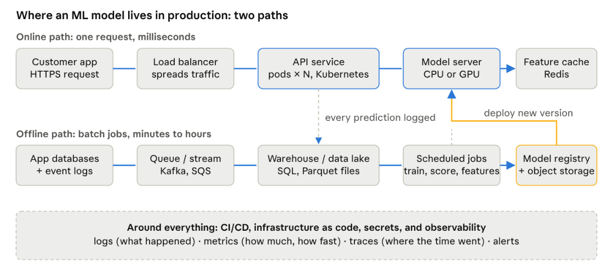
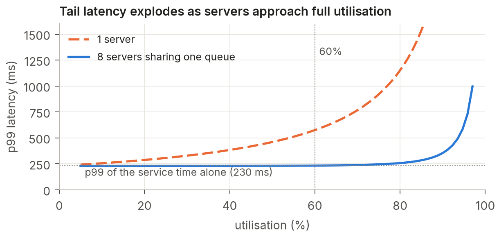

# 42 · Infrastructure primer

Part XI · Applied ML systems (optional track). No prerequisites: this chapter assumes you have trained models in notebooks but never deployed one. Read it before Chapter 21 (serving) and Chapter 47 (MLOps).

## Why it matters

A model in a notebook helps nobody. To be used, it has to run on a computer that is always on, receive requests over a network, return answers fast enough, survive crashes and traffic spikes, and be updated without breaking anything. That is "infrastructure". Data scientists are not expected to be platform engineers, but in senior interviews and in daily work you must speak the vocabulary: what a container is, why Kubernetes restarts things, what p99 latency means, why a batch job and an API are designed differently, and how many machines a model needs. This chapter explains each piece from zero, in the order a request actually travels.

For LLM work two more things matter, and the chapter ends with them: serving models that need GPUs, where batching and memory rather than CPU decide capacity and a new replica can take minutes to load its weights (42.13), and the infrastructure of training runs that span many GPUs and nodes (42.14). What an interviewer tests is less the tool names than the arithmetic: how many replicas, how long a cold start, how big a checkpoint, why p99 explodes near full load.

The Python code was run; outputs are quoted. Dockerfiles, Kubernetes files and shell commands are standard examples that were not run here; check the linked docs for current syntax.

The chapter starts with the big picture, the online and offline paths that most ML systems combine (42.1), then explains the building blocks one at a time, in the order a request meets them: machines and the cloud (42.2), network APIs (42.3), containers (42.4) and Kubernetes (42.5), storage (42.6), and queues and streams (42.7). Sections 42.8 and 42.9 apply them to ML: the three modes of inference, and how to reason about latency, throughput and capacity. Then come how changes are shipped safely (42.10), how running systems are observed (42.11), and one request followed end to end (42.12). Sections 42.13 and 42.14 extend the picture to GPU serving and to training infrastructure.

Each piece of infrastructure exists to solve a specific failure: a model that runs on one laptop and not another, a service that dies with its machine, a slow consumer that blocks a fast producer. Learning each tool through the failure it prevents makes system-design conversations much easier to follow.

## Key concepts

Each line is a one-sentence definition with a link to a good explanation. The sections below go deeper.

- **Server / virtual machine (VM)**: a computer in a data centre that you rent and reach over the network; a VM is a slice of a physical machine. [Cloud computing overview](https://en.wikipedia.org/wiki/Cloud_computing).
- **CPU vs GPU**: a CPU has a few powerful cores for general work; a GPU has thousands of small cores for doing the same maths on many numbers at once, which is what neural networks need. [NVIDIA explainer](https://blogs.nvidia.com/blog/whats-the-difference-between-a-cpu-and-a-gpu/).
- **Shell and Linux**: almost every server runs Linux and is operated through a text terminal. [The Missing Semester](https://missing.csail.mit.edu/) (MIT) teaches the essentials.
- **HTTP and APIs**: programs talk over the network by sending HTTP requests (GET, POST) to URLs and getting responses, usually JSON. An API is the agreed set of URLs and message formats. [MDN: HTTP overview](https://developer.mozilla.org/en-US/docs/Web/HTTP/Overview), [REST](https://en.wikipedia.org/wiki/REST).
- **Latency and throughput**: how long one request takes, and how many requests per second the system handles. Reported as percentiles: p50, p95, p99.
- **Container (Docker)**: your code plus everything it needs (Python version, libraries, model file) packed into one image that runs the same on any machine. [What is a container?](https://www.docker.com/resources/what-container/), [Docker get-started guide](https://docs.docker.com/get-started/).
- **Kubernetes**: software that runs many containers across many machines, restarts them when they crash, and adds or removes copies as traffic changes. [Kubernetes overview](https://kubernetes.io/docs/concepts/overview/).
- **Load balancer**: spreads incoming requests across the copies of a service. [Load balancing](https://en.wikipedia.org/wiki/Load_balancing_(computing)).
- **Autoscaling**: automatically changing the number of copies with load. [Horizontal Pod Autoscaling](https://kubernetes.io/docs/tasks/run-application/horizontal-pod-autoscale/).
- **Object storage**: cheap storage for files of any size (datasets, model weights), addressed by a path like `s3://bucket/models/v3.pt`. [Amazon S3](https://aws.amazon.com/s3/).
- **Databases vs warehouses**: an app database (OLTP) handles many small reads and writes for the live product; a data warehouse handles big analytical queries. [OLTP](https://en.wikipedia.org/wiki/Online_transaction_processing), [Data warehouse](https://en.wikipedia.org/wiki/Data_warehouse).
- **Cache (Redis)**: a very fast in-memory key-value store for data needed in milliseconds, such as precomputed features. [Redis](https://en.wikipedia.org/wiki/Redis).
- **Queue and stream**: a buffer between producers and consumers of events, so neither has to wait for the other. [Message queue](https://en.wikipedia.org/wiki/Message_queue), [Kafka introduction](https://kafka.apache.org/intro).
- **Batch, online and streaming inference**: predict for everything on a schedule; predict per request; predict per event as it arrives.
- **CI/CD**: automatic testing and deployment on every code change. [CI/CD](https://en.wikipedia.org/wiki/CI/CD).
- **Infrastructure as code (Terraform)**: describing servers, databases and permissions in versioned files instead of clicking in a console. [What is Terraform](https://developer.hashicorp.com/terraform/intro).
- **Observability**: logs, metrics and traces that let you see what a running system is doing. [What is OpenTelemetry?](https://opentelemetry.io/docs/what-is-opentelemetry/), [Prometheus overview](https://prometheus.io/docs/introduction/overview/).
- **Little's law**: the average number of requests in flight equals arrival rate times time in the system; it sizes capacity. [Little's law](https://en.wikipedia.org/wiki/Little%27s_law).
- **Continuous batching**: an LLM server adds and removes requests from the running batch at every decoding step, so GPU throughput depends on load (42.13, Chapter 21.6).
- **Cluster scheduler (Slurm, Kubernetes)**: decides which job runs on which machines; Slurm dominates large training clusters (42.14).

## 42.1 The big picture



*Most ML systems combine a fast online path (answer one request now) with a slow offline path (process yesterday's data). Read it left to right, top then bottom.*

Two paths cover almost every ML system you will meet:

- **Online path.** A customer opens the app; the app sends a request; within about 100–300 ms the system must answer (a ranked list, an ETA, a fraud score). Everything here is about speed and reliability.
- **Offline path.** Every event (orders, clicks, ratings) is stored. Scheduled jobs process it hours later: build training data, retrain the model, compute features, or score everything in bulk. Everything here is about correctness, cost and volume.

The two meet in two places: the model trained offline is deployed to the online model server, and every online prediction is logged so it becomes offline data. When you design a system (Chapter 46), first decide which parts must be online. Many teams make everything online by default and pay for it in cost and complexity; if a prediction can be computed overnight and looked up, it usually should be.

## 42.2 Machines: CPU, GPU, memory and the cloud

**What a server is.** A computer with CPUs, memory (RAM), disk and a network card, sitting in a data centre. You rarely own one: you rent **virtual machines** from a cloud provider (AWS, Google Cloud, Azure), paying per hour or second.

**CPU vs GPU in ML terms.**

|  | CPU | GPU |
|---|---|---|
| Cores | 4–128 strong, general cores | thousands of simple cores |
| Good at | branching logic, data processing, small models (trees, logistic regression), small batches | large matrix multiplications: training and serving neural networks, especially LLMs |
| Memory | system RAM, tens to hundreds of GB | its own VRAM (for example 24, 48 or 80 GB on older and mid-range cards; 141 GB on an H200, about 180–192 GB on a B200, 288 GB on a B300); the model must fit here |
| Cost | cents to a few dollars per hour | roughly one to several dollars per hour per GPU, more for top models |

Rules of thumb: tree models and small classifiers serve happily on CPUs; transformers serve faster on GPUs; LLMs effectively require GPUs (or a provider's API). The question "does the model fit in GPU memory?" decides a lot; Chapter 21 shows the arithmetic. For LLM serving, memory rather than FLOPs is usually the binding constraint: a 70B-parameter model in bf16 needs 140 GB for weights alone, before the KV cache that grows with every concurrent request, so it needs two 80 GB GPUs or one 141 GB card with little room to spare. Each generation of GPU has added memory faster than it has made the decode step cheaper, because decoding is limited by memory bandwidth, not arithmetic.

**Cloud service levels.** From most control to least: *IaaS* (rent VMs and manage everything), *PaaS / managed services* (the provider runs the database, the Kubernetes cluster or the training job; for ML: SageMaker, Vertex AI, Azure ML, Databricks), *SaaS / APIs* (you just call an endpoint, such as an LLM API). Managed services cost more per hour but less in engineering time; most companies mix them.

**Regions and zones.** A region is a geographic location (for example Frankfurt or Bahrain); zones are separate data centres within it. Run copies in several zones so one data-centre failure does not take you down, and keep data in the region your users and data-protection rules require.

## 42.3 Talking over the network: HTTP and APIs

When the app asks for an ETA, it sends an **HTTP request**: a method (`POST`), a URL (`https://api.example.com/eta/predict`), headers (authentication token, content type) and a body, usually **JSON**. The server replies with a **status code** (200 OK, 400 bad request, 422 invalid input, 500 server error, 503 unavailable) and a JSON body. An **API** is the contract: which URLs exist, what they accept, what they return.

A minimal model API in Python with FastAPI. Pydantic models define and validate the contract, so bad inputs are rejected before they reach the model:

```python
from fastapi import FastAPI
from pydantic import BaseModel, Field
import numpy as np
app = FastAPI(title="eta-model")

class EtaRequest(BaseModel):
    distance_km: float = Field(ge=0, le=50)
    prep_minutes: float = Field(ge=0, le=120)
    is_rush_hour: bool

class EtaResponse(BaseModel):
    eta_minutes: float
    model_version: str

# Load the model ONCE at startup, never per request.
W = np.array([2.1, 1.0, 6.0]); B = 4.0          # stand-in for a trained model
MODEL_VERSION = "eta-2026-11-01"

@app.get("/health")                    # used by the load balancer and Kubernetes
def health():
    return {"status": "ok"}

@app.post("/predict", response_model=EtaResponse)
def predict(req: EtaRequest):
    x = np.array([req.distance_km, req.prep_minutes, float(req.is_rush_hour)])
    return EtaResponse(eta_minutes=round(float(W @ x + B), 1), model_version=MODEL_VERSION)
```

Run it locally with `uvicorn serve:app --port 8000` and open `http://localhost:8000/docs` for interactive documentation that FastAPI generates. Tested in-process with FastAPI's `TestClient`:

```python
from fastapi.testclient import TestClient
client = TestClient(app)
client.get("/health").json()          # {'status': 'ok'}
client.post("/predict", json={"distance_km": 3.2, "prep_minutes": 12, "is_rush_hour": True})
# 200 {'eta_minutes': 28.7, 'model_version': 'eta-2026-11-01'}
client.post("/predict", json={"distance_km": -1, "prep_minutes": 12, "is_rush_hour": True})
# 422 'Input should be greater than or equal to 0'
```

Three habits worth copying: return the **model version** with every prediction (debugging and A/B analysis need it); expose a **health endpoint**; validate inputs at the edge. Other protocols you will hear about: **gRPC** (binary, faster, used between internal services) and **WebSockets / server-sent events** (streaming, which is how LLM tokens arrive word by word).

## 42.4 Containers: "it works on my machine", solved

Your model needs a specific Python version, specific library versions, the model file and some system libraries. A **container image** packages all of that into one artefact; a **container** is a running instance of it. The image is built from a **Dockerfile**, a recipe:

```dockerfile
# Dockerfile (standard example, not run here)
# Base image: a small Linux with Python
FROM python:3.11-slim
WORKDIR /app
# Copy the dependency list first, so this layer is cached between code changes
COPY requirements.txt .
# requirements.txt pins exact versions
RUN pip install --no-cache-dir -r requirements.txt
# Application code and (in this simple version) the model file
COPY serve.py model.pt ./
EXPOSE 8000
CMD ["uvicorn", "serve:app", "--host", "0.0.0.0", "--port", "8000"]
```

Docker treats `#` as a comment only at the start of a line: a comment after an instruction (`FROM python:3.11-slim  # base image`) is passed to the instruction as extra arguments, and the build fails or does something unintended. Keep comments on their own lines. Building, running and publishing the image are shell commands, not part of the Dockerfile:

```bash
# Build the image from the Dockerfile in the current directory
docker build -t eta-model:1.4.0 .
# Run it, mapping port 8000 on the host to port 8000 in the container
docker run -p 8000:8000 eta-model:1.4.0
# Tag it with the registry's address, then upload it
docker tag eta-model:1.4.0 registry.example.com/eta-model:1.4.0
docker push registry.example.com/eta-model:1.4.0
```

**Model inside the image, or downloaded at start?** This Dockerfile copies `model.pt` into the image, while 42.6 describes weights downloaded from object storage when the container starts. Both are common, and the choice is a trade-off. Baking the model in makes the image fully immutable (the tag identifies code and model together, a rollback restores both, and start-up needs no network access to a bucket), which suits small models of a few hundred MB. Downloading at start keeps images small and lets you change the model version without rebuilding, which suits large models: a 16 GB image slows every build, push and node pull. For multi-GB LLM weights, a third option is common: weights on a shared volume or a node-local cache that new pods mount, so a scale-up does not re-download them (42.13).

Key ideas: images are **immutable** and **versioned by tag** (never deploy `latest` in production); they are stored in a **registry** (Docker Hub, ECR, GCR, Artifact Registry); a container is not a VM (it shares the host's kernel, so it starts in seconds and is light). For GPUs, base images from NVIDIA (CUDA) include the drivers' user-space libraries. Keep images small: large images slow down every deploy and scale-up.

## 42.5 Kubernetes: running many containers reliably

One container on one machine dies when the machine dies. **Kubernetes** (often "k8s") runs your containers across a **cluster** of machines and continuously makes reality match what you declared. The core objects:

- **Pod**: the smallest unit, one or more containers that run together. [Pods](https://kubernetes.io/docs/concepts/workloads/pods/).
- **Deployment**: "keep 6 copies of this pod running, version 1.4.0"; it replaces crashed pods and rolls out new versions gradually. [Deployments](https://kubernetes.io/docs/concepts/workloads/controllers/deployment/).
- **Service**: a stable network name and load balancing across the pods. [Services](https://kubernetes.io/docs/concepts/services-networking/service/).
- **Horizontal Pod Autoscaler (HPA)**: adds pods when CPU (or a custom metric such as requests per second) rises, removes them when it falls.
- **Probes**: *liveness* (restart me if this fails) and *readiness* (do not send me traffic until this passes, for example until the model has loaded). They must check different things; see below.
- **Resource requests and limits**: how much CPU, memory and how many GPUs each pod needs; the scheduler places pods on machines with room.

```yaml
# deployment.yaml (standard example, not run here)
apiVersion: apps/v1
kind: Deployment
metadata: {name: eta-model}
spec:
  replicas: 6
  selector: {matchLabels: {app: eta-model}}
  template:
    metadata: {labels: {app: eta-model}}
    spec:
      containers:
      - name: api
        image: registry.example.com/eta-model:1.4.0
        ports: [{containerPort: 8000}]
        resources:
          requests: {cpu: "1", memory: "2Gi"}
          limits: {memory: "2Gi"}          # GPU pods add: nvidia.com/gpu: 1
        readinessProbe: {httpGet: {path: /ready, port: 8000}, periodSeconds: 5}
        livenessProbe: {httpGet: {path: /health, port: 8000}, periodSeconds: 10, failureThreshold: 3}
```

**Liveness and readiness must differ.** The API in 42.3 has one `/health` endpoint that returns ok as soon as the process runs, even before the model is ready. Used for both probes, it sends traffic to pods that cannot yet answer. The two probes answer different questions:

- **Readiness: can this pod serve a request right now?** It should check that the model is loaded (and warmed up, if the first requests are slow) and that the dependencies it cannot work without, such as the feature cache, are reachable. A failing readiness probe only removes the pod from the Service's load balancing; it is not restarted.
- **Liveness: is this process stuck beyond repair?** It should check only the process itself (the event loop answers). A failing liveness probe restarts the container. If liveness also checked the feature cache, a cache outage would make every pod fail liveness at once, Kubernetes would restart all of them, each restart would reload the model and fail again: a restart storm that turns a dependency's brief outage into a full outage.

```python
from contextlib import asynccontextmanager
from fastapi import FastAPI, Response

STATE = {"model": None}

@asynccontextmanager
async def lifespan(app):
    STATE["model"] = object()          # stand-in for loading weights, which can take minutes
    yield

app = FastAPI(lifespan=lifespan)

@app.get("/health")                    # liveness: the process answers
def health():
    return {"status": "ok"}

@app.get("/ready")                     # readiness: model loaded, dependencies reachable
def ready(response: Response):
    ok = STATE["model"] is not None    # add a cheap ping to the feature cache here
    response.status_code = 200 if ok else 503
    return {"ready": ok}
```

For slow-loading models, Kubernetes also has a *startup probe* that holds off the liveness probe until the first success, so a model that takes three minutes to load is not killed for being slow.

You will rarely write these from scratch (platform teams provide templates, Helm charts or an internal deploy tool), but you should be able to read one and explain why a pod keeps restarting (failing liveness probe, out of memory: `OOMKilled`) or never receives traffic (readiness never passes, for example a slow model load). Managed alternatives that hide Kubernetes entirely: Cloud Run, AWS App Runner, SageMaker or Vertex AI endpoints, and serverless GPU platforms.

## 42.6 Storage: where data and models live

| Store | What it is for | Typical latency | Examples |
|---|---|---|---|
| App database (OLTP) | live product data: orders, users, menus; many small reads and writes | ~1–10 ms | PostgreSQL, MySQL, DynamoDB |
| Cache / key-value | features and results needed in milliseconds | <1 ms | Redis, Memcached |
| Data warehouse | analytics and training data; SQL over billions of rows | seconds | BigQuery, Snowflake, Redshift |
| Data lake / object storage | raw files, Parquet tables, model weights, checkpoints | tens of ms per file | S3, GCS, Azure Blob |
| Vector database | nearest-neighbour search over embeddings (Chapter 30) | ~1–50 ms | pgvector, FAISS-based services, Pinecone, Qdrant |

The rule: never query the warehouse inside an online request (too slow, too expensive); precompute and push what the online path needs into a cache or online feature store (Chapter 47). Model weights live in object storage and are downloaded when a container starts (or baked into the image for small models; 42.4 discusses the trade-off); a **model registry** (MLflow and similar) records which file is which version and which one is in production.

## 42.7 Queues and streams: decoupling systems

If the order service called the fraud model, the email service and the analytics pipeline directly, one slow consumer would slow every order. Instead it **publishes an event** ("order 123 placed") to a **queue** or **stream**, and each consumer reads at its own pace.

- **Queue** (SQS, RabbitMQ, Celery with Redis): each message is processed by one worker, then removed. Good for background jobs: "generate a description for this new menu item", "run the LLM classifier on this merchant".
- **Stream / log** (Kafka, Kinesis, Pub/Sub): an ordered, replayable log of events that many consumers can read independently. Good for real-time features ("orders in this area in the last 10 minutes"), streaming inference and feeding the warehouse.

Queues also absorb spikes: at dinner rush, messages wait a little longer instead of the system falling over. They make LLM pipelines robust too: put each item on a queue, have workers call the model with retries, and failed items go to a **dead-letter queue** for inspection instead of being lost.

## 42.8 Batch, online and streaming inference

| Mode | How | Latency | When to use | Delivery example |
|---|---|---|---|---|
| Batch | scheduled job scores everything, writes results to a table or cache | hours | predictions that do not depend on the moment; huge volumes; LLM jobs via batch APIs | nightly restaurant embeddings, weekly merchant categories |
| Online (real-time) | an API scores each request | ms | depends on context known only at request time | ranking the home feed, ETA at checkout |
| Streaming | a consumer scores each event as it arrives | seconds | react quickly to events, no user waiting | flag a suspicious order within seconds |
| Hybrid | batch precomputes the heavy part; online combines it cheaply | ms | most real systems | precomputed user and restaurant embeddings, online dot product + light reranker |

Scheduled jobs are run by an **orchestrator** (Airflow, Dagster, Prefect, or the cloud's own), which handles dependencies ("train only after the data job succeeds"), retries and alerts.

## 42.9 Latency, throughput and capacity

**Latency** is time per request; report percentiles, not averages, because users feel the slow tail. p99 = 99% of requests are faster than this. Measuring the toy API in-process:

```python
import time, numpy as np
lat = []
for _ in range(2000):
    t = time.perf_counter()
    client.post("/predict", json={"distance_km": 3.2, "prep_minutes": 12, "is_rush_hour": False})
    lat.append((time.perf_counter() - t) * 1000)
np.percentile(lat, [50, 95, 99])     # p50 2.78 ms, p95 3.15 ms, p99 3.60 ms (no network)
```

Real requests add network time, feature lookups and the model itself, and the tail grows under load.

**Throughput** is requests per second (RPS or QPS). **Little's law** links them:

$$
L = \lambda\,W
$$

where L is the average number of requests in the system, λ the arrival rate and W the average time each spends there. It holds for any stable system, whatever the arrival pattern, which is why it is the first tool for capacity. Applied to the replicas' processing alone (W = the service time, the time a replica spends working on one request), L is the average number of busy request slots. That sizes the number of copies you need:

```python
import numpy as np
def replicas_needed(peak_rps, latency_s, concurrency_per_replica, headroom=0.6):
    in_flight = peak_rps * latency_s                     # Little's law: L = lambda * W
    return int(np.ceil(in_flight / (concurrency_per_replica * headroom)))

replicas_needed(3000, 0.05, 8)    # 32 replicas for a 50 ms model at 3,000 RPS
replicas_needed(3000, 0.40, 8)    # 250 replicas if the model takes 400 ms
```

The 0.6 headroom keeps each replica at about 60% utilisation, because latency rises steeply as a server approaches 100% busy (queues build up). Notice the lesson: an 8× slower model needs about 8× the machines. Latency is a cost driver, not only a user-experience number.

**Which latency goes into W, and where "concurrency per replica" comes from.** Use the *service time* measured at low load, not the end-to-end latency measured under load. The latency under load already includes queueing, which grows with utilisation (the figure below), and the headroom factor is what accounts for that; feeding a loaded latency in as well counts the queueing twice and over-provisions. The output of the calculation is a utilisation, and the latency users will see at that utilisation is read off the queueing curve or, better, a load test. `concurrency_per_replica` is not a setting you choose; it is measured. Load-test one replica, raise the number of concurrent requests step by step, and record p99 at each step: the useful concurrency is the knee, the largest value where p99 still meets the SLO. For a Python service it is bounded by the number of worker processes when inference is CPU-bound, because the GIL lets only one thread run Python at a time; async request handling raises concurrency only for work that waits on I/O (feature lookups, calls to other services). A replica with 4 uvicorn workers on 4 cores doing CPU-bound inference has a concurrency of about 4, whatever the async framework says.



*p99 latency of a service whose requests take 50 ms on average (exponentially distributed), as utilisation rises: one server against eight servers fed from a shared queue (the M/M/1 and M/M/8 queueing models). At 80% utilisation one server's p99 is 1.15 s; eight pooled servers stay at 258 ms.*

**Two lessons from queueing theory.**

- **Utilisation costs latency non-linearly.** For a single server, p99 more than doubles between 50% and 80% utilisation and doubles again by 90%. This is why capacity plans keep headroom.
- **Pooling helps.** Eight servers pulling from one queue can run at 90% with p99 near 350 ms, because an idle server picks up the next request instead of letting it wait behind a slow one. Load balancers that route to the least-busy replica approximate this; random routing behaves more like eight separate single-server queues.

For one server with exponential service times (the M/M/1 model), the time a request spends in the system is itself exponential with rate μ − λ, where μ is the service rate and λ the arrival rate. Its p99 is therefore ln(100)/(μ − λ). With a 50 ms mean service time (μ = 20 per second), that gives 0.46 s at 50% utilisation, 1.15 s at 80% and 2.30 s at 90%: the factor 1/(1 − ρ) is the whole story of the curve.

Real services are burstier than this model, so measure p99 under load tests rather than trusting the formula. The shape of the curve holds.

### Tail latency at scale: fan-out

A request that calls many backends in parallel waits for the slowest. If each backend is slow (beyond its own p99) 1% of the time, a request that fans out to N of them is slow with probability 1 − 0.99ᴺ: 18% for N = 20 and 63% for N = 100. A page that assembles results from 100 shards therefore sees each shard's p99 on most requests (Dean and Barroso, "The Tail at Scale", 2013). This is why a service with an excellent p50 can have a p99 five times higher, and why the fixes target the tail specifically:

- **Hedged requests:** if a backend has not answered by its p95, send the same request to a second replica and take whichever answers first. This costs about 5% extra load and removes most of the tail caused by one slow machine.
- **Timeouts with partial results:** return the best answer from the shards that responded (a ranking missing 1% of candidates is usually fine).
- **Removing the sources of slowness:** garbage-collection pauses, cold replicas that just started, very large inputs, a noisy neighbour on the same machine, and synchronous batching windows that make a request wait for the batch to fill. Traces (42.11) show which one it is: a slow span in one service, on particular replicas, or for particular inputs.

Other terms you will hear: **SLO** (service-level objective, for example "p99 under 200 ms, 99.9% availability"), **timeouts** (never wait forever on a dependency), **fallbacks** (if the model is down, serve a popularity ranking), **cold start** (time for a new replica to load the model before it can serve).

## 42.10 Shipping changes safely: CI/CD and infrastructure as code

Every incident review eventually asks "what changed?". The practices below make that question answerable and the change reversible.

- **Version control (git)** for everything: code, configs, prompts, infrastructure.
- **CI (continuous integration)**: on every pull request, a service such as GitHub Actions or GitLab CI runs tests, linters and, for ML, a small evaluation.
- **CD (continuous delivery/deployment)**: after merge, build the image, push it to the registry, and deploy to staging, then production, often gradually (Chapter 47 covers shadow, canary and A/B releases).
- **Infrastructure as code**: Terraform (or Pulumi, CloudFormation) files describe buckets, databases, clusters and permissions, reviewed and versioned like code.
- **Secrets** (API keys, database passwords) never go in code or images; they come from a secret manager (AWS Secrets Manager, Vault) as environment variables at runtime.

## 42.11 Observability: seeing inside a running system

A running system cannot be stepped through with a debugger. Observability is how you answer "why is it slow?" or "why did it predict that?" after the fact, from what the system recorded.

- **Logs**: timestamped records of events ("request 7f3 predicted eta=28.7 with model v1.4.0"). Structured (JSON) logs can be searched and aggregated. Redact personal data (Chapter 28).
- **Metrics**: numbers over time: request rate, error rate, latency percentiles, CPU, GPU memory, and ML metrics such as the mean prediction or the share of low-confidence outputs. Collected by Prometheus or a vendor, shown in Grafana or Datadog.
- **Traces**: the path of one request through every service, with the time spent in each; the fastest way to find where latency comes from. OpenTelemetry is the standard.
- **Alerts**: rules on metrics that page a person ("error rate above 2% for 5 minutes"), linked to a **runbook** saying what to do.

The four signals Google's SRE book recommends watching for any service: latency, traffic, errors and saturation. Chapter 47 adds the ML-specific layers (data drift, prediction drift, business metrics).

## 42.12 How it fits together: one request, end to end

A customer opens the app at 20:05 and the home feed is ranked:

1. The app sends `GET /feed?user=123&lat=…&lon=…` over HTTPS to the load balancer.
2. The load balancer forwards it to one of 20 pods of the ranking service (Kubernetes keeps 20 alive; the HPA added 8 for the dinner rush).
3. The service fetches the user's precomputed embedding and recent-order features from Redis (written last night by a batch job and updated by a stream consumer during the day).
4. It retrieves 500 candidate restaurants open nearby, calls the ranking model server, and gets scores in 30 ms.
5. It applies business rules (closed restaurants, delivery radius), logs the request, the scores and the model version to the event stream, and returns the top 50 in about 120 ms end to end.
6. Tonight, a scheduled job reads those logs from the warehouse, joins the orders that followed, retrains the model, evaluates it, registers it, and a CD pipeline rolls it out as a canary tomorrow.

If you can tell this story, with the reasons for each piece, you can hold the infrastructure part of any ML system design interview.

## 42.13 Serving models on GPUs

Everything so far assumed a CPU service whose capacity is a fixed number of concurrent requests per replica. A GPU model server breaks that assumption in three ways: its throughput depends on how many requests it batches together, a new replica can take minutes to become ready, and the hardware is expensive and sometimes scarce. The question this section answers is how capacity planning, autoscaling and deployment change when the model needs a GPU.

### Batching makes concurrency a variable

A GPU does one large matrix multiplication almost as fast as one small one, so it pays to process many requests together. **Dynamic batching** (Triton, TorchServe, Ray Serve) collects requests for a few milliseconds and runs them as one batch: throughput rises sharply, at the cost of that waiting window added to every request's latency. For LLMs, where each request generates tokens for seconds, **continuous batching** (vLLM, SGLang, TensorRT-LLM, TGI) adds new requests to the running batch at every decoding step and removes finished ones at once (Chapter 21.6). The consequence for 42.9's arithmetic: "concurrency per replica" is no longer a constant. A replica's throughput rises with the number of requests in flight until the KV cache fills or the per-token latency crosses the SLO, so the right capacity unit for an LLM is tokens per second per replica at the latency target, measured by a load test.

**Worked sizing.** A chat feature peaks at 50 requests per second, each generating 300 output tokens on average: 15,000 output tokens per second. A load test shows one replica (say, one 8-GPU node running a 70B model) sustains 2,500 output tokens per second before the time per output token exceeds the SLO. With 70% headroom for bursts, the service needs 15,000 / (2,500 × 0.7) = 8.6, so 9 replicas. Input tokens also cost time (the prefill), and a workload with long prompts needs its own load test; Chapter 21.9 does the arithmetic for prefill and decode separately. The numbers here are illustrative; the method is what an interviewer looks for.

### Cold starts and autoscaling

A CPU replica of a small model is ready in seconds. A GPU replica of an LLM must get a GPU node (minutes if the cluster has to provision one), pull a large container image, download the weights and load them into GPU memory. A 70B model in bf16 is 140 GB: at 1 GB/s from object storage that is 140 seconds of download alone, and an 8B model is 16 GB, about 16 seconds. So autoscaling on CPU utilisation, which reacts after the load arrives, is too slow for traffic spikes. The usual remedies:

- **Scale on the right signal.** Queue depth, requests in flight or KV-cache utilisation predict overload better than GPU utilisation, which reads high even at moderate load.
- **Keep warm capacity.** A minimum number of replicas, sized for the predictable daily peak, with autoscaling only for the excess; scale ahead of known peaks on a schedule.
- **Make loading faster.** Cache weights on node-local NVMe disks or a shared volume so a new pod reads them at several GB/s, stream weights straight to the GPU, and keep images small by not baking weights into them (42.4).
- **Readiness that means ready.** A replica is ready only after the weights are loaded and a warm-up request has run (42.5); otherwise the first users pay for compilation and memory allocation.

### Node pools, spot instances and the serving stack

Kubernetes clusters for ML usually have separate **node pools**: CPU nodes for the API and feature services, GPU nodes (often several types) for models, with taints so that only GPU workloads land on expensive nodes. GPU pods request `nvidia.com/gpu: 1` (or more); the NVIDIA device plugin makes the GPUs schedulable. **Spot or preemptible instances** cost a fraction of on-demand prices but can be reclaimed with little notice (around two minutes on some clouds, less on others). They suit batch inference, evaluation jobs and training with frequent checkpoints, and are risky for latency-critical serving unless on-demand capacity covers the baseline.

The serving software is a stack: an inference engine that runs the model efficiently (vLLM, SGLang, TensorRT-LLM for LLMs; ONNX Runtime or TorchScript-style compiled models for smaller networks), optionally a model server that handles batching, multiple models and metrics (Triton Inference Server), and an orchestration layer that handles replicas, routing and autoscaling (KServe on Kubernetes, Ray Serve, or a managed endpoint). For LLMs at scale, the router matters too: sending requests that share a prompt prefix to the same replica raises prefix-cache hits, which lowers both latency and cost. Chapter 21 explains what happens inside the engine; this section is about running it.

## 42.14 Training infrastructure

Training a model on one GPU needs nothing beyond this chapter's first sections. Training on hundreds or thousands of GPUs adds a different set of systems: a scheduler that gives a job all its nodes at once, a network fast enough that GPUs on different machines can exchange gradients every step, storage that can feed data and absorb checkpoints, and a way to survive the hardware failures that become routine at that scale. The question this section answers is what each of those is and why it is shaped the way it is. Chapter 17 covers the parallelism strategies that run on top, and Chapter 47.9 the operational practice.

**Slurm or Kubernetes.** Large training clusters have traditionally used **Slurm**, an HPC batch scheduler: you submit a job asking for, say, 64 nodes with 8 GPUs each, it waits in a queue until all 64 are free, then starts every process at once (gang scheduling) and gives them the whole nodes. That model suits training, where a job is useless unless all its ranks start together and stay together. **Kubernetes** was built for long-running services that scale replica by replica, and needs add-ons (gang-scheduling plugins and queueing systems such as Kueue or Volcano, plus operators for distributed PyTorch jobs) to behave like Slurm. Many organisations run Slurm for big training, Kubernetes for serving and smaller jobs, or Slurm-on-Kubernetes hybrids; the interview point is gang scheduling and topology awareness, not the brand.

**The network.** Within a node, GPUs talk over NVLink (hundreds of GB/s per GPU); recent rack-scale systems extend one NVLink domain to dozens of GPUs. Between nodes, gradients and activations travel over **InfiniBand** or **RoCE** (RDMA over Ethernet), typically one 400 Gb/s or faster link per GPU, so that data moves GPU-to-GPU without passing through the CPU. **NCCL** is the library that implements the collectives (all-reduce, all-gather, reduce-scatter) on top. Because every synchronous training step waits for the slowest collective, one bad cable or misconfigured switch slows the whole job; topology-aware placement (keeping tensor-parallel groups inside an NVLink domain) is part of the scheduler's job.

**Storage.** Training reads data and writes checkpoints. Datasets usually live in object storage as large sharded files (WebDataset tar shards, Parquet, or pre-tokenised binary arrays) streamed by the data loader, sometimes with a local NVMe cache; millions of small files are slow on every storage system. Checkpoints go to a parallel filesystem (Lustre, GPFS/Spectrum Scale, or a cloud-managed equivalent) or object storage. Their size is easy to underestimate: a full training checkpoint of a 70B model with Adam (bf16 weights, fp32 master copy and two fp32 moments, 14 bytes per parameter) is about 1 TB; Chapter 17 counts 16 bytes per parameter and gets 1.12 TB. Written at 20 GB/s aggregate, that takes about a minute; writing it every 20 minutes synchronously would cost several percent of the run. So checkpoints are written sharded, in parallel from every rank, and asynchronously (copy to CPU memory, write in the background). Chapter 17 derives the best checkpoint interval from the failure rate.

**Failures are routine.** With thousands of GPUs, some component fails every few hours: a GPU with memory errors, a NIC, a node that hangs. Training infrastructure therefore needs health checks before and during jobs, automatic detection of hangs (a step that never finishes), fast relaunch from the latest checkpoint, and spare nodes. The number that matters is effective throughput, the share of wall-clock time spent on useful steps, not peak speed.

## Pitfalls

- Loading the model inside the request handler instead of once at startup.
- Querying the warehouse from an online request.
- Deploying the `latest` image tag, so you cannot tell what is running or roll back.
- Reporting average latency instead of p95/p99.
- Running servers near 100% utilisation and wondering why latency explodes.
- No timeout or fallback on a model call, so a slow model takes the whole page down.
- Secrets in code, notebooks or container images.
- Making everything real-time when a nightly batch job would do.
- Using one `/health` endpoint for both liveness and readiness, or a liveness probe that checks dependencies (restart storms).
- Comments after a Dockerfile instruction on the same line.
- Sizing replicas with latency measured under load, so queueing is counted twice; or assuming a Python replica's concurrency is set by async rather than by its worker processes.
- Autoscaling a GPU service on GPU utilisation alone, with no warm capacity, so a spike waits minutes for new replicas to load their weights.
- Treating "concurrency per replica" as a constant for a batched GPU server.

## Interview questions

**Beginner / mid level**

**1. What is the difference between a container and a virtual machine?** A VM includes a full operating system on virtualised hardware; a container shares the host kernel and only packages the app and its dependencies, so it is smaller and starts in seconds. The trade-off is isolation: a VM's separate kernel isolates tenants more strongly, which is why cloud providers run containers inside VMs for untrusted workloads. Number: a slim Python image is a few hundred MB and starts in about a second; a VM image is several GB and boots in tens of seconds to minutes. Follow-up: "how does a container use a GPU?" The host has the NVIDIA driver; the container brings the CUDA user-space libraries and gets the device through the container runtime's GPU support.

**2. What do a Kubernetes Deployment, Service and HPA each do?** A Deployment declares the desired state (which image, how many replicas) and keeps it true: it replaces crashed pods and rolls out new versions gradually, a few pods at a time. A Service gives the changing set of pods one stable name and load-balances requests across those that pass readiness. The Horizontal Pod Autoscaler changes the replica count from a metric. Number: the HPA sets desired replicas = ceil(current × metric / target), so 6 pods at 90% CPU with a 60% target become ceil(6 × 90/60) = 9. Follow-up: "why is CPU a poor scaling signal for a GPU model server?" GPU utilisation reads high at moderate load and CPU barely moves; scale on queue depth or requests in flight instead.

**3. When would you use batch inference instead of an online API?** When predictions do not depend on request-time context, volume is large, or cost matters more than freshness. Nightly scores for 10 million users are one job that runs on cheap or spot machines and writes to a cache, instead of a fleet sized for peak traffic that sits idle at night. When not to: the prediction depends on what the user just did, or on context that only exists at request time (the basket, the location, the query). Follow-up: "what if only part of it needs freshness?" Hybrid: precompute the heavy part in batch (embeddings), combine it online with fresh features in a light model.

**4. What do p50 and p99 latency mean, and why report both?** p50 is the median: half of requests are faster. p99 is the value 99% of requests are faster than; the slowest 1% are slower. The mean hides the tail, and the tail is what users notice and what drives timeouts. Number: a page that makes 20 backend calls sees at least one call beyond its p99 on 1 − 0.99²⁰ = 18% of page loads, so the p99 of a backend shapes the typical experience of the page. Follow-up: "why not p99.9?" Report it for very high-traffic services, but it needs a lot of data to estimate: at 1,000 requests a minute, a one-minute p99.9 rests on one request.

**5. Why put a queue between two services?** It decouples them: the producer does not wait for the consumer, a slow or failed consumer does not slow or break the producer, and a burst is absorbed as a backlog instead of an outage. Messages can be retried, and failures go to a dead-letter queue instead of being lost. Number: if orders arrive at 1,000 a second for a 10-minute dinner peak and the consumer handles 600, the backlog reaches 240,000 messages; at 300 spare messages a second afterwards it drains in about 13 minutes. Trade-off: the result is asynchronous, so a queue does not suit work the user is waiting for, and you must handle duplicates (make consumers idempotent). Follow-up: "queue or stream?" A queue for jobs processed once; a stream (Kafka) for events that several consumers read and may replay.

**Senior level**

**6. Your model API meets its p50 target but p99 is five times higher. What could cause it and what would you check?** A p99 far above p50 means some requests take a different path or wait. Candidates: queueing near saturation (p99 rises as 1/(1 − utilisation), so at 80% a single server's p99 is 2.5 times its value at 50%); fan-out, where a request waits for the slowest of many backends (with 100 backends, 63% of requests see some backend's p99); garbage-collection pauses; cold replicas just started by the autoscaler; batching windows; slow feature lookups; a few huge inputs; noisy neighbours. Confirm each with traces: is the slow span in one service, on particular replicas, at particular times, or for particular inputs? Fixes match the cause: more headroom or better load balancing, hedged requests after the p95, timeouts with partial results, warm-up before readiness, input size limits. Follow-up: "how do you know it is queueing?" p99 tracks utilisation and request rate, and the time is in the server's queue, not in its handler.

**7. Estimate how many replicas you need for 2,000 RPS with 80 ms latency and 4 concurrent requests per replica.** In flight = 2000 × 0.08 = 160; at 4 per replica and 60% headroom, 160 / 2.4 ≈ 67 replicas. Two clarifications make it a strong answer: the 80 ms must be the service time measured at low load (if it already includes queueing under load, the headroom double-counts it), and the 4 must come from a load test, the largest concurrency at which p99 still meets the SLO (for CPU-bound Python, roughly the number of worker processes). Then add redundancy across zones, so losing one zone does not overload the rest: with three zones, each must carry half the load, not a third. Follow-up: "what if latency doubles?" In flight doubles and so does the fleet: about 134 replicas.

**8. Design the infrastructure for scoring 10 million menu items with an LLM every week, robust to API failures.** Put items on a queue or in batch files; process them with workers or the provider's batch API; retry with exponential backoff; send repeated failures to a dead-letter queue; make writes idempotent, keyed by item id and model version; skip items whose text has not changed since the last run; monitor cost and failure rate. Cost first: at 500 input and 100 output tokens per item and $0.15/$0.60 per million, 10 million items cost about $1,350 a week in real time and half that in batch. Rate limits next: 6 billion tokens at a 2-million-tokens-per-minute limit take 50 hours, so the job must be spread over days or use batch quotas. Checkpoint progress (which items are done) so a crash resumes rather than restarts, and validate every output against its schema, re-queuing failures with a capped retry count. Follow-up: "the provider is down for six hours?" The queue holds the work; the job finishes later; nothing customer-facing depends on it.

**9. A new model version doubles CPU per request. What changes operationally, and how would you roll it out?** Twice the replicas or bigger machines for the same traffic; update resource requests and autoscaling limits; load-test; canary release with latency and error guardrails. Number: the 67-replica fleet of question 7 becomes about 134, so check cluster quota and node-pool limits before the rollout, not during it. Also check whether the extra CPU raises p99 more than p50 (larger inputs may now dominate), and whether the cost is justified by the online gain. Follow-up: "can you avoid doubling the fleet?" Optimise the model (quantise, distil, compile with ONNX Runtime), cache predictions for repeated inputs, or serve the new model only to the traffic where it helps.

**10. You serve an open 70B LLM on Kubernetes. Traffic doubles in five minutes. What happens, and how would you design for it?** New replicas need a GPU node (minutes to provision if none is free), a large image, and 140 GB of weights loaded into GPU memory: at 1 GB/s from object storage that is over two minutes of download alone. So reactive autoscaling arrives after the spike. Design for it with warm minimum capacity sized for the daily peak, scheduled scale-up ahead of known peaks, weights cached on node-local NVMe or a shared volume, readiness that includes a warm-up request, and a scaling signal that leads (queue depth, requests in flight, KV-cache use) rather than GPU utilisation. Meanwhile protect the replicas you have: admission control or a queue with a timeout, and a fallback (a smaller model, or a clear "busy" response). Trade-off: warm capacity costs money every hour it is idle. Follow-up: "spot GPUs?" Fine for batch and evaluation, risky for latency-critical serving unless on-demand capacity covers the baseline.

**11. Why must liveness and readiness probes check different things?** Readiness answers "can this pod serve now?": model loaded and warmed, essential dependencies reachable; failing it removes the pod from load balancing without a restart. Liveness answers "is this process stuck?": it should check only the process; failing it restarts the container. If liveness checked a shared dependency such as the feature cache, a cache outage would fail every pod's liveness at once, Kubernetes would restart all of them, and each would spend minutes reloading the model: a restart storm that turns a brief dependency outage into a full one. Follow-up: "the model takes three minutes to load and the pod is killed during start-up?" Add a startup probe, which holds off liveness until the first success.

**12. Slurm or Kubernetes for a 512-GPU training run, and what else does the run need from infrastructure?** Training needs gang scheduling (all 64 nodes start together or not at all), whole-node allocation and topology-aware placement; Slurm provides these natively, Kubernetes with gang-scheduling and queueing add-ons. Beyond the scheduler: an InfiniBand or RoCE fabric with NCCL for the collectives, NVLink within nodes for tensor parallelism, data streamed from object storage in large shards, and fast checkpoint storage. Number: a full checkpoint of a 70B model with Adam is about 1 TB; at 20 GB/s it takes about 50 seconds, so it must be written asynchronously and sharded, at an interval set by the failure rate (Chapter 17). Follow-up: "one node is 20% slower?" Every synchronous step waits for it; find it from per-rank step times and evict it.

## Practice

1. Run the FastAPI example locally, call it with `curl`, then package it in a Docker image and run the container.

<details><summary>Hint and expected result</summary>

`curl -X POST localhost:8000/predict -H 'Content-Type: application/json' -d '{"distance_km": 3.2, "prep_minutes": 12, "is_rush_hour": true}'` should return `{"eta_minutes": 28.7, ...}`, and a negative distance a 422. If the build fails at `FROM`, check for a comment on the same line as an instruction. The slim image should be a few hundred MB; `docker images` shows the size.

</details>

2. Deploy the container to a free or cheap managed platform (Cloud Run, Render, Hugging Face Spaces) and measure p50/p95 latency from your laptop.

<details><summary>Hint and expected result</summary>

In-process the handler takes about 3 ms (42.9). From your laptop expect tens of milliseconds at p50, dominated by network round-trip time to the region, and a much slower first request after idle (a cold start of seconds on scale-to-zero platforms). Report both, and the difference between them, as the network and cold-start cost.

</details>

3. Install `kind` or `minikube`, deploy the YAML above, delete a pod and watch Kubernetes recreate it. Then add the `/ready` endpoint, make it return 503 for the first 30 seconds after start-up, and watch the pod stay out of the Service until it passes.

<details><summary>Hint and expected result</summary>

`kubectl get pods -w` shows the deleted pod replaced within seconds. With the delayed readiness, `kubectl get endpoints` lists the new pod only after about 30 seconds, while `kubectl get pods` shows it Running but 0/1 Ready. If you point the liveness probe at `/ready` instead, with a short failure threshold, the pod is restarted in a loop: the restart storm of 42.5.

</details>

4. Draw the two-path diagram for a system you know (search, fraud, recommendations) and label which parts are batch, online and streaming.

<details><summary>Hint and expected result</summary>

A good diagram has every online component answering within the latency budget from precomputed or cached data, and every arrow from the online path back to the offline path labelled with what is logged. If any online box reads from the warehouse, move that work offline.

</details>

5. Redo the capacity arithmetic for three latency targets and explain the cost difference.

<details><summary>Hint and expected result</summary>

With 3,000 RPS, 8 concurrent requests per replica and 60% headroom: 50 ms gives 32 replicas, 100 ms gives 63 and 400 ms gives 250 (`code/ch42_check.py`). Replicas scale linearly with service time, so the cost does too.

</details>

6. **Research exercise: measure the queueing curve and the tail at scale.** Load-test one replica of the API (with `locust`, `k6` or a Python script sending requests at a fixed Poisson rate) at utilisations from 20% to 95%, five runs each, and plot p50 and p99 against utilisation alongside the M/M/1 prediction ln(100)/(μ − λ). Then simulate a fan-out to N = 1, 10 and 100 backends and measure the share of requests slower than one backend's p99, with and without hedging at the p95.

<details><summary>Hint and expected result</summary>

Expect the measured p99 to follow the 1/(1 − ρ) shape but sit above the M/M/1 curve at high load, because real arrivals are burstier and service times are not exponential; report the run-to-run spread, which grows sharply above 80% utilisation. For the fan-out, `code/ch42_check.py` simulates it: the share of slow requests is close to 1 − 0.99ᴺ (about 1%, 9% and 63%). With log-normal backend latencies, hedging at the p95 cuts these to about 0.3%, 3% and 26% for about 5% extra load: a large gain, but not a cure, because the backup request starts late and has its own spread. Hedging works best when the slowness comes from a particular machine (a pause, a noisy neighbour), so that the retry is fast and independent; it helps less when the request itself is expensive.

</details>

## Go deeper

- [The Missing Semester of Your CS Education](https://missing.csail.mit.edu/) (MIT): shell, git, debugging; the fastest way to get comfortable on servers.
- [Docker: get started](https://docs.docker.com/get-started/) and [What is a container?](https://www.docker.com/resources/what-container/)
- [Kubernetes concepts overview](https://kubernetes.io/docs/concepts/overview/), then [Pods](https://kubernetes.io/docs/concepts/workloads/pods/), [Deployments](https://kubernetes.io/docs/concepts/workloads/controllers/deployment/), [Services](https://kubernetes.io/docs/concepts/services-networking/service/) and [autoscaling](https://kubernetes.io/docs/tasks/run-application/horizontal-pod-autoscale/).
- [FastAPI tutorial](https://fastapi.tiangolo.com/tutorial/): building and testing APIs in Python.
- [MDN: An overview of HTTP](https://developer.mozilla.org/en-US/docs/Web/HTTP/Overview).
- Dean and Barroso, ["The Tail at Scale"](https://research.google/pubs/the-tail-at-scale/) (Communications of the ACM, 2013): fan-out, hedged requests and why p99 dominates large services.
- [vLLM documentation](https://docs.vllm.ai/en/latest/) and [KServe](https://kserve.github.io/website/): an LLM inference engine and a Kubernetes model-serving layer; Chapter 21 explains the engine.
- [Slurm overview](https://slurm.schedmd.com/overview.html): the scheduler behind most large training clusters.
- [Google SRE book](https://sre.google/sre-book/table-of-contents/), especially the chapters on monitoring and service-level objectives.
- [What is Terraform](https://developer.hashicorp.com/terraform/intro) and [What is OpenTelemetry?](https://opentelemetry.io/docs/what-is-opentelemetry/)
- Chip Huyen, [Designing Machine Learning Systems](https://www.oreilly.com/library/view/designing-machine-learning/9781098107956/) (O'Reilly, 2022): chapters on deployment and infrastructure, written for data scientists.
- [Made With ML](https://madewithml.com/) (Goku Mohandas): a free course that takes one ML project from notebook to production.

## Done when

- You can draw the online and offline paths of an ML system and name each component, and explain containers, images, registries, pods, deployments, services and autoscaling in plain words.
- You have built and run the model API in a Docker container yourself, with a Dockerfile whose comments sit on their own lines, and can explain when to bake the model into the image and when to download it.
- You can explain, in two minutes, why liveness and readiness probes must differ and what a restart storm is.
- You can choose batch, online, streaming or hybrid inference for a use case and justify it.
- You can size replicas with Little's law in under two minutes: 2,000 RPS, 80 ms, concurrency 4, 60% headroom, answer 67; and say which latency goes into W and how concurrency per replica is measured.
- You can compute the M/M/1 p99 at 80% utilisation for a 50 ms service (answer 1.15 s) and the share of requests hit by a backend's p99 at fan-out 100 (answer 63%).
- You can size an LLM service in tokens per second (50 RPS × 300 tokens at 2,500 tokens per second per replica with 70% headroom: answer 9 replicas) and explain why GPU autoscaling needs warm capacity (140 GB of weights at 1 GB/s is 140 s).
- You can explain Slurm vs Kubernetes for training, what NCCL and InfiniBand are for, and why a 70B checkpoint (about 1 TB) is written asynchronously.
- You know what logs, metrics, traces and alerts are each for, and which one finds a p99 problem.

---

[← 41 · NLP tasks with modern tools](41-nlp-tasks-with-modern-tools.md) · [Contents](../README.md#contents) · [43 · Recommender systems →](43-recommender-systems.md)
