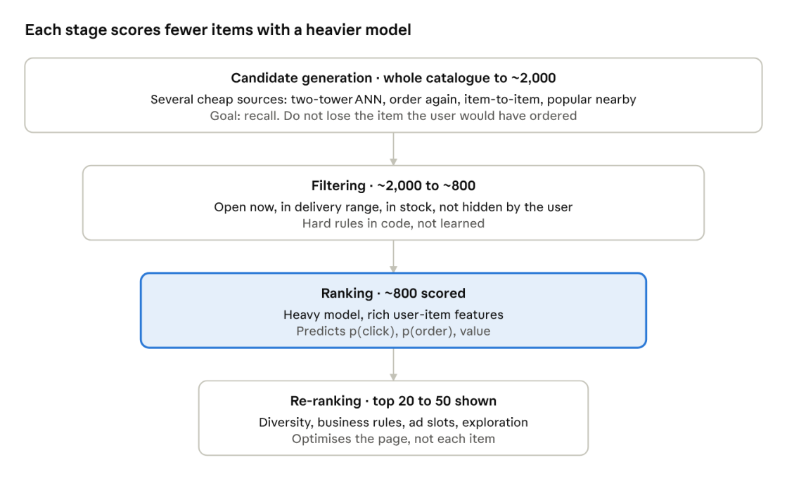
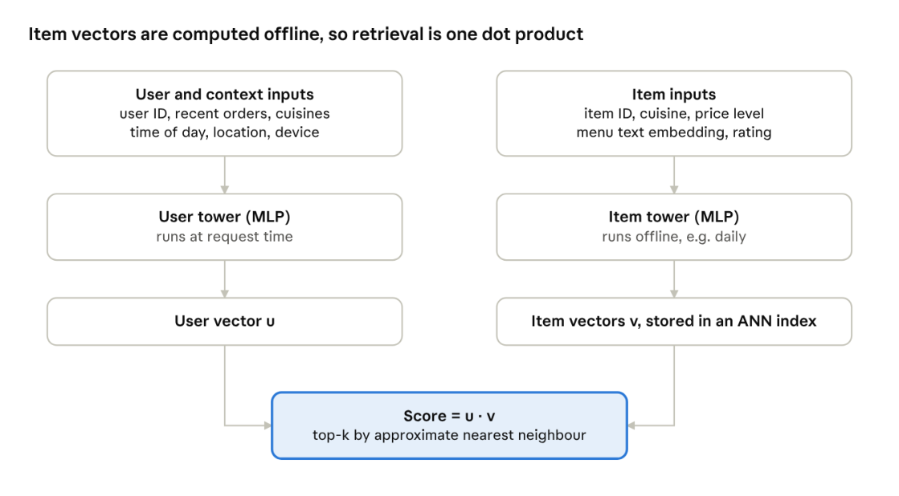

# 43 · Recommender systems

Part XI · Applied ML systems (optional track). Prerequisites: Chapter 40 (classic models, gradient boosting) and Chapters 8 and 29 (embeddings) help, but this chapter stands on its own. Worked designs that build on it: E.1 Restaurant feed and E.6 LLM judge for reco relevance.

## Why it matters

On a food-delivery app, recommendations decide most of what a user sees: the home feed, "order again", dish suggestions, cross-sell at checkout. In a marketplace, one ranking change moves orders, partner revenue and courier load at the same time, so recsys work is judged on business metrics, not only on model metrics.

In interviews for marketplace and consumer-app roles, the ML depth and architecture rounds are very likely to include a recommendation or ranking question. Chapter 46 gives you the answer framework; this chapter gives you the depth an interviewer probes once you are inside the framework. If you already work on recommendations, connect each section as you read to a decision your team has made or should make.

The chapter's running example is a food-delivery marketplace, but every idea maps directly onto the big-tech versions of the problem. A home feed of restaurants is a social or video feed (Meta, TikTok, YouTube); "order again" is "buy it again" in e-commerce; p(order) × basket value is pCTR × bid in an ads auction, where calibration is not optional because the predicted probability sets the price. Big-tech interviewers add three staples this chapter covers explicitly: calibration after negative downsampling (43.5), embedding tables with billions of IDs (43.12), and multi-task conflicts and delayed feedback (43.5, 43.10).

The chapter starts with framing: what a recommender optimises and for whom (43.1). It then builds the classic foundation, collaborative filtering and matrix factorisation (43.2), and the multi-stage architecture that every large system uses (43.3), followed by each stage in turn: two-tower retrieval (43.4), ranking models (43.5) and re-ranking into a page (43.6). Sections 43.7 to 43.9 cover the problems that make recommendation hard in practice: cold start, the feedback loop that exploration breaks, and position bias. The chapter ends with evaluation, including delayed feedback and long-term effects (43.10), where LLMs fit in (43.11), and the embedding tables and continual training that dominate big-tech systems (43.12).

Two ideas recur. Scale forces a funnel: no model can score every item for every user in real time, so cheap models narrow the candidates and expensive ones order them. And the data is shaped by the system itself: users can only click what was shown, so every model trained on logs inherits the biases of the model that produced them.

## Key concepts

- **Collaborative filtering**: recommend what similar users liked, using only the interaction matrix. [Collaborative filtering](https://en.wikipedia.org/wiki/Collaborative_filtering); [Google's recommendation systems course](https://developers.google.com/machine-learning/recommendation) is a gentle introduction.
- **Matrix factorisation**: learn a vector per user and per item whose dot product predicts interest. [Matrix factorisation for recommenders](https://en.wikipedia.org/wiki/Matrix_factorization_(recommender_systems)).
- **Implicit feedback and BPR**: clicks and orders instead of ratings; train so observed items rank above unobserved ones. [BPR paper](https://arxiv.org/abs/1205.2618).
- **Two-stage architecture: candidate generation then ranking**: a cheap retrieval step narrows millions of items to hundreds; a richer model ranks them. [Eugene Yan: System Design for Recommendations and Search](https://eugeneyan.com/writing/system-design-for-discovery/).
- **Two-tower models**: separate user and item encoders, trained with in-batch negatives, served with nearest-neighbour search (Chapter 30).
- **Ranking models with feature crosses**: combining memorisation and generalisation. [Wide & Deep](https://arxiv.org/abs/1606.07792).
- **Cold start**: new users and items with no history; handled with content features, popularity and exploration. [Cold start](https://en.wikipedia.org/wiki/Cold_start_(recommender_systems)).
- **Exploration and bandits**: showing some uncertain items to learn about them. [Multi-armed bandit](https://en.wikipedia.org/wiki/Multi-armed_bandit).
- **Feedback loops, position bias and diversity**: a recommender trains on what it showed; correct for it and protect variety and fairness.
- **Calibration after negative downsampling**: undoing the effect of keeping only a fraction of negatives, p = q/(q + (1 − q)/w).
- **Multi-task learning (MMoE, PLE)**: one model for clicks, orders and value, with gates that limit conflicts between tasks.
- **Embedding tables at scale**: billions of ID vectors, hashed, thresholded, sharded and trained with row-wise optimisers. [TorchRec](https://pytorch.org/torchrec/).

## 43.1 Framing the problem

Before any model, a recommender needs an answer to two questions: what is it trying to maximise, and what in the logs counts as evidence for or against an item? Most failures later in the chapter (clickbait, starved new items, offline gains that vanish online) trace back to a vague answer here.

**What are we optimising?** A recommender is never "show relevant items". It is a choice between short-term signals (click, add to cart, order) and long-term goals (retention, order frequency, basket value, partner health). Write the objective down explicitly, usually as a weighted combination, for example:

$$
\mathrm{score} = p(\mathrm{order})\times\mathbb{E}[\mathrm{basket\ value}] + w\cdot p(\mathrm{click})
$$

Every weight is a product decision you should be able to defend. In ads the same structure is the expected value of an impression, bid × pCTR (plus quality terms); in a feed it is a weighted sum of predicted likes, comments, shares and watch time.

**Explicit vs implicit feedback.**

| Type | Examples | Strengths | Problems |
|---|---|---|---|
| Explicit | Ratings, reviews, thumbs up/down | Clear preference signal | Rare; biased towards extreme opinions; the people who rate are not typical |
| Implicit | Impressions, clicks, orders, reorders, dwell time | Abundant; reflects real behaviour | Noisy; no clear negative; a missing interaction can mean "not seen" or "not available", not "dislike" |

Most production systems run on implicit feedback. The hard question is always **what counts as a negative**:

- *Impressed but not clicked or ordered:* the best negatives for ranking, because the user saw the item and chose something else.
- *Never shown:* "probably not interested" at best. Used as sampled negatives for retrieval, never as true labels.
- *Not available:* a closed restaurant or one outside the delivery range is not a negative at all. Filter these out of training labels.

**The interaction log you need.** One row per impression:

| Field | Example | Why it is needed |
|---|---|---|
| `user_id`, `item_id`, `timestamp` | 123, 9876, 2026-10-01 19:42 | The interaction itself; time-based splits |
| `surface`, `position` | home feed, 4 | Position bias (43.9); per-surface models |
| `event` | impression, click, order | Labels, including the impressed-but-not-chosen negatives |
| `context` | time of day, location, device | Context features; what was feasible at that moment |
| `score`, `propensity` | 0.83, 0.12 | Off-policy evaluation and debugging (43.8, 43.10) |

Without impressions and positions you cannot build negatives, correct for position bias or evaluate a new policy offline. If your team does not log this, that is the first fix.

**What is special about food delivery:**

- The feasible set changes by location and time: what is open and deliverable right now.
- Repeat consumption is high: people reorder from the same places, so "order again" is a very strong baseline and you should not blindly exclude seen items.
- Context matters a lot: lunch vs dinner, weekday vs weekend, weather.
- Two levels of item: restaurants and dishes, each with its own surfaces.

**Code: from raw events to training data with a time-based split.**

```python
import pandas as pd

events = pd.DataFrame({
    "user_id": [1, 1, 2, 2, 3, 3, 3],
    "item_id": [10, 11, 10, 12, 11, 12, 13],
    "event":   ["order", "click", "order", "order", "click", "order", "impression"],
    "ts": pd.to_datetime(["2026-10-01", "2026-10-03", "2026-10-02", "2026-10-09",
                          "2026-10-05", "2026-10-11", "2026-10-12"]),
})

# Stronger signals count more: a confidence weight per event type.
weights = {"impression": 0.0, "click": 1.0, "order": 5.0}
events["w"] = events["event"].map(weights)

# Time-based split: train on the past, evaluate on what happened next.
cutoff = pd.Timestamp("2026-10-08")
train = events[events.ts < cutoff]
test = events[(events.ts >= cutoff) & (events.event == "order")]

interactions = (train.groupby(["user_id", "item_id"], as_index=False)["w"].sum()
                     .query("w > 0"))
```

A random split leaks the future into training (the model sees next week's orders), and offline metrics look far better than they will online. Always split by time.

## 43.2 Collaborative filtering and matrix factorisation

**Intuition.** Users who ordered the same things in the past will like the same things in the future. You need no item content at all, only the user-item interaction matrix.

This is the oldest idea in recommendation and still a production baseline. The question the section answers: how do you turn a huge, mostly empty matrix of who-interacted-with-what into scores for the empty cells, and how do you do it fast enough for millions of users?

**Item-to-item CF.** Compute the similarity between item columns of the interaction matrix (cosine is standard), then score items by how similar they are to what the user already had. It is a strong, cheap, explainable baseline ("because you ordered from X"), and Amazon ran on it for years.

```python
import numpy as np

def item_item_scores(R, user):
    """R: users x items interaction counts. Returns a score per item for one user."""
    X = (R > 0).astype(float)
    norms = np.linalg.norm(X, axis=0) + 1e-9
    S = (X.T @ X) / np.outer(norms, norms)   # cosine similarity between items
    np.fill_diagonal(S, 0.0)
    return X[user] @ S                         # sum of similarities to the user's items
```

**Matrix factorisation (MF).** Approximate the interaction matrix as the product of two thin matrices: each user gets a vector uᵤ and each item a vector vᵢ in k dimensions, and the predicted score is their dot product uᵤ · vᵢ. Similar users end up close together, and so do similar items.

*Explicit ratings:* minimise the error only on observed cells:

$$
\mathcal{L} = \sum_{(u,i)\,\mathrm{observed}}\left(r_{ui} - \mathbf{u}_u\cdot\mathbf{v}_i\right)^2 + \lambda\left(\sum_{u}\Vert\mathbf{u}_u\Vert^2 + \sum_{i}\Vert\mathbf{v}_i\Vert^2\right)
$$

*Implicit feedback (Hu, Koren and Volinsky, 2008):* every cell counts. The preference pᵤᵢ is 1 if the user interacted and 0 otherwise; the confidence cᵤᵢ = 1 + α·rᵤᵢ grows with the number of interactions:

$$
\mathcal{L} = \sum_{u,i} c_{ui}\left(p_{ui} - \mathbf{u}_u\cdot\mathbf{v}_i\right)^2 + \lambda\left(\sum_{u}\Vert\mathbf{u}_u\Vert^2 + \sum_{i}\Vert\mathbf{v}_i\Vert^2\right)
$$

The regulariser sums once over all users and once over all items (writing it inside the data sum, as some texts do, would penalise a popular item's vector once per interaction).

**ALS (alternating least squares)** solves this efficiently: fix the item vectors and each user vector has a closed-form solution; then fix the users and solve each item; repeat. Each step is a small ridge regression, so it parallelises well (Spark ALS). With V the n_items × k matrix of item vectors, Cᵤ the diagonal matrix of user u's confidences and pᵤ their preference vector, the user step is

$$
\mathbf{u}_u = \left(V^{\top}C_uV + \lambda I\right)^{-1}V^{\top}C_u\,\mathbf{p}_u
$$

### The trick that makes implicit ALS fast

Written naively, VᵀCᵤV sums over every item in the catalogue, because with implicit feedback every cell has confidence at least 1. That costs O(k²·n_items) per user: with a million items and k = 64, about 4 × 10⁹ operations for each user, every sweep. Hu, Koren and Volinsky's key observation is that Cᵤ is the identity plus a correction that is non-zero only on the nᵤ items the user interacted with:

$$
V^{\top}C_uV = V^{\top}V + V^{\top}\left(C_u - I\right)V
$$

VᵀV is the same for every user, so compute it once per sweep (O(k²·n_items), shared). The correction term sums only over the user's nᵤ items, at O(k²·nᵤ). The right-hand side VᵀCᵤpᵤ is also sparse, because pᵤ is zero outside those items: it is Σᵢ cᵤᵢvᵢ over the user's items. Adding the k × k solve, each user costs O(k²·nᵤ + k³). For nᵤ = 50 and k = 64 that is about 470,000 operations instead of 4 × 10⁹, roughly 8,800 times fewer. Total cost per sweep becomes linear in the number of interactions, not in users × items, which is what lets ALS run on billions of interactions. `code/ch43_check.py` checks that the sparse update gives the same vectors as the dense one.

```python
def implicit_als(R, k=16, alpha=20.0, reg=0.1, iters=10, seed=0):
    """Dense version for learning; use the `implicit` library on sparse data in practice."""
    rng = np.random.default_rng(seed)
    n_users, n_items = R.shape
    U = rng.normal(scale=0.1, size=(n_users, k))
    V = rng.normal(scale=0.1, size=(n_items, k))
    P = (R > 0).astype(float)          # preference
    C = 1.0 + alpha * R                # confidence
    I = reg * np.eye(k)
    for _ in range(iters):
        for u in range(n_users):       # fix V, solve each user
            A = (V.T * C[u]) @ V + I
            b = (V.T * C[u]) @ P[u]
            U[u] = np.linalg.solve(A, b)  # dense O(k² n_items) per user: see implicit_als_user_step below
        for i in range(n_items):       # fix U, solve each item
            A = (U.T * C[:, i]) @ U + I
            b = (U.T * C[:, i]) @ P[:, i]
            V[i] = np.linalg.solve(A, b)
    return U, V

def implicit_als_user_step(V, VtV, items, conf, reg):
    """The fast user update: only the user's items enter, plus the shared VᵀV.
    items: indices the user interacted with; conf: their confidences c_ui = 1 + alpha * r_ui."""
    Vu = V[items]                                     # (n_u, k)
    A = VtV + (Vu.T * (conf - 1.0)) @ Vu + reg * np.eye(V.shape[1])
    b = Vu.T @ conf                                   # p_ui = 1 on these items, 0 elsewhere
    return np.linalg.solve(A, b)

def recommend(U, V, R, user, n=5, exclude_seen=True):
    scores = U[user] @ V.T
    if exclude_seen:                   # True for discovery surfaces, False for "order again"
        scores[R[user] > 0] = -np.inf
    return np.argsort(-scores)[:n]
```

**BPR (Bayesian personalised ranking, Rendle et al., 2009).** Instead of predicting 0/1, optimise the ranking directly: for a user, an item they interacted with should score higher than one they did not. Sample triples (user u, positive item p, negative item n) and maximise

$$
\sum_{(u,p,n)}\ln\sigma\left(x_{up} - x_{un}\right) - \lambda\Vert\Theta\Vert^2
$$

where x_{ui} = uᵤ · vᵢ is the model's score, σ the sigmoid and Θ all the parameters. Each term is the log-probability that the user prefers the positive to the negative, so BPR maximises the AUC of each user's ranking in a smooth way. This pairwise idea comes back in learning to rank (Chapter 44).

**When not to use ALS or plain MF:** rich content or context matters more than co-occurrence (the same user wants different things at 9 am and 9 pm), the catalogue turns over fast so most items are cold, or you need to score new users in real time without a fold-in step.

**Why MF is not enough on its own:**

- No features: a new user or item has no vector (cold start).
- No context: the same recommendations at 9 am and 9 pm.
- Transductive: new users need retraining or a fold-in step.

Two-tower models (43.4) keep the dot-product idea and fix all three by computing the vectors from features. MF and item-to-item CF remain excellent candidate sources and baselines.

## 43.3 The multi-stage architecture

**Why stages?** A city's catalogue has tens of thousands of restaurants and hundreds of thousands of dishes. A heavy ranking model with hundreds of features cannot score all of them within a 100–200 ms page budget. So production systems use a funnel: cheap models over many items first, expensive models over few items last.



*multi-stage recommender · 4 stages, illustrative sizes*

The sizes are illustrative; what matters is that each stage cuts the set by an order of magnitude while the model per item gets heavier.

| Stage | Job | Typical models | Metric to watch |
|---|---|---|---|
| Candidate generation | Find everything plausibly relevant | Two-tower + ANN, item- to-item CF, MF, "order again", popular in the area, new restaurants | Recall@k of items later ordered |
| Filtering | Remove what cannot or must not be shown | Rules: availability, delivery range, stock, user blocks, legal | Share of shown items that were unavailable (should be ~0) |
| Ranking | Order the candidates by predicted value | GBDT, DLRM/DCN, multi-task deep nets | NDCG@k, AUC/logloss per task, calibration |
| Re-ranking | Build the best page, not the best list | MMR/diversity, business rules, ad insertion, exploration | Diversity, coverage, page-level conversion |

**Design points interviewers probe:**

- **Several retrieval sources.** One source rarely has full recall. Run several in parallel, merge, deduplicate, and pass the source as a feature to the ranker so it learns how much to trust each.
- **Filtering early in food delivery.** Availability and delivery range are hard constraints, so they often move *into* retrieval: an ANN index per city or delivery zone, or filtered ANN search. Otherwise you retrieve 2,000 candidates and find that 1,800 are closed.
- **Latency budget.** A typical split: retrieval 20–30 ms, feature fetching 20–40 ms, ranking 30–50 ms, re-ranking under 10 ms. Feature fetching is often the bottleneck, not the model.
- **Each stage is trained on different data.** Retrieval learns from all interactions with sampled negatives; ranking learns from impressions (what the previous system showed). That second fact creates feedback loops (43.8, 43.9).

## 43.4 Two-tower retrieval

**Intuition.** Keep MF's idea (score = dot product of a user vector and an item vector) but compute each vector with a neural network from features. The user tower sees the user, their history and the context; the item tower sees only the item. Because the item vector does not depend on the user, you compute all item vectors in advance and put them in an approximate nearest neighbour (ANN) index. At request time you run the user tower once and fetch the top few hundred items by dot product in milliseconds.



*two-tower retrieval · online user side, offline item side*

**Training with in-batch negatives.** Each training example is a positive pair (user, item they ordered). In a batch of B pairs, treat every other item in the batch as a negative for each user. That gives a B × B score matrix where the diagonal holds the positives, and you train with softmax cross-entropy over each row. It is cheap (no extra item computations) and works very well.

**The popularity problem and the logQ correction.** Items appear in batches in proportion to their popularity, so popular items are used as negatives far more often and the model learns to push them down too much. The fix (Yi et al., 2019, Google) is to subtract the log of each item's sampling probability from its logit before the softmax:

$$
s^{c}_{ui} = s_{ui} - \log q_i
$$

where s_{ui} is the user–item logit and qᵢ the probability that item i appears in a batch (its share of training pairs). **Why this is the right correction.** The full softmax over all N items has denominator Σⱼ exp(s_{uj}). A batch gives only a sample of items, drawn with probability qⱼ each. Importance sampling estimates a sum over all items from a sample by dividing each sampled term by its sampling probability: Σⱼ exp(s_{uj}) ≈ (1/m) Σ_{j in sample} exp(s_{uj})/qⱼ = (1/m) Σ_{j in sample} exp(s_{uj} − log qⱼ). So subtracting log qⱼ from each sampled logit makes the sampled softmax a (consistent) estimate of the full one; without it, a popular item with qⱼ a hundred times the average is over-counted a hundredfold in the denominator and its score is pushed down. Mixing in some uniformly sampled random items as extra negatives also helps the long tail, because in-batch sampling almost never shows the model a tail item as a negative.

**The temperature.** The code divides cosine similarities (between −1 and 1) by a temperature τ = 0.05, so logits span −20 to 20. The temperature controls how the gradient is shared among negatives: each negative's weight in the gradient is its softmax probability. With similarities 0.9, 0.7, 0.5 and 0.3 for four negatives, τ = 1 spreads the weight almost evenly (0.33, 0.27, 0.22, 0.18), τ = 0.2 gives 0.64 to the hardest, and τ = 0.05 gives it 0.98. A low temperature therefore acts as built-in hard-negative mining and spreads embeddings more uniformly over the sphere; too low, and the model fixates on the hardest negatives, which are often false negatives (the same item under another ID, a near-duplicate, a restaurant the user would also have liked). τ is usually tuned in the 0.02–0.2 range or learned.

**Hard negatives.** Items the user saw but did not order, or near-misses (same cuisine, same area), teach finer distinctions. Add a small share of them; too many make training unstable and hurt recall.

**Code: a two-tower model in PyTorch.**

```python
import torch
import torch.nn as nn
import torch.nn.functional as F

class Tower(nn.Module):
    def __init__(self, n_ids, n_feats, dim=64):
        super().__init__()
        self.id_emb = nn.Embedding(n_ids, dim)
        self.mlp = nn.Sequential(nn.Linear(dim + n_feats, 128), nn.ReLU(), nn.Linear(128, dim))

    def forward(self, ids, feats):
        x = torch.cat([self.id_emb(ids), feats], dim=-1)
        return F.normalize(self.mlp(x), dim=-1)      # unit vectors: dot product = cosine

class TwoTower(nn.Module):
    def __init__(self, n_users, n_items, n_user_feats, n_item_feats, dim=64, temperature=0.05):
        super().__init__()
        self.user_tower = Tower(n_users, n_user_feats, dim)
        self.item_tower = Tower(n_items, n_item_feats, dim)
        self.temperature = temperature

    def loss(self, user_ids, user_feats, item_ids, item_feats, item_log_q=None):
        u = self.user_tower(user_ids, user_feats)      # (B, d)
        v = self.item_tower(item_ids, item_feats)      # (B, d)
        logits = u @ v.T / self.temperature            # row i: user i against every item in the batch
        if item_log_q is not None:                     # logQ correction for popularity
            logits = logits - item_log_q.unsqueeze(0)
        # The same item twice in a batch is not a negative for itself
        same_item = item_ids.unsqueeze(0) == item_ids.unsqueeze(1)
        same_item.fill_diagonal_(False)
        logits = logits.masked_fill(same_item, float("-inf"))
        labels = torch.arange(len(user_ids))           # positives sit on the diagonal
        return F.cross_entropy(logits, labels)
```

Training and retrieval:

```python
# item_log_q: log of each item's share of training pairs, computed once
counts = torch.bincount(train_item_ids, minlength=n_items).float() + 1
item_log_q = torch.log(counts / counts.sum())

model = TwoTower(n_users, n_items, n_user_feats, n_item_feats)
opt = torch.optim.Adam(model.parameters(), lr=1e-3)
for u_ids, i_ids in batches:                           # positive (user, item) pairs
    loss = model.loss(u_ids, user_feat_table[u_ids], i_ids, item_feat_table[i_ids], item_log_q[i_ids])
    opt.zero_grad(); loss.backward(); opt.step()

model.eval()
with torch.no_grad():
    all_items = model.item_tower(torch.arange(n_items), item_feat_table)   # offline, then indexed
    u = model.user_tower(user_id, user_feat_table[user_id])               # online, per request
    top = torch.topk(u @ all_items.T, k=200).indices                     # exact; ANN at scale
```

**Serving.** Item vectors are recomputed on a schedule and loaded into an ANN index: FAISS, ScaNN, or HNSW inside a vector database. ANN trades a little recall for a lot of speed, so measure ANN recall against exact search on a sample. For food delivery, partition the index by city or delivery zone, or use filtered search, so you do not retrieve restaurants that cannot deliver.

**Limits.** The two towers only meet at the final dot product, so the model cannot learn user-item cross features ("this user has ordered from this exact restaurant 5 times", "distance from this user to this restaurant"). That is why two-tower is a retrieval model and the ranker exists. The same structure appears as the bi-encoder in RAG retrieval (Chapter 30).

## 43.5 Ranking models

**What the ranker adds.** It scores a few hundred candidates, so it can afford rich features, and above all **user-item cross features**: how often this user ordered from this restaurant, distance and ETA from this user, the price compared with what this user usually spends, cuisine affinity, time since the last order there. These are usually the most predictive features in food delivery.

**Labels.** One row per impression. Typical targets: p(click | impression), p(order | impression), sometimes basket value or rating. With several targets, train a **multi-task** model and combine the heads at serving:

$$
\mathrm{score} = p(\mathrm{click})\times p(\mathrm{order}\mid\mathrm{click})\times\mathbb{E}[\mathrm{value}]
$$

Learning p(order | click) only on clicked rows causes sample selection bias; ESMM (Alibaba, 2018) fixes it by training p(click) and p(click and order) on all impressions and getting p(order | click) as their ratio. Multiplying heads only works if each one is calibrated, which leads to a problem every large system has.

| Model | Key idea | When to use |
|---|---|---|
| GBDT (LightGBM, XGBoost) | Trees on hand-built tabular features; binary loss or LambdaMART | First production ranker; strong with tabular features; easy to debug |
| Wide & Deep (Google, 2016) | Linear model on crosses (memorisation) plus an MLP on embeddings (generalisation) | Historical baseline; explains the memorisation vs generalisation idea |
| DLRM (Meta, 2019) | Embeddings for categoricals, MLP for dense features, dot products between all pairs of embeddings | Large sparse ID features at scale |
| DCN-v2 (Google, 2021) | Cross layers learn explicit feature crosses of bounded degree | When feature crosses matter and you want them learned |
| DIN (Alibaba, 2018) | Attention over the user's history, weighted by relevance to the candidate | Long, varied histories; "which past orders matter for this item?" |
| SASRec (2018), BERT4Rec (2019) | Transformer over the user's item sequence, predicting the next item | Sequential behaviour; also used as a retrieval source |
| MMoE (Google, 2018) | Several expert networks shared by task-specific gates | Multi-task with conflicting objectives |
| PLE (Tencent, 2020) | Shared and task-specific experts, in levels | Multi-task where MMoE still shows the seesaw |

### Calibration after negative downsampling

Click and conversion data are extremely imbalanced (CTRs of 1% or less), so large systems keep all positives and only a fraction w of negatives, for example w = 0.1, to cut training cost. A model trained on the sampled data is calibrated for the sampled data, not for reality: it over-predicts by roughly a factor 1/w at low rates. If the true probability is p, the sampled data has p positives for every w(1 − p) negatives, so the model learns q = p/(p + w(1 − p)). Solving for p:

$$
p = \dfrac{q}{q + (1-q)/w}
$$

Equivalently, the log-odds shift by log w: logit(p) = logit(q) + log w. **Worked example:** a true CTR of 1% with w = 0.1 gives q = 0.01/(0.01 + 0.1 × 0.99) = 0.092; applying the formula to 0.092 recovers 0.010. Without the correction, an ads auction that charges by bid × pCTR would overestimate every expected value about ninefold, and a ranker that multiplies p(click) by p(order | click) would mix heads trained at different sampling rates. After correcting, still check calibration on unsampled recent traffic (reliability diagrams and the ratio of predicted to observed rate per segment), because drift and feature changes break it again; many systems add a small calibration layer (isotonic or Platt, per surface) trained on fresh data.

### Multi-task conflicts: shared bottoms, MMoE and PLE

Training one network for clicks, orders, likes and watch time saves compute and lets sparse tasks borrow from dense ones. It also creates **negative transfer**: tasks whose gradients disagree pull the shared layers in different directions, and improving one task makes another worse (the "seesaw" effect reported for production multi-task rankers). A click-optimised representation favours eye-catching items; an order-optimised one favours items people actually buy. The standard architectures differ in how much they share. A **shared-bottom** model shares every layer below the task heads, which works when the tasks are closely related and fails worst when they are not. **MMoE** (Ma et al., Google, 2018) replaces the shared bottom with several expert networks and gives each task its own softmax gate over the experts, so each task chooses its own mixture and conflicting tasks can use different experts. **PLE** (Tang et al., Tencent, 2020) adds task-specific experts alongside the shared ones, in several levels, which reduces the seesaw further when tasks conflict strongly. Practical additions: weight the task losses (by uncertainty, or by tuning against the business metric), and monitor every task's metric when changing one, because the seesaw shows up as a gain on the target task and a quiet loss elsewhere.

### Feature crosses and the DCN-v2 layer

**A DCN-v2 cross layer in PyTorch.** Each layer computes

$$
\mathbf{x}_{l+1} = \mathbf{x}_0\odot\left(W\mathbf{x}_l + \mathbf{b}\right) + \mathbf{x}_l
$$

where x₀ is the input embedding vector, xₗ the output of layer l, ⊙ elementwise multiplication and W, b the layer's weights. Each layer multiplies by the input once more, so stacking L layers gives feature interactions up to degree L+1.

```python
class CrossLayer(nn.Module):
    def __init__(self, d):
        super().__init__()
        self.lin = nn.Linear(d, d)

    def forward(self, x0, x):
        return x0 * self.lin(x) + x          # explicit cross with the input, plus residual

class DCNRanker(nn.Module):
    """Cross network and deep network in parallel, one logit per task (e.g. click, order)."""
    def __init__(self, d_in, n_cross=3, n_tasks=2):
        super().__init__()
        self.cross = nn.ModuleList([CrossLayer(d_in) for _ in range(n_cross)])
        self.deep = nn.Sequential(nn.Linear(d_in, 128), nn.ReLU(), nn.Linear(128, 64), nn.ReLU())
        self.heads = nn.Linear(d_in + 64, n_tasks)

    def forward(self, x0):
        x = x0
        for layer in self.cross:
            x = layer(x0, x)
        return self.heads(torch.cat([x, self.deep(x0)], dim=-1))   # train with BCE-with-logits per task
```

**A LambdaMART ranker with LightGBM.** Rows are (request, candidate) pairs; `group` says how many rows belong to each request, in order.

```python
import lightgbm as lgb

# y: 0 = impressed only, 1 = clicked, 2 = ordered (graded relevance)
ranker = lgb.LGBMRanker(objective="lambdarank", n_estimators=300, learning_rate=0.05)
ranker.fit(X_train, y_train, group=group_train,
           eval_set=[(X_val, y_val)], eval_group=[group_val], eval_at=[10])
# Recent LightGBM versions prefer eval_X / eval_y over eval_set; check the docs.
```

**How to choose in an interview.** Start with GBDT: fast to ship, a strong baseline, easy feature importance. Move to a deep model when you have very large data, many sparse ID features or sequences, or need multi-task learning in one model. Say that the gain from good features usually beats the gain from a fancier architecture.

## 43.6 Re-ranking: building the page

The ranker scores each item on its own, but the user sees a page. Sorting by score alone gives ten pizza places in a row, the same chain three times, and no room for new restaurants or sponsored slots. Re-ranking turns a sorted list into a good page.

**Diversity with MMR (maximal marginal relevance).** Build the list greedily: at each step pick the item with the best balance of relevance and difference from what is already chosen:

$$
i^{*} = \arg\max_{i \notin S}\left[\lambda\,\mathrm{rel}(i) - (1-\lambda)\max_{j \in S}\mathrm{sim}(i, j)\right]
$$

where S is the set already chosen, rel(i) the ranker's score scaled to [0, 1], sim the cosine similarity of item embeddings, and λ the trade-off: λ = 1 is pure relevance, lower values buy diversity. **Worked example:** two pizza places with scores 0.9 and 0.85 and similarity 0.95, and a sushi place with score 0.7 and similarity 0.1 to the first pizza. With λ = 0.7, the first pick is the top pizza (no redundancy yet). For the second, the other pizza is worth 0.7 × 0.85 − 0.3 × 0.95 = 0.31 and the sushi 0.7 × 0.7 − 0.3 × 0.1 = 0.46, so sushi comes second.

```python
import numpy as np

def mmr(scores, emb, k=10, lam=0.7):
    """scores: ranker scores scaled to [0, 1]; emb: item embeddings (e.g. cuisine or content)."""
    emb = emb / np.linalg.norm(emb, axis=1, keepdims=True)
    chosen, candidates = [], list(range(len(scores)))
    while candidates and len(chosen) < k:
        def value(i):
            redundancy = max((emb[i] @ emb[j] for j in chosen), default=0.0)
            return lam * scores[i] - (1 - lam) * redundancy
        best = max(candidates, key=value)
        chosen.append(best)
        candidates.remove(best)
    return chosen
```

Scale the scores to the same range as the similarity, or λ loses its meaning. Determinantal point processes (DPPs) are a more principled alternative used at YouTube: they score a whole set by the determinant of a kernel matrix built from quality and similarity, which is large only when the items are both good and mutually different. MMR is what you code in an interview.

**Business rules usually applied here:** a cap per cuisine or per chain in the top N; guaranteed exposure for new restaurants (exploration, 43.8); sponsored items in fixed slots; exposure fairness across partners; pushing down restaurants with long ETAs or high cancellation rates. Keep them few, written down, and each one tested in an A/B test. A pile of undocumented rules is where ranking quality quietly dies.

## 43.7 Cold start

There are three kinds, and each has its own fixes.

| Case | Problem | Fixes |
|---|---|---|
| New user | No history | Popular in the area at this time of day; context features (location, time, device, app entry point); onboarding choices (favourite cuisines); session-based models that use clicks from the current session; update quickly after the first order |
| New item (restaurant or dish) | No interactions, so ID embeddings are untrained | Content features in the item tower (cuisine, price, menu text and photo embeddings) so it gets a useful vector on day one; guaranteed exploration impressions; borrow from similar existing restaurants |
| New city or market | Little data overall | One global model with city features; transfer from similar cities; heavier weight on content and popularity until data arrives |

**ID dropout.** If the model always sees an item ID embedding during training, it relies on it and does badly when the ID is new. Randomly replace item IDs with an "unknown" token for a share of training examples so the model also learns to score from content alone.

**Where LLMs help.** Generating clean tags, cuisine and dietary labels, or a normalised dish taxonomy from raw menus gives new items good content features immediately. This is the value of a well-structured food taxonomy: it is cold-start infrastructure as much as a catalogue clean-up.

## 43.8 Exploration and bandits

**The feedback loop.** The ranker learns from impressions, and impressions come from the ranker. Items it never shows never get data, so it never learns they are good. Popular items get more popular, and new restaurants starve. Exploration means deliberately showing some items whose value is uncertain, paying a small short-term cost to learn.

**Multi-armed bandits** formalise this. Each option is an "arm" with an unknown reward rate.

- **ε-greedy:** show the best-known arm, except with probability ε show a random one. Simple, but explores blindly.
- **UCB (upper confidence bound):** pick the arm with the highest optimistic estimate, mean plus an uncertainty bonus that shrinks with data.
- **Thompson sampling:** keep a posterior over each arm's reward rate, draw one sample from each, pick the highest. Uncertain arms sometimes draw high and get tried; arms that are clearly worse stop being tried. It works well in practice and is easy to explain.
- **Contextual bandits** (LinUCB, neural Thompson sampling) make the reward depend on features of the user and the item, which is what a recommender really needs. LinUCB fits a ridge regression per arm and scores arm a for context x as θₐ·x + α√(xᵀAₐ⁻¹x), where Aₐ = λI + Σ xxᵀ over the times a was shown: the first term is the predicted reward, the second its uncertainty in the direction of this context, which shrinks as similar contexts accumulate.

**Code: Beta-Bernoulli Thompson sampling,** for example to choose which of three home-screen banners to show.

```python
import numpy as np

rng = np.random.default_rng(0)
true_ctr = np.array([0.04, 0.05, 0.07])    # unknown in real life
alpha, beta = np.ones(3), np.ones(3)       # Beta(1, 1) prior for each arm

for t in range(20_000):
    arm = int(np.argmax(rng.beta(alpha, beta)))   # one plausible CTR per arm, pick the best
    click = rng.random() < true_ctr[arm]
    alpha[arm] += click                            # successes
    beta[arm] += 1 - click                         # failures

print((alpha + beta - 2).astype(int))   # pulls per arm, e.g. [232 1432 18336]: most go to the best arm
```


*Cumulative regret, the clicks lost against always showing the best banner, averaged over 60 simulated runs with the three CTRs above. ε-greedy keeps spending 10% of traffic at random forever, so its regret grows linearly; Thompson sampling's exploration fades as the posteriors separate.*

After 20,000 impressions, ε-greedy has lost about 60 clicks and Thompson sampling about 35, and the gap keeps widening. The difference matters most when many items compete and the differences between them are small, which is the normal case in recommendation. Decaying ε over time narrows the gap but adds a schedule to tune; Thompson sampling gets the decay for free from the data.

**In a production recommender** you rarely run a pure bandit over everything. Common patterns: reserve one or two slots per page for exploration; add an uncertainty bonus to new items' ranking scores for their first N impressions; use a bandit for small decisions (which carousel, which banner, which promotion). Whatever you do, **log the probability with which each item was shown** (the propensity). That log is what makes unbiased offline evaluation possible later (43.10). Measure exploration's cost as the drop in short-term conversion in the exploration slots, and its benefit as catalogue coverage and new-restaurant success.

## 43.9 Position bias and inverse propensity scoring

**The problem.** Items at the top get more clicks because they are at the top, not only because they are better. A model trained naively on click logs learns "was shown high" as a sign of relevance, ranks those items high again, and the loop reinforces itself.

**The examination hypothesis.** A click needs two things: the user looked at the position, and the item was relevant:

$$
P(\mathrm{click}\mid i, k) = \theta_k\cdot r_i
$$

where θₖ = P(examined | position k) is the examination probability, or propensity, which falls with position, and rᵢ = P(relevant | item i). Under this model a click at position k is evidence of relevance, but a missing click at a low position is weak evidence of irrelevance, because the user may never have looked.

**Fix 1: position as a training feature, removed at serving.** Train with the position as an input (often in a small separate "shallow tower" whose output is added to the main logit, as YouTube described in 2019), then at serving set the position to a fixed value or drop the bias tower. The main model is left to explain relevance.

**Fix 2: inverse propensity scoring (IPS).** Weight each click by 1/θₖ, so a click at position 5 counts more than one at position 1. Which loss the weight goes into matters. Joachims et al. (2017) showed that a **rank-based loss summed over clicked items only** (for example the rank of each clicked item, or a pairwise loss between each clicked item and the others in the list), weighted by 1/θₖ, is an unbiased estimate of the same loss over truly relevant items. Because E[cᵢ/θₖ] = rᵢ, every relevant item counts once in expectation, wherever it was shown.

**The pointwise trap.** It is tempting to plug the same weights into a pointwise click model: weight clicked rows by 1/θₖ, unclicked rows by 1, and train binary cross-entropy. That is biased. The positive term is right in expectation, but every unclicked row is still treated as a full negative, including the many low-position items that were never examined. For one item with relevance r shown at a position with θ = 1/3, the weighted loss is minimised at r/(r + 1 − θr): with r = 0.5 that is 0.375, not 0.5 (the unweighted model gives θr = 0.17). The fix for pointwise models (Saito et al., 2020) replaces the label itself by its unbiased estimate c/θ in both terms of the cross-entropy:

$$
\mathcal{L} = -\sum_{i}\left[\dfrac{c_i}{\theta_{k_i}}\log s_i + \left(1 - \dfrac{c_i}{\theta_{k_i}}\right)\log\left(1 - s_i\right)\right]
$$

where cᵢ is the click, θ_{kᵢ} the propensity of the position the row was shown at, and sᵢ the predicted relevance. Since E[cᵢ/θ] = rᵢ, the expected loss equals the cross-entropy against the true relevance. A clicked row at a low position gets a *negative* weight on its log(1 − s) term, which most libraries' `sample_weight` cannot express and which makes the loss unbounded below, so implementations write the loss directly and clip it (or the weights). In a simulation with five positions (`code/ch43_check.py`, 20 seeds), the unweighted click model underestimates relevance by 0.137 on average, the weighted-clicks-only version by 0.047, and the unbiased estimator by 0.0005.

```python
import torch
import torch.nn.functional as F

# P(examined | position), estimated from a small randomisation experiment
examine_prob = torch.tensor([1.0, 0.7, 0.5, 0.4, 0.33])

def unbiased_pointwise_loss(logits, clicked, position, clip=10.0):
    """Saito et al. (2020): the label c is replaced by c / theta in both cross-entropy terms."""
    w = (clicked / examine_prob[position]).clamp(max=clip)   # unbiased estimate of relevance
    pos = -F.logsigmoid(logits)                 # -log s
    neg = -F.logsigmoid(-logits)                # -log(1 - s)
    loss = w * pos + (1 - w) * neg              # (1 - w) < 0 for clicks at low positions
    return loss.mean()
```

In practice many teams avoid the negative weights altogether with Fix 1, the bias tower, which learns θₖ and relevance jointly from the clicks; IPS is cleanest for pairwise and listwise rankers such as LambdaMART, where Chapter 44 picks it up.
**Estimating the propensities.** Run a small experiment that randomly swaps items between positions (for example positions k and k+1) and compare click rates of the same items in different positions. Alternatives exploit natural variation in where items appeared across ranker versions (intervention harvesting), or fit propensities and relevance jointly with EM.

**Practical cautions.** Large weights from low propensities blow up variance, so clip them; clipping trades a little bias back for much less variance. On mobile grids and carousels, position is two-dimensional (row and column) and a horizontally scrolled carousel has a very steep drop. And remember a second bias: items never shown have no label at all, which no position correction fixes; only exploration does.

## 43.10 Evaluation

**Offline metrics by stage.**

| Stage | Metrics | What they tell you |
|---|---|---|
| Retrieval | Recall@k, HitRate@k | Did the item the user later ordered make it into the candidate set? |
| Ranking | NDCG@k, MRR, MAP; AUC, GAUC (AUC per user, averaged), logloss and calibration per task | Is the order right, and are the probabilities usable when heads are multiplied together? |
| Whole page | Coverage, intra-list diversity, novelty, share of exposure going to the top 1% of items | Is the system healthy beyond accuracy? |

```python
import numpy as np

def recall_at_k(recommended, relevant, k):
    return len(set(recommended[:k]) & set(relevant)) / max(len(relevant), 1)

def ndcg_at_k(recommended, relevant, k):
    rel = set(relevant)
    dcg = sum(1 / np.log2(i + 2) for i, item in enumerate(recommended[:k]) if item in rel)
    idcg = sum(1 / np.log2(i + 2) for i in range(min(len(rel), k)))
    return dcg / idcg if idcg else 0.0

recall_at_k([5, 3, 9, 1], relevant=[3, 7], k=3)   # 0.5
ndcg_at_k([5, 3, 9, 1], relevant=[3, 7], k=3)     # ~0.39
```

**Protocol that holds up.**

- Split by time: train up to day T, evaluate on orders after T.
- Score the candidates production would have had: only items that were open and deliverable for that user at that moment.
- Do not evaluate on "the true item plus 100 random negatives". Krichene and Rendle (2020) showed these sampled metrics can reverse the ranking of models. Use the full candidate set, or at least the realistic one.
- Report metrics per segment: new vs returning users, big vs small cities, repeat vs discovery orders.

**Offline replay (off-policy evaluation).** Logs only tell you what happened for the items the old policy showed. To estimate how a new policy would have done, reweight logged rewards by how much more or less likely the new policy is to take the same action:

$$
\hat V(\mathrm{new}) = \dfrac{1}{n}\sum_{i=1}^{n} r_i\,\dfrac{\pi_{\mathrm{new}}(a_i\mid x_i)}{\pi_{\mathrm{log}}(a_i\mid x_i)}
$$

```python
def ips_value(rewards, p_new, p_logged, clip=10.0):
    """Estimated reward of a new policy from logs; clipping trades a little bias for less variance."""
    w = np.minimum(p_new / p_logged, clip)
    return np.mean(w * rewards)
```

Its limits are why most teams still rely on A/B tests: it needs logged propensities; if the old policy was deterministic, actions it never took have zero probability and cannot be evaluated; for whole slates the probabilities become tiny and the variance huge. Doubly robust estimators (a reward model plus an IPS correction) reduce variance. Use replay to choose which candidates deserve an A/B test, not to replace it.

**Online.**

- **A/B tests** on business metrics: orders per user, conversion, GMV, retention, with guardrails on delivery time, cancellations and partner concentration. Watch for novelty effects in the first week.
- **Interleaving** for comparing two rankers: mix both rankings into one list per user and count which ranker's items get clicked or ordered. It needs far less traffic than an A/B test to detect a winner.
- **Marketplace interference:** if the recommender shifts demand towards some restaurants, it affects their prep times and courier supply for everyone, including the control group. For supply-side effects, use switchback or geo-level experiments (Chapter 2 and Chapter 46).

**The classic trap:** offline NDCG up, A/B flat or down. The usual causes are a metric that does not match the business goal, an offline candidate set different from production, leakage in features, or position bias in the test labels.

### Delayed feedback

Clicks arrive within seconds; orders, conversions, purchases after a delivery and retention arrive hours or days later. A model trained on yesterday's impressions labels every conversion that has not happened *yet* as a negative, so it under-predicts conversion, most of all for items whose conversions are slow (expensive purchases, pre-orders). Three standard responses: wait (train only on impressions older than the attribution window, which costs freshness); correct (model the delay explicitly, as Chapelle (2014) did for display ads, so a not-yet-converted impression counts as a partial negative depending on how long it has been observed); or use an early proxy (add to cart, checkout started) as an auxiliary task and correct later when the true label arrives. The same delay affects A/B tests: read conversion metrics only after the attribution window has closed for every exposed user.

### Long-term effects: are you trading retention for clicks?

A senior interviewer will ask how you know a ranking change that lifts clicks this week is not hurting retention over months. A two-week A/B test cannot see a slow erosion of trust in the feed. Three tools help:

- **Long-running holdbacks.** Keep a small share of users (1–5%) on the old system, or with no personalisation at all, for months; compare retention and order frequency against everyone else. A holdback measures the cumulative effect of many launches that each looked positive.
- **Surrogate metrics.** Find short-term metrics that predict long-term outcomes, validated on past experiments (for example, orders from restaurants the user had not tried, or the share of sessions ending in an order), and use them as guardrails alongside clicks.
- **Guardrails on the bad kinds of engagement.** Cancellations, refunds, complaints, "not interested" taps, and in feeds, hides and unfollows. A change that raises clicks and these at once is clickbait.

Watch for **learning effects**: users adapt to a new feed over weeks, so effects measured in the first days (novelty or initial confusion) often fade or reverse; plot the treatment effect by day of exposure, not just its average.

## 43.11 LLMs in recommendation

At scale, classic retrieval and ranking models still do the heavy lifting because of latency and cost. LLMs enter in five places, roughly in order of how common they are today.

1. **Content understanding and features.** Use an LLM or an embedding model to turn messy menus, descriptions and reviews into structured attributes (cuisine, dietary labels, dish type, taxonomy nodes) and into text embeddings for the item tower. This mostly helps cold start and long-tail items, and it is the cheapest win: run it offline in batch.
2. **LLM as relevance judge.** Ask an LLM to rate whether a recommended item fits a user's history and context, then use those labels for offline evaluation at a scale humans cannot reach. Calibrate the judge against human labels first (agreement measured with Cohen's kappa) and check it for bias. Worked design E.6 covers this end to end, and Chapter 24 covers judges in general.
3. **Semantic IDs and generative retrieval.** TIGER (Rajput et al., 2023) quantises each item's content embedding into a short tuple of codes with an RQ-VAE, so similar items share prefixes. A sequence-to-sequence transformer then generates the semantic ID of the next item from the user's history. Because IDs come from content, new items get meaningful IDs immediately.
4. **Generative recommenders.** Meta's HSTU work (Zhai et al., 2024) treats user actions as a sequence and trains very large transformer-style models on them, reporting gains over classic deep ranking models in production and a scaling law: quality kept improving as compute grew over several orders of magnitude, which classic DLRM-style rankers had not shown. Since then the direction has gone further. Kuaishou's OneRec (2025) reports replacing the cascade of retrieval and ranking stages with a single generative model that outputs semantic IDs, served in production, and fine-tuned with preference optimisation against a reward model. Semantic IDs have also moved into production ranking as a replacement or complement for random item IDs, because they let new and rare items share parameters with similar ones (Singh et al., 2024, at YouTube). Treat these as the research frontier: the funnel of 43.3 still runs most systems, and the open questions are serving cost per request and whether the gains hold outside the largest platforms.
5. **Conversational and explanation surfaces.** "Something healthy under €15 that arrives in 30 minutes": the LLM parses intent into filters and a query, classic retrieval finds candidates, and the LLM re-ranks a short list or explains the picks. Keep the LLM on small candidate sets, cache results, and distil into smaller models when traffic grows.

**How to talk about it in an interview.** Show judgement about where an LLM earns its cost: offline enrichment and evaluation first, online LLM calls only on small candidate sets and where the user is already expressing intent in language. Mention that every LLM-generated feature needs its own quality check and that judges need calibration.

## 43.12 Embedding tables at scale and continual training

Most of the parameters of an industrial recommender are not in its neural layers but in its embedding tables: one learned vector for every user ID, item ID, advertiser, query token and other categorical value. At big-tech scale these tables have billions of rows and dominate memory, training time and serving cost. The question this section answers is how such tables are built, stored and kept fresh, which is a standard senior follow-up after any two-tower or DLRM answer.

### The size problem

A table of 1 billion IDs with 64-dimensional fp32 vectors is 1 × 10⁹ × 64 × 4 bytes = 256 GB, before optimiser state. Adam keeps two more numbers per weight, so training state is 768 GB for one table; no single GPU holds it. Four techniques make it tractable, and production systems combine them.

**Hashing and its collisions.** Instead of a row per ID, hash each ID into M buckets (the hashing trick). That caps memory but makes unrelated IDs share a vector. If N IDs hash into M buckets, the share of IDs that collide with at least one other is about 1 − e^(−N/M): 10 million IDs in 100 million buckets collide 9.5% of the time; with N = M, 63%. Collisions hurt most for head IDs (a popular item sharing a vector with random others), so common practice is a dedicated row for every frequent ID and hashing only for the tail. Compositional tricks (the quotient–remainder embedding of Shi et al., 2020, which builds each vector from two smaller tables) give every ID a unique combination at a fraction of the memory.

**Frequency thresholds.** IDs seen fewer than k times in the training window (say 5) map to a shared "rare" row, or get no ID embedding at all and rely on content features (43.7). Most IDs in a long-tailed catalogue are rare, so this removes most rows while losing little, because a vector trained on three examples is noise anyway.

**Smaller or mixed dimensions and precision.** Rare IDs need fewer dimensions than popular ones (mixed-dimension embeddings), and tables can be stored and served in fp16 or int8 with little loss.

**Sharding.** The remaining tables are split across GPUs or hosts: whole tables to different devices (table-wise), rows of one large table across devices (row-wise), or columns (column-wise). Each training step then has an all-to-all exchange: every device sends the IDs in its batch to the devices that own those rows and receives the vectors back. Meta's DLRM and the TorchRec library implement this model-parallel embedding layer with data-parallel dense layers on top; the sharding plan is chosen by a planner that balances memory and communication.

**Optimiser state.** Because each row is updated only when its ID appears, rows see very different numbers of updates, which suits adaptive optimisers. **Row-wise AdaGrad** keeps one accumulator per row instead of one per weight: for the 1-billion-row table that is 4 GB of optimiser state instead of the 512 GB Adam's two moments need. It is the standard choice for large embedding tables, while the dense layers use Adam.

### Online and continual training, and feature freshness

Item catalogues, trends and user interests change daily, and new IDs arrive every minute. A model trained once a week has no embeddings for this week's items and stale ones for the rest. Large systems therefore train **continually**: they start from yesterday's checkpoint and keep training on a stream of fresh impressions (incremental training every few hours, or truly online training with updates pushed to serving every few minutes). The problems this creates: new IDs must be inserted into the tables on the fly (hash tables with eviction of IDs not seen for a while, rather than fixed-size arrays); the model can drift or degrade silently, so every pushed version needs an automatic evaluation gate on held-out recent data and a rollback; and the training data arrives with delayed labels (43.10).

**Feature freshness** is the same problem on the input side. Features such as "items this user clicked in the last 10 minutes" or "orders for this restaurant in the last hour" must be computed by a streaming pipeline and written to the online feature store within seconds, and the training data must use exactly the values that were available at prediction time (point-in-time correctness, Chapter 48.3). A feature that is fresher in training than at serving is leakage; one that is staler at serving than in training is train–serve skew. Both show up as offline gains that do not survive the A/B test.

## Pitfalls

- **Random train/test splits.** They leak the future. Always split by time, and compute features point-in-time (`merge_asof`, Chapter 48.3).
- **Sampled-negative metrics.** "True item plus 100 random items" makes every model look good and can reverse model rankings.
- **Optimising clicks.** You get clickbait thumbnails and promotions that do not turn into orders. Optimise orders or value, with clicks as an auxiliary task.
- **Treating "not available" as "not liked".** A closed restaurant or one out of range is not a negative label.
- **Not logging impressions, positions and propensities.** Without them you cannot fix position bias, build good negatives or evaluate offline.
- **Ignoring position bias.** The model learns its own past ranking and the feedback loop locks in.
- **Excluding everything the user has seen.** In food delivery, reorders are a large share of orders; "order again" is a feature, not a bug. Exclude seen items only on discovery surfaces.
- **Train-serve skew.** Features computed one way in the training pipeline and another way online. Use a feature store or the same code path, and compare logged online features with offline recomputations.
- **Unmeasured ANN recall.** The index silently drops good candidates. Measure it against exact search.
- **Stale embeddings.** Item vectors from last month with a user tower from today: retrain and re-index together, or version them.
- **Uncalibrated multi-task heads.** Multiplying p(click) by p(order | click) only works if both are calibrated.
- **Forgetting to undo negative downsampling.** A model trained on 10% of negatives over-predicts a 1% CTR about ninefold until you apply p = q/(q + (1 − q)/w).
- **Pointwise IPS with weighted clicks and unweighted non-clicks.** It still treats unexamined items as negatives; use the unbiased estimator or a bias tower (43.9).
- **Labelling not-yet-converted impressions as negatives.** Delayed conversions make fresh training data look worse than it is.
- **Hashing head IDs into shared buckets.** Popular items deserve their own rows; hash only the tail.
- **Judging a feed change by a two-week test alone.** Keep a long-running holdback to see retention effects.
- **A pile of business rules.** Each rule was a good idea once; together they override the model. Keep a list, owners, and an A/B result for each.

## Interview questions

Try each one aloud before reading the model answer. Questions 1–5 are basic, 6–11 intermediate, 12–20 senior.

**1. What is the difference between explicit and implicit feedback, and where do negatives come from with implicit data?** Explicit feedback is a stated preference (ratings), rare and biased towards extremes. Implicit feedback is behaviour (impressions, clicks, orders): abundant but with no explicit negatives. For ranking, the best negatives are items the user saw and did not choose. For retrieval, use sampled negatives (in-batch plus some random). Items that were unavailable are not negatives at all. Follow-up: "is an impressed-but-not-clicked item at position 20 a good negative?" Weak: it was probably never examined, so weight it by the examination probability or drop it (43.9).

**2. Why do recommenders use multiple stages?** Latency and cost. A rich ranker cannot score a whole catalogue in 100 ms, so cheap high-recall models cut the set to thousands, rules remove what cannot be shown, a heavy model ranks hundreds, and re-ranking builds the page. Each stage optimises a different metric: recall early, precision and value late. Number: a ranker costing 50 µs per item scores 500 candidates in 25 ms but a 100,000-item catalogue in 5 seconds. Follow-up: "what is lost?" Anything retrieval misses can never be ranked, so measure retrieval recall separately.

**3. How does matrix factorisation work for implicit feedback?** Every user and item gets a k-dimensional vector and the score is their dot product. With implicit data every cell is a 0/1 preference weighted by a confidence that grows with interaction count, and ALS solves it by alternating closed-form ridge regressions for users and items. The trick that makes it scale: VᵀCᵤV = VᵀV + Vᵀ(Cᵤ − I)V, where VᵀV is shared and the correction touches only the user's nᵤ items, so each user costs O(k²nᵤ + k³) instead of O(k²·n_items), about 8,800 times less for a million items, k = 64 and nᵤ = 50. When not to use it: rich content or context matters more than co-occurrence, the catalogue is mostly cold, or new users must be scored in real time. Follow-up: "ALS or SGD?" ALS handles the all-cells implicit loss exactly and parallelises per user; SGD suits sampled losses like BPR.

**4. What metric would you use for the retrieval stage, and why not NDCG?** Recall@k (or HitRate@k) of the items the user later ordered. The retrieval stage's job is not to order; it is to not lose the right item. Order inside the candidate set is decided by the ranker. Number: if retrieval recall@500 is 60%, no ranker can find the other 40% of eventual orders, which caps the whole system. Follow-up: "how do you choose k?" From the ranker's latency budget, then check that recall@k has flattened by that k.

**5. What is cold start and how do you handle a new restaurant?** No interactions means an untrained ID embedding. Use content features in the item tower (cuisine, price, menu embeddings) so it gets a vector on day one, give it guaranteed exploration impressions, train with ID dropout so the model can score from content, and borrow signals from similar existing restaurants. Semantic IDs (43.11) give a new item an ID that shares parameters with similar items. Follow-up: "how many exploration impressions?" Enough to estimate its conversion rate to within the gap that matters: at a 5% rate, 400 impressions give a 95% interval of about ±2 points.

**6. Explain in-batch negatives in a two-tower model. What bias does it introduce and how do you fix it?** Other positives in the batch serve as negatives, giving a B × B logit matrix trained with softmax cross-entropy. Items appear as negatives in proportion to popularity, so popular items get over-penalised. The logQ correction subtracts each item's log sampling probability from its logit, which by importance sampling makes the sampled softmax a consistent estimate of the full softmax. Add a share of uniformly sampled corpus negatives (mixed negative sampling), because in-batch sampling almost never presents tail items as negatives. Mask false negatives: the same item twice in a batch, and near-duplicates. The temperature (τ = 0.05 with unit vectors) decides how much the hardest negatives dominate: at τ = 0.05 a negative with similarity 0.9 takes 98% of the gradient weight against ones at 0.7, 0.5 and 0.3. Evaluate tail recall separately (recall@k for items outside the top 10% by popularity). Follow-up: "why not only hard negatives?" They are often false negatives and make training unstable; mix a small share.

**7. Why can't a two-tower model use user-item cross features, and where do they go?** The towers only interact at the final dot product, which is what makes precomputing item vectors and ANN search possible. Cross features such as distance or past orders from this restaurant need both user and item at once, so they go into the ranker. Follow-up: "can you get some interaction into retrieval?" Partly: late-interaction or multi-vector models, or a light re-scoring of the top few thousand ANN results, at extra cost.

**8. GBDT or deep model for the ranker?** Start with GBDT: strong on tabular features, fast to train, easy to debug and explain. Move to a deep model with very large data, many sparse IDs, sequence features, or several objectives to learn together. Better features usually beat a fancier architecture. A common middle step: feed learned embeddings (from the two-tower model) into the GBDT as features. Follow-up: "how do you know the deep model is worth it?" An A/B test after matching the GBDT offline, and an honest cost of serving and maintaining it.

**9. How do you handle position bias?** Model examination explicitly: either add position as a training feature (or a separate bias tower) and neutralise it at serving, or weight clicks by inverse propensity of examination, estimated from a small randomisation experiment. For IPS, the weights belong in a rank-based loss over clicked items (Joachims), or in the unbiased pointwise loss with c/θ in both terms (Saito); weighting clicks by 1/θ and non-clicks by 1 in pointwise BCE is still biased (0.375 instead of 0.5 for r = 0.5 at θ = 1/3). Clip weights. Neither fixes items that were never shown; that needs exploration. Follow-up: "how do you get θ?" Swap adjacent positions at random for a small share of traffic and compare click rates of the same items.

**10. How would you combine click, order and basket value into one ranking?** Multi-task model with a head per target, calibrated; combine as p(click) × p(order | click) × expected value, or a weighted sum with weights chosen by A/B tests against the business goal. Mention ESMM to avoid selection bias when learning p(order | click), and guardrails such as delivery time. Expect the seesaw: tasks that share a bottom fight, so use MMoE or PLE and monitor every task when tuning one. Follow-up: "the order head was trained with 10% of negatives?" Undo it before multiplying: p = q/(q + (1 − q)/w).

**11. How do you add diversity, and how do you measure whether it helped?** Re-rank with MMR or caps per cuisine and chain. Measure intra-list diversity and coverage offline, and online check that conversion holds or improves and that more restaurants receive orders. Diversity is a means; the test is orders and retention. Number: with λ = 0.7, a second pizza at score 0.85 and similarity 0.95 is worth 0.31, a sushi place at 0.7 and similarity 0.1 is worth 0.46, so sushi wins the second slot. Follow-up: "how do you set λ?" Sweep it offline to trace the NDCG–diversity curve, then A/B test two or three points on it.

**12. Offline NDCG improved by 3% but the A/B test is flat. What do you investigate?** Whether the offline candidate set matches production (availability, filters, re-ranking); leakage or point-in-time errors in new features; position bias in the evaluation labels; whether NDCG on clicks matches the online metric (orders); segment effects cancelling out; train-serve skew in features; and whether re-ranking rules override the change. Then check the test itself: power, novelty, sample ratio mismatch. Number: if the A/B test was powered for a 1% lift in orders and offline NDCG gains typically translate at a third or less, a 3% NDCG gain may simply be below the test's detection threshold. Follow-up: "how would you check translation?" Plot past launches' offline gains against their online effects.

**13. How would you run exploration in production, and how do you know what it costs?** Reserve a slot or two per page, or add an uncertainty bonus to new items for their first impressions, or use a bandit for small decisions. Log propensities. Measure cost as conversion loss in exploration slots against a holdout without exploration, and benefit as coverage and new-restaurant success over weeks. Number: in the banner simulation, ε-greedy with ε = 0.1 loses about 60 clicks over 20,000 impressions and Thompson sampling about 35. Follow-up: "which bandit for a feed?" A contextual one (LinUCB or neural Thompson sampling) on a few slots, not over the whole page.

**14. How would you evaluate a new ranking policy from logs before an A/B test?** Off-policy evaluation: IPS or doubly robust estimators using logged propensities. State the limits: it needs stochastic logging with overlap, variance explodes for slates, so use it to choose candidates for A/B tests, not to replace them. Interleaving is a cheaper online alternative for ranker comparisons. Number: if the new policy puts an item at the top that the old one showed there with probability 0.01, each such reward is weighted 100, so a handful of rows dominate the estimate; clip and report the effective sample size. Follow-up: "the logging policy was deterministic?" Then there is no overlap; add a little randomisation to logging first.

**15. How is "order again" different from "discover new restaurants" as a design problem?** Order again is mostly a recency-frequency problem with time and context (a strong heuristic or a small model wins), seen items are the point, and the metric is speed to reorder. Discovery needs retrieval beyond the user's history, exploration, diversity and novelty, excludes seen items, and is judged on new-restaurant conversion and long-term retention, not short-term clicks. The same split exists as "buy it again" vs "recommended for you" in e-commerce. Follow-up: "how do you allocate page space between them?" A/B test the mix, with retention as the deciding metric.

**16. Where would you use LLMs in this system, and where would you not?** Yes: offline enrichment of menus into attributes and embeddings (cold start), LLM judges for offline relevance evaluation after calibration, conversational search where users express intent in words, and explanations on short lists. No: scoring thousands of candidates per request in the main ranking path, where latency and cost rule it out; there, classic models (possibly distilled from LLM signals) stay. Watch the frontier: generative recommenders with semantic IDs (HSTU, OneRec) are moving into production at the largest platforms. Follow-up: "what does an LLM call per candidate cost?" At 500 candidates and even $10⁻⁵ per call, $0.005 per page view, more than most pages earn.

**17. Your CTR model was trained with 10% of negatives. How do you get calibrated probabilities?** The sampled data has p positives for every w(1 − p) negatives, so the model learns q = p/(p + w(1 − p)); invert it: p = q/(q + (1 − q)/w), or equivalently add log w to the logit. Number: a true CTR of 1% at w = 0.1 shows up as 9.2%; the formula maps 0.092 back to 0.010. Then verify calibration on unsampled recent traffic per segment, and add a small isotonic or Platt layer if needed, because drift breaks it again. Trade-off: heavier downsampling saves compute but raises variance on the negatives. Follow-up: "why does calibration matter so much in ads?" The auction charges by bid × pCTR, so a ninefold over-prediction misprices every impression and lets one advertiser's miscalibrated model win slots it should not.

**18. How do you handle an embedding table with a billion user IDs?** At 64 fp32 dimensions it is 256 GB, plus 512 GB of Adam state, so: give frequent IDs their own rows and hash the tail (with N IDs in M buckets, about 1 − e^(−N/M) of IDs collide), map IDs below a frequency threshold to a shared row or to content features, store in lower precision, shard rows across devices with an all-to-all exchange per step (DLRM, TorchRec), and use row-wise AdaGrad (4 GB of state instead of 512 GB). Keep the table fresh with continual training and on-the-fly insertion of new IDs with eviction. Trade-off: hashing saves memory but makes unrelated IDs share vectors; it hurts most on head IDs. Follow-up: "why row-wise AdaGrad?" Rows are updated at very different rates, an adaptive per-row step size handles that, and one accumulator per row is almost free.

**19. Your multi-task ranker improved orders but likes went down. What is going on and what do you do?** Negative transfer: the tasks share a bottom and their gradients conflict, so tuning for one moves the other (the seesaw). Check whether the drop is real with per-task metrics on the same test data. Then reduce sharing where tasks conflict: MMoE gives each task its own gate over shared experts, PLE adds task-specific experts; re-weight the task losses; or, if the tasks are truly at odds, accept a trade-off chosen explicitly against the business objective. Follow-up: "how do you choose loss weights?" Tune them against the online metric that combines the tasks, not against the sum of offline losses.

**20. How do you know a ranking change is not trading long-term retention for short-term clicks?** A two-week A/B test cannot see slow erosion. Use a long-running holdback (1–5% of users on the old system for months) to measure cumulative effects on retention; validated surrogate metrics that predict long-term outcomes; guardrails on bad engagement (cancellations, refunds, hides, "not interested"); and plot the treatment effect by day of exposure to separate novelty from lasting effects. Delayed conversions also need the attribution window to close before you read the test. Trade-off: holdbacks cost the holdback group the improvements, so keep them small and rotate them. Follow-up: "the holdback shows a retention gap but no single launch did?" That is the point of a holdback: many small, individually positive launches can add up to a negative.

## Practice

Do these in your own repo, one notebook or script per exercise. The Instacart Market Basket dataset on Kaggle is the closest public dataset to food delivery (orders, reorders, products, time of day); MovieLens is the classic fallback.

1. **Baselines.** On Instacart, with a time-based split, build: most popular overall, most popular for this user (order again), item-to-item CF, and implicit ALS with the `implicit` library. Report Recall@20 and NDCG@20 for each. *Good solution:* clear split, a results table, and a sentence on why "order again" is so hard to beat.

<details><summary>Hint and expected result</summary>

Use each user's last order as the test set and everything before as training. Expect "order again" (the user's most frequently bought products) to beat global popularity by a wide margin and to be competitive with or ahead of ALS on Recall@20, because a large share of items in an Instacart order are reorders. ALS and item-to-item CF win on the items the user had not bought before; report recall on those separately.

</details>

2. **Two-tower.** Train the PyTorch model from 43.4 with and without the logQ correction. Compare Recall@50 and the average popularity of retrieved items, then add a share of uniformly sampled negatives. *Good solution:* you can explain which change moved head recall and which moved tail recall, and why.

<details><summary>Hint and expected result</summary>

Without logQ, popular items are over-penalised as negatives, so the retrieved items are on average less popular than the items users actually bought; logQ moves the popularity of retrieved items towards that of the test items and usually raises overall Recall@50, mostly on head items. Uniform negatives are what teach the model about tail items it rarely sees as negatives, so expect them, not logQ, to move tail recall. Run three seeds: differences smaller than the seed spread are not real.

</details>

3. **Ranker.** Take the top 100 candidates from exercise 2, add user-item features (times ordered this product, days since last order, aisle affinity), and train a LightGBM LambdaMART ranker. *Good solution:* NDCG above retrieval-only, and a feature importance plot you can explain.

<details><summary>Hint and expected result</summary>

"Times this user ordered this product" and "days since last order" should dominate feature importance, and NDCG@10 should rise clearly over the retrieval order. If a feature built from the test period appears in training, NDCG will look implausibly high: that is leakage.

</details>

4. **Re-ranking.** Apply MMR on aisle or department embeddings and plot NDCG against intra-list diversity for λ from 0.3 to 1.0.

<details><summary>Hint and expected result</summary>

The curve should be flat from λ = 1.0 down to about 0.7–0.8 (diversity rises at little NDCG cost) and then fall steeply. Check your implementation on the three-item example of 43.6: with λ = 0.7, sushi takes the second slot.

</details>

5. **Bandits.** Extend the Thompson sampling code with ε-greedy and UCB and plot cumulative regret for each.

<details><summary>Hint and expected result</summary>

Over 20,000 impressions with CTRs 4%, 5% and 7%, expect ε-greedy (ε = 0.1) to lose about 60 clicks and Thompson sampling about 35 on average over many runs (43.8); UCB1 usually lands between them. Average over at least 50 runs, because a single run is noisy.

</details>

6. **From-scratch drills (no autocomplete).** Implement recall@k, NDCG@k, cosine similarity, item-to-item CF and one ALS step in NumPy within 30 minutes. Deep-ML has problems on similarity measures and ranking metrics that make good warm-ups.

<details><summary>Hint and expected result</summary>

`recall_at_k([5, 3, 9, 1], [3, 7], 3)` is 0.5 and `ndcg_at_k` on the same input is about 0.39. Write the ALS user step both densely and with the VᵀV trick of 43.2, and check with `np.allclose` that they agree.

</details>

7. **Design rehearsal.** Answer "design the restaurant feed" out loud in 35 minutes using the Chapter 46 framework, then compare with worked design E.1. Then answer the big-tech variant, "design the ads ranking for a feed", and make sure you covered calibration after downsampling, delayed conversions and the auction.

<details><summary>Hint and expected result</summary>

A complete answer names the objective and its weights, the log schema, at least three retrieval sources, the ranker's labels and cross features, re-ranking rules, the offline metrics per stage and the A/B design with guardrails and a holdback. If you ran out of time before evaluation, cut the model discussion, not the evaluation.

</details>

8. **Research exercise: position bias estimators.** Simulate 50 items with relevance between 0.05 and 0.6, shown at random among five positions with examination probabilities 1, 0.7, 0.5, 0.4 and 0.33, and clicks drawn from the examination hypothesis. Estimate each item's relevance with three pointwise estimators: plain click rate, clicks weighted by 1/θ with unweighted non-clicks, and the unbiased c/θ estimator. Repeat over 20 seeds and report the mean bias and its spread; then misestimate the propensities by 20% and repeat.

<details><summary>Hint and expected result</summary>

`code/ch43_check.py` runs the first part: mean bias −0.137 for the plain click rate, −0.047 for weighted clicks, and about 0.000 for the unbiased estimator, with seed standard deviations below 0.01. With propensities 20% too high (capped at 1), the unbiased estimator becomes biased too, by about −0.044, because it divides by the wrong θ; which shows that the method is only as good as the propensity experiment.

</details>

## Read next

- *Machine Learning System Design Interview* (Aminian and Xu): chapters on video recommendation, event recommendation, similar listings and personalised news feed.
- Covington, Adams and Sargin, *Deep Neural Networks for YouTube Recommendations* (RecSys 2016): the two-stage architecture.
- Yi et al., *Sampling-Bias-Corrected Neural Modeling for Large Corpus Item* *Recommendations* (RecSys 2019): two-tower with logQ.
- Hu, Koren and Volinsky, *Collaborative Filtering for Implicit Feedback Datasets* (2008); Rendle et al., *BPR* (2009).
- Wang et al., *DCN V2* (2021); Kang and McAuley, *SASRec* (2018); Ma et al., *ESMM* (2018).
- Joachims, Swaminathan and Schnabel, *Unbiased Learning-to-Rank with Biased* *Feedback* (2017).
- Krichene and Rendle, *On Sampled Metrics for Item Recommendation* (KDD 2020).
- Rajput et al., *Recommender Systems with Generative Retrieval* (TIGER, 2023); Zhai et al., *Actions Speak Louder than Words* (HSTU, 2024).
- Saito et al., *Unbiased Recommender Learning from Missing-Not-At-Random Implicit Feedback* (WSDM 2020): the unbiased pointwise estimator.
- Chapelle, *Modeling Delayed Feedback in Display Advertising* (KDD 2014).
- Ma et al., *Modeling Task Relationships in Multi-task Learning with Multi-gate Mixture-of-Experts* (MMoE, KDD 2018); Tang et al., *Progressive Layered Extraction* (PLE, RecSys 2020).
- Naumov et al., *Deep Learning Recommendation Model for Personalization and Recommendation Systems* (DLRM, 2019), and the TorchRec documentation for sharded embedding tables.
- Eugene Yan, *System Design for Recommendations and Search*, on eugeneyan.com.
- Google's free *Recommendation Systems* course on developers.google.com, for a quick refresher on candidate generation, scoring and re-ranking.

**Links:** [Google recommendation systems course](https://developers.google.com/machine-learning/recommendation) · [System Design for Recommendations and Search](https://eugeneyan.com/writing/system-design-for-discovery/) · [BPR](https://arxiv.org/abs/1205.2618) · [Wide & Deep](https://arxiv.org/abs/1606.07792). Other titles above can be found by searching their title.

## Done when

- You can draw the four-stage funnel and say what each stage optimises and how it is measured, and map it onto a feed and an ads system.
- In 5 minutes, you can write the implicit-feedback ALS loss, derive the user update, and explain the VᵀV trick: for a million items, k = 64 and nᵤ = 50, the per-user cost drops about 8,800-fold.
- You can write item-to-item CF in NumPy without notes and the BPR objective from memory.
- You can write a two-tower training step with in-batch negatives, derive the logQ correction from importance sampling in three lines, and say what τ = 0.05 does to the gradient on hard negatives.
- You can derive the downsampling correction p = q/(q + (1 − q)/w) and compute it for a 1% CTR at w = 0.1 (answer: the model shows 0.092; the correction returns 0.010).
- You can explain the multi-task seesaw and the difference between shared-bottom, MMoE and PLE.
- You can state the examination hypothesis, explain why pointwise BCE with 1/θ-weighted clicks is biased (0.375 instead of 0.5 for r = 0.5, θ = 1/3), write the unbiased pointwise loss, and say which loss Joachims' IPS applies to.
- You can write recall@k and NDCG@k from scratch (the 43.10 example gives 0.5 and 0.39) and explain why sampled metrics mislead.
- You can explain Thompson sampling, the LinUCB score, and how exploration runs in a real product.
- You can size a billion-row embedding table (256 GB in fp32, 4 GB of row-wise AdaGrad state) and explain hashing, frequency thresholds, sharding and continual training.
- You can answer "offline up, online flat" with at least five concrete causes, and "are you trading retention for clicks?" with holdbacks, surrogates and guardrails.
- You can name three places LLMs help a recommender, one place they should not go, and what generative recommenders change.

---

[← 42 · Infrastructure primer](42-infrastructure-primer.md) · [Contents](../README.md#contents) · [44 · Search ranking and learning to rank →](44-search-and-learning-to-rank.md)
