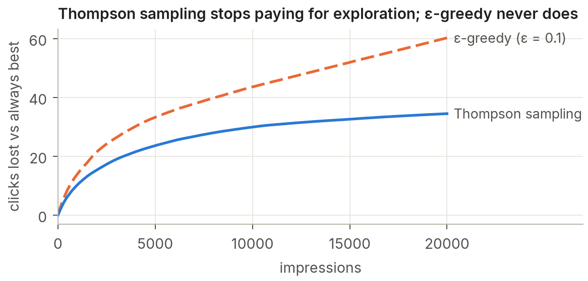

# 43 · Recommender systems

Part XI · Applied ML systems (optional track). Prerequisites: Chapter 40 (classic models, gradient boosting) and Chapters 8 and 29 (embeddings) help, but this chapter stands on its own. Worked designs that build on it: E.1 Restaurant feed and E.6 LLM judge for reco relevance.

## Why it matters

On a food-delivery app, recommendations decide most of what a user sees: the home feed, "order again", dish suggestions, cross-sell at checkout. In a marketplace, one ranking change moves orders, partner revenue and courier load at the same time, so recsys work is judged on business metrics, not only on model metrics.

In interviews for marketplace and consumer-app roles, the ML depth and architecture rounds are very likely to include a recommendation or ranking question. Chapter 46 gives you the answer framework; this chapter gives you the depth an interviewer probes once you are inside the framework. If you already work on recommendations, connect each section as you read to a decision your team has made or should make.

## Key concepts

- **Collaborative filtering**: recommend what similar users liked, using only the interaction matrix. [Collaborative filtering](https://en.wikipedia.org/wiki/Collaborative_filtering); [Google's recommendation systems course](https://developers.google.com/machine-learning/recommendation) is a gentle introduction.
- **Matrix factorisation**: learn a vector per user and per item whose dot product predicts interest. [Matrix factorisation for recommenders](https://en.wikipedia.org/wiki/Matrix_factorization_(recommender_systems)).
- **Implicit feedback and BPR**: clicks and orders instead of ratings; train so observed items rank above unobserved ones. [BPR paper](https://arxiv.org/abs/1205.2618).
- **Two-stage architecture: candidate generation then ranking**: a cheap retrieval step narrows millions of items to hundreds; a richer model ranks them. [Eugene Yan: System Design for Recommendations and Search](https://eugeneyan.com/writing/system-design-for-discovery/).
- **Two-tower models**: separate user and item encoders, trained with in-batch negatives, served with nearest-neighbour search (Chapter 30).
- **Ranking models with feature crosses**: combining memorisation and generalisation. [Wide & Deep](https://arxiv.org/abs/1606.07792).
- **Cold start**: new users and items with no history; handled with content features, popularity and exploration. [Cold start](https://en.wikipedia.org/wiki/Cold_start_(recommender_systems)).
- **Exploration and bandits**: showing some uncertain items to learn about them. [Multi-armed bandit](https://en.wikipedia.org/wiki/Multi-armed_bandit).
- **Feedback loops, position bias and diversity**: a recommender trains on what it showed; correct for it and protect variety and fairness.

## 43.1 Framing the problem

**What are we optimising?** A recommender is never "show relevant items". It is a choice between short-term signals (click, add to cart, order) and long-term goals (retention, order frequency, basket value, partner health). Write the objective down explicitly, usually as a weighted combination, for example `score = p(order) × expected basket value +` `w × p(click)`. Every weight is a product decision you should be able to defend.

**Explicit vs implicit feedback.**

| Type | Examples | Strengths | Problems |
|---|---|---|---|
| Explicit | Ratings, reviews, thumbs up/down | Clear preference signal | Rare; biased towards extreme opinions; the people who rate are not typical |
| Implicit | Impressions, clicks, orders, reorders, dwell time | Abundant; reflects real behaviour | Noisy; no clear negative; a missing interaction can mean "not seen" or "not available", not "dislike" |

Most production systems run on implicit feedback. The hard question is always **what counts as a negative**:

- *Impressed but not clicked or ordered:* the best negatives for ranking, because the user saw the item and chose something else.
- *Never shown:* "probably not interested" at best. Used as sampled negatives for retrieval, never as true labels.
- *Not available:* a closed restaurant or one outside the delivery range is not a negative at all. Filter these out of training labels.

**The interaction log you need.** One row per impression: `user_id, item_id, timestamp,`

`surface, position, event (impression, click, order), context (time, location,` `device), and the score or propensity the system used`. Without impressions and positions you cannot build negatives, correct for position bias or evaluate a new policy offline. If your team does not log this, that is the first fix.

**What is special about food delivery:**

- The feasible set changes by location and time: what is open and deliverable right now.
- Repeat consumption is high: people reorder from the same places, so "order again" is a very strong baseline and you should not blindly exclude seen items.
- Context matters a lot: lunch vs dinner, weekday vs weekend, weather.
- Two levels of item: restaurants and dishes, each with its own surfaces.

**Code: from raw events to training data with a time-based split.**

```python
import pandas as pd

events = pd.DataFrame({
    "user_id": [1, 1, 2, 2, 3, 3, 3],
    "item_id": [10, 11, 10, 12, 11, 12, 13],
    "event":   ["order", "click", "order", "order", "click", "order", "impression"],
    "ts": pd.to_datetime(["2026-10-01", "2026-10-03", "2026-10-02", "2026-10-09",
                          "2026-10-05", "2026-10-11", "2026-10-12"]),
})

# Stronger signals count more: a confidence weight per event type.
weights = {"impression": 0.0, "click": 1.0, "order": 5.0}
events["w"] = events["event"].map(weights)

# Time-based split: train on the past, evaluate on what happened next.
cutoff = pd.Timestamp("2026-10-08")
train = events[events.ts < cutoff]
test = events[(events.ts >= cutoff) & (events.event == "order")]

interactions = (train.groupby(["user_id", "item_id"], as_index=False)["w"].sum()
                     .query("w > 0"))
```

A random split leaks the future into training (the model sees next week's orders), and offline metrics look far better than they will online. Always split by time.

## 43.2 Collaborative filtering and matrix factorisation

**Intuition.** Users who ordered the same things in the past will like the same things in the future. You need no item content at all, only the user-item interaction matrix.

**Item-to-item CF.** Compute the similarity between item columns of the interaction matrix (cosine is standard), then score items by how similar they are to what the user already had. It is a strong, cheap, explainable baseline ("because you ordered from X"), and Amazon ran on it for years.

```python
import numpy as np

def item_item_scores(R, user):
    """R: users x items interaction counts. Returns a score per item for one user."""
    X = (R > 0).astype(float)
    norms = np.linalg.norm(X, axis=0) + 1e-9
    S = (X.T @ X) / np.outer(norms, norms)   # cosine similarity between items
    np.fill_diagonal(S, 0.0)
    return X[user] @ S                         # sum of similarities to the user's items
```

**Matrix factorisation (MF).** Approximate the interaction matrix as the product of two thin matrices: each user gets a vector uᵤ and each item a vector vᵢ in k dimensions, and the predicted score is their dot product uᵤ · vᵢ. Similar users end up close together, and so do similar items.

*Explicit ratings:* minimise the error only on observed cells:

`L = Σ over observed (u,i) of (rᵤᵢ − uᵤ·vᵢ)² + λ(‖uᵤ‖² + ‖vᵢ‖²)`

*Implicit feedback (Hu, Koren and Volinsky, 2008):* every cell counts. The preference pᵤᵢ is 1 if the user interacted and 0 otherwise; the confidence cᵤᵢ = 1 + α·rᵤᵢ grows with the number of interactions:

`L = Σ over all (u,i) of cᵤᵢ (pᵤᵢ − uᵤ·vᵢ)² + λ(‖uᵤ‖² + ‖vᵢ‖²)`

**ALS (alternating least squares)** solves this efficiently: fix the item vectors and each user vector has a closed-form solution, uᵤ = (VᵀCᵤV + λI)⁻¹ VᵀCᵤpᵤ; then fix the users and solve each item; repeat. Each step is a small ridge regression, so it parallelises well (Spark ALS).

```python
def implicit_als(R, k=16, alpha=20.0, reg=0.1, iters=10, seed=0):
    """Dense version for learning; use the `implicit` library on sparse data in practice."""
    rng = np.random.default_rng(seed)
    n_users, n_items = R.shape
    U = rng.normal(scale=0.1, size=(n_users, k))
    V = rng.normal(scale=0.1, size=(n_items, k))
    P = (R > 0).astype(float)          # preference
    C = 1.0 + alpha * R                # confidence
    I = reg * np.eye(k)
    for _ in range(iters):
        for u in range(n_users):       # fix V, solve each user
            A = (V.T * C[u]) @ V + I
            b = (V.T * C[u]) @ P[u]
            U[u] = np.linalg.solve(A, b)
        for i in range(n_items):       # fix U, solve each item
            A = (U.T * C[:, i]) @ U + I
            b = (U.T * C[:, i]) @ P[:, i]
            V[i] = np.linalg.solve(A, b)
    return U, V

def recommend(U, V, R, user, n=5, exclude_seen=True):
    scores = U[user] @ V.T
    if exclude_seen:                   # True for discovery surfaces, False for "order again"
        scores[R[user] > 0] = -np.inf
    return np.argsort(-scores)[:n]
```

**BPR (Bayesian personalised ranking, Rendle et al., 2009).** Instead of predicting 0/1, optimise the ranking directly: for a user, an item they interacted with should score higher than one they did not. Sample triples (user, positive, negative) and maximise `Σ ln σ(xᵤₚ` `− xᵤₙ)`. This pairwise idea comes back in learning to rank (Chapter 44).

**Why MF is not enough on its own:**

- No features: a new user or item has no vector (cold start).
- No context: the same recommendations at 9 am and 9 pm.
- Transductive: new users need retraining or a fold-in step.

Two-tower models (43.4) keep the dot-product idea and fix all three by computing the vectors from features. MF and item-to-item CF remain excellent candidate sources and baselines.

## 43.3 The multi-stage architecture

**Why stages?** A city's catalogue has tens of thousands of restaurants and hundreds of thousands of dishes. A heavy ranking model with hundreds of features cannot score all of them within a 100–200 ms page budget. So production systems use a funnel: cheap models over many items first, expensive models over few items last.


*multi-stage recommender · 4 stages, illustrative sizes*

The sizes are illustrative; what matters is that each stage cuts the set by an order of magnitude while the model per item gets heavier.

| Stage | Job | Typical models | Metric to watch |
|---|---|---|---|
| Candidate generation | Find everything plausibly relevant | Two-tower + ANN, item- to-item CF, MF, "order again", popular in the area, new restaurants | Recall@k of items later ordered |
| Filtering | Remove what cannot or must not be shown | Rules: availability, delivery range, stock, user blocks, legal | Share of shown items that were unavailable (should be ~0) |
| Ranking | Order the candidates by predicted value | GBDT, DLRM/DCN, multi-task deep nets | NDCG@k, AUC/logloss per task, calibration |
| Re-ranking | Build the best page, not the best list | MMR/diversity, business rules, ad insertion, exploration | Diversity, coverage, page-level conversion |

**Design points interviewers probe:**

- **Several retrieval sources.** One source rarely has full recall. Run several in parallel, merge, deduplicate, and pass the source as a feature to the ranker so it learns how much to trust each.
- **Filtering early in food delivery.** Availability and delivery range are hard constraints, so they often move *into* retrieval: an ANN index per city or delivery zone, or filtered ANN search. Otherwise you retrieve 2,000 candidates and find that 1,800 are closed.
- **Latency budget.** A typical split: retrieval 20–30 ms, feature fetching 20–40 ms, ranking 30–50 ms, re-ranking under 10 ms. Feature fetching is often the bottleneck, not the model.
- **Each stage is trained on different data.** Retrieval learns from all interactions with sampled negatives; ranking learns from impressions (what the previous system showed). That second fact creates feedback loops (43.8, 43.9).

## 43.4 Two-tower retrieval

**Intuition.** Keep MF's idea (score = dot product of a user vector and an item vector) but compute each vector with a neural network from features. The user tower sees the user, their history and the context; the item tower sees only the item. Because the item vector does not depend on the user, you compute all item vectors in advance and put them in an approximate nearest neighbour (ANN) index. At request time you run the user tower once and fetch the top few hundred items by dot product in milliseconds.


*two-tower retrieval · online user side, offline item side*

**Training with in-batch negatives.** Each training example is a positive pair (user, item they ordered). In a batch of B pairs, treat every other item in the batch as a negative for each user. That gives a B × B score matrix where the diagonal holds the positives, and you train with softmax cross-entropy over each row. It is cheap (no extra item computations) and works very well.

**The popularity problem and the logQ correction.** Items appear in batches in proportion to their popularity, so popular items are used as negatives far more often and the model learns to push them down too much. The fix (Yi et al., 2019, Google) is to subtract the log of each item's sampling probability from its logit before the softmax: `logitᵤᵢ − log qᵢ`. Mixing in some uniformly sampled random items as extra negatives also helps the long tail.

**Hard negatives.** Items the user saw but did not order, or near-misses (same cuisine, same area), teach finer distinctions. Add a small share of them; too many make training unstable and hurt recall.

**Code: a two-tower model in PyTorch.**

```python
import torch
import torch.nn as nn
import torch.nn.functional as F

class Tower(nn.Module):
    def __init__(self, n_ids, n_feats, dim=64):
        super().__init__()
        self.id_emb = nn.Embedding(n_ids, dim)
        self.mlp = nn.Sequential(nn.Linear(dim + n_feats, 128), nn.ReLU(), nn.Linear(128, dim))

    def forward(self, ids, feats):
        x = torch.cat([self.id_emb(ids), feats], dim=-1)
        return F.normalize(self.mlp(x), dim=-1)      # unit vectors: dot product = cosine

class TwoTower(nn.Module):
    def __init__(self, n_users, n_items, n_user_feats, n_item_feats, dim=64, temperature=0.05):
        super().__init__()
        self.user_tower = Tower(n_users, n_user_feats, dim)
        self.item_tower = Tower(n_items, n_item_feats, dim)
        self.temperature = temperature

    def loss(self, user_ids, user_feats, item_ids, item_feats, item_log_q=None):
        u = self.user_tower(user_ids, user_feats)      # (B, d)
        v = self.item_tower(item_ids, item_feats)      # (B, d)
        logits = u @ v.T / self.temperature            # row i: user i against every item in the batch
        if item_log_q is not None:                     # logQ correction for popularity
            logits = logits - item_log_q.unsqueeze(0)
        # The same item twice in a batch is not a negative for itself
        same_item = item_ids.unsqueeze(0) == item_ids.unsqueeze(1)
        same_item.fill_diagonal_(False)
        logits = logits.masked_fill(same_item, float("-inf"))
        labels = torch.arange(len(user_ids))           # positives sit on the diagonal
        return F.cross_entropy(logits, labels)
```

Training and retrieval:

```python
# item_log_q: log of each item's share of training pairs, computed once
counts = torch.bincount(train_item_ids, minlength=n_items).float() + 1
item_log_q = torch.log(counts / counts.sum())

model = TwoTower(n_users, n_items, n_user_feats, n_item_feats)
opt = torch.optim.Adam(model.parameters(), lr=1e-3)
for u_ids, i_ids in batches:                           # positive (user, item) pairs
    loss = model.loss(u_ids, user_feat_table[u_ids], i_ids, item_feat_table[i_ids], item_log_q[i_ids])
    opt.zero_grad(); loss.backward(); opt.step()

model.eval()
with torch.no_grad():
    all_items = model.item_tower(torch.arange(n_items), item_feat_table)   # offline, then indexed
    u = model.user_tower(user_id, user_feat_table[user_id])               # online, per request
    top = torch.topk(u @ all_items.T, k=200).indices                     # exact; ANN at scale
```

**Serving.** Item vectors are recomputed on a schedule and loaded into an ANN index: FAISS, ScaNN, or HNSW inside a vector database. ANN trades a little recall for a lot of speed, so measure ANN recall against exact search on a sample. For food delivery, partition the index by city or delivery zone, or use filtered search, so you do not retrieve restaurants that cannot deliver.

**Limits.** The two towers only meet at the final dot product, so the model cannot learn user-item cross features ("this user has ordered from this exact restaurant 5 times", "distance from this user to this restaurant"). That is why two-tower is a retrieval model and the ranker exists. The same structure appears as the bi-encoder in RAG retrieval (Chapter 30).

## 43.5 Ranking models

**What the ranker adds.** It scores a few hundred candidates, so it can afford rich features, and above all **user-item cross features**: how often this user ordered from this restaurant, distance and ETA from this user, the price compared with what this user usually spends, cuisine affinity, time since the last order there. These are usually the most predictive features in food delivery.

**Labels.** One row per impression. Typical targets: p(click | impression), p(order | impression), sometimes basket value or rating. With several targets, train a **multi-task** model and combine the heads at serving: `score = p(click) × p(order | click) ×` `expected value`. Learning p(order | click) only on clicked rows causes sample selection bias; ESMM (Alibaba, 2018) fixes it by training p(click) and p(click and order) on all impressions and getting p(order | click) as their ratio.

| Model | Key idea | When to use |
|---|---|---|
| GBDT (LightGBM, XGBoost) | Trees on hand-built tabular features; binary loss or LambdaMART | First production ranker; strong with tabular features; easy to debug |
| Wide & Deep (Google, 2016) | Linear model on crosses (memorisation) plus an MLP on embeddings (generalisation) | Historical baseline; explains the memorisation vs generalisation idea |
| DLRM (Meta, 2019) | Embeddings for categoricals, MLP for dense features, dot products between all pairs of embeddings | Large sparse ID features at scale |
| DCN-v2 (Google, 2021) | Cross layers learn explicit feature crosses of bounded degree | When feature crosses matter and you want them learned |
| DIN (Alibaba, 2018) | Attention over the user's history, weighted by relevance to the candidate | Long, varied histories; "which past orders matter for this item?" |
| SASRec (2018), BERT4Rec (2019) | Transformer over the user's item sequence, predicting the next item | Sequential behaviour; also used as a retrieval source |
| MMoE (Google, 2018) | Several expert networks shared by task-specific gates | Multi-task with conflicting objectives |

**A DCN-v2 cross layer in PyTorch.** Each layer computes `xₗ₊₁ = x₀ ⊙ (W xₗ + b) + xₗ`, so stacking L layers gives feature interactions up to degree L+1.

```python
class CrossLayer(nn.Module):
    def __init__(self, d):
        super().__init__()
        self.lin = nn.Linear(d, d)

    def forward(self, x0, x):
        return x0 * self.lin(x) + x          # explicit cross with the input, plus residual

class DCNRanker(nn.Module):
    """Cross network and deep network in parallel, one logit per task (e.g. click, order)."""
    def __init__(self, d_in, n_cross=3, n_tasks=2):
        super().__init__()
        self.cross = nn.ModuleList([CrossLayer(d_in) for _ in range(n_cross)])
        self.deep = nn.Sequential(nn.Linear(d_in, 128), nn.ReLU(), nn.Linear(128, 64), nn.ReLU())
        self.heads = nn.Linear(d_in + 64, n_tasks)

    def forward(self, x0):
        x = x0
        for layer in self.cross:
            x = layer(x0, x)
        return self.heads(torch.cat([x, self.deep(x0)], dim=-1))   # train with BCE-with-logits per task
```

**A LambdaMART ranker with LightGBM.** Rows are (request, candidate) pairs; `group` says how many rows belong to each request, in order.

```python
import lightgbm as lgb

# y: 0 = impressed only, 1 = clicked, 2 = ordered (graded relevance)
ranker = lgb.LGBMRanker(objective="lambdarank", n_estimators=300, learning_rate=0.05)
ranker.fit(X_train, y_train, group=group_train,
           eval_set=[(X_val, y_val)], eval_group=[group_val], eval_at=[10])
# Recent LightGBM versions prefer eval_X / eval_y over eval_set; check the docs.
```

**How to choose in an interview.** Start with GBDT: fast to ship, a strong baseline, easy feature importance. Move to a deep model when you have very large data, many sparse ID features or sequences, or need multi-task learning in one model. Say that the gain from good features usually beats the gain from a fancier architecture.

## 43.6 Re-ranking: building the page

The ranker scores each item on its own, but the user sees a page. Sorting by score alone gives ten pizza places in a row, the same chain three times, and no room for new restaurants or sponsored slots. Re-ranking turns a sorted list into a good page.

**Diversity with MMR (maximal marginal relevance).** Build the list greedily: at each step pick the item with the best balance of relevance and difference from what is already chosen:

`next = argmax over i not chosen of [ λ · rel(i) − (1 − λ) · max over chosen j` `of sim(i, j) ]`

```python
import numpy as np

def mmr(scores, emb, k=10, lam=0.7):
    """scores: ranker scores scaled to [0, 1]; emb: item embeddings (e.g. cuisine or content)."""
    emb = emb / np.linalg.norm(emb, axis=1, keepdims=True)
    chosen, candidates = [], list(range(len(scores)))
    while candidates and len(chosen) < k:
        def value(i):
            redundancy = max((emb[i] @ emb[j] for j in chosen), default=0.0)
            return lam * scores[i] - (1 - lam) * redundancy
        best = max(candidates, key=value)
        chosen.append(best)
        candidates.remove(best)
    return chosen
```

Scale the scores to the same range as the similarity, or λ loses its meaning. Determinantal point processes (DPPs) are a more principled alternative used at YouTube; MMR is what you code in an interview.

**Business rules usually applied here:** a cap per cuisine or per chain in the top N; guaranteed exposure for new restaurants (exploration, 43.8); sponsored items in fixed slots; exposure fairness across partners; pushing down restaurants with long ETAs or high cancellation rates. Keep them few, written down, and each one tested in an A/B test. A pile of undocumented rules is where ranking quality quietly dies.

## 43.7 Cold start

There are three kinds, and each has its own fixes.

| Case | Problem | Fixes |
|---|---|---|
| New user | No history | Popular in the area at this time of day; context features (location, time, device, app entry point); onboarding choices (favourite cuisines); session-based models that use clicks from the current session; update quickly after the first order |
| New item (restaurant or dish) | No interactions, so ID embeddings are untrained | Content features in the item tower (cuisine, price, menu text and photo embeddings) so it gets a useful vector on day one; guaranteed exploration impressions; borrow from similar existing restaurants |
| New city or market | Little data overall | One global model with city features; transfer from similar cities; heavier weight on content and popularity until data arrives |

**ID dropout.** If the model always sees an item ID embedding during training, it relies on it and does badly when the ID is new. Randomly replace item IDs with an "unknown" token for a share of training examples so the model also learns to score from content alone.

**Where LLMs help.** Generating clean tags, cuisine and dietary labels, or a normalised dish taxonomy from raw menus gives new items good content features immediately. This is the value of a well-structured food taxonomy: it is cold-start infrastructure as much as a catalogue clean-up.

## 43.8 Exploration and bandits

**The feedback loop.** The ranker learns from impressions, and impressions come from the ranker. Items it never shows never get data, so it never learns they are good. Popular items get more popular, and new restaurants starve. Exploration means deliberately showing some items whose value is uncertain, paying a small short-term cost to learn.

**Multi-armed bandits** formalise this. Each option is an "arm" with an unknown reward rate.

- **ε-greedy:** show the best-known arm, except with probability ε show a random one. Simple, but explores blindly.
- **UCB (upper confidence bound):** pick the arm with the highest optimistic estimate, mean plus an uncertainty bonus that shrinks with data.
- **Thompson sampling:** keep a posterior over each arm's reward rate, draw one sample from each, pick the highest. Uncertain arms sometimes draw high and get tried; arms that are clearly worse stop being tried. It works well in practice and is easy to explain.
- **Contextual bandits** (LinUCB, neural Thompson sampling) make the reward depend on features of the user and the item, which is what a recommender really needs.

**Code: Beta-Bernoulli Thompson sampling,** for example to choose which of three home-screen banners to show.

```python
import numpy as np

rng = np.random.default_rng(0)
true_ctr = np.array([0.04, 0.05, 0.07])    # unknown in real life
alpha, beta = np.ones(3), np.ones(3)       # Beta(1, 1) prior for each arm

for t in range(20_000):
    arm = int(np.argmax(rng.beta(alpha, beta)))   # one plausible CTR per arm, pick the best
    click = rng.random() < true_ctr[arm]
    alpha[arm] += click                            # successes
    beta[arm] += 1 - click                         # failures

print((alpha + beta - 2).astype(int))   # pulls per arm, e.g. [232 1432 18336]: most go to the best arm
```



*Cumulative regret, the clicks lost against always showing the best banner, averaged over 60 simulated runs with the three CTRs above. ε-greedy keeps spending 10% of traffic at random forever, so its regret grows linearly; Thompson sampling's exploration fades as the posteriors separate.*

After 20,000 impressions, ε-greedy has lost about 60 clicks and Thompson sampling about 35, and the gap keeps widening. The difference matters most when many items compete and the differences between them are small, which is the normal case in recommendation. Decaying ε over time narrows the gap but adds a schedule to tune; Thompson sampling gets the decay for free from the data.

**In a production recommender** you rarely run a pure bandit over everything. Common patterns: reserve one or two slots per page for exploration; add an uncertainty bonus to new items' ranking scores for their first N impressions; use a bandit for small decisions (which carousel, which banner, which promotion). Whatever you do, **log the probability with which each item was shown** (the propensity). That log is what makes unbiased offline evaluation possible later (43.10). Measure exploration's cost as the drop in short-term conversion in the exploration slots, and its benefit as catalogue coverage and new-restaurant success.

## 43.9 Position bias and inverse propensity scoring

**The problem.** Items at the top get more clicks because they are at the top, not only because they are better. A model trained naively on click logs learns "was shown high" as a sign of relevance, ranks those items high again, and the loop reinforces itself.

**The examination hypothesis.** A click needs two things: the user looked at the position, and the item was relevant: `P(click | item, position) = P(examined | position) ×` `P(relevant | item)`. The first factor, the examination probability or propensity, falls with position.

**Fix 1: position as a training feature, removed at serving.** Train with the position as an input (often in a small separate "shallow tower" whose output is added to the main logit, as YouTube described in 2019), then at serving set the position to a fixed value or drop the bias tower. The main model is left to explain relevance.

**Fix 2: inverse propensity scoring (IPS).** Weight each click by 1 / P(examined | position), so a click at position 5 counts more than one at position 1. Joachims et al. (2017) showed this gives an unbiased learning-to-rank objective if the propensities are right.

```python
import numpy as np

# P(examined | position), estimated from a small randomisation experiment
examine_prob = {1: 1.0, 2: 0.7, 3: 0.5, 4: 0.4, 5: 0.33}

p = df["position"].map(examine_prob).clip(lower=0.1)    # clip: cap weights at 10
df["w"] = np.where(df["clicked"] == 1, 1.0 / p, 1.0)
model.fit(X, y, sample_weight=df["w"])
```

**Estimating the propensities.** Run a small experiment that randomly swaps items between positions (for example positions k and k+1) and compare click rates of the same items in different positions. Alternatives exploit natural variation in where items appeared across ranker versions (intervention harvesting), or fit propensities and relevance jointly with EM.

**Practical cautions.** Large weights from low propensities blow up variance, so clip them. On mobile grids and carousels, position is two-dimensional (row and column) and a horizontally scrolled carousel has a very steep drop. And remember a second bias: items never shown have no label at all, which no position correction fixes; only exploration does.

## 43.10 Evaluation

**Offline metrics by stage.**

| Stage | Metrics | What they tell you |
|---|---|---|
| Retrieval | Recall@k, HitRate@k | Did the item the user later ordered make it into the candidate set? |
| Ranking | NDCG@k, MRR, MAP; AUC, GAUC (AUC per user, averaged), logloss and calibration per task | Is the order right, and are the probabilities usable when heads are multiplied together? |
| Whole page | Coverage, intra-list diversity, novelty, share of exposure going to the top 1% of items | Is the system healthy beyond accuracy? |

```python
import numpy as np

def recall_at_k(recommended, relevant, k):
    return len(set(recommended[:k]) & set(relevant)) / max(len(relevant), 1)

def ndcg_at_k(recommended, relevant, k):
    rel = set(relevant)
    dcg = sum(1 / np.log2(i + 2) for i, item in enumerate(recommended[:k]) if item in rel)
    idcg = sum(1 / np.log2(i + 2) for i in range(min(len(rel), k)))
    return dcg / idcg if idcg else 0.0

recall_at_k([5, 3, 9, 1], relevant=[3, 7], k=3)   # 0.5
ndcg_at_k([5, 3, 9, 1], relevant=[3, 7], k=3)     # ~0.39
```

**Protocol that holds up.**

- Split by time: train up to day T, evaluate on orders after T.
- Score the candidates production would have had: only items that were open and deliverable for that user at that moment.
- Do not evaluate on "the true item plus 100 random negatives". Krichene and Rendle (2020) showed these sampled metrics can reverse the ranking of models. Use the full candidate set, or at least the realistic one.
- Report metrics per segment: new vs returning users, big vs small cities, repeat vs discovery orders.

**Offline replay (off-policy evaluation).** Logs only tell you what happened for the items the old policy showed. To estimate how a new policy would have done, reweight logged rewards by how much more or less likely the new policy is to take the same action:

`V̂(new) = (1/n) Σ rᵢ × π_new(aᵢ | xᵢ) / π_log(aᵢ | xᵢ)`

```python
def ips_value(rewards, p_new, p_logged, clip=10.0):
    """Estimated reward of a new policy from logs; clipping trades a little bias for less variance."""
    w = np.minimum(p_new / p_logged, clip)
    return np.mean(w * rewards)
```

Its limits are why most teams still rely on A/B tests: it needs logged propensities; if the old policy was deterministic, actions it never took have zero probability and cannot be evaluated; for whole slates the probabilities become tiny and the variance huge. Doubly robust estimators (a reward model plus an IPS correction) reduce variance. Use replay to choose which candidates deserve an A/B test, not to replace it.

**Online.**

- **A/B tests** on business metrics: orders per user, conversion, GMV, retention, with guardrails on delivery time, cancellations and partner concentration. Watch for novelty effects in the first week.
- **Interleaving** for comparing two rankers: mix both rankings into one list per user and count which ranker's items get clicked or ordered. It needs far less traffic than an A/B test to detect a winner.
- **Marketplace interference:** if the recommender shifts demand towards some restaurants, it affects their prep times and courier supply for everyone, including the control group. For supply-side effects, use switchback or geo-level experiments (Chapter 2 and Chapter 46).

**The classic trap:** offline NDCG up, A/B flat or down. The usual causes are a metric that does not match the business goal, an offline candidate set different from production, leakage in features, or position bias in the test labels.

## 43.11 LLMs in recommendation

At scale, classic retrieval and ranking models still do the heavy lifting because of latency and cost. LLMs enter in five places, roughly in order of how common they are today.

1. **Content understanding and features.** Use an LLM or an embedding model to turn messy menus, descriptions and reviews into structured attributes (cuisine, dietary labels, dish type, taxonomy nodes) and into text embeddings for the item tower. This mostly helps cold start and long-tail items, and it is the cheapest win: run it offline in batch.
2. **LLM as relevance judge.** Ask an LLM to rate whether a recommended item fits a user's history and context, then use those labels for offline evaluation at a scale humans cannot reach. Calibrate the judge against human labels first (agreement measured with Cohen's kappa) and check it for bias. Worked design E.6 covers this end to end, and Chapter 24 covers judges in general.
3. **Semantic IDs and generative retrieval.** TIGER (Rajput et al., 2023) quantises each item's content embedding into a short tuple of codes with an RQ-VAE, so similar items share prefixes. A sequence-to-sequence transformer then generates the semantic ID of the next item from the user's history. Because IDs come from content, new items get meaningful IDs immediately.
4. **Generative recommenders.** Meta's HSTU work (Zhai et al., 2024) treats user actions as a sequence and trains very large transformer-style models on them, reporting gains over classic deep ranking models in production. It is the clearest sign of where large-scale recsys is going.
5. **Conversational and explanation surfaces.** "Something healthy under €15 that arrives in 30 minutes": the LLM parses intent into filters and a query, classic retrieval finds candidates, and the LLM re-ranks a short list or explains the picks. Keep the LLM on small candidate sets, cache results, and distil into smaller models when traffic grows.

**How to talk about it in an interview.** Show judgement about where an LLM earns its cost: offline enrichment and evaluation first, online LLM calls only on small candidate sets and where the user is already expressing intent in language. Mention that every LLM-generated feature needs its own quality check and that judges need calibration.

## Pitfalls

- **Random train/test splits.** They leak the future. Always split by time, and compute features point-in-time (`merge_asof`, Chapter 46).
- **Sampled-negative metrics.** "True item plus 100 random items" makes every model look good and can reverse model rankings.
- **Optimising clicks.** You get clickbait thumbnails and promotions that do not turn into orders. Optimise orders or value, with clicks as an auxiliary task.
- **Treating "not available" as "not liked".** A closed restaurant or one out of range is not a negative label.
- **Not logging impressions, positions and propensities.** Without them you cannot fix position bias, build good negatives or evaluate offline.
- **Ignoring position bias.** The model learns its own past ranking and the feedback loop locks in.
- **Excluding everything the user has seen.** In food delivery, reorders are a large share of orders; "order again" is a feature, not a bug. Exclude seen items only on discovery surfaces.
- **Train-serve skew.** Features computed one way in the training pipeline and another way online. Use a feature store or the same code path, and compare logged online features with offline recomputations.
- **Unmeasured ANN recall.** The index silently drops good candidates. Measure it against exact search.
- **Stale embeddings.** Item vectors from last month with a user tower from today: retrain and re-index together, or version them.
- **Uncalibrated multi-task heads.** Multiplying p(click) by p(order | click) only works if both are calibrated.
- **A pile of business rules.** Each rule was a good idea once; together they override the model. Keep a list, owners, and an A/B result for each.

## Interview questions

Try each one aloud before reading the model answer. Questions 1–5 are basic, 6–11 intermediate, 12–16 senior.

**1. What is the difference between explicit and implicit feedback, and where do negatives come from with implicit data?** Explicit feedback is a stated preference (ratings), rare and biased towards extremes. Implicit feedback is behaviour (impressions, clicks, orders): abundant but with no explicit negatives. For ranking, the best negatives are items the user saw and did not choose. For retrieval, use sampled negatives (in-batch plus some random). Items that were unavailable are not negatives at all.

**2. Why do recommenders use multiple stages?** Latency and cost. A rich ranker cannot score a whole catalogue in 100 ms, so cheap high-recall models cut the set to thousands, rules remove what cannot be shown, a heavy model ranks hundreds, and re-ranking builds the page. Each stage optimises a different metric: recall early, precision and value late.

**3. How does matrix factorisation work for implicit feedback?** Every user and item gets a k-dimensional vector and the score is their dot product. With implicit data every cell is a 0/1 preference weighted by a confidence that grows with interaction count, and ALS solves it by alternating closed-form ridge regressions for users and items.

**4. What metric would you use for the retrieval stage, and why not NDCG?** Recall@k (or HitRate@k) of the items the user later ordered. The retrieval stage's job is not to order; it is to not lose the right item. Order inside the candidate set is decided by the ranker.

**5. What is cold start and how do you handle a new restaurant?** No interactions means an untrained ID embedding. Use content features in the item tower (cuisine, price, menu embeddings) so it gets a vector on day one, give it guaranteed exploration impressions, train with ID dropout so the model can score from content, and borrow signals from similar existing restaurants.

**6. Explain in-batch negatives in a two-tower model. What bias does it introduce and how do you fix it?** Other positives in the batch serve as negatives, giving a B × B logit matrix trained with softmax cross-entropy. Items appear as negatives in proportion to popularity, so popular items get over-penalised. The logQ correction subtracts each item's log sampling probability from its logit; adding uniformly sampled negatives also helps.

**7. Why can't a two-tower model use user-item cross features, and where do they go?** The towers only interact at the final dot product, which is what makes precomputing item vectors and ANN search possible. Cross features such as distance or past orders from this restaurant need both user and item at once, so they go into the ranker.

**8. GBDT or deep model for the ranker?** Start with GBDT: strong on tabular features, fast to train, easy to debug and explain. Move to a deep model with very large data, many sparse IDs, sequence features, or several objectives to learn together. Better features usually beat a fancier architecture.

**9. How do you handle position bias?** Model examination explicitly: either add position as a training feature (or a separate bias tower) and neutralise it at serving, or weight clicks by inverse propensity of examination, estimated from a small randomisation experiment. Clip weights. Neither fixes items that were never shown; that needs exploration.

**10. How would you combine click, order and basket value into one ranking?** Multi-task model with a head per target, calibrated; combine as p(click) × p(order | click) × expected value, or a weighted sum with weights chosen by A/B tests against the business goal. Mention ESMM to avoid selection bias when learning p(order | click), and guardrails such as delivery time.

**11. How do you add diversity, and how do you measure whether it helped?** Re-rank with MMR or caps per cuisine and chain. Measure intra-list diversity and coverage offline, and online check that conversion holds or improves and that more restaurants receive orders. Diversity is a means; the test is orders and retention.

**12. Offline NDCG improved by 3% but the A/B test is flat. What do you investigate?** Whether the offline candidate set matches production (availability, filters, re-ranking); leakage or point-in-time errors in new features; position bias in the evaluation labels; whether NDCG on clicks matches the online metric (orders); segment effects cancelling out; train-serve skew in features; and whether re-ranking rules override the change. Then check the test itself: power, novelty, sample ratio mismatch.

**13. How would you run exploration in production, and how do you know what it costs?** Reserve a slot or two per page, or add an uncertainty bonus to new items for their first impressions, or use a bandit for small decisions. Log propensities. Measure cost as conversion loss in exploration slots against a holdout without exploration, and benefit as coverage and new-restaurant success over weeks.

**14. How would you evaluate a new ranking policy from logs before an A/B test?** Off-policy evaluation: IPS or doubly robust estimators using logged propensities. State the limits: it needs stochastic logging with overlap, variance explodes for slates, so use it to choose candidates for A/B tests, not to replace them. Interleaving is a cheaper online alternative for ranker comparisons.

**15. How is "order again" different from "discover new restaurants" as a design problem?** Order again is mostly a recency-frequency problem with time and context (a strong heuristic or a small model wins), seen items are the point, and the metric is speed to reorder. Discovery needs retrieval beyond the user's history, exploration, diversity and novelty, excludes seen items, and is judged on new-restaurant conversion and long-term retention, not short-term clicks.

**16. Where would you use LLMs in this system, and where would you not?** Yes: offline enrichment of menus into attributes and embeddings (cold start), LLM judges for offline relevance evaluation after calibration, conversational search where users express intent in words, and explanations on short lists. No: scoring thousands of candidates per request in the main ranking path, where latency and cost rule it out; there, classic models (possibly distilled from LLM signals) stay.

## Practice

Do these in your own repo, one notebook or script per exercise. The Instacart Market Basket dataset on Kaggle is the closest public dataset to food delivery (orders, reorders, products, time of day); MovieLens is the classic fallback.

1. **Baselines.** On Instacart, with a time-based split, build: most popular overall, most popular for this user (order again), item-to-item CF, and implicit ALS with the `implicit` library. Report Recall@20 and NDCG@20 for each. *Good solution:* clear split, a results table, and a sentence on why "order again" is so hard to beat.
2. **Two-tower.** Train the PyTorch model from 43.4 with and without the logQ correction. Compare Recall@50 and the average popularity of retrieved items. *Good solution:* logQ improves tail recall; you can explain why.
3. **Ranker.** Take the top 100 candidates from exercise 2, add user-item features (times ordered this product, days since last order, aisle affinity), and train a LightGBM LambdaMART ranker. *Good solution:* NDCG above retrieval-only, and a feature importance plot you can explain.
4. **Re-ranking.** Apply MMR on aisle or department embeddings and plot NDCG against intra-list diversity for λ from 0.3 to 1.0.
5. **Bandits.** Extend the Thompson sampling code with ε-greedy and UCB and plot cumulative regret for each.
6. **From-scratch drills (no autocomplete).** Implement recall@k, NDCG@k, cosine similarity, item-to-item CF and one ALS step in NumPy within 30 minutes. Deep-ML has problems on similarity measures and ranking metrics that make good warm-ups.
7. **Design rehearsal.** Answer "design the restaurant feed" out loud in 35 minutes using the Chapter 46 framework, then compare with worked design E.1.

## Read next

- *Machine Learning System Design Interview* (Aminian and Xu): chapters on video recommendation, event recommendation, similar listings and personalised news feed.
- Covington, Adams and Sargin, *Deep Neural Networks for YouTube Recommendations* (RecSys 2016): the two-stage architecture.
- Yi et al., *Sampling-Bias-Corrected Neural Modeling for Large Corpus Item* *Recommendations* (RecSys 2019): two-tower with logQ.
- Hu, Koren and Volinsky, *Collaborative Filtering for Implicit Feedback Datasets* (2008); Rendle et al., *BPR* (2009).
- Wang et al., *DCN V2* (2021); Kang and McAuley, *SASRec* (2018); Ma et al., *ESMM* (2018).
- Joachims, Swaminathan and Schnabel, *Unbiased Learning-to-Rank with Biased* *Feedback* (2017).
- Krichene and Rendle, *On Sampled Metrics for Item Recommendation* (KDD 2020).
- Rajput et al., *Recommender Systems with Generative Retrieval* (TIGER, 2023); Zhai et al., *Actions Speak Louder than Words* (HSTU, 2024).
- Eugene Yan, *System Design for Recommendations and Search*, on eugeneyan.com.
- Google's free *Recommendation Systems* course on developers.google.com, for a quick refresher on candidate generation, scoring and re-ranking.

**Links:** [Google recommendation systems course](https://developers.google.com/machine-learning/recommendation) · [System Design for Recommendations and Search](https://eugeneyan.com/writing/system-design-for-discovery/) · [BPR](https://arxiv.org/abs/1205.2618) · [Wide & Deep](https://arxiv.org/abs/1606.07792). Other titles above can be found by searching their title.

## Done when

You can draw the four-stage funnel and say what each stage optimises and how it is measured. You can explain implicit MF and ALS, and write item-to-item CF in NumPy without notes. You can write a two-tower training step with in-batch negatives and explain the logQ correction. You can explain why cross features belong in the ranker, and choose between GBDT and a deep ranker. You can explain position bias and two ways to correct it, including how propensities are estimated. You can write recall@k and NDCG@k from scratch and explain why sampled metrics mislead. You can explain Thompson sampling and how exploration runs in a real product. You can answer "offline up, online flat" with at least five concrete causes. You can name three places LLMs help a recommender and one place they should not go.

---

[← 42 · Infrastructure primer](42-infrastructure-primer.md) · [Contents](../README.md#contents) · [44 · Search ranking and learning to rank →](44-search-and-learning-to-rank.md)
