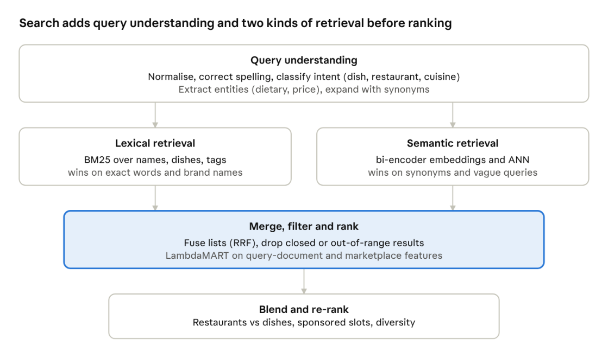
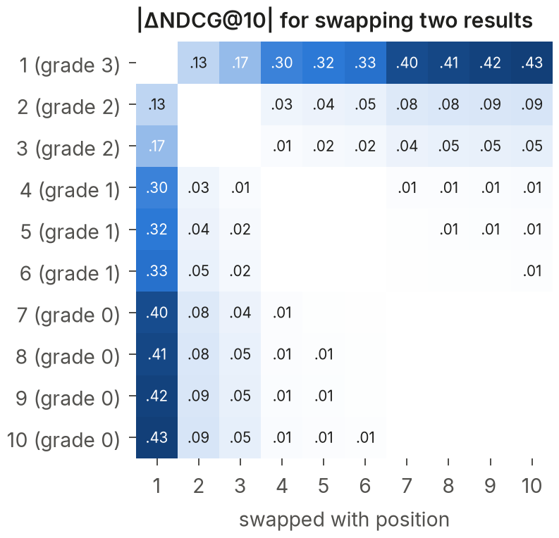

# 44 · Search ranking and learning to rank

Part XI · Applied ML systems (optional track). Read Chapter 43 first: this chapter reuses its funnel, two-tower retrieval and position-bias material. Worked design that builds on it: E.2 Dish and restaurant search. Retrieval for RAG (Chapter 30) uses the same lexical, semantic and hybrid methods.

## Why it matters

Search users have the strongest intent in the app: they typed what they want. Search usually converts far better than browsing, and a failed search (no results, wrong results) is one of the most direct ways to lose an order. In food delivery, search is also hard: short, misspelled, multilingual queries; results that must be open and deliverable right now; and a mix of restaurants and dishes on one page.

Learning to rank (LTR) is the core technique behind search ranking, and the same losses rank recommendations, ads and RAG passages. Interviewers expect you to know pointwise, pairwise and listwise approaches, explain LambdaMART, and design features for a marketplace search.

The food-delivery case maps directly onto the big-tech versions of the problem. Web search has the same pipeline with a far larger index and far longer tail. E-commerce product search (the Amazon ESCI dataset in Practice 4 is built from it) has the same "results must be in stock and shippable" constraint as "restaurant must be open and in range". App-store and video search add strong navigational intent. Sponsored search turns the final stage into an auction, where the ranking score must be a calibrated probability because it is multiplied by a bid (44.7). When an interviewer at any of these companies asks about ranking, they are testing the same three things: whether you can make the loss match the metric, whether you know that click logs are biased by the ranker that produced them, and whether you can evaluate a ranker online without fooling yourself.

The chapter starts with how search differs from recommendation and the shape of a search pipeline (44.1). It then follows a query through it: understanding the query (44.2), retrieving candidates lexically, semantically or both (44.3), and the features a ranker uses (44.4). Sections 44.5 and 44.6 explain learning to rank, from the three families of losses to the RankNet-to-LambdaMART story interviewers ask for. The chapter ends with what is special about marketplace search (44.7), neural re-rankers (44.8), evaluation (44.9) and a worked ranking iteration (44.10).

The central idea of learning to rank is that the loss should match the metric. Users only look at the top of the list, so a good ranking loss concentrates on getting the top positions right, and the progression from pointwise to listwise methods is the history of making that happen.

## Key concepts

- **Search pipeline**: query understanding (spelling, synonyms, intent) → retrieval (lexical and semantic) → ranking → business rules. [Eugene Yan: System Design for Recommendations and Search](https://eugeneyan.com/writing/system-design-for-discovery/).
- **Learning to rank (pointwise, pairwise, listwise)**: training a model to order results, with losses on single items, pairs or whole lists. [Learning to rank](https://en.wikipedia.org/wiki/Learning_to_rank).
- **LambdaMART**: boosted trees trained with pairwise gradients weighted by the change in NDCG; the standard strong baseline. [From RankNet to LambdaRank to LambdaMART](https://www.microsoft.com/en-us/research/publication/from-ranknet-to-lambdarank-to-lambdamart-an-overview/); available as the `lambdarank` objective in [LightGBM](https://lightgbm.readthedocs.io/en/latest/).
- **Relevance labels**: human judgements or behaviour (clicks, add-to-cart, orders) turned into graded labels.
- **Position bias and unbiased learning to rank**: top results get clicked partly because they are on top; correct with inverse propensity weighting. [Unbiased Learning-to-Rank with Biased Feedback](https://arxiv.org/abs/1608.04468).
- **Offline ranking metrics and online tests**: NDCG and MRR offline, then interleaving or A/B tests online (Chapters 4 and 47).
- **Multilingual and transliterated queries**: spelling variants, mixed scripts and per-language vocabularies.
- **Textbook**: [Introduction to Information Retrieval](https://nlp.stanford.edu/IR-book/).

## 44.1 Search vs recommendation, and the search pipeline

Search is a recommender with a query. The funnel from Chapter 43 still applies, with three differences:

- **Relevance to the query comes first.** A personalised result that does not match "sushi" is wrong, however much the user likes burgers. Personalisation breaks ties among relevant results.
- **Query understanding is a stage of its own.** Before retrieving anything, you need to know what the user meant.
- **Lexical matching matters.** Exact words (a restaurant's name, a dish name) are strong signals, so search keeps a keyword index next to the embedding index.



*search pipeline · query understanding, hybrid retrieval, ranking, blending*

The two retrieval paths cover each other's weaknesses: BM25 finds "Pizzeria Napoli" exactly but misses "something cheesy"; embeddings find the vague query but can miss an exact brand name. The ranker then sees the merged set with features from both.

## 44.2 Query understanding

Food-delivery queries are short (one or two words), often misspelled, often in several languages, and ambiguous: "burger" is a dish, "Burger King" is a restaurant, "healthy" is a vague need. Query understanding turns the raw string into something retrieval and ranking can use.

| Step | What it does | Typical method |
|---|---|---|
| Normalisation | Lower-case, strip accents, unify units and spacing | Rules |
| Spelling correction | "piza" → "pizza", "suhsi" → "sushi" | Edit distance against a vocabulary weighted by popularity; learned from reformulations (users who typed A then B) |
| Intent classification | Restaurant name, dish, cuisine, grocery item, vague need | Text classifier (fine-tuned small encoder, or an LLM labelling data for one) |
| Entity extraction | "vegan", "under €10", "near me", a brand | Dictionaries plus NER; LLMs for long-tail phrasing |
| Query expansion | "chips" → "fries"; "poke" → "poke bowl" | Synonym lists mined from co-clicks; embeddings |

**Spelling correction from scratch** (the Norvig approach): generate all strings within one or two edits and pick the most popular known word.

```python
def edits1(word):
    letters = "abcdefghijklmnopqrstuvwxyz"
    splits = [(word[:i], word[i:]) for i in range(len(word) + 1)]
    deletes = [a + b[1:] for a, b in splits if b]
    transposes = [a + b[1] + b[0] + b[2:] for a, b in splits if len(b) > 1]
    replaces = [a + c + b[1:] for a, b in splits if b for c in letters]
    inserts = [a + c + b for a, b in splits for c in letters]
    return set(deletes + transposes + replaces + inserts)

def correct(word, vocab_counts):
    """vocab_counts: word -> popularity (e.g. how often it appears in successful queries)."""
    if word in vocab_counts:
        return word
    one = [w for w in edits1(word) if w in vocab_counts]
    if one:
        return max(one, key=vocab_counts.get)
    two = {w2 for w1 in edits1(word) for w2 in edits1(w1) if w2 in vocab_counts}
    return max(two, key=vocab_counts.get) if two else word
vocab = {"pizza": 9000, "sushi": 7000, "burger": 8000, "lasagna": 900, "poke": 1200}
correct("pizzza", vocab), correct("lasgna", vocab), correct("suhsi", vocab)
# pizza, lasagna, sushi
```

Build the vocabulary from queries that led to orders, not from all queries, or common misspellings ("piza") end up in the vocabulary and are never corrected. In production, prefer showing results for the correction with a "search instead for" link over silently replacing the query.

**Autocomplete.** Suggest completions as the user types, ranked by popularity, and later by personalisation and location. The basic data structure is a prefix lookup with the top suggestions cached per prefix:

```python
import bisect

class Autocomplete:
    def __init__(self, query_counts):
        self.queries = sorted(query_counts)    # sorted strings make prefix ranges contiguous
        self.counts = query_counts

    def suggest(self, prefix, k=5):
        lo = bisect.bisect_left(self.queries, prefix)
        hi = bisect.bisect_left(self.queries, prefix + "\uffff")
        return sorted(self.queries[lo:hi], key=self.counts.get, reverse=True)[:k]

ac = Autocomplete({"pizza": 900, "pizza margherita": 300, "pizzeria napoli": 120, "poke": 500})
ac.suggest("piz")   # ['pizza', 'pizza margherita', 'pizzeria napoli']
```

At scale this is a trie or finite-state transducer with the top-k stored at each node, so a lookup costs one walk down the prefix. Rank suggestions with a small learned model (popularity in this city, this user's history, time of day), and filter offensive or zero-result completions.

## 44.3 Retrieval: lexical, semantic and hybrid

Retrieval has to cut millions of documents to a few hundred candidates in milliseconds, without losing the right answer. Two families do this: lexical retrieval, which matches words through an inverted index, and semantic retrieval, which matches meaning through embeddings. They fail in different places, which is why production systems run both.

### BM25

**Motivation.** Counting matching words is not enough. "The" matches everything; a document that says "pizza" twenty times is not twenty times as relevant as one that says it once; and a long menu matches more words by chance than a short one. BM25 fixes all three.

**Intuition.** For each query term, BM25 multiplies an IDF weight (rare words count more) by a saturating term-frequency factor (the tenth mention adds less than the first), with the saturation point moved by document length (a mention in a short document is stronger evidence than one in a long document).

$$
\mathrm{BM25}(q,d) = \sum_{t \in q} \mathrm{IDF}(t)\,\frac{f(t,d)\,(k_1+1)}{f(t,d) + k_1\,(1-b+b\,|d|/\overline{|d|})}
$$

Here f(t, d) is how often term t occurs in document d, |d| is the document's length in terms, and the bar over |d| denotes the average length over the collection (avgdl). k₁ ≈ 1.2 sets how fast term frequency saturates: as f grows, the fraction tends to k₁ + 1, so a term can never contribute more than (k₁ + 1)·IDF. b ≈ 0.75 sets how much length normalisation applies: b = 0 ignores length, b = 1 divides fully by relative length.

The IDF used in the code below is the Lucene variant:

$$
\mathrm{IDF}(t) = \ln\left(1 + \frac{N - n_t + 0.5}{n_t + 0.5}\right)
$$

N is the number of documents and n_t the number that contain t. The original Robertson–Spärck Jones form, ln((N − n_t + 0.5)/(n_t + 0.5)), goes negative for a term in more than half the documents, so a match would *lower* the score. The "1 +" inside the log keeps IDF positive. Chapter 30.2 covers the inverted index that makes this fast.

**Worked example.** Query "pizza napoli" over three documents: d₁ = "napoli pizza pizza" (3 terms), d₂ = "napoli pasta" (2 terms), d₃ = "sushi bar" (2 terms). So N = 3 and avgdl = 7/3 ≈ 2.33.

| Quantity | pizza | napoli |
|---|---|---|
| n_t (documents containing it) | 1 | 2 |
| Lucene IDF | ln(1 + 2.5/1.5) = 0.981 | ln(1 + 1.5/2.5) = 0.470 |
| Classic RSJ IDF | ln(2.5/1.5) = 0.511 | ln(1.5/2.5) = −0.511 |

For d₁ the length term is k₁(1 − b + b·3/2.33) = 1.2 × 1.214 = 1.457. "pizza" contributes 0.981 × 2 × 2.2 / (2 + 1.457) = 1.248 and "napoli" 0.470 × 1 × 2.2 / (1 + 1.457) = 0.421, a total of **1.669**. For d₂ the length term is 1.2 × (0.25 + 0.75 × 2/2.33) = 1.071, and "napoli" contributes 0.470 × 2.2 / 2.071 = **0.499**. d₃ scores 0. Notice the saturation: two mentions of "pizza" give 1.248, not twice the 0.878 that one mention in d₁ would give (1.757). With the classic IDF, d₂ would score below d₃, which matches nothing: the reason libraries use the shifted form.

**Properties.** BM25 has no training, two parameters and an index that updates the moment a document is added, which is why it remains the lexical half of most hybrid systems. Its weakness is vocabulary mismatch: "chips" never matches "fries" unless query expansion (44.2) adds it.

```python
import math
from collections import Counter

class BM25:
    def __init__(self, docs, k1=1.2, b=0.75):
        self.docs = [d.lower().split() for d in docs]
        self.k1, self.b = k1, b
        self.avgdl = sum(len(d) for d in self.docs) / len(self.docs)
        self.tf = [Counter(d) for d in self.docs]
        df = Counter(t for d in self.docs for t in set(d))
        n = len(self.docs)
        self.idf = {t: math.log(1 + (n - c + 0.5) / (c + 0.5)) for t, c in df.items()}

    def score(self, query, i):
        tf, dl = self.tf[i], len(self.docs[i])
        s = 0.0
        for t in query.lower().split():
            if t in tf:
                f = tf[t]
                s += self.idf[t] * f * (self.k1 + 1) / (f + self.k1 * (1 - self.b + self.b * dl / self.avgdl))
        return s

    def search(self, query, k=10):
        scored = sorted(((self.score(query, i), i) for i in range(len(self.docs))), reverse=True)
        return [i for s, i in scored[:k] if s > 0]
```

In production this is an inverted index in Elasticsearch, OpenSearch or Solr, with fields weighted differently (a match in the restaurant name counts more than one in a menu description).

**Semantic retrieval** embeds the query and the documents with a bi-encoder (the two-tower model of Chapter 43, with a text encoder for the query) and searches with ANN. Train it on (query, ordered item) pairs from search logs with in-batch negatives, starting from a pretrained multilingual sentence encoder. Chapter 29 covers embedding models in depth.

### Training dense retrievers: hard negatives and false negatives

In-batch negatives are mostly easy: a "sushi" query against a random burger restaurant teaches the model nothing it did not know. The model improves most from **hard negatives**, documents that score high but are wrong ("sushi" against a Japanese restaurant that serves only ramen). The standard recipe mines them with the current model or with BM25. ANCE (Xiong et al., 2020) goes further and refreshes the mined negatives from an asynchronously rebuilt index as training proceeds, because negatives mined by an old checkpoint become easy for the new one.

Mining has a trap: the hardest "negatives" are often **false negatives**, relevant documents that simply were not clicked or labelled. In search logs, a restaurant the user did not click for "pizza" may be a perfectly good pizza place shown at position 9. Training to push it away teaches the model to separate equally relevant items. The usual defences are to skip the top few mined results, drop candidates whose score from a stronger cross-encoder is close to the positive's, or exclude items the user never had a chance to examine. Chapter 29.3 covers the mechanics and the temperature interaction.

### Learned sparse retrieval

**SPLADE** (Formal et al., 2021) sits between BM25 and dense retrieval. A transformer reads the document and outputs a weight for every vocabulary term, including terms that do not appear in the text ("fries" gets weight in a document that only says "chips"). A sparsity penalty keeps most weights at zero, so the output still goes into an ordinary inverted index. You get learned term expansion and term weighting with the exact-match behaviour, index tooling and interpretability of lexical search. It is a strong choice when exact names matter (product codes, brands) but vocabulary mismatch hurts BM25, and its main costs are a model pass at indexing time and larger posting lists than BM25.

### Index freshness

Search indexes go stale in ways recommender candidate lists do not. A restaurant closes, a dish sells out, a price changes, a new store opens. Three layers handle this. Static text (names, menus) is re-indexed incrementally within minutes; inverted indexes support this cheaply, and ANN indexes such as HNSW accept inserts but degrade with many deletes, so they are rebuilt periodically. Fast-changing state (open now, in stock, busy) is never baked into the index: it is applied as a filter at query time from a real-time store. New documents have no embeddings from engagement-trained towers until they are encoded, so the document tower must run on content alone at insert time. An interviewer who asks "how does a new restaurant appear in search within five minutes?" wants to hear these layers.

**Hybrid retrieval** runs both and fuses the lists. Scores from BM25 and cosine similarity are on different scales, so the simplest robust fusion uses only ranks: **reciprocal rank fusion (RRF)**.

```python
from collections import defaultdict

def rrf(rankings, k=60):
    """rankings: lists of doc ids, best first. k=60 is the value from the original paper."""
    scores = defaultdict(float)
    for ranking in rankings:
        for rank, doc in enumerate(ranking, start=1):
            scores[doc] += 1.0 / (k + rank)
    return sorted(scores, key=scores.get, reverse=True)

rrf([bm25_ids, embedding_ids])
```

RRF is a good first-stage merge. The ranker then sees both the BM25 score and the cosine similarity as features and learns the best weighting.

## 44.4 Features for search ranking

Search ranking features come in four families. In an interview, listing them by family shows structure.

| Family | Examples |
|---|---|
| Query | Length, intent class, language, is it a brand name, query popularity, historical click-through of the query |
| Document (restaurant or dish) | Rating, number of orders, price level, cuisine, prep time, cancellation rate, photo quality, is it new |
| Query-document | BM25 per field (name, dishes, tags), exact name match, cosine similarity, share of query terms matched, historical CTR and conversion for this query-document pair |
| User and context | User's past orders from this restaurant, cuisine affinity, price sensitivity, distance, ETA, time of day, device |

**Query-document engagement features are often the strongest** and also the riskiest. Raw CTR on few impressions is noise (2 clicks out of 3 impressions is not a 67% CTR), so smooth it towards a prior:

```python
prior = df["clicks"].sum() / df["impressions"].sum()
alpha = 50                                   # prior strength, in pseudo-impressions
qd = (df.groupby(["query", "restaurant_id"])
        .agg(clicks=("clicks", "sum"), imps=("impressions", "sum")))
qd["ctr_smoothed"] = (qd["clicks"] + alpha * prior) / (qd["imps"] + alpha)
```

Two cautions. Compute these features only from data before each training example's timestamp, or you leak the label into the feature. And engagement features carry position bias (results shown higher got more clicks), so either compute them from position-debiased clicks or accept that they reinforce the current ranking.

## 44.5 Learning to rank: pointwise, pairwise, listwise

All three train a scoring function s = f(query, document) and sort by s. They differ in what the loss looks at.

| Approach | Loss looks at | Idea | Examples | Trade-off |
|---|---|---|---|---|
| Pointwise | One document at a time | Predict its relevance label or click probability | Logistic regression, GBDT with logloss, MSE on grades | Simple, gives calibrated probabilities; ignores that only the order matters |
| Pairwise | Two documents for the same query | The more relevant one should score higher | RankNet, RankSVM, BPR | Optimises order directly; treats a swap at positions 50 and 51 like one at 1 and 2 |
| Listwise | The whole result list | Optimise a list metric (NDCG) or match a target distribution over the list | ListNet, LambdaRank, LambdaMART, softmax loss | Focuses on the top where users look; harder to reason about, scores not calibrated |

**Labels.** Graded relevance per (query, document): from human judgments (0 = irrelevant to 3 = perfect), or from engagement (0 = shown, 1 = clicked, 2 = added to cart, 3 = ordered). Ranking losses only compare documents **within the same query**, which is why the data carries a query or group id.

**The three losses in PyTorch,** for one query with scores `s` and graded labels `y`:

```python
import torch
import torch.nn.functional as F

def pointwise_loss(s, y):
    # Binary relevance: was it relevant at all?
    return F.binary_cross_entropy_with_logits(s, (y > 0).float())

def ranknet_loss(s, y):
    # For every pair where y_i > y_j: -log sigmoid(s_i - s_j)
    diff = s.unsqueeze(1) - s.unsqueeze(0)               # diff[i, j] = s_i - s_j
    pairs = (y.unsqueeze(1) > y.unsqueeze(0)).float()    # 1 where i should rank above j
    return (F.softplus(-diff) * pairs).sum() / pairs.sum().clamp(min=1)

def listnet_loss(s, y):
    # Cross-entropy between the label distribution and the score distribution over the list
    return -(F.softmax(y.float(), dim=0) * F.log_softmax(s, dim=0)).sum()
```

`softplus(-x)` is `log(1 + e^{-x})`, which equals `-log σ(x)` but is numerically stable. On a small synthetic test, all three learn a sensible ranking; the pairwise and listwise losses get the order right with fewer of the model's resources spent on getting the exact label values right.

### ListNet's scale problem, the softmax loss and ListMLE

ListNet turns the labels into a target distribution with softmax(y). That makes the loss depend on the *scale* of the grades: with grades 0–3, softmax(3, 2, 0) puts 0.71 of the mass on the top document; rescale the same grades to 0–1 and the target flattens to 0.48, 0.34, 0.18, so the loss cares much less about getting the top document first. The fix in practice is either a temperature on the labels or one of two cleaner listwise losses.

The **softmax loss** (also called sampled softmax or listwise cross-entropy) treats the clicked or ordered item as the one correct class among the list. With one positive p it is −log(e^{s_p} / Σⱼ e^{s_j}); with graded labels, weight each positive's term by its gain. It is the loss of two-tower retrieval with in-batch negatives (Chapter 43.4), and it fits data with one positive per list, such as "which restaurant did the user order from".

**ListMLE** maximises the likelihood of the ideal permutation under the Plackett–Luce model: pick the best document with probability softmax over all scores, remove it, pick the next from the rest, and so on. It needs a full ordering of the labels and is sensitive to how ties are broken, so it suits dense graded labels better than sparse clicks.

```python
def softmax_loss(s, y):
    # Gain-weighted cross-entropy over the list; reduces to -log softmax(s)[pos] with one positive.
    w = (2.0 ** y.float() - 1)
    return -(w * F.log_softmax(s, dim=0)).sum() / w.sum().clamp(min=1e-9)

def listmle_loss(s, y):
    # Plackett-Luce negative log-likelihood of the label-sorted permutation.
    s_sorted = s[torch.argsort(y, descending=True)]
    # log-sum-exp over the suffix s_sorted[i:], for every i
    tail_lse = torch.logcumsumexp(s_sorted.flip(0), dim=0).flip(0)
    return (tail_lse - s_sorted).sum()
```

### When the scores must be calibrated

Listwise and pairwise losses are invariant to adding a constant to every score in a query, so their outputs are not probabilities. That is fine when the score only sorts one list. It breaks when the score feeds arithmetic downstream: an ads auction ranks by bid × pCTR, a page that blends restaurants and dishes compares scores from two lists, and a threshold ("show only results with P(order) > 2%") needs a probability. Three fixes are common. Train pointwise and accept some loss of NDCG. Calibrate the listwise output afterwards with isotonic or Platt scaling on held-out data (Chapter 4). Or train a multi-objective loss, a weighted sum of a listwise loss and a pointwise log loss, which keeps most of the ranking gain and keeps the scores calibrated. Negative downsampling and inverse-propensity weights also break calibration and need the same post-hoc correction (Chapter 46, Step 3).

## 44.6 From RankNet to LambdaMART

This is the most-asked LTR story in interviews. Tell it in three steps.

1. **RankNet (Burges et al., 2005).** Model the probability that document i should rank above j as σ(sᵢ − sⱼ) and train with cross-entropy on pairs. The gradient pushes sᵢ up and sⱼ down for each misordered pair; summing over pairs gives one number per document, called its **lambda**: how hard and in which direction to push its score.
2. **LambdaRank (2006).** NDCG is what we care about, but it is not differentiable (it depends on sorted positions). The trick: skip writing the loss and define the gradients directly as RankNet's pair gradient multiplied by **|ΔNDCG|**, the change in NDCG if i and j swapped positions. Swapping positions 1 and 2 changes NDCG a lot; swapping 50 and 51 barely at all, so the model concentrates on the top of the list.
3. **LambdaMART (2008–2010).** Use those lambdas as the pseudo-gradients in gradient-boosted trees (MART: multiple additive regression trees). Each new tree fits the lambdas. It won the 2010 Yahoo! Learning to Rank Challenge and is still the default production ranker for tabular features.



*|ΔNDCG@10| for swapping the results at two positions of an ideally ordered list with grades 3, 2, 2, 1, 1, 1, 0, 0, 0, 0. Swapping the top result with a bottom one costs 0.40–0.43; swapping positions 4 and 7 costs 0.01.*

This matrix is the weight LambdaRank puts on each pair's gradient. Mistakes involving the top result get 10 to 40 times more weight than mistakes among the lower positions, so model capacity goes where users look. It also explains a common surprise: a LambdaMART model can have worse pairwise accuracy than a RankNet model, yet better NDCG, because it trades many cheap mistakes low in the list for fewer expensive ones at the top.

### The lambda, written out

Take one query, and write i ▷ j when document i has a higher grade than document j. RankNet's loss for that pair is the cross-entropy C_ij = log(1 + e^{−σ(sᵢ − sⱼ)}), where sᵢ and sⱼ are the model's scores and σ is a scale constant (usually 1). Differentiating with respect to sᵢ gives the pair's gradient, and LambdaRank multiplies it by the NDCG change:

$$
\lambda_{ij} = \frac{-\sigma}{1 + e^{\sigma (s_i - s_j)}}\,\left|\Delta \mathrm{NDCG}_{ij}\right|
$$

The first factor is large when the pair is misordered (sᵢ < sⱼ) and fades to zero once i is comfortably above j. |ΔNDCG_ij| is the change in NDCG if i and j swapped their current positions. Each document collects the lambdas of all its pairs:

$$
\lambda_i = \sum_{j:\, i \rhd j} \lambda_{ij} \;-\; \sum_{j:\, j \rhd i} \lambda_{ji}
$$

λᵢ plays the role of ∂C/∂sᵢ, so gradient descent moves sᵢ by −η·λᵢ: a negative lambda pushes the score up. The original RankNet gradient is the same formula without the |ΔNDCG| factor.

**Worked example.** Three documents for one query, σ = 1. A has grade 0 and score 1.0, B grade 2 and score 0.5, C grade 1 and score 0.0. The current order is A, B, C (the irrelevant one on top); its NDCG is 0.659, against an ideal DCG of 3.631.

| Pair (i ▷ j) | 1/(1 + e^{sᵢ−sⱼ}) | ΔNDCG of the swap | λ_ij |
|---|---|---|---|
| B ▷ A | 1/(1 + e^{−0.5}) = 0.622 | 0.305 | −0.190 |
| C ▷ A | 1/(1 + e^{−1.0}) = 0.731 | 0.138 | −0.101 |
| B ▷ C | 1/(1 + e^{0.5}) = 0.378 | 0.072 | −0.027 |

Summing: λ_B = −0.190 − 0.027 = −0.217 (push up hardest), λ_C = −0.101 + 0.027 ≈ −0.073 (push up a little), λ_A = +0.190 + 0.101 ≈ +0.29 (push down). B gets most of the push because moving it to the top recovers the most NDCG; the B–C pair is already in the right order and contributes little.

**The Newton step in MART.** LambdaMART fits each regression tree to the −λᵢ values, then sets each leaf's output with one Newton step rather than the plain mean: the leaf value is −Σλᵢ / Σwᵢ over the documents in the leaf, where wᵢ = Σⱼ σ²·|ΔNDCG_ij|·ρ_ij(1 − ρ_ij) is the second derivative and ρ_ij = 1/(1 + e^{σ(sᵢ−sⱼ)}). This is the same second-order trick as XGBoost's leaf weight (Chapter 40), and it is why LightGBM's `lambdarank` objective supplies both gradients and Hessians.

**Is there a loss behind it?** LambdaRank defined gradients without a loss, which was an open embarrassment for years. Wang et al.'s LambdaLoss framework (2018) showed that LambdaRank's updates optimise a (coarse) upper bound on an NDCG-based loss, fitted with an EM-like procedure, and derived tighter variants. The interview-ready answer: "the lambdas correspond to optimising a bound on the NDCG loss, so LambdaMART is a metric-driven method with a loss behind it, not only a heuristic."

### Unbiased LambdaMART and trust bias

Chapter 43.9 corrects position bias by weighting each click by 1/P(examined at its position). Unbiased LambdaMART (Hu et al., 2019) brings that into the boosting loop: it estimates position-bias ratios (for clicked and for unclicked documents) together with the ranker, alternating between fitting trees with bias-corrected lambdas and re-estimating the ratios from the current model's pairwise losses, so no separate randomisation experiment is needed. Click logs also carry **trust bias**: users click higher results not only because they look at them more but because they trust the ranker, so a top-ranked irrelevant result gets more clicks than the same result examined lower down. Pure examination-propensity weighting does not remove this; it needs a model with separate click probabilities for relevant and irrelevant results at each position (Agarwal et al., 2019). The practical point for an interview: IPS fixes "was it seen?", not "was it clicked because it was on top?".

**LambdaRank in code:** the RankNet pair loss, weighted by |ΔNDCG| computed from the current ranking.

```python
def lambdarank_loss(s, y):
    n = len(s)
    with torch.no_grad():                                 # weights, not part of the gradient
        order = torch.argsort(s, descending=True)
        ranks = torch.empty(n, dtype=torch.long)
        ranks[order] = torch.arange(n)                    # current position of each doc
        gains = 2.0 ** y.float() - 1
        disc = 1.0 / torch.log2(ranks.float() + 2)
        ideal_disc = 1.0 / torch.log2(torch.arange(n).float() + 2)
        idcg = (torch.sort(gains, descending=True).values * ideal_disc).sum().clamp(min=1e-9)
        # |change in NDCG| if docs i and j swapped positions
        delta = ((gains.unsqueeze(1) - gains.unsqueeze(0)) *
                 (disc.unsqueeze(1) - disc.unsqueeze(0))).abs() / idcg
    pairs = (y.unsqueeze(1) > y.unsqueeze(0)).float()
    diff = s.unsqueeze(1) - s.unsqueeze(0)
    return (delta * pairs * F.softplus(-diff)).sum() / pairs.sum().clamp(min=1)
```

**LambdaMART in practice** is `LGBMRanker(objective="lambdarank")` (code in Chapter 43.5) or XGBoost with `objective="rank:ndcg"`. Useful settings to know: `eval_at` (the k for NDCG), `label_gain` (the gain per relevance grade), and `lambdarank_truncation_level` (how deep in the list pairs are considered). Rows must be sorted by query, with `group` giving the number of rows per query.

## 44.7 Marketplace search: what is special in food delivery

- **Results must be orderable.** Open now, within delivery range, item in stock, minimum order reachable. A result the user cannot order is worse than no result. Apply these filters in retrieval (geo-filtered index per city or zone) rather than after ranking.
- **Navigational queries.** When someone types a restaurant name, that restaurant must be first. Detect it in query understanding (exact or fuzzy name match) and pin it. If it is closed, still show it, clearly labelled, with alternatives below: the user learns it exists and is not confused.
- **Restaurants vs dishes.** "Pizza" can mean restaurants that serve pizza or specific pizza dishes. Either rank both types in one model with the type as a feature, or rank them separately and blend using the intent probabilities from query understanding.
- **Distance, ETA and fees.** These are ranking features (users trade quality for speed) and user-facing sort options. Keep the default ranking learned; offer explicit sorts on top.
- **Zero and low results.** Track the zero-result rate by query. Fallbacks in order: spelling correction, query relaxation (drop a term), semantic retrieval, then related cuisines nearby. Most zero-result queries are long-tail misspellings, synonyms, or items nobody nearby sells, and each needs a different fix.
- **Multilingual queries and transliteration.** In the Gulf, users search in Arabic, English and transliterated Arabic ("shawarma", "shawerma", "شاورما"). Multilingual embeddings, transliteration variants in the synonym lists and per-language spelling vocabularies all help. It is a concrete point to raise in any interview for a multilingual market.
- **Sponsored results.** Ads are blended into fixed slots and should pass a relevance threshold so a paid burger does not appear for "sushi". Ad ranking is roughly bid × predicted conversion, with relevance as a constraint (Chapter 46, worked design E.7).
- **Supply health.** Pushing all "pizza" searchers to one popular place overloads its kitchen and lengthens delivery for everyone. Prep-time and load features, and occasional throttling of overloaded partners, protect the experience.

### Ads in search: an auction, not a fixed slot

Treating sponsored results as "slots 2 and 5 go to the highest bidder" leaves money and relevance on the table. Sponsored search at web and e-commerce scale runs an auction per query: each eligible ad gets an expected value of bid × pCTR (or bid × pConversion for cost-per-order ads), ads below a relevance or quality threshold are dropped, and the winners are priced by a generalised second-price or similar rule so that advertisers pay roughly what they needed to beat the next ad. Three consequences matter for the ranker. pCTR must be calibrated, because it multiplies money: a model that is 20% over-confident on one advertiser's ads hands it 20% more spend. The relevance constraint is what stops a paid burger appearing for "sushi", and it should be learned from the organic relevance model, not hand-set. And the page-level question, how many ads and where, trades short-term revenue against long-term search conversion, so it is set by long-running holdout experiments, not by the auction itself. Worked design E.7 goes through the full auction.

### The latency budget

Search sits on the critical path of a user typing, so a typical budget is 100–200 ms at p99 end to end, of which ranking gets a few tens of milliseconds. The costs that decide the architecture are easy to estimate. A LambdaMART model with 500 trees scores a few hundred candidates in a few milliseconds on a CPU. A cross-encoder costs one transformer forward pass per (query, document) pair: re-ranking 100 candidates with a 6-layer MiniLM is about 100 short sequences per query, a few milliseconds per batch on a GPU but tens to hundreds of milliseconds on a CPU, which is why it is limited to the top 50–100. Two levers buy most of the headroom. **Result caching** for head queries works because query frequency is heavily skewed: a small fraction of distinct queries covers a large share of traffic, and their results (before personalisation and availability filtering) can be cached for minutes. **Precomputation** moves document-side work offline: document embeddings, menu-match features and the cross-encoder scores for the most frequent (query, document) pairs.

## 44.8 Neural re-rankers: cross-encoders and LLMs

**Bi-encoder vs cross-encoder.** A bi-encoder embeds query and document separately and compares vectors: fast, precomputable, used for retrieval. A cross-encoder feeds the query and document together into one transformer, so every query token can attend to every document token. It is much more accurate at judging relevance, but it must run once per (query, document) pair, so it is only affordable on the top 50–100 candidates.

```python
from sentence_transformers import CrossEncoder

reranker = CrossEncoder("cross-encoder/ms-marco-MiniLM-L-6-v2")   # small English model; pick a multilingual one for Arabic/English
scores = reranker.predict([(query, doc_text) for doc_text in top_candidates])
```

(API as of 2025–26; check the current sentence-transformers docs.) For marketplace search, the cross-encoder's score usually becomes **a feature in the LambdaMART ranker** rather than the final ranking, because availability, distance and popularity still matter. Fine-tune it on your own (query, ordered item) pairs; off-the-shelf models are trained on web search data.

**ColBERT (late interaction)** sits between the two: it stores one vector per document token and scores with the sum of maximum similarities per query token. Nearly cross-encoder quality at retrieval speed, at the cost of a much larger index. Chapter 30 covers it.

**LLMs in search ranking.**

- *Pointwise:* ask the LLM to grade each (query, document) pair. Simple, but expensive per document.
- *Listwise:* give the LLM the query and a short numbered list and ask for the reordered list (the RankGPT approach). Sliding windows handle longer lists.
- *As a label source:* the most practical use today. LLM-graded relevance labels for thousands of queries train or evaluate the production ranker, after calibration against human judgments (Chapter 24, worked design E.6).
- *Distillation:* train a small cross-encoder to imitate the LLM's judgments, then serve the small model.

Cost and latency usually keep LLMs out of the online path for high-traffic search, except for long, natural-language queries where the gain is largest.

## 44.9 Evaluating search

**Where relevance labels come from.**

| Source | Strength | Weakness |
|---|---|---|
| Clicks and orders | Free, abundant, reflect real users | Position bias; only covers what was shown; an order also depends on price and ETA, not only relevance |
| Human judgments | Clean graded labels with written guidelines | Expensive; slow; raters need clear guidelines and agreement checks |
| LLM judgments | Cheap at scale; consistent | Must be calibrated against human labels (Cohen's kappa) and checked for bias |

A practical setup: a fixed **golden set** of queries (the head queries plus a random sample of torso and tail), judged by humans on a 0–3 scale; LLM judgments to extend it; engagement data for training.

**Offline metrics.**

- **NDCG@k with graded gains** (2^rel − 1): the default for ranking quality.
- **MRR**: for navigational queries, where one result is the right one (the restaurant the user named).
- **Precision@k, Recall@k**: precision for the visible top; recall for the retrieval stage.

```python
import numpy as np

def dcg_at_k(rels, k):
    rels = np.asarray(rels, dtype=float)[:k]
    return float(np.sum((2 ** rels - 1) / np.log2(np.arange(2, len(rels) + 2))))

def ndcg_at_k(rels_in_ranked_order, k, all_rels=None):
    """all_rels: grades of ALL known relevant docs for the query, so missed docs lower the score."""
    pool = all_rels if all_rels is not None else rels_in_ranked_order
    ideal = dcg_at_k(sorted(pool, reverse=True), k)
    return dcg_at_k(rels_in_ranked_order, k) / ideal if ideal > 0 else 0.0

def mrr(first_relevant_ranks):
    """1-based rank of the first relevant result per query, or None if there was none."""
    return float(np.mean([1.0 / r if r else 0.0 for r in first_relevant_ranks]))

ndcg_at_k([0, 3, 2, 0, 1], k=5)   # ~0.67
mrr([1, 3, None, 2])              # ~0.46
```

A common bug: computing the ideal DCG only from the retrieved list. Then a system that retrieves one mediocre result and nothing else scores a perfect 1.0. Use all known relevant documents for the ideal.

### Click models

**Click models** explain how users produce clicks, so you can recover relevance from biased logs. Every click model separates two events: the user *examines* a result, and, if examined, *finds it attractive* enough to click. Click = examined and attractive. The models differ in what decides examination.

The **position-based model (PBM)** says examination depends only on position: P(click at rank r) = θ_r · rel_d, where θ_r is the probability that rank r is looked at and rel_d the document's attractiveness. The θ_r are exactly the propensities that inverse propensity scoring divides by (Chapter 43.9), so fitting a PBM (by EM on logs, or from experiments that randomly swap adjacent results) is how propensities are estimated in practice.

The **cascade model** says users scan top-down and stop at the first click, so a result is examined only if every result above it was skipped:

$$
P(\mathrm{click\ at\ } r) = \mathrm{rel}_r \prod_{i<r} (1 - \mathrm{rel}_i)
$$

Here rel_i is the probability that the result at rank i is attractive enough to click. **Worked example:** three results with rel = 0.3, 0.6 and 0.5. Rank 1 is always examined, so P(click) = 0.3. Rank 2 is examined with probability 0.7 and clicked with 0.7 × 0.6 = 0.42. Rank 3 is examined with 0.7 × 0.4 = 0.28 and clicked with 0.28 × 0.5 = 0.14. The result at rank 3 is nearly as attractive as rank 2 but gets a third of the clicks, all because of what sits above it. Read naively, the click log says rank 2 is three times as relevant as rank 3; the cascade model recovers 0.6 vs 0.5. Notice that here the examination probability of rank 3 depends on the *documents* above it, not only its position, which a PBM cannot express.

The **dynamic Bayesian network (DBN)** model generalises the cascade: after a click the user is satisfied with some probability and stops, otherwise they continue scanning with some persistence probability. It fits multi-click sessions (comparing several restaurants) that the cascade model forbids.

### Interleaving: why it needs so little traffic

In an A/B test, users in arm A and users in arm B are different people, so the comparison carries all the between-user variance: heavy users, light users, hungry users and browsers. Most of the variance in search conversion is between users, not between rankers. **Interleaving** removes it by showing every user one list that mixes both rankers, so each session is a paired comparison: the same user, at the same moment, with the same intent, chooses between results from A and from B. Published comparisons (Chapelle et al., 2012, on web search; Netflix's engineering blog, 2017, on recommendations) report interleaving reaching the same decision as an A/B test with one to two orders of magnitude less traffic.

**Team-draft interleaving** builds the list like picking teams in a playground: flip a coin for who picks first, then each ranker in turn adds its highest-ranked result not already in the list, and each result remembers which "team" added it.

```python
import random

def team_draft(rank_a, rank_b, k=10, rng=random):
    merged, team, picks = [], {}, {"A": 0, "B": 0}
    lists = {"A": rank_a, "B": rank_b}
    while len(merged) < k:
        # the team with fewer picks goes next; a coin flip breaks ties
        if picks["A"] != picks["B"]:
            name = "A" if picks["A"] < picks["B"] else "B"
        else:
            name = "A" if rng.random() < 0.5 else "B"
        nxt = next((d for d in lists[name] if d not in team), None)   # its best unused result
        if nxt is None:
            break
        merged.append(nxt); team[nxt] = name; picks[name] += 1
    return merged, team

def credit(clicked, team):
    a = sum(team.get(d) == "A" for d in clicked)
    b = sum(team.get(d) == "B" for d in clicked)
    return "A" if a > b else "B" if b > a else "tie"
```

**The credit rule:** for each session, count the clicks (or orders) on results contributed by each team; the team with more wins the session, and equal counts are a tie. Across sessions, test whether A's share of the decided (non-tie) sessions differs from 50% with a binomial or sign test. Interleaving gives a direction and a preference strength, not the size of the business effect, which is why the A/B test still follows (44.10).

**Online metrics.**

| Metric | What it tells you |
|---|---|
| Search conversion | Share of searches that end in an order: the primary metric |
| Zero-result rate | Share of queries with no results |
| Reformulation rate | Share of searches followed by another search: a sign the first one failed |
| Abandonment | Searches with no click at all |
| Position of first click or order | Lower is better: relevant results are near the top |
| Time to order from search | Speed of a successful search |

For comparing two rankers, **team-draft interleaving** is the standard tool in search: build each result list by alternately drafting from the two rankers, and credit each click or order to the ranker that contributed that result. It detects differences with much less traffic than an A/B test. Use A/B tests for the final decision on business metrics, and always segment by query type (head, torso, tail; navigational vs dish vs cuisine), because averages hide that a change helped head queries and broke the tail.

## 44.10 A worked ranking iteration

The team wants to add a "dish match" feature to restaurant search: how well the query matches the restaurant's menu items, not only its name and cuisine.

1. **Start from failing queries.** Pull 200 queries with low conversion and read their result pages. Many are dish queries ("chicken biryani", "acai bowl"): the ranker shows restaurants with matching cuisines first, even when another restaurant has the exact dish and better reviews.
2. **Build the feature point in time.** BM25 and embedding similarity between the query and the restaurant's menu items, computed from the menu as it was at each logged search (Chapter 48.3). Today's menu would leak future information into old searches.
3. **Evaluate offline on two label sources.**
   - **Engagement labels.** Train and test on 8 weeks of logged searches, with labels 0–3 from shown, clicked, added to cart and ordered. Weight by inverse propensity of position (Chapter 43.9).
   - **Human labels.** Score the golden set of 1,500 queries, judged 0–3 by humans.
   - **Comparing.** Use a paired bootstrap over queries for NDCG@10: both rankers are scored on the same queries, so resample *queries* with replacement, recompute the mean difference on each resample, and take the 2.5th and 97.5th percentiles. Resampling queries rather than (query, document) rows respects the fact that the query is the unit of variation (code after this list).
   - Suppose NDCG@10 rises from 0.612 to 0.627 on the golden set, with a 95% interval for the difference of +0.008 to +0.022, and by +0.05 on the dish-query slice. (An interval of ±0.007 on 1,500 queries implies a per-query standard deviation of the difference of about 0.007 / 1.96 × √1,500 ≈ 0.14, typical for NDCG.) Navigational queries are unchanged, which they must be: the named restaurant still ranks first.
4. **Check that nothing else moved.**
   - Zero-result rate: unchanged, because ranking does not change retrieval.
   - Latency: menu similarity is precomputed per restaurant and query term, adding 2 ms at p99.
   - Supply concentration: does the change push more orders to a few restaurants at peak? Check the top-10 share of orders under the new ranking in replay.
5. **Interleave before the A/B test.** Team-draft interleaving on 5% of traffic for a week detects the preference quickly. Suppose the new ranker wins 53% of the decided searches, with a clear interval.
6. **Run the A/B test for the business metric.** Use search conversion as the primary metric, with the reformulation rate and the order cancellation rate as guardrails. The interleaving result already makes the direction likely. The A/B test measures the size of the effect, and catches anything interleaving cannot see, such as a change in what users order.
7. **Write it up:**
   - the failing-query analysis that motivated the change;
   - the offline gain with its interval, overall and by slice;
   - the interleaving and A/B results;
   - what did not change;
   - the next idea, for example dish-level results for dish queries.

The paired bootstrap from step 3, in code:

```python
def paired_bootstrap_ci(ndcg_old, ndcg_new, n_boot=10_000, seed=0):
    """ndcg_old, ndcg_new: per-query NDCG@10 arrays, aligned by query."""
    rng = np.random.default_rng(seed)
    d = np.asarray(ndcg_new) - np.asarray(ndcg_old)       # per-query difference
    idx = rng.integers(0, len(d), size=(n_boot, len(d)))  # resample queries
    boots = d[idx].mean(axis=1)
    return d.mean(), np.percentile(boots, [2.5, 97.5])
```

## Pitfalls

- **Ideal DCG from the retrieved list only.** It rewards retrieving less. Use all known relevant documents.
- **Mixing queries in the ranking loss.** Pairwise and listwise losses only make sense within a query; forgetting `group` or sorting rows wrongly silently breaks training.
- **Leaky engagement features.** Query-document CTR computed over a period that includes the training example's own click.
- **Treating clicks as relevance.** Clicks carry position bias, and orders also depend on price, ETA and fees. Debias, or combine with human or LLM judgments.
- **Silent spelling correction.** Replacing a correct but rare word (a new restaurant's name) with a popular one. Show "showing results for", and never correct exact matches to known names.
- **Only evaluating on head queries.** Head queries are easy and already good; the tail is where users fail. Sample the tail into your golden set.
- **Semantic retrieval alone.** Embeddings miss exact names and numbers. Keep a lexical path.
- **Ignoring navigational intent.** If the named restaurant is not first, nothing else in the list matters to that user.
- **Results that cannot be ordered.** Filtering after ranking leaves empty or closed pages. Filter in retrieval.
- **One metric for all intents.** NDCG for dish and cuisine queries, MRR or success@1 for navigational ones.
- **Uncalibrated scores in an auction or a blend.** Listwise scores multiplied by a bid or compared across lists. Calibrate first (44.5).
- **Mined negatives that are really positives.** The hardest negatives from click logs are often relevant but unclicked; filter them before training a retriever.
- **Single-seed ranker comparisons.** Differences of a fraction of an NDCG point are within seed noise; report seeds and query-level bootstrap intervals.

## Interview questions

Questions 1–5 are basic, 6–11 intermediate, 12–18 senior.

**1. What is the difference between pointwise, pairwise and listwise learning to rank?** Pointwise predicts each document's relevance on its own (classification or regression). Pairwise learns which of two documents for the same query should rank higher (RankNet). Listwise optimises a property of the whole list, usually NDCG (LambdaRank, LambdaMART, ListNet). Pairwise and listwise optimise order, which is what users see; pointwise gives calibrated probabilities. The senior trade-off: when the score feeds arithmetic downstream (an ads auction multiplying pCTR by a bid, blending restaurants with dishes, a threshold), you need calibration, so either train pointwise, calibrate the listwise output on held-out data, or train a weighted sum of a listwise and a pointwise loss. Follow-up: "can a listwise model's scores be compared across queries?" Not as they stand, because the loss is unchanged by adding a constant per query.

**2. Explain BM25 in one minute.** A keyword score summing, over query terms, IDF (rare terms count more) times a term-frequency factor that saturates (k₁) and is normalised by document length (b). A term's contribution can never exceed (k₁ + 1)·IDF, so with k₁ = 1.2 the tenth mention adds almost nothing. It is a strong, cheap baseline and still the lexical half of most hybrid systems. Follow-up: "why the log(1 + …) in the IDF?" The classic form goes negative for terms in more than half the documents.

**3. Why combine lexical and semantic retrieval?** Lexical catches exact names, brands and numbers; semantic catches synonyms, paraphrases and vague queries. Each covers the other's failures. Fuse with reciprocal rank fusion, score 1/(60 + rank) summed over lists, because BM25 and cosine scores are on incomparable scales; then let the ranker weigh both scores as features. When not to bother: a catalogue of codes or names only, where BM25 plus fuzzy matching already gets recall near 1.

**4. What is NDCG and why the log discount?** DCG sums graded gains discounted by log₂(position + 1), because users look less at lower positions; NDCG divides by the best possible DCG so scores are comparable across queries. Graded gains (2^rel − 1) reward putting the very best results first: with grades 0–3, a grade-3 result is worth 7 and a grade-1 result 1, while the linear gain (rel) would make it only 3 times as valuable. That choice matters: the exponential gain weights the step from grade 2 to 3 (gain 3 to 7) four times as heavily as the step from 0 to 1, so the metric, and LambdaRank trained on it, cares mostly about the very best results; and it makes the metric sensitive to how labels are scaled, so fix the grade scale before comparing models. Follow-up: compute the ideal DCG from all known relevant documents, not only the retrieved ones.

**5. How would you handle misspelled queries?** Candidate corrections within one or two edits, ranked by popularity in successful queries and by context; learn corrections from reformulations (users who typed A then quickly B and ordered). Show the correction transparently and never overwrite exact matches to known restaurant names. Build the vocabulary from queries that led to orders, or common misspellings like "piza" become "correct".

**6. Explain LambdaMART.** RankNet gives pairwise gradients from σ(sᵢ − sⱼ). LambdaRank multiplies each pair's gradient by the |ΔNDCG| of swapping the pair, λᵢⱼ = −σ/(1 + e^{σ(sᵢ − sⱼ)}) × |ΔNDCG_ij|, and sums them per document, so errors near the top matter most, without needing NDCG to be differentiable. LambdaMART fits gradient-boosted trees to those lambdas, with a Newton step per leaf using the second derivative. It is the default production ranker for tabular features. Follow-up: "is there a loss behind the lambdas?" Yes: the LambdaLoss framework (Wang et al., 2018) shows LambdaRank optimises a bound on an NDCG-based loss.

**7. Bi-encoder vs cross-encoder: when do you use each?** Bi-encoders encode query and documents separately, so document vectors are precomputed and searched with ANN: retrieval. Cross-encoders read query and document together: far more accurate but one forward pass per pair, so only for re-ranking the top 50–100. Re-ranking 100 candidates is 100 forward passes per query; at 1,000 QPS that is 100,000 passes a second, a GPU fleet of its own. In a marketplace, the cross-encoder score is often a feature for the final ranker.

**8. Which features would you build for restaurant search?** By family: query (intent, length, language), document (rating, popularity, prep time, price), query-document (BM25 per field, exact name match, embedding similarity, smoothed query-restaurant CTR and conversion), user and context (distance, ETA, past orders there, cuisine affinity, time of day). Smooth engagement features towards a prior: 2 clicks out of 3 impressions with a prior of 10% and 50 pseudo-impressions gives (2 + 5)/(3 + 50) ≈ 13%, not 67%. And compute them point in time, or the label leaks in.

**9. A user types a restaurant name and it is closed. What do you show?** The restaurant first, clearly marked closed with its opening time, then the most similar open alternatives nearby. Hiding it makes the user think search is broken, and they leave rather than browse. Measure it with MRR or success@1 on navigational queries, not NDCG.

**10. How do you get relevance labels for training and evaluation?** Engagement for training at scale, debiased for position; a human-judged golden set (0–3 scale, guidelines, agreement checks) for evaluation; LLM judges to scale the golden set after calibrating against the human labels (report Cohen's kappa between LLM and humans; above about 0.6 is usable). The trade-off: engagement labels reflect price and ETA as well as relevance, while human labels reflect topical relevance only, which is one reason offline and online results disagree (Q15).

**11. How do you measure search quality online?** Search conversion as the primary metric, with zero-result rate, reformulation rate, abandonment and position of first order as diagnostics; team-draft interleaving to compare rankers quickly; A/B tests for the final call; everything segmented by query type. Interleaving tells you which ranker users prefer, not by how much conversion changes, so it never replaces the A/B test.

**12. Search conversion dropped 2% last week. How do you investigate?** Check instrumentation and traffic mix first (app release, new city, marketing campaign bringing new users). Then segment: by query type, language, city, platform. Look at zero-result and reformulation rates for spikes, which point to retrieval or spelling breaking. Check supply (restaurants closed, a big partner offline) and recent ranking or index changes. Compare with conversion from browsing to separate a search problem from a demand problem. Size it first: on 2 million searches a week at 30% conversion, the standard error of a weekly rate is about √(0.3 × 0.7 / 2M) ≈ 0.03 points, so a 2% relative drop (0.6 points) is far outside noise, and the question is why, not whether. Follow-up: "everything is flat except one city": then look at that city's supply and index, not the model.

**13. How would you blend restaurants and dishes in one result page?** Estimate intent probabilities in query understanding. Either rank both types with one model that includes type and intent features, calibrated so scores are comparable, or rank separately and allocate slots by intent (more dishes for "margherita", more restaurants for "italian"). Calibration is the crux: two LambdaMART models trained on different lists produce scores on different scales, so map each to P(order) with isotonic regression before interleaving them. Test the blending policy online; offline metrics struggle with mixed lists. Follow-up: "why not one listwise model over both?" You can, but its scores are only comparable within one list, and the slot policy still needs probabilities.

**14. How would you add LLMs to restaurant search?** Start offline: LLM-generated labels to train and evaluate the ranker, menu enrichment for better matching, synonym and transliteration mining. Online, use them for query understanding of long natural-language queries ("something light and vegan under €12") turned into filters plus a semantic query. Keep the high-traffic ranking path on LambdaMART and distilled cross-encoders for latency and cost. The arithmetic: at 1,000 searches a second, even $0.0002 per LLM call is $0.20 a second, about $17,000 a day, so the LLM goes where the gain per call is largest (the long tail) or offline. Follow-up: cache LLM query rewrites for head queries; they repeat.

**15. Your new ranker wins offline on NDCG but loses an interleaving test. Why might that be?** The offline labels and online behaviour disagree: the golden set over-represents head queries; labels judge topical relevance while users also weigh ETA, price and fees; the offline candidate set ignores availability; or the new model is worse at navigational queries, where one failure is very visible. Look at per-segment interleaving results and at the queries where the two rankers disagree most. Then fix the offline set so it would have predicted the loss (add the failing slice, or switch labels to orders), because an offline metric that cannot predict online outcomes will mislead the next iteration too.

**16. Write the LambdaRank gradient and say what each part does.** For a pair where i should rank above j, λᵢⱼ = −σ/(1 + e^{σ(sᵢ − sⱼ)}) × |ΔNDCG_ij|. The logistic factor is RankNet's gradient: near σ when the pair is badly misordered, near zero once i is well above j. |ΔNDCG_ij| weights the pair by how much the metric would change if the two swapped. Each document sums its lambdas, adding λᵢⱼ where it is the better document and subtracting λⱼᵢ where it is the worse one. Example: an irrelevant document at score 1.0 above a grade-2 document at 0.5 gives logistic factor 0.622 and, with ΔNDCG 0.305, λ = −0.19 for the grade-2 document. Follow-up: "why not differentiate NDCG?" It is piecewise constant in the scores, so its gradient is zero almost everywhere.

**17. How would you estimate position propensities for unbiased learning to rank?** The cleanest way is randomisation: on a small slice of traffic, swap adjacent results (or shuffle the top k) and compare click rates of the same documents at different positions; the ratio gives θ_r/θ_{r+1}. Without randomisation, fit a position-based click model by EM, or use interventions that occur naturally when different rankers placed the same document at different positions (intervention harvesting). Then weight each click by 1/θ_r. The trade-off: small propensities give huge weights and high variance, so clip the weights (for example at 1/θ ≤ 10) and accept some bias. Follow-up: trust bias means clicks at the top are inflated beyond examination, which propensity weighting alone does not fix.

**18. How would you train a dense retriever for search from click logs?** Pairs of (query, clicked or ordered document) with in-batch negatives and a softmax loss, starting from a pretrained multilingual encoder; then add hard negatives mined with BM25 or the current model, refreshed as the model improves (ANCE). Guard against false negatives: relevant but unclicked documents among the mined negatives, so skip the top few mined results or filter with a cross-encoder. Evaluate on recall@100 for the retrieval stage, not NDCG, because the ranker fixes the order. Follow-up: popular documents appear in many batches as negatives and get over-penalised, which the logQ correction fixes (Chapter 43.4).

## Practice

1. **BM25 from scratch.** Implement BM25 without looking (30 minutes). Test it on a small set of menus you write yourself, then compare with the `rank_bm25` package.

<details><summary>Hint and expected result</summary>

Reproduce the worked example in 44.3 first: "pizza napoli" over the three documents should give 1.669, 0.499 and 0. `rank_bm25`'s `BM25Okapi` uses a different IDF (it floors negative IDFs with an epsilon), so its scores differ from yours on common terms while the ranking usually agrees.

</details>

2. **Learning to rank on a public dataset.** Download MSLR-WEB10K (Microsoft's LTR dataset, pre-split into folds with query groups). Train LightGBM with `objective="binary"` (pointwise) and `objective="lambdarank"` and compare NDCG@10. *Good solution:* a short table, and an explanation of why lambdarank wins at the top.

<details><summary>Hint and expected result</summary>

Pass `group` as the number of rows per query, in file order. Expect lambdarank NDCG@10 of roughly 0.5 on fold 1 with default settings and a few hundred trees; a pointwise model on binarised labels comes in a few points lower. If your lambdarank number is far below 0.45, check the group array first.

</details>

3. **Losses by hand.** Implement the RankNet, ListNet and LambdaRank losses from 44.5–44.6 and train a linear scorer with each on MSLR features. Plot NDCG@10 per epoch.

<details><summary>Hint and expected result</summary>

Standardise the features (MSLR has heavy-tailed counts) or every loss diverges. A linear scorer lands well below the GBDT of Practice 2; LambdaRank should finish highest of the three on NDCG@10, RankNet close, and ListNet with raw grades lowest unless you add a label temperature (44.5).

</details>

4. **Hybrid retrieval.** On the Amazon ESCI shopping-queries dataset (query-product pairs graded Exact, Substitute, Complement, Irrelevant), retrieve with BM25 and with a sentence-transformers model, fuse with RRF, and compare Recall@100 and NDCG@10 for each. *Good solution:* hybrid beats both; you can show queries where each single method fails.

<details><summary>Hint and expected result</summary>

BM25 typically wins on queries with model numbers and brand names; the dense model wins on descriptive queries ("gift for a runner"). Expect RRF to beat the better single method on Recall@100 by a few points; if it does not, check that both lists are long enough (fuse at least the top 100 of each).

</details>

5. **Re-rank with a cross-encoder** on the top 50 from exercise 4 and measure the NDCG gain and the extra latency per query.

<details><summary>Hint and expected result</summary>

Batch all 50 pairs in one call. Expect a clear NDCG@10 gain over the hybrid list and a latency of tens of milliseconds per query on a GPU, more on a CPU; report p50 and p99, not the mean.

</details>

6. **Spelling and autocomplete.** Build the spelling corrector and autocomplete from 44.2 on a list of dish names, and write five test cases each, including one that must not be corrected.

<details><summary>Hint and expected result</summary>

`code/ch44_check.py` gives the expected outputs for the small vocabulary: "piza" stays "piza" when it is in the vocabulary (the trap the text warns about), "pizzza" → "pizza", "lasgna" → "lasagna", "suhsi" → "sushi".

</details>

7. **Design rehearsal.** Answer "design dish and restaurant search for a delivery app" aloud in 35 minutes, then compare with worked design E.2.

8. **Research exercise: how much does the |ΔNDCG| weight buy, and how noisy is the answer?** On MSLR-WEB10K fold 1, train LightGBM with `objective="lambdarank"`, `objective="rank_xendcg"` (a listwise cross-entropy without the |ΔNDCG| weights) and `objective="binary"` on labels ≥ 2, each with five random seeds (`seed`, `bagging_seed`, `feature_fraction_seed`). Report mean NDCG@10 and the standard deviation across seeds, and a paired bootstrap interval over queries for the difference.

<details><summary>Hint and expected result</summary>

Expect the differences between objectives to be small, around a point of NDCG@10 or less, and the seed-to-seed standard deviation to be a few tenths of a point. The lesson is the research one: a single-seed comparison of ranking objectives can easily be reversed by noise, so report seeds and query-level intervals before claiming a win. Compare the bootstrap interval (query noise) with the seed spread (training noise): both matter.

</details>

## Read next

- Manning, Raghavan and Schütze, *Introduction to Information Retrieval* (free online): chapter 6 (scoring and term weighting), chapter 8 (evaluation), chapter 15 (machine-learned relevance).
- Burges, *From RankNet to LambdaRank to LambdaMART: An Overview* (Microsoft Research technical report, 2010). The single best source for 44.6.
- Robertson and Zaragoza, *The Probabilistic Relevance Framework: BM25 and Beyond* (2009).
- Cormack, Clarke and Büttcher, *Reciprocal Rank Fusion outperforms Condorcet and individual Rank Learning Methods* (SIGIR 2009).
- Nogueira and Cho, *Passage Re-ranking with BERT* (2019): the cross-encoder re-ranker.
- Sun et al., *Is ChatGPT Good at Search? Investigating Large Language Models as Re-Ranking Agents* (RankGPT, 2023).
- Chuklin, Markov and de Rijke, *Click Models for Web Search* (2015 book); Chapelle and Zhang, *A Dynamic Bayesian Network Click Model for Web Search Ranking* (2009).
- Wang et al., *The LambdaLoss Framework for Ranking Metric Optimization* (CIKM 2018); Hu et al., *Unbiased LambdaMART* (WWW 2019); Agarwal et al., *Addressing Trust Bias for Unbiased Learning-to-Rank* (WWW 2019).
- Formal et al., *SPLADE* (SIGIR 2021); Xiong et al., *Approximate Nearest Neighbor Negative Contrastive Learning for Dense Text Retrieval* (ANCE, [arXiv:2007.00808](https://arxiv.org/abs/2007.00808)).
- Chapelle et al., *Large-Scale Validation and Analysis of Interleaved Search Evaluation* (ACM TOIS 2012).
- Radlinski, Kurup and Joachims, *How Does Clickthrough Data Reflect Retrieval Quality?* (2008), for interleaving.
- Eugene Yan's writing on search and query understanding (eugeneyan.com), and the engineering blogs of Instacart, DoorDash and Uber Eats on search ranking, which describe very similar marketplace problems.

**Links:** [From RankNet to LambdaRank to LambdaMART](https://www.microsoft.com/en-us/research/publication/from-ranknet-to-lambdarank-to-lambdamart-an-overview/) · [Unbiased Learning-to-Rank](https://arxiv.org/abs/1608.04468) · [Introduction to Information Retrieval](https://nlp.stanford.edu/IR-book/). Other titles above can be found by searching their title.

## Done when

You can draw the search pipeline (query understanding, lexical and semantic retrieval, ranking, blending) in two minutes and say what each stage optimises.

Without notes, you can write the BM25 formula and compute the worked example of 44.3 by hand: "pizza napoli" over the three documents gives 1.669, 0.499 and 0. You can explain why the Lucene IDF has a "1 +" inside the log.

In five minutes you can write the LambdaRank λ formula and reproduce the three-document example: λ_B ≈ −0.217, λ_C ≈ −0.073, λ_A ≈ +0.29. You can tell the RankNet → LambdaRank → LambdaMART story in two minutes, including the Newton step and the LambdaLoss answer to "is there a loss?".

You can compute cascade-model click probabilities for rel = (0.3, 0.6, 0.5) and get 0.30, 0.42 and 0.14, and explain how a position-based model yields IPS propensities.

You can write team-draft interleaving and its credit rule from memory and explain in one sentence why it needs less traffic than an A/B test.

You can compute NDCG@5 for the ranked grades (0, 3, 2, 0, 1) and get ≈ 0.67, and say why the ideal DCG must use all known relevant documents.

You can debug a 2% drop in search conversion out loud, step by step, including a standard-error check that the drop is real.

---

[← 43 · Recommender systems](43-recommender-systems.md) · [Contents](../README.md#contents) · [45 · Marketplace and logistics ML →](45-marketplace-and-logistics-ml.md)
