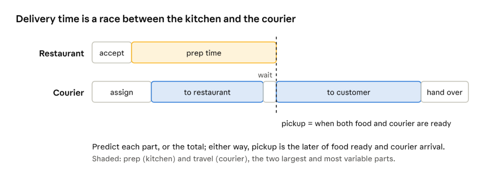

# 45 · Marketplace and logistics ML

Part XI · Applied ML systems (optional track). Assumes Chapters 3, 4 and 40 (fundamentals, forecasting metrics, gradient boosting) and Chapter 2 (experiments). Worked designs that build on it: E.8 Demand forecasting for quick commerce, and the marketplace parts of E.1.

## Why it matters

Delivery companies are logistics businesses with an app on top. Demand forecasts decide how many couriers to schedule and how much stock a dark store holds; ETA predictions set customer expectations and drive dispatch; balancing supply and demand decides delivery times and courier earnings; prices and incentives steer both sides. These are the problems delivery platforms spend most of their applied ML effort on, and interviewers at these companies expect you to speak about them fluently, even for a role focused on LLMs and recommendations.

## Key concepts

- **Demand forecasting**: predicting orders by area and time slot to plan couriers and stock; classic time-series methods and gradient boosting both matter. [Forecasting: Principles and Practice](https://otexts.com/fpp3/) (free book).
- **Quantile and probabilistic forecasts**: predicting a range (for example the 90th percentile), because staffing decisions depend on the tail. [Quantile regression](https://en.wikipedia.org/wiki/Quantile_regression).
- **ETA prediction**: estimating preparation, pickup and travel time; errors are asymmetric because late is worse than early. [Uber: DeepETA](https://www.uber.com/blog/deepeta-how-uber-predicts-arrival-times/).
- **Dispatch and assignment**: matching orders to couriers as an optimisation problem, often with batching. [Assignment problem](https://en.wikipedia.org/wiki/Assignment_problem), [Hungarian algorithm](https://en.wikipedia.org/wiki/Hungarian_algorithm).
- **Marketplace balance and dynamic pricing**: delivery fees and courier incentives that steer supply and demand.
- **Uplift modelling**: predicting who changes behaviour because of an incentive, not who would act anyway. [Uplift modelling](https://en.wikipedia.org/wiki/Uplift_modelling).
- **Switchback experiments**: randomising by area and time window when users share couriers, because user-level A/B tests leak (Chapter 2).

## 45.1 Demand forecasting

**What is forecast:** orders per zone per 15–60 minutes (for courier staffing), units per product per store per day (for quick-commerce stock, E.8), restaurant order volume (for partner prep). The decision sets the granularity, horizon and loss: under-staffing costs late deliveries, over-staffing costs idle courier pay.

**Baselines first.** Seasonal naive (same hour last week) is often hard to beat for strongly weekly patterns; moving averages of the same hour over recent weeks smooth noise.

**Gradient boosting with lag features** is the workhorse: one global model across all zones or products, with features computed point-in-time:

- Calendar: hour, day of week, holidays, Ramadan and Eid in the Gulf, paydays, school holidays.
- Lags at the forecast horizon or beyond (same hour 7 and 14 days ago), rolling means of the same hour.
- Weather forecasts (rain sharply raises delivery demand), events (football matches), marketing campaigns.
- Entity features: zone, store size, number of open restaurants.

```python
import numpy as np, pandas as pd, lightgbm as lgb

def add_features(df):
    """df: one row per (zone, hour) with ts and orders, sorted by zone and ts."""
    df = df.copy()
    df["hour"], df["dow"] = df.ts.dt.hour, df.ts.dt.dayofweek
    g = df.groupby("zone")["orders"]
    for lag in (24 * 7, 24 * 14):                          # lags ≥ the forecast horizon: no leakage
        df[f"lag_{lag}"] = g.shift(lag)
    df["roll_mean_same_hour"] = (df.groupby(["zone", "hour"])["orders"]
                                   .transform(lambda s: s.shift(7).rolling(4, min_periods=1).mean()))
    return df

def wape(y, p):
    return np.abs(y - p).sum() / np.abs(y).sum()

cols = ["zone", "hour", "dow", "lag_168", "lag_336", "roll_mean_same_hour"]
model = lgb.LGBMRegressor(n_estimators=400, learning_rate=0.05).fit(train[cols], train["orders"])
q90 = lgb.LGBMRegressor(objective="quantile", alpha=0.9, n_estimators=400).fit(train[cols], train["orders"])
```

On four months of synthetic hourly demand for five zones (with lunch and dinner peaks, weekend uplift and slow growth), seasonal naive scored WAPE 0.136 and LightGBM 0.108 on the last two weeks. The P90 quantile model covered only 82% of actual values, not 90%: quantile models often under-cover and need checking and calibration (for example conformal prediction on recent residuals) before staffing on them.

**Deep models** (DeepAR, N-BEATS, N-HiTS, Temporal Fusion Transformer, and pretrained time-series foundation models) can help with many related series and rich covariates; on typical company data, a well-featured GBDT is a strong default and the baseline any deep model must beat.

**Hard parts interviewers like:**

- **Hierarchies:** city → zone → store; forecasts should add up. Reconcile with bottom-up, top-down or optimal reconciliation (MinT).
- **Intermittent demand:** many products sell zero most days; use Tweedie or Poisson losses, or Croston-style methods.
- **Censored demand:** when a product was out of stock, sales understate demand. Exclude or impute stock-out periods, or model availability explicitly (E.8).
- **Feedback loops:** the forecast drives staffing and stock, which drive what you observe next.
- **Evaluation:** WAPE and bias overall and per segment; pinball loss for quantiles; backtest with rolling origins (Chapter 3.6), at the horizon you will actually forecast.

## 45.2 ETA prediction

The ETA shown at checkout is a promise: too optimistic and orders arrive late (complaints, refunds, churn), too pessimistic and customers order elsewhere. ETAs also feed dispatch (when to send the courier) and ranking (Chapter 44.7).



*anatomy of a delivery · kitchen and courier timelines, illustrative*

**Decompose or predict the total?** Predicting components (prep time, courier travel to the restaurant, wait, travel to the customer, hand-over) gives separate signals for dispatch and diagnosis; predicting the total end to end is simpler and often more accurate for the customer-facing number. Many companies do both: component models for operations, an end-to-end model (using component predictions as features) for the promise.

**Features:** restaurant prep-time history by hour and item count, current kitchen load (open orders), courier supply and distance, routing-engine travel times, weather, time of day, basket size, building type (stairs, gated compounds, high-rises are common in Dubai).

**Loss and promise.** The mean minimises squared error, but customers care about lateness. Predict a quantile (P70–P90) for the shown ETA, or a distribution, and choose the quantile by trading conversion against lateness in an experiment. Show a range ("25–35 min") when uncertainty is high.

**Evaluation:** MAE and bias; percentage of orders later than promised; error percentiles (P90 absolute error); calibration of quantiles (does P80 cover 80%?); per city, restaurant type and hour. Online: conversion, late-order rate, complaints.

**Traps:** labels are affected by the system itself (couriers dispatched by an earlier ETA); timestamps reported by couriers or restaurants are noisy ("picked up" pressed late); and point-in-time features matter (kitchen load at order time, not at pickup).

## 45.3 Supply-demand balancing and optimisation basics

Prediction tells you what will happen; optimisation decides what to do about it. Three classic problems:

**Dispatch as an assignment problem.** Match couriers to orders to minimise total pickup time (or a weighted cost of lateness, distance and fairness). Greedy assignment (each order takes the nearest free courier) is fast but globally poor; the Hungarian algorithm solves the batch exactly.

```python
import numpy as np
from scipy.optimize import linear_sum_assignment

cost = np.linalg.norm(couriers[:, None, :] - orders[None], axis=2) / speed_km_per_min   # (couriers, orders)
rows, cols = linear_sum_assignment(cost)          # optimal one-to-one matching
total_minutes = cost[rows, cols].sum()
```

On a random instance with 6 couriers and 5 orders, optimal assignment needed 45.1 total pickup minutes against 50.0 for greedy order-by-order matching. Real dispatch adds batching (one courier, two orders), time windows, food readiness, and runs every few seconds on a rolling horizon.

**Rebalancing as a linear programme.** Given idle couriers per zone and forecast need for the next 30 minutes, move couriers at minimum travel cost so every zone is covered:

```python
from scipy.optimize import linprog

# x[i, j] = couriers moved from zone i to zone j (x[i, i] = staying)
# minimise sum(dist[i, j] * x[i, j])
# subject to: sum_j x[i, j] <= supply[i]   (cannot move more than you have)
#             sum_i x[i, j] >= need[j]      (each zone ends with at least its need)
n = len(supply)
A_ub, b_ub = [], []
for i in range(n):
    row = np.zeros(n * n); row[i * n:(i + 1) * n] = 1; A_ub.append(row); b_ub.append(supply[i])
for j in range(n):
    row = np.zeros(n * n); row[j::n] = -1; A_ub.append(row); b_ub.append(-need[j])
res = linprog(dist.flatten(), A_ub=np.array(A_ub), b_ub=np.array(b_ub), bounds=(0, None), method="highs")
moves = res.x.reshape(n, n)
```

With supply (12, 3, 8, 2) and need (6, 7, 5, 7) across four zones, the solver moves 4 couriers from zone 1 to zone 2, 2 from zone 1 to zone 4, and 3 from zone 3 to zone 4, at minimum total distance. In practice couriers are independent workers, so "moves" become incentives or heat-map suggestions, not orders, and the LP output feeds those.

**Staffing.** Turn demand forecasts into courier hours per zone and slot with a target service level (for example, 90% of orders picked up within 10 minutes), often via queueing approximations or simulation; then schedule shifts to cover the requirement at minimum cost.

**Vocabulary to use in interviews:** linear programming (continuous, convex, fast), integer programming (whole couriers, harder), assignment and matching, vehicle routing (with time windows, NP-hard, solved with heuristics such as those in OR-Tools), and the idea of **predict-then-optimise**: forecast errors matter differently depending on the decision they feed.

## 45.4 Pricing and incentives (conceptual)

- **Delivery fees and surge:** raising fees when supply is short reduces demand to what couriers can serve and funds incentives; too much hurts conversion and trust. Decisions rest on **price elasticity**, estimated from experiments, since observational price data is confounded (prices rise when demand is high).
- **Courier incentives:** guaranteed earnings or bonuses for working in busy zones and hours shift supply where forecasts show gaps.
- **Customer promotions and vouchers:** target by incremental effect (uplift, Chapter 2.10), not by likelihood to order, or you pay people who would have ordered anyway.
- **Partner commissions and ads:** affect which restaurants join and how they are ranked (Chapter 44.7, E.7).

In interviews, show you understand the two-sided effects: every pricing lever moves both demand and supply, and the right metric is marketplace-level (orders delivered on time, total contribution), not one side's.

## 45.5 Experiments in two-sided marketplaces

Covered in Chapter 2.9: user-level A/B tests are biased whenever treatment and control compete for the same couriers or restaurant capacity (dispatch, pricing, incentives, ETA changes that shift demand). Use switchbacks (city × time slots), geo experiments, or both, with slot-level analysis and carryover buffers. Combine with simulation before live tests for changes that could hurt service levels.

## Pitfalls

- **Random splits for forecast evaluation;** always backtest by time at the real horizon.
- **Lags shorter than the horizon** (using yesterday's value to forecast a week ahead).
- **Ignoring stock-outs,** so demand forecasts learn sales capped by availability.
- **Point forecasts for staffing and stock decisions** that need quantiles.
- **Uncalibrated quantiles** (a "P90" that covers 82%).
- **Mean-based ETAs** shown as promises.
- **Greedy dispatch evaluated only per order,** never on total system cost.
- **Optimising one side** (customer ETA) while hurting the other (courier earnings).
- **User-level A/B tests for supply-side changes.**
- **Pricing decisions from observational elasticities.**

## Interview questions

Questions 1–4 basic, 5–9 intermediate, 10–13 senior.

**1. How would you forecast hourly orders per zone?** Seasonal-naive baseline; then a global GBDT with calendar, lags at or beyond the horizon, rolling same-hour means, weather and events; backtest by time; WAPE and bias per zone; quantiles for staffing.

**2. Why WAPE rather than MAPE for demand?** MAPE explodes for small actuals (quiet hours, small zones) and is undefined at zero; WAPE weights errors by volume (Chapter 4.5).

**3. What is the assignment problem?** Matching agents to tasks one-to-one at minimum total cost; solved exactly by the Hungarian algorithm (`linear_sum_assignment`); the core of batch dispatch.

**4. What would you predict for an ETA shown to customers?** A high quantile (P70–P90) or a range, chosen by experiment, rather than the mean, because lateness costs more than earliness.

**5. How do you handle censored demand in quick commerce?** Flag stock-out periods; exclude or impute them; model sales as min(demand, stock); use availability as a feature; treat forecasts as unconstrained demand.

**6. How do you make forecasts at store level add up to city level?** Hierarchical reconciliation: bottom-up, top-down, or optimal combination (MinT), and evaluate at the levels where decisions are made.

**7. Decompose ETA or predict end to end?** Components help dispatch and diagnosis and allow targeted fixes; end-to-end often gives the best customer-facing number; combine by feeding component predictions into an end-to-end model.

**8. Your P90 forecast covers 80% of outcomes. What do you do?** Recalibrate with conformal prediction or an empirical correction on recent residuals, check by segment and horizon, and investigate drift (new demand patterns, events).

**9. How would you rebalance couriers?** Forecast need per zone for the next window, solve a min-cost transport LP from surplus to deficit zones, then translate moves into incentives or suggestions; evaluate with a switchback test.

**10. Design ETA prediction for a new city with little data.** Global model trained on all cities with city-level features; routing-engine travel times as features; prep-time priors by cuisine and restaurant size; wider quantiles initially; fast feedback loop; monitor late rate daily.

**11. A new dispatch algorithm reduces average pickup time in simulation. How do you launch it?** Check simulation assumptions against real data, then a switchback test across cities and time slots measuring delivery time, late rate, courier utilisation and earnings, cancellations; guardrails; gradual rollout.

**12. How do forecast errors translate into business cost, and how would you choose the loss?** Under-forecast causes late deliveries and lost orders; over-forecast causes idle courier pay or wasted stock. Estimate both costs, and choose the quantile q = cost_under / (cost_under + cost_over) (the newsvendor result) as the forecast target.

**13. How would you decide delivery fees by zone and time?** Estimate elasticities with randomised experiments; model demand and supply responses; optimise fees for marketplace-level objectives (orders delivered on time, contribution, fairness) under constraints; test with switchbacks; watch long-term retention.

## Practice

1. **Forecasting:** on the M5 (Walmart) dataset or a public bike-sharing or taxi demand dataset, build seasonal naive, LightGBM with lags and a quantile model; backtest with rolling origins; report WAPE, bias and quantile coverage.
2. **Conformal calibration:** calibrate the quantile model's intervals with recent residuals and re-check coverage.
3. **Dispatch:** simulate a small city with couriers and orders arriving over time; compare greedy and Hungarian batch assignment on average and P90 pickup times.
4. **Rebalancing LP:** extend the LP with a cap on moves per courier and a cost for leaving demand uncovered.
5. **ETA:** on the NYC taxi trip duration dataset, predict P50 and P80 trip durations; evaluate calibration and late rate.
6. **Design drill:** answer E.8 (quick-commerce demand forecasting) aloud in 35 minutes, then compare with the model answer.

## Read next

- Hyndman and Athanasopoulos, *Forecasting: Principles and Practice* (3rd edition, free online): chapters on benchmarks, evaluation, hierarchical forecasting.
- Makridakis et al., *The M5 Accuracy Competition: Results, Findings and Conclusions* (2022): why gradient boosting won.
- Engineering blogs of DoorDash, Uber, Instacart and Lyft on ETA prediction, dispatch, forecasting and switchback experiments.
- Salinas et al., *DeepAR* (2017); Lim et al., *Temporal Fusion Transformers* (2019).
- Angelopoulos and Bates, *A Gentle Introduction to Conformal Prediction* (2021).
- Google OR-Tools documentation: assignment, linear programming and vehicle routing guides.

**Links:** [Forecasting: Principles and Practice](https://otexts.com/fpp3/) · [Uber: DeepETA](https://www.uber.com/blog/deepeta-how-uber-predicts-arrival-times/) · [Trustworthy Online Controlled Experiments](https://experimentguide.com/). Other titles above can be found by searching their title.

## Done when

You can build and backtest a demand forecast with GBDT and lags, and beat seasonal naive.

You can explain hierarchies, intermittent and censored demand, and quantile calibration.

You can design ETA prediction, choose a quantile for the promise, and evaluate it.

You can solve assignment and transport problems with SciPy and explain predict-then-optimise.

You can discuss pricing and incentives with two-sided effects.

You can design a switchback test for a supply-side change.

---

[← 44 · Search ranking and learning to rank](44-search-and-learning-to-rank.md) · [Contents](../README.md#contents) · [46 · ML system design: the method →](46-ml-system-design.md)
