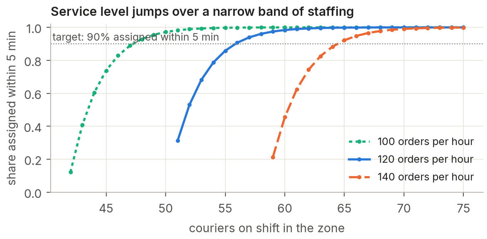

# 45 · Marketplace and logistics ML

Part XI · Applied ML systems (optional track). Assumes Chapters 3, 4 and 40 (fundamentals, forecasting metrics, gradient boosting) and Chapter 2 (experiments). Worked designs that build on it: E.8 Demand forecasting for quick commerce, and the marketplace parts of E.1.

## Why it matters

Delivery companies are logistics businesses with an app on top. Demand forecasts decide how many couriers to schedule and how much stock a dark store holds; ETA predictions set customer expectations and drive dispatch; balancing supply and demand decides delivery times and courier earnings; prices and incentives steer both sides. These are the problems delivery platforms spend most of their applied ML effort on, and interviewers at these companies expect you to speak about them fluently, even for a role focused on LLMs and recommendations.

The chapter covers the core models of a delivery marketplace in the order a day's operations depend on them. Demand forecasting (45.1) decides how many couriers are needed where; ETA prediction (45.2) sets the promise each customer sees; supply-demand balancing (45.3) turns predictions into decisions with optimisation; and pricing and incentives (45.4) steer both sides of the market. Section 45.5 links to marketplace experiments, and 45.6 works through a staffing plan.

The same problems appear under other names across big tech. Ride-hailing (Uber, Lyft) has the same dispatch, ETA and surge-pricing problems with drivers instead of couriers. E-commerce fulfilment forecasts units per product per warehouse with the same censored, intermittent demand. Cloud providers forecast capacity and size server fleets with the same queueing and quantile arguments, and support-team staffing is the textbook home of the Erlang C model used in 45.6. Ads delivery adds budget pacing, a forecasting-plus-control problem of the same shape. An interviewer asking about any of these is testing whether you can connect a probabilistic forecast to a decision with asymmetric costs, and whether you know which experiment gives an unbiased answer when both sides of a market share supply.

The recurring theme is that a prediction is only useful through the decision it feeds, and the decision usually has asymmetric costs. A late delivery costs more than an early one, and an idle courier costs less than an unserved order, so the right model often predicts a quantile or a distribution rather than the average.

## Key concepts

- **Demand forecasting**: predicting orders by area and time slot to plan couriers and stock; classic time-series methods and gradient boosting both matter. [Forecasting: Principles and Practice](https://otexts.com/fpp3/) (free book).
- **Quantile and probabilistic forecasts**: predicting a range (for example the 90th percentile), because staffing decisions depend on the tail. [Quantile regression](https://en.wikipedia.org/wiki/Quantile_regression).
- **ETA prediction**: estimating preparation, pickup and travel time; errors are asymmetric because late is worse than early. [Uber: DeepETA](https://www.uber.com/blog/deepeta-how-uber-predicts-arrival-times/).
- **Dispatch and assignment**: matching orders to couriers as an optimisation problem, often with batching. [Assignment problem](https://en.wikipedia.org/wiki/Assignment_problem), [Hungarian algorithm](https://en.wikipedia.org/wiki/Hungarian_algorithm).
- **Marketplace balance and dynamic pricing**: delivery fees and courier incentives that steer supply and demand.
- **Uplift modelling**: predicting who changes behaviour because of an incentive, not who would act anyway. [Uplift modelling](https://en.wikipedia.org/wiki/Uplift_modelling).
- **Switchback experiments**: randomising by area and time window when users share couriers, because user-level A/B tests leak (Chapter 2).

## 45.1 Demand forecasting

**What is forecast:** orders per zone per 15–60 minutes (for courier staffing), units per product per store per day (for quick-commerce stock, E.8), restaurant order volume (for partner prep). The decision sets the granularity, horizon and loss: under-staffing costs late deliveries, over-staffing costs idle courier pay.

**Baselines first.** Seasonal naive (same hour last week) is often hard to beat for strongly weekly patterns; moving averages of the same hour over recent weeks smooth noise.

**Gradient boosting with lag features** is the workhorse: one global model across all zones or products, with features computed point-in-time:

- Calendar: hour, day of week, holidays, Ramadan and Eid in the Gulf, paydays, school holidays.
- Lags at the forecast horizon or beyond (same hour 7 and 14 days ago), rolling means of the same hour.
- Weather forecasts (rain sharply raises delivery demand), events (football matches), marketing campaigns.
- Entity features: zone, store size, number of open restaurants.

```python
import numpy as np, pandas as pd, lightgbm as lgb

def add_features(df):
    """df: one row per (zone, hour) with ts and orders, sorted by zone and ts."""
    df = df.copy()
    df["hour"], df["dow"] = df.ts.dt.hour, df.ts.dt.dayofweek
    g = df.groupby("zone")["orders"]
    for lag in (24 * 7, 24 * 14):                          # lags ≥ the forecast horizon: no leakage
        df[f"lag_{lag}"] = g.shift(lag)
    # same weekday and hour over the previous four weeks: within each (zone, dow, hour)
    # group consecutive rows are 7 days apart, so shift(1) is "last week"
    df["roll_mean_same_dow_hour"] = (df.groupby(["zone", "dow", "hour"])["orders"]
                                       .transform(lambda s: s.shift(1).rolling(4, min_periods=1).mean()))
    return df

def wape(y, p):
    return np.abs(y - p).sum() / np.abs(y).sum()

cols = ["zone", "hour", "dow", "lag_168", "lag_336", "roll_mean_same_dow_hour"]
model = lgb.LGBMRegressor(n_estimators=400, learning_rate=0.05).fit(train[cols], train["orders"])
q90 = lgb.LGBMRegressor(objective="quantile", alpha=0.9, n_estimators=400).fit(train[cols], train["orders"])
```

On four months of synthetic hourly demand for five zones (with lunch and dinner peaks, weekend uplift and slow growth), seasonal naive scored WAPE 0.136 and LightGBM 0.110 on the last two weeks (`code/ch45_check.py`). The P90 quantile model covered only 82.5% of actual values, not 90%: quantile models often under-cover and need checking and calibration before staffing on them. (A note on the rolling feature: grouping by (zone, hour) alone and shifting by 7 rows would average the same hour on days 7–10 ago, mixing weekdays. Grouping by weekday as well gives the "same hour on the same weekday over recent weeks" the text describes.)

### Calibrating quantiles with conformal prediction

**Split conformal** turns any quantile model into one with a coverage guarantee, as long as the calibration data and the future are exchangeable. Hold out a calibration window the model did not train on (the last two weeks of the training period, say). For each calibration point compute the score Eᵢ = yᵢ − q̂(xᵢ): how far the truth fell above the predicted P90. Then shift every future forecast up by the empirical quantile of those scores at level (1 − α)(1 + 1/n), where n is the number of calibration points and α = 0.1 for a P90. The (1 + 1/n) factor is the finite-sample correction that makes the guarantee exact. Applied to both ends of an interval, this is conformalised quantile regression (CQR, Romano, Patterson and Candès, 2019).

On the synthetic data, with 1,680 calibration hours, the shift is +1.9 orders and coverage rises from 81.9% to 87.8% (the quantile model refitted without the calibration window). It does not reach 90%, and the reason is the useful lesson: demand grows over time, so the test period is not exchangeable with the calibration window and the guarantee does not hold. In production, recompute the shift on a rolling recent window, or use an adaptive variant that raises the shift after each miss and lowers it after each hit, so coverage tracks drift.

**Deep models** (DeepAR, N-BEATS, N-HiTS, Temporal Fusion Transformer, and pretrained time-series foundation models) can help with many related series and rich covariates; on typical company data, a well-featured GBDT is a strong default and the baseline any deep model must beat.

**Time-series foundation models** (Amazon's Chronos, Google's TimesFM and similar) are transformers pretrained on large collections of public and synthetic series and used zero-shot: give them a history, get a forecast distribution, no training. They help most where GBDT is weakest: new series with little history (a new zone, a new product), many short series without good covariates, and quick baselines. They usually lose to a tuned GBDT when the drivers are known covariates the foundation model cannot see (weather, promotions, holidays, courier supply), which is the common case in delivery. The honest interview answer: try one zero-shot as a baseline and as a fallback for cold-start series, and keep the GBDT where covariates carry the signal.

**Hard parts interviewers like:**

- **Hierarchies:** city → zone → store; forecasts should add up. Reconcile with bottom-up, top-down or optimal reconciliation (MinT). Bottom-up is noisy because store-level series are noisy; top-down loses local patterns. MinT (minimum trace, Wickramasuriya, Athanasopoulos and Hyndman, 2019) forecasts every level independently, then finds the coherent set closest to them, weighting each level by the inverse of its forecast-error covariance, so the more reliable levels pull harder.
- **Intermittent demand:** many products sell zero most days; use Tweedie or Poisson losses, or Croston-style methods. Croston's method forecasts the size of non-zero demands and the interval between them separately and divides one by the other, which beats a moving average that smears demand across zero days. The Tweedie loss models a distribution with a point mass at zero and a continuous positive part, so one GBDT learns both "will it sell" and "how much"; it was a common choice among strong M5 entries.
- **Censored demand:** when a product was out of stock, sales understate demand. Exclude or impute stock-out periods, or model availability explicitly (E.8).
- **Feedback loops:** the forecast drives staffing and stock, which drive what you observe next.
- **Evaluation:** WAPE and bias overall and per segment; pinball loss for quantiles; backtest with rolling origins (Chapter 3.6), at the horizon you will actually forecast.

## 45.2 ETA prediction

The ETA shown at checkout is a promise: too optimistic and orders arrive late (complaints, refunds, churn), too pessimistic and customers order elsewhere. ETAs also feed dispatch (when to send the courier) and ranking (Chapter 44.7).


*anatomy of a delivery · kitchen and courier timelines, illustrative*

**Decompose or predict the total?** Predicting components (prep time, courier travel to the restaurant, wait, travel to the customer, hand-over) gives separate signals for dispatch and diagnosis; predicting the total end to end is simpler and often more accurate for the customer-facing number. Many companies do both: component models for operations, an end-to-end model (using component predictions as features) for the promise.

**Features:** restaurant prep-time history by hour and item count, current kitchen load (open orders), courier supply and distance, routing-engine travel times, weather, time of day, basket size, building type (stairs, gated compounds, high-rises are common in Dubai).

**Predict the residual over a routing engine.** A routing engine (OSRM, Google Maps, an in-house graph) already knows road distances, speeds and traffic. Rather than learn travel time from scratch, the strongest industrial ETA models predict a *correction* to the routing engine's estimate: ETA = routing ETA + f(features), where f learns what the map cannot see (parking at a mall, building entrances, courier behaviour, the time a restaurant really takes at peak). Uber's DeepETA is the published example: a transformer over many features that predicts the residual over the routing engine's ETA. The residual has a much smaller range than the total, so it is easier to learn, and the system degrades gracefully to the routing estimate when the model is unsure or down.

**Loss and promise.** The mean minimises squared error, but customers care about lateness. Predict a quantile (P70–P90) for the shown ETA, or a distribution, and choose the quantile by trading conversion against lateness in an experiment. Show a range ("25–35 min") when uncertainty is high. Training with an asymmetric loss does this directly: the pinball (quantile) loss at level τ charges τ per minute of under-prediction and 1 − τ per minute of over-prediction, so at τ = 0.8 being 5 minutes late costs four times as much as being 5 minutes early, and the minimiser is the 80th percentile. DeepETA used an asymmetric Huber loss for the same reason: robust to outliers like the Huber loss, but tilted so that lateness costs more.

**Evaluation:** MAE and bias; percentage of orders later than promised; error percentiles (P90 absolute error); calibration of quantiles (does P80 cover 80%?); per city, restaurant type and hour. Online: conversion, late-order rate, complaints.

**Traps:** labels are affected by the system itself (couriers dispatched by an earlier ETA); timestamps reported by couriers or restaurants are noisy ("picked up" pressed late); and point-in-time features matter (kitchen load at order time, not at pickup).

## 45.3 Supply-demand balancing and optimisation basics

Prediction tells you what will happen; optimisation decides what to do about it. Three classic problems:

**Dispatch as an assignment problem.** Match couriers to orders to minimise total pickup time (or a weighted cost of lateness, distance and fairness). Greedy assignment (each order takes the nearest free courier) is fast but globally poor; the Hungarian algorithm solves the batch exactly.

```python
import numpy as np
from scipy.optimize import linear_sum_assignment

cost = np.linalg.norm(couriers[:, None, :] - orders[None], axis=2) / speed_km_per_min   # (couriers, orders)
rows, cols = linear_sum_assignment(cost)          # optimal one-to-one matching
total_minutes = cost[rows, cols].sum()
```

On a random instance with 6 couriers and 5 orders, optimal assignment needed 45.1 total pickup minutes against 50.0 for greedy order-by-order matching. Real dispatch adds batching (one courier, two orders), time windows, food readiness, and runs every few seconds on a rolling horizon.

**Why real dispatch is not one Hungarian call.** Three things break the clean assignment problem. *Batching*: giving one courier two orders from the same restaurant saves a trip, but it is no longer one-to-one matching; it is a vehicle-routing problem, NP-hard, solved with heuristics. *Time*: orders and couriers arrive continuously, so the dispatcher must decide how long to wait. A longer batching window (collect orders for 60 seconds, then match) finds better batches and better matches, but every second of waiting is a second of delay for the first order in the window; a window of a minute or two is a typical compromise, tuned by switchback tests. *Readiness*: a courier sent too early waits at the restaurant (wasted courier time), too late and the food waits (cold food), so the assignment uses predicted prep time. The practical answer is a rolling-horizon heuristic: every few seconds, solve a matching or insertion problem over the current open orders and available couriers, commit only the assignments that are urgent, and leave the rest open for the next round, when better information may arrive. Some companies learn the value of waiting with reinforcement learning (the value of a courier in a zone at a time), and use that value inside the matching cost. What breaks at scale: solve time grows quickly with batch size, so cities are partitioned into regions solved independently, at the cost of worse matches at region borders.

**Rebalancing as a linear programme.** Given idle couriers per zone and forecast need for the next 30 minutes, move couriers at minimum travel cost so every zone is covered:

```python
from scipy.optimize import linprog

# x[i, j] = couriers moved from zone i to zone j (x[i, i] = staying)
# minimise sum(dist[i, j] * x[i, j])
# subject to: sum_j x[i, j] <= supply[i]   (cannot move more than you have)
#             sum_i x[i, j] >= need[j]      (each zone ends with at least its need)
n = len(supply)
A_ub, b_ub = [], []
for i in range(n):
    row = np.zeros(n * n); row[i * n:(i + 1) * n] = 1; A_ub.append(row); b_ub.append(supply[i])
for j in range(n):
    row = np.zeros(n * n); row[j::n] = -1; A_ub.append(row); b_ub.append(-need[j])
res = linprog(dist.flatten(), A_ub=np.array(A_ub), b_ub=np.array(b_ub), bounds=(0, None), method="highs")
moves = res.x.reshape(n, n)
```

With supply (12, 3, 8, 2) and need (6, 7, 5, 7) across four zones, the solver moves 4 couriers from zone 1 to zone 2, 2 from zone 1 to zone 4, and 3 from zone 3 to zone 4, at minimum total distance. In practice couriers are independent workers, so "moves" become incentives or heat-map suggestions, not orders, and the LP output feeds those.

**Staffing.** Turn demand forecasts into courier hours per zone and slot with a target service level (for example, 90% of orders picked up within 10 minutes), often via queueing approximations or simulation; then schedule shifts to cover the requirement at minimum cost.



*Share of orders assigned a courier within 5 minutes, by couriers on shift, from the Erlang C queueing model. Each order keeps a courier busy for 25 minutes on average. Below the offered load (orders per hour × hours per order) the queue grows without bound, so those points are omitted.*

### The Erlang C model and its assumptions

**Motivation.** A forecast says 120 orders an hour; dispatch needs a number of couriers. Dividing demand by throughput gives the *minimum* (the offered load), but at exactly that number the queue never clears: any burst of orders waits, and waits grow without bound. The question is how much above the load to staff for a service target, and queueing theory answers it.

**The model.** Treat the zone as an M/M/c queue. Orders arrive as a Poisson process at rate λ (orders per hour). Each order occupies one courier for an exponentially distributed time with mean 1/μ (25 minutes here, so μ = 2.4 orders per courier-hour). There are c couriers, and an order that finds them all busy waits in one queue. The offered load a = λ/μ is the average number of busy couriers: 120/2.4 = 50. The probability that an arriving order has to wait at all is the Erlang C formula:

$$
C(c,a) = \frac{\frac{a^c}{c!}\,\frac{c}{c-a}}{\sum_{k=0}^{c-1} \frac{a^k}{k!} + \frac{a^c}{c!}\,\frac{c}{c-a}}
$$

It needs c > a; otherwise every order waits and the queue grows. Given that an order waits, its wait is exponential with rate cμ − λ (the rate at which the c couriers free up, minus the arrival rate), so:

$$
P(W > t) = C(c,a)\, e^{-(c\mu - \lambda)\, t}
$$

**Worked example.** λ = 120 per hour, 1/μ = 25 minutes, target P(W ≤ 5 min) ≥ 0.9. With c = 56: C(56, 50) = 0.309, cμ − λ = 56 × 2.4 − 120 = 14.4 per hour = 0.24 per minute, so P(W > 5) = 0.309 × e^{−1.2} = 0.093 and the service level is 90.7%. With 55 couriers it is 85.9%, so 56 is the answer. In code, compute C(c, a) through the stable Erlang B recursion rather than the factorials, which overflow (`code/ch45_check.py`).

**The assumptions, and why they break.** Poisson arrivals are reasonable within an hour but not across the hour boundary or during a promotion burst. Exponential service times understate the variance of real delivery times (long trips to the edge of the zone), and more variance means longer queues, so Erlang C is optimistic. Couriers are not interchangeable servers: service time depends on distance from the restaurant, which depends on which courier is assigned. Batching breaks "one order, one courier". Couriers log off and on. And "late" here means "no courier assigned within 5 minutes", not "delivered late". So use Erlang C for the shape of the answer and a first number, then calibrate the conversion from demand to couriers with a simulation fitted to real delivery logs, or directly from observed service levels at different staffing ratios.

**Square-root staffing.** The number of couriers needed is the offered load plus a safety margin that grows with its square root: c ≈ a + β√a. For 120 orders an hour the load is 50 couriers, and the 90%-within-5-minutes target needs 56, so β is about 0.85. The margin is a smaller fraction of the load in busy zones, which is why pooling neighbouring zones saves couriers. The reason is the law of large numbers: the standard deviation of a Poisson count grows as the square root of its mean, so the buffer needed to absorb fluctuations grows as √a, not as a. Two zones with 120 orders an hour each need 2 × 56 = 112 couriers if staffed separately; one pooled zone with 240 orders an hour (load 100) needs 107 by Erlang C for the same target, five fewer.

**Vocabulary to use in interviews:** linear programming (continuous, convex, fast), integer programming (whole couriers, harder), assignment and matching, vehicle routing (with time windows, NP-hard, solved with heuristics such as those in OR-Tools), and the idea of **predict-then-optimise**: forecast errors matter differently depending on the decision they feed.

## 45.4 Pricing and incentives (conceptual)

Pricing decides who uses the marketplace and when. Four levers matter, and each moves both sides of the market at once.

**Delivery fees and surge.** Raising fees when supply is short reduces demand to what couriers can serve and funds incentives; too much hurts conversion and trust. Decisions rest on **price elasticity**, the percentage change in orders per percentage change in price, estimated from experiments, since observational price data is confounded (prices rise when demand is high). **Courier incentives** (guaranteed earnings or bonuses for working in busy zones and hours) shift supply where forecasts show gaps. **Customer promotions and vouchers** should be targeted by incremental effect (uplift, Chapter 2.10), not by likelihood to order, or you pay people who would have ordered anyway. **Partner commissions and ads** affect which restaurants join and how they are ranked (Chapter 44.7, E.7).

### A worked elasticity estimate

A switchback test alternates a zone's delivery fee between €2.99 and €3.49 in randomised 30-minute slots for two weeks. In the €2.99 slots, 20.0% of sessions convert; in the €3.49 slots, 19.0%. The price change is +16.7% and the conversion change −5.0%, so the elasticity is −5.0 / 16.7 ≈ −0.30: demand is inelastic in this range. Follow it through the marketplace for a zone with 600 sessions an hour:

| Quantity | €2.99 | €3.49 |
|---|---|---|
| Orders per hour | 120 | 114 |
| Fee revenue per hour | €359 | €398 |
| Courier load (orders/h × 25 min) | 50.0 | 47.5 |

Fewer orders, more fee revenue, and 2.5 fewer busy couriers, which at the 56-courier staffing level of 45.6 shortens waits for everyone else. Whether the change is good depends on the guardrails the test also measures: retention of the users who saw the higher fee, and courier earnings, which fall with fewer orders.

**Why the naive regression gets the wrong sign.** Regress hourly orders on the fee in historical data and the slope comes out *positive*: high fees go with many orders. Surge pricing raises the fee exactly when underlying demand is high (Friday dinner, rain), so the fee is a proxy for demand. In a simulation with a true elasticity of −0.30 and surge pricing on busy hours, the observational log-log slope is +1.50 (`code/ch45_check.py`). Only randomisation (or a credible instrument, such as fee changes driven by an unrelated cost rule) breaks the link between the fee and the demand shock.

In interviews, show you understand the two-sided effects: every pricing lever moves both demand and supply, and the right metric is marketplace-level (orders delivered on time, total contribution), not one side's. Also name the long-term effects a two-week test misses: users who learn to avoid surge hours, couriers who leave when earnings fall, and the trust cost of fees that feel arbitrary. These are why most companies cap surge, and why "when not to surge" (an emergency, a regulated market, a brand-new city still building trust) is a fair senior question.

## 45.5 Experiments in two-sided marketplaces

Covered in Chapter 2.9: user-level A/B tests are biased whenever treatment and control compete for the same couriers or restaurant capacity (dispatch, pricing, incentives, ETA changes that shift demand). Use switchbacks (city × time slots), geo experiments, or both, with slot-level analysis and carryover buffers. Combine with simulation before live tests for changes that could hurt service levels.

**Simulators, and how to trust them.** A dispatch or staffing simulator replays historical orders (times, restaurants, destinations) against a model of courier behaviour (speeds, acceptance, log-on and log-off) and a candidate policy. It is only as good as its calibration. First, replay the *current* policy and check that the simulator reproduces the observed outcomes: pickup times, delivery times, utilisation and late rates, by city and hour, within a tolerance agreed in advance. Second, check it against the past: for an earlier change that went through a switchback test, the simulator should have predicted the measured effect's direction and rough size. Simulators are weakest exactly where policies change behaviour (couriers reacting to new incentives, customers to new ETAs), so use them to rank candidates and rule out bad ones, and let a switchback make the final decision.

## 45.6 A worked staffing plan

Plan courier shifts for one zone for Friday 19:00–20:00.

1. **Forecast with uncertainty.** The demand model (45.1) predicts 120 orders, and its quantile model gives a 10th–90th percentile range of 101–139. Staffing to the mean is a bet that demand will not be above average, a bet lost half the time.
2. **Convert demand to couriers.** With 25 minutes per order and a target of 90% assigned within 5 minutes, the Erlang C curve gives:

   | Demand (orders/hour) | Offered load (couriers) | Couriers for 90% within 5 min |
   |---|---|---|
   | 100 | 41.7 | 48 |
   | 120 | 50.0 | 56 |
   | 140 | 58.3 | 65 |

3. **Choose the staffing level from the costs.** This is a newsvendor problem.
   - Under-staffing costs late orders: refunds, cancellations and lost repeat orders, say €6 per late order.
   - Over-staffing costs guaranteed courier pay, say €9 per courier-hour.
   - Average the cost of each staffing level over the demand forecast (normal, mean 120, standard deviation 15). For each demand level x, the expected late orders are x × P(W > 5 min) from Erlang C with c couriers (all x when c ≤ x/2.4). The expected cost, 6 × E[late orders] + 9c, falls from €749 at 56 couriers to a minimum of €617 at 65, then rises slowly; 64–66 are within €2 of each other.
   - Q12's newsvendor rule, q = c_u/(c_u + c_o), cannot be applied directly, because the two costs are in different units: euros per late order and euros per courier-hour. Convert by asking what one more courier buys. The 65th courier avoids 1.75 late orders an hour on average, worth €10.49, more than its €9; the 66th avoids 1.38, worth €8.25, less than €9. So 65 is optimal: the marginal analysis is the newsvendor rule in the decision's own units.
   - The optimum lands near staffing for the 90th-percentile demand (139 orders an hour needs 64 couriers), because a missing courier is cheap when demand is low and very expensive when it is high. At 130 orders an hour the 65th courier avoids 0.9 late orders; at 140 it avoids 5.4; at 150, 27. The late-order curve is steep, so the expected value of a courier is dominated by the high-demand tail, which pushes the optimum to a high quantile.
4. **Add flexibility instead of more fixed staff.** Above the plan, use surge incentives for couriers in neighbouring zones and allow cross-zone dispatch. The pooling effect (42.9) means two zones that share couriers need fewer in total than two zones staffed separately.
5. **Check against reality.** After the slot, compare the forecast with actual demand and the planned with the achieved service level. If the service level misses while demand matched the forecast, the queueing assumptions are wrong (for example, service times are longer at peak, because restaurants are slower), and the conversion step needs fixing, not the forecast.

The structure, forecast distribution → queueing model → cost-based quantile → flexibility → feedback, is the answer shape interviewers look for in "how many couriers do we need?" questions.

## Pitfalls

- **Random splits for forecast evaluation;** always backtest by time at the real horizon.
- **Lags shorter than the horizon** (using yesterday's value to forecast a week ahead).
- **Ignoring stock-outs,** so demand forecasts learn sales capped by availability.
- **Point forecasts for staffing and stock decisions** that need quantiles.
- **Uncalibrated quantiles** (a "P90" that covers 82%).
- **Mean-based ETAs** shown as promises.
- **Greedy dispatch evaluated only per order,** never on total system cost.
- **Optimising one side** (customer ETA) while hurting the other (courier earnings).
- **User-level A/B tests for supply-side changes.**
- **Pricing decisions from observational elasticities.**
- **Trusting Erlang C without calibration.** It assumes Poisson arrivals, exponential service and interchangeable couriers; check it against observed service levels.
- **Conformal calibration on a non-exchangeable window.** With trending demand the coverage guarantee fails; recalibrate on a rolling window.

## Interview questions

Questions 1–4 basic, 5–9 intermediate, 10–16 senior.

**1. How would you forecast hourly orders per zone?** Seasonal-naive baseline; then a global GBDT with calendar, lags at or beyond the horizon, rolling same-hour means, weather and events; backtest by time; WAPE and bias per zone; quantiles for staffing. On the chapter's synthetic data this takes WAPE from 0.136 (same hour last week) to 0.110. Follow-up: "why one global model rather than one per zone?" It shares patterns across zones, so small and new zones borrow strength from big ones; add the zone as a feature.

**2. Why WAPE rather than MAPE for demand?** MAPE explodes for small actuals (quiet hours, small zones) and is undefined at zero; WAPE weights errors by volume (Chapter 4.5). An hour with 2 actual orders and a forecast of 4 contributes 100% to MAPE, the same as a peak hour off by half, while WAPE counts it as 2 orders out of the total. Report bias next to it, because WAPE hides a model that is always low.

**3. What is the assignment problem?** Matching agents to tasks one-to-one at minimum total cost; solved exactly by the Hungarian algorithm (`linear_sum_assignment`) in O(n³); the core of batch dispatch. In the chapter's example, the optimal matching needs 45.1 pickup minutes against 50.0 for greedy. It stops being enough once a courier can take two orders, which turns it into a routing problem.

**4. What would you predict for an ETA shown to customers?** A high quantile (P70–P90) or a range, chosen by experiment, rather than the mean, because lateness costs more than earliness. Train with the pinball loss at that quantile, or an asymmetric Huber loss, and check that the P80 really covers 80% per city and hour. Follow-up: too high a quantile loses conversion, so the level is a business choice measured online.

**5. How do you handle censored demand in quick commerce?** Flag stock-out periods; exclude or impute them; model sales as min(demand, stock); use availability as a feature; treat forecasts as unconstrained demand. If you train on raw sales, the forecast learns the stock-outs and recommends ordering less, which causes more stock-outs: a feedback loop.

**6. How do you make forecasts at store level add up to city level?** Hierarchical reconciliation: bottom-up, top-down, or optimal combination (MinT), and evaluate at the levels where decisions are made. MinT forecasts every level, then finds the closest coherent set, weighting levels by the inverse of their error covariance, so it usually beats both bottom-up (noisy) and top-down (blind to local patterns).

**7. Decompose ETA or predict end to end?** Components help dispatch and diagnosis and allow targeted fixes; end-to-end often gives the best customer-facing number; combine by feeding component predictions into an end-to-end model. For travel time, predict the residual over a routing engine (as DeepETA does) rather than the total, because the residual is smaller and easier to learn.

**8. Your P90 forecast covers 80% of outcomes. What do you do?** Recalibrate with conformal prediction or an empirical correction on recent residuals, check by segment and horizon, and investigate drift (new demand patterns, events). Concretely: compute yᵢ − q̂(xᵢ) on a recent calibration window and add its (1 − α)(1 + 1/n) quantile to every forecast. If demand is trending, the calibration window is not exchangeable with the future (the chapter's example only reaches 87.8%), so recompute on a rolling window or use an adaptive update.

**9. How would you rebalance couriers?** Forecast need per zone for the next window, solve a min-cost transport LP from surplus to deficit zones, then translate moves into incentives or suggestions; evaluate with a switchback test. Couriers are independent workers, so the LP output is a target, not an instruction; the real decision variable is the incentive needed to make enough couriers move.

**10. Design ETA prediction for a new city with little data.** Global model trained on all cities with city-level features; routing-engine travel times as features; prep-time priors by cuisine and restaurant size; wider quantiles initially; fast feedback loop; monitor late rate daily. Predicting the residual over the routing engine helps most here, because the routing engine already knows the new city's roads. Follow-up: shrink restaurant-level prep-time estimates towards the cuisine prior until each restaurant has a few dozen orders.

**11. A new dispatch algorithm reduces average pickup time in simulation. How do you launch it?** Check simulation assumptions against real data (replay the current policy and confirm the simulator reproduces observed pickup times and late rates), then a switchback test across cities and time slots measuring delivery time, late rate, courier utilisation and earnings, cancellations; guardrails; gradual rollout. A user-level A/B test is wrong here, because treatment and control share couriers. Follow-up: switchback slots need a carryover buffer, since couriers dispatched in one slot are still busy in the next.

**12. How do forecast errors translate into business cost, and how would you choose the loss?** Under-forecast causes late deliveries and lost orders; over-forecast causes idle courier pay or wasted stock. Estimate both costs, and choose the quantile q = c_u / (c_u + c_o) (the newsvendor result) as the forecast target. With c_u = €6 and c_o = €2 for a perishable item, q = 0.75. When the costs are in different units, as in courier staffing (euros per late order vs euros per courier-hour), convert through the decision: add couriers while the late orders each one avoids are worth more than its cost (45.6).

**13. How would you decide delivery fees by zone and time?** Estimate elasticities with randomised experiments (fee jitter across slots, or switchbacks), never from observational data, where surge makes the fee a proxy for demand and the slope comes out with the wrong sign. Model demand and supply responses; optimise fees for marketplace-level objectives (orders delivered on time, contribution, fairness) under constraints; test with switchbacks; watch long-term retention, because users learn to avoid surge hours and couriers leave when earnings fall. Example: an elasticity of −0.30 means a 16.7% fee rise costs 5% of orders but raises fee revenue by 11%. When not to surge: emergencies, regulated markets, and new cities still building trust.

**14. How many couriers do you need for 120 orders an hour, 25 minutes per order, 90% assigned within 5 minutes?** The offered load is 120 × 25/60 = 50 busy couriers on average, but staffing at 50 lets the queue grow without bound. Erlang C (M/M/c) gives P(wait) = C(c, a) and P(W > t) = C(c, a)·e^{−(cμ − λ)t}; at c = 56, C = 0.309 and P(W > 5 min) = 0.309 × e^{−1.2} = 0.093, so 56 meets the target and 55 (85.9%) does not. The assumptions are Poisson arrivals, exponential service and interchangeable couriers, all optimistic, so treat 56 as a starting point and calibrate with a simulator or observed service levels. Follow-up: pooling two such zones needs 107 rather than 112, because the buffer grows with √load.

**15. How would you evaluate a new dispatch policy offline before a switchback?** Build a simulator that replays historical orders against a model of courier behaviour, and validate it twice: it must reproduce today's policy's observed outcomes by city and hour, and it should have predicted the direction of past switchback results. Then compare policies in the simulator on the same replayed demand (common random numbers reduce variance). The trade-off: simulators are weakest where the policy changes behaviour (courier acceptance, customer reactions to ETAs), so use them to filter candidates, not to decide.

**16. When would you use a time-series foundation model instead of GBDT?** For series with little history (new zones, new products), for many short series without useful covariates, and as a zero-shot baseline that costs nothing to try. GBDT usually wins when known covariates drive demand (weather, promotions, holidays), because the foundation model cannot see them. A practical setup uses the foundation model as a cold-start fallback and switches to the GBDT once a series has a few weeks of data.

## Practice

1. **Forecasting:** on the M5 (Walmart) dataset or a public bike-sharing or taxi demand dataset, build seasonal naive, LightGBM with lags and a quantile model; backtest with rolling origins; report WAPE, bias and quantile coverage.

<details><summary>Hint and expected result</summary>

Use lags at or beyond the forecast horizon only. On hourly taxi or bike demand, LightGBM typically beats seasonal naive by 15–30% in WAPE; on the chapter's synthetic data the gain is 0.136 → 0.110. Expect the P90 to under-cover by several points before calibration.

</details>

2. **Conformal calibration:** calibrate the quantile model's intervals with recent residuals and re-check coverage.

<details><summary>Hint and expected result</summary>

Follow 45.1: hold out the last two weeks of training as calibration, add the (1 − α)(1 + 1/n) quantile of y − q̂. On the synthetic data coverage rises from 81.9% to 87.8%. Then try a rolling window of the most recent week, recomputed daily, and see whether trending demand stops eroding coverage.

</details>

3. **Dispatch:** simulate a small city with couriers and orders arriving over time; compare greedy and Hungarian batch assignment on average and P90 pickup times.

<details><summary>Hint and expected result</summary>

Batch every 30–120 seconds and match with `linear_sum_assignment`. Expect batch matching to cut average pickup time by roughly the 10% of the static example (45.1 vs 50.0 minutes), more at high load; plot pickup time against the batching window to see the waiting-versus-matching trade-off.

</details>

4. **Rebalancing LP:** extend the LP with a cap on moves per courier and a cost for leaving demand uncovered.

<details><summary>Hint and expected result</summary>

Add a slack variable uᵢ ≥ 0 per zone with cost p per uncovered courier and change the need constraint to Σᵢ xᵢⱼ + uⱼ ≥ needⱼ. With the chapter's numbers total supply (25) equals total need (25), so the base LP covers every zone at cost 44; with a high p nothing changes, and once p falls below the cost of the long moves into zone 4 (8 units from zone 1), the solver leaves that deficit uncovered instead: at p = 5 the total cost drops from 44 to 38 with 5 units of need in zone 4 uncovered. Cap the moves out of zone 1 and watch which deficits go uncovered first.

</details>

5. **ETA:** on the NYC taxi trip duration dataset, predict P50 and P80 trip durations; evaluate calibration and late rate.

<details><summary>Hint and expected result</summary>

Use the pinball loss in LightGBM (`objective="quantile"`). A well-calibrated P80 has about 20% of trips longer than predicted overall; check it by hour of day, where it usually breaks first.

</details>

6. **Design drill:** answer E.8 (quick-commerce demand forecasting) aloud in 35 minutes, then compare with the model answer.

7. **Erlang C:** implement Erlang C with the Erlang B recursion and reproduce the 45.6 table (48, 56 and 65 couriers for 100, 120 and 140 orders an hour).

<details><summary>Hint and expected result</summary>

`code/ch45_check.py` has the reference implementation. Then reproduce the newsvendor step: the expected cost is minimised at 65 couriers, €617.

</details>

8. **Research exercise: how wrong is Erlang C?** Write a discrete-event simulation of one zone: Poisson orders at 120 an hour, c couriers, service times drawn first from an exponential with mean 25 minutes, then from a lognormal with the same mean and a coefficient of variation of 0.5 and 1.5. For each, find the smallest c that meets 90% assigned within 5 minutes, over 20 simulated evenings each, and report the mean and spread.

<details><summary>Hint and expected result</summary>

With exponential service (coefficient of variation 1) the simulation should agree with Erlang C at 56, up to simulation noise. Expect the less variable service time to need slightly fewer couriers and the more variable one slightly more: in many-server queues the probability of waiting is driven mainly by the load, while the length of waits grows with service-time variance. Report the run-to-run spread, and how many simulated evenings you need before the difference is distinguishable from noise.

</details>

## Read next

- Hyndman and Athanasopoulos, *Forecasting: Principles and Practice* (3rd edition, free online): chapters on benchmarks, evaluation, hierarchical forecasting.
- Makridakis et al., *The M5 Accuracy Competition: Results, Findings and Conclusions* (2022): why gradient boosting won.
- Engineering blogs of DoorDash, Uber, Instacart and Lyft on ETA prediction, dispatch, forecasting and switchback experiments.
- Salinas et al., *DeepAR* (2017); Lim et al., *Temporal Fusion Transformers* (2019).
- Angelopoulos and Bates, *A Gentle Introduction to Conformal Prediction* (2021); Romano, Patterson and Candès, *Conformalized Quantile Regression* (2019).
- Gans, Koole and Mandelbaum, *Telephone Call Centers: Tutorial, Review, and Research Prospects* (2003): Erlang C and square-root staffing in their home domain.
- Wickramasuriya, Athanasopoulos and Hyndman, *Optimal Forecast Reconciliation for Hierarchical and Grouped Time Series Through Trace Minimization* (2019): MinT.
- Google OR-Tools documentation: assignment, linear programming and vehicle routing guides.

**Links:** [Forecasting: Principles and Practice](https://otexts.com/fpp3/) · [Uber: DeepETA](https://www.uber.com/blog/deepeta-how-uber-predicts-arrival-times/) · [Trustworthy Online Controlled Experiments](https://experimentguide.com/). Other titles above can be found by searching their title.

## Done when

You can build and backtest a demand forecast with GBDT and lags, and beat seasonal naive (on the chapter's synthetic data, WAPE 0.136 → 0.110).

Without notes, you can apply split conformal to a P90: score yᵢ − q̂(xᵢ), shift by the (1 − α)(1 + 1/n) quantile, and explain why coverage still falls short when demand trends.

You can write the Erlang C formula and P(W > t) = C(c, a)·e^{−(cμ − λ)t} in five minutes, state its four assumptions, and compute the staffing for 120 orders an hour at 25 minutes per order: load 50, answer 56 couriers (C = 0.309, P(W > 5 min) = 0.093).

You can run the newsvendor step in marginal form: the 65th courier avoids 1.75 late orders (€10.49 > €9), the 66th 1.38 (€8.25 < €9), so 65 is optimal; and explain why it lands near P90 demand.

You can compute an elasticity from a switchback (−5.0% conversion for +16.7% fee: −0.30) and explain why the observational regression gets the wrong sign.

You can solve assignment and transport problems with SciPy and explain why real dispatch is a rolling-horizon heuristic with a batching window.

You can design a switchback test for a supply-side change, including carryover buffers and how to validate a simulator before it.

---

[← 44 · Search ranking and learning to rank](44-search-and-learning-to-rank.md) · [Contents](../README.md#contents) · [46 · ML system design: the method →](46-ml-system-design.md)
