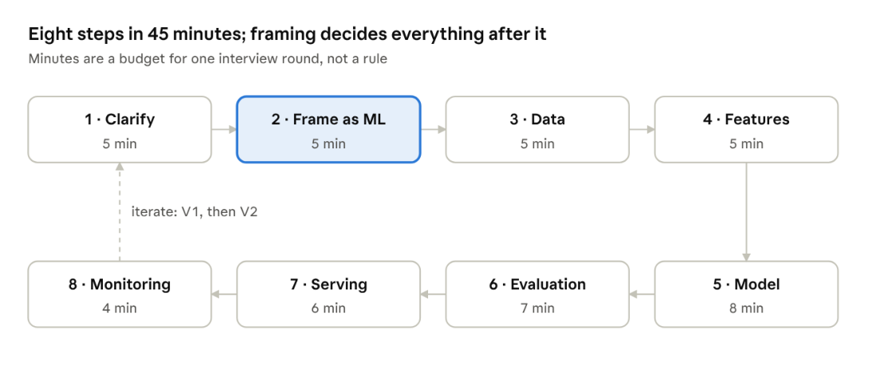
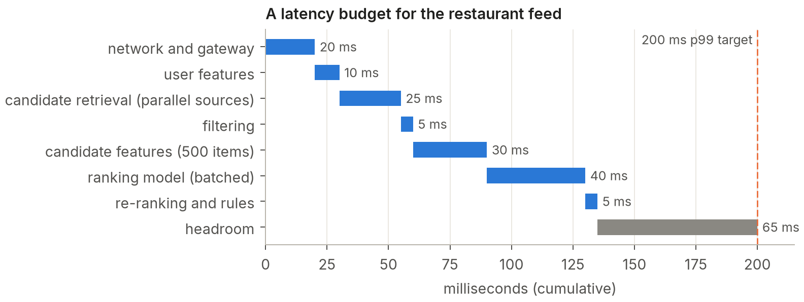

# 46 · ML system design: the method

Part XI · Applied ML systems (optional track). Draws on Chapters 3, 4, 42 and 43 to 45; worked designs that apply the method are in Appendix E.

This chapter teaches the method you use in every design round. The ten worked designs are in Appendix E. Try each one yourself, timed, before reading its answer.

## Why it matters

A system design round is not a test of whether you know the "right" architecture. It is a 45-minute simulation of how you would lead an ML project: can you turn a vague business ask into a measurable problem, choose sensible components, and reason about trade-offs out loud?

On the job this is the same skill as writing a design doc or scoping a quarter. You already do it; the interview format just compresses it.

The round comes in two flavours. Product companies (ads, feeds, search, marketplaces, e-commerce) ask for a product ML system: a ranker, a classifier, a forecaster, an LLM feature. Frontier labs and research teams increasingly ask for a research or LLM-infrastructure system: a training run, an evaluation suite, an RL pipeline, a serving stack for a large model. The method is the same eight steps in both; what changes is where the numbers come from. A product design is anchored by QPS, latency budgets and an A/B test; a research design is anchored by FLOPs, tokens, GPU memory and failure rates. This chapter teaches the method on a product example, then works one research design and one LLM-serving design in the same way, because those are where candidates from either background are weakest.

### What interviewers score

Most companies use a rubric with four or five dimensions. The names vary, but the substance is consistent:

| Dimension | What a strong answer shows | What a weak answer shows |
|---|---|---|
| Problem framing | Asks about the business goal, users and constraints before designing; turns them into an ML objective and success metrics | Starts drawing models in the first two minutes |
| ML depth | Picks models and losses for stated reasons; knows the failure modes of each choice | Name-drops architectures without saying why |
| Data and evaluation | Knows where labels come from, their biases, and how offline metrics relate to the online goal | Treats data as given; evaluates only with accuracy or AUC |
| Production sense | Thinks about latency, scale, freshness, cost, monitoring and iteration | Stops at "train the model" |
| Communication | Structures the 45 minutes, checks in with the interviewer, states assumptions | Monologues, or waits to be led |

At mid-level the bar is a complete, sensible design with sound reasoning. At senior level the extra signal is trade-offs: why this and not that, what you would build first, and what you would cut.

## The framework at a glance



*the eight-step framework · 45-minute budget*

Use the eight steps as headings on the whiteboard or in your notes, in this order. If the interviewer pulls you deeper into one step, take the time from serving and monitoring, never from clarifying and framing. The dashed arrow is how you close: what V1 ships, and what V2 adds.

## Key concepts

- **ML system design interview**: a 45–60 minute open conversation where you design an end-to-end ML system and defend the trade-offs. Good overviews: [Chip Huyen's ML Interviews Book](https://huyenchip.com/ml-interviews-book/) and her [Designing Machine Learning Systems](https://www.oreilly.com/library/view/designing-machine-learning/9781098107956/).
- **Problem framing**: business goal → ML objective → label → offline metric → online metric and guardrails (Chapter 3).
- **Two-path architecture**: an online path for requests and an offline path for training and batch scoring (Chapter 42).
- **Candidate generation and ranking**: the standard shape for any "pick the best few out of millions" problem. [System Design for Recommendations and Search](https://eugeneyan.com/writing/system-design-for-discovery/).
- **Back-of-the-envelope estimation**: users, requests per second, storage and cost from rough numbers; Little's law for capacity (Chapter 42.9).
- **Baseline first**: heuristics and simple models before deep ones. [Rules of Machine Learning](https://developers.google.com/machine-learning/guides/rules-of-ml).
- **Deployment and monitoring**: release ladder, drift and feedback loops (Chapter 47).

## Step 1 · Clarify the problem

Spend the first 5–7 minutes asking questions and writing the answers where the interviewer can see them. Every later choice should trace back to something on this list.

**The checklist, in the order to ask:**

1. **Business goal.** What are we trying to move? ("More orders from the home feed", "fewer bad reviews published".) Is there one north-star metric?
2. **Users and surface.** Who sees the output, where, and what do they do with it? Mobile app, back-office tool, an API for another team?
3. **Scale.** Daily active users, requests per second at peak, size of the catalogue (restaurants, items, documents).
4. **Latency and freshness.** Is this real-time (under ~200 ms), near-real-time (seconds), or batch (hourly or daily)? How fresh must the data be?
5. **Constraints.** Markets and languages, privacy rules, budget (especially for LLMs), existing infrastructure, team size.
6. **What exists today.** A heuristic, a rule system, an older model? This becomes your baseline.

If the interviewer says "you decide", state an assumption out loud and write it down: "I'll assume 10 million daily users and a 150 ms budget for the feed." Stated assumptions are fine; silent ones are not.

## Step 2 · Frame it as an ML problem

Translate the business goal into four things: the **ML objective**, the **label**, the **prediction target at serving time**, and the **metrics**. This is where most candidates lose the round, because a wrong framing makes every later step wrong.

**Ask first: does this need ML?** A rule or a sorted list is sometimes the right answer for a first version. Saying so, then explaining when ML starts to pay off, is a strong senior signal.

### Framing examples

| Business ask | ML task | Label | Offline metric | Online metric |
|---|---|---|---|---|
| Order more from the home feed | Rank restaurants per user | Ordered (or clicked) after an impression | NDCG@10, recall@50 for retrieval | Orders per session, conversion |
| Find dishes in search | Rank items for a query | Clicked or ordered after the query | NDCG@10, MRR | Search conversion, null-result rate |
| Classify merchants into a taxonomy | Multi-class (or multi-label) classification | Human-labelled sample; LLM labels checked by humans | Macro F1, per-class precision | Filter usage, search success on filtered queries |
| Publish only safe reviews | Binary classification with a threshold | Moderator decisions | Precision at fixed recall, PR-AUC | Complaints, moderation cost |
| Delivery time estimate | Regression | Actual delivery time | MAE, share within ±5 min | Cancellation rate, customer contacts |
| Predict order cancellations | Binary classification, calibrated | Cancelled within X minutes | Log loss, calibration curve | Cancellations prevented, cost |

### Choosing the objective

- **Clicks are easy to get but cheap to fool.** Optimising clicks alone rewards clickbait and pictures, not orders. A common answer is a weighted combination, for example score = P(click) × P(order | click), or a multi-task model with one head per event.
- **Setting the combination weights.** A score such as P(order) + α·P(click) + β·expected margin has weights no offline metric can set, because they encode business trade-offs. Treat them as hyper-parameters of the product, tuned online. Run a small grid (or a bandit over weight settings) on a few percent of traffic, plot each setting on the two or three metrics that trade off (orders, revenue, a diversity or partner-fairness guardrail), and pick from the Pareto front, the settings where no metric can improve without another getting worse. Two pitfalls: the heads must be calibrated, or a weight tuned today silently changes meaning when one head is retrained; and short tests favour clicky settings whose cost (lower retention) shows up only in long-term holdouts.
- **Proxy vs true goal.** The label you can train on (an order within the session) is a proxy for the goal (long-term retention). Say so, and say how you would check the proxy does not drift from the goal: long-term holdouts, retention guardrails.
- **One metric to decide, several to guard.** Pick one primary online metric for the A/B test and name two or three guardrails (latency, cancellations, diversity, revenue per order).

## Step 3 · Data

Say where every label and feature comes from, and what is wrong with it. Interviewers care less about the volume of data than about whether you see its biases.

**Label sources, from cheapest to most expensive:**

- **Implicit feedback:** impressions, clicks, add-to-cart, orders, dwell time, skips. Plentiful, but biased: users can only click what you showed them, and they click higher positions more (**position bias**).
- **Explicit feedback:** ratings, reviews, thumbs up or down. Sparse, and skewed towards extremes.
- **Human labels:** annotators or moderators. Accurate but slow and expensive; check agreement between annotators before trusting them.
- **LLM labels:** fast and cheap at scale, but they need a human-labelled sample to measure their error rate. (Chapter 41.3 has a worked example.)

**The questions to answer for any dataset:**

1. **What counts as a negative?** For ranking, a shown-but-not-clicked item is a weak negative; a never-shown item is unknown, not negative. For retrieval, you usually sample negatives (random, popular, or "hard" negatives that look relevant).
2. **Label delay.** An order is known in minutes, a refund in days, churn in weeks. Training on recent data with incomplete labels biases the model.
3. **Class imbalance.** Conversion is often 1–5% of impressions. Options: downsample negatives (and correct the predicted probabilities afterwards), class weights, or focal loss. Evaluate with PR-AUC or precision at k, not accuracy. The correction is worth knowing by heart, because ads and feed interviewers ask for it; it is worked after this list.
4. **Splits.** Use time-based splits for anything that is deployed into the future. Random splits leak future behaviour into training.
5. **Privacy.** Personal data, retention limits, and consent across markets. One sentence is enough unless the interviewer probes.

**Correcting for negative downsampling.** Keep every positive but only a fraction w of the negatives, and the model trains on a world where positives are 1/w times more common relative to negatives. Its outputs q are inflated. Bayes' rule undoes it: the odds are multiplied by 1/w in training, so divide them by 1/w at serving.

$$
p = \frac{q}{q + (1-q)/w}
$$

Here q is the model's prediction, w the rate at which negatives were kept, and p the calibrated probability. **Example:** with w = 0.1, a true base rate of 2% appears as 0.02 / (0.02 + 0.98 × 0.1) ≈ 16.9% in training. A prediction of q = 0.2 maps back to 0.2 / (0.2 + 0.8/0.1) = 0.2 / 8.2 ≈ 2.4%. The correction leaves the ranking unchanged (it is monotone), so a pure ranker does not need it; anything that multiplies or thresholds the probability (an ads auction, P(click) × P(order), an alert threshold) does. Check calibration on a non-downsampled holdout afterwards, because the formula assumes the negatives were dropped uniformly at random.

## Step 4 · Features

Group features by entity, then say how fresh each group needs to be. This structure alone makes an answer sound senior.

| Group | Examples (restaurant feed) | Freshness |
|---|---|---|
| User | Order history, favourite cuisines, price sensitivity, user embedding | Daily batch, plus real-time session events |
| Item | Cuisine, rating, price level, prep time, item embedding | Daily, plus real-time availability (open, busy) |
| Context | Time of day, weekday, weather, location, device | Request time |
| User × item | Past orders from this restaurant, distance, similarity of embeddings | Mixed |
| Session | Items viewed in the last 10 minutes, current query | Real time |

**Point-in-time correctness.** The most common leakage in production ML: training rows joined with feature values that were only known later. Every training example must use the feature values as they were at the moment of the prediction. A feature store does this for you; in an interview, saying "point-in-time join" shows you know the trap.

In pandas, `merge_asof` does exactly this:

```python
import pandas as pd

# One row per impression we want to label and train on
impressions = pd.DataFrame({
    "user_id": [1, 1, 2],
    "ts": pd.to_datetime(["2026-11-01 12:00", "2026-11-03 19:00", "2026-11-02 13:00"]),
    "ordered": [0, 1, 0],
})

# A feature that changes over time: the user's order count, snapshotted when it changes
user_orders = pd.DataFrame({
    "user_id": [1, 1, 2],
    "ts": pd.to_datetime(["2026-10-30 09:00", "2026-11-02 20:00", "2026-10-15 10:00"]),
    "orders_to_date": [4, 5, 11],
})

# Point-in-time join: for each impression, take the latest feature value at or before ts
train = pd.merge_asof(
    impressions.sort_values("ts"),
    user_orders.sort_values("ts"),
    on="ts",
    by="user_id",
    direction="backward",  # never look into the future
)
print(train)
#   user_id                  ts  ordered  orders_to_date
# 0       1 2026-11-01 12:00:00        0               4
# 1       2 2026-11-02 13:00:00        0              11
# 2       1 2026-11-03 19:00:00        1               5
```

A naive `merge` on `user_id` with the latest value would have given the first impression `orders_to_date = 5`: a value from the future.

**Embeddings as features.** Learned user and item embeddings (from a two-tower model, matrix factorisation or a text encoder over menus) compress a lot of signal. Mention how they are refreshed, because a stale embedding table quietly hurts new items most.

## Step 5 · The model

Always start with a baseline, then climb a ladder of complexity, and say what each rung buys you. Jumping straight to a transformer is a weak signal; knowing when you would stop climbing is a strong one.

### The model ladder (ranking example)

| Rung | Model | Why stop here | Why go further |
|---|---|---|---|
| 0 | Heuristic: popularity in your area, distance, rating | No training, easy to explain, a fair baseline | Ignores the individual user |
| 1 | Logistic regression on hand-built features | Fast, calibrated, interpretable | Misses feature interactions |
| 2 | Gradient-boosted trees (LightGBM, XGBoost) | The strong default for tabular ranking; handles interactions and missing values | Struggles with very high-cardinality IDs and raw sequences |
| 3 | Deep model with embeddings (two-tower for retrieval, DLRM or DCN for ranking) | Learns from IDs and sequences, shares signal across users | More data, infrastructure and tuning |
| 4 | Sequence and transformer models over user history (e.g. SASRec), or LLM-based components | Captures order and intent within a session | Cost and latency; gains are often small at mid scale |

At a mid-sized marketplace, rung 2 for ranking plus rung 3 (a two-tower model) for retrieval is a credible, defensible design.

### The multi-stage architecture

When the catalogue is large (thousands to millions of items) you cannot score every item with a heavy model within the latency budget. So systems run a funnel: cheap stages that cut many items, then expensive stages over few. The diagram below shows it; the numbers are typical orders of magnitude, not a rule.


*multi-stage recommendation funnel · 4 stages*

**Each stage, in one line:**

- **Candidate generation (retrieval).** Several cheap sources in parallel: a two-tower model searched with approximate nearest neighbours, "popular near you", "ordered before", collaborative filtering. Optimise for **recall**.
- **Filtering.** Remove what cannot be served: closed, out of delivery range, out of stock, blocked.
- **Ranking.** A heavier model scores each surviving candidate with rich features. Optimise for **precision at the top** (NDCG@k).
- **Re-ranking.** Business rules and diversity: no five pizzas in a row, sponsored slots, freshness for new restaurants, fairness across partners.

### Choosing the loss

- **Pointwise** (binary cross-entropy on click or order): simple, gives calibrated probabilities you can combine and threshold.
- **Pairwise** (e.g. BPR, RankNet): learns that the ordered item should score above the skipped one; closer to what ranking needs.
- **Listwise** (e.g. LambdaRank, softmax over the list): optimises the order of the whole list; best for NDCG, more complex.
- **Multi-task:** one shared model with heads for click, add-to-cart and order, combined with weights at serving time. Common in production because business goals change faster than models.

## Step 6 · Evaluation

Evaluation is where you show you know offline numbers can lie. Cover three layers: offline metrics, the online experiment, and the guardrails.

**Offline.**

- Pick metrics that match the stage: recall@k for retrieval, NDCG@k or MAP for ranking, PR-AUC and calibration for classifiers, MAE for regression.
- Evaluate on a **time-based** holdout (train on weeks 1–4, test on week 5).
- **Slice** the results: new vs returning users, small vs large cities, cuisines, languages. An average improvement can hide a regression for new users.
- Know the limits of **logged data**: you only have labels for items that were shown, so a new model that surfaces different items is judged on incomplete data. Mention counterfactual evaluation (inverse propensity scoring) and that the final word belongs to an A/B test.

**Online.**

- An A/B test with a primary metric, a minimum detectable effect, and a duration long enough to cover weekly cycles (usually at least one or two full weeks).
- In two-sided marketplaces, users in treatment and control compete for the same couriers and restaurants, which biases a simple user-level A/B test. Mention **switchback** tests (randomise by city and time slot) or geo experiments when supply is shared.
- For ranking, **interleaving** (mixing results from both models in one list) detects differences with far less traffic.
- Variance reduction (CUPED) shortens tests (Chapter 2).

**Guardrails.** Latency, error rate, cancellations, delivery time, revenue per order, diversity, and complaints. The model should win the primary metric without breaking any of these.

## Step 7 · Serving

Describe how a request flows through the system, and where the time goes.

- **Batch vs online.** Precompute what you can: nightly candidate lists per user, item embeddings, daily features. Compute online only what depends on the request: context, session, real-time availability.
- **Latency budget.** Split it across stages, for example: retrieval 30 ms, feature fetch 30 ms, ranking 50 ms, re-ranking 10 ms, network and overhead the rest.
- **Approximate nearest-neighbour search** (HNSW, IVF, ScaNN, or a vector database) for embedding retrieval in milliseconds over millions of items.
- **Caching** for popular requests, and a **fallback** (popularity list) when the model or a feature service times out. Always mention the fallback.
- **Model updates.** How often do you retrain (daily is common for ranking), and how do new models reach production: shadow mode, then canary, then the A/B test.

## Step 8 · Monitoring and iteration

Close by showing the system keeps working after launch.

- **Data and feature drift:** distributions of inputs compared with training (population stability index, KL divergence), missing-value rates, freshness of feature tables.
- **Prediction drift:** the distribution of scores, and calibration over time.
- **Business metrics:** the online metric and guardrails on a dashboard, with alerts.
- **Feedback loops:** a recommender trains on what it showed, so it can narrow over time. Counter with exploration (a small share of random or bandit-chosen slots) and with diversity in re-ranking.
- **Iteration plan:** what you would build next, in order. Ending with "V1 is X, V2 adds Y because Z" is one of the clearest senior signals.

## Back-of-the-envelope maths

Two minutes of rough numbers make the serving discussion concrete and stop you from proposing something that cannot work. Round aggressively; the order of magnitude is what matters.

**Worked example: the restaurant feed.** Assume 10 million daily active users, 5 feed loads each, 1 million restaurants and dishes (20,000 restaurants with about 50 dishes each, the same marketplace as the 45-minute design below), 128-dimensional embeddings, 500 candidates ranked per request.

| Quantity | Calculation | Result |
|---|---|---|
| Average requests per second | 10M × 5 ÷ 86,400 | about 580 QPS |
| Peak (lunch and dinner, ×3) | 580 × 3 | about 1,700 QPS |
| Item embedding table | 1M × 128 × 4 bytes | about 0.5 GB: fits in memory on one machine |
| User embedding table (50M users) | 50M × 128 × 4 bytes | about 26 GB: needs a key-value store or sharding |
| Ranking work at peak | 1,700 × 500 candidates | about 850,000 scorings per second: needs batched inference across several replicas |

**Worked example: an LLM classification job.** 10 million products, about 300 input tokens and 50 output tokens each. The prices below are placeholders for illustration; check current pricing before quoting any.

| Quantity | Calculation | Result |
|---|---|---|
| Input tokens | 10M × 300 | 3 billion |
| Output tokens | 10M × 50 | 500 million |
| Cost at $0.15 per 1M input, $0.60 per 1M output | 3,000 × 0.15 + 500 × 0.60 | $750 |
| With a 50% batch discount | 750 × 0.5 | $375 |

The same arithmetic explains how teams reach 5–10× cost reductions: batch discounts, shorter prompts and fewer calls multiply.

**A small calculator to practise with:**

```python
SECONDS_PER_DAY = 86_400

def qps(daily_users: float, requests_per_user: float, peak_factor: float = 3.0) -> tuple[float, float]:
    """Average and peak requests per second."""
    avg = daily_users * requests_per_user / SECONDS_PER_DAY
    return avg, avg * peak_factor

def embedding_memory_gb(n_rows: float, dim: int, bytes_per_value: int = 4) -> float:
    """Memory for a dense embedding table (float32 = 4 bytes, float16 = 2)."""
    return n_rows * dim * bytes_per_value / 1e9

def llm_cost_usd(n_calls: float, in_tokens: float, out_tokens: float,
                 usd_per_m_in: float, usd_per_m_out: float,
                 batch_discount: float = 0.0) -> float:
    """Total cost of an LLM job; prices are per million tokens."""
    cost = n_calls * (in_tokens * usd_per_m_in + out_tokens * usd_per_m_out) / 1e6
    return cost * (1 - batch_discount)

avg, peak = qps(10e6, 5)
print(f"{avg:,.0f} QPS average, {peak:,.0f} at peak")       # 579 QPS average, 1,736 at peak
print(f"{embedding_memory_gb(1e6, 128):.2f} GB of item embeddings")  # 0.51 GB
print(f"${llm_cost_usd(10e6, 300, 50, 0.15, 0.60, batch_discount=0.5):,.0f}")
# $375
```

**A latency budget.** Split the p99 target across the stages before choosing models, because the budget decides what each stage can afford.



*An example p99 budget for the restaurant feed. The stages run in sequence except the candidate sources, which run in parallel within their 25 ms. The ranking model gets 40 ms for 500 candidates, which is what decides between a gradient-boosted model and a larger neural ranker. A third of the budget is kept as headroom for tail effects.*

If the ranking model needs 100 ms, the budget shows the options: score fewer candidates, use a cheaper first-pass ranker to cut 500 to 100 first, precompute item-side parts of the model, or relax the target. Saying this in an interview shows you understand the funnel as a cost structure, not only as a diagram.

**Rough latency numbers worth remembering** (orders of magnitude, not benchmarks): an in-memory lookup takes well under a millisecond; a network call within a data centre about half a millisecond; a cache or key-value store read around 1 ms; a gradient-boosted model scoring a few hundred candidates a few milliseconds; an approximate nearest-neighbour search over millions of vectors a few milliseconds; an LLM call hundreds of milliseconds to seconds. That last one is why LLMs rarely sit in a 150 ms request path.

## Designing LLM systems

The eight steps still apply to an LLM design (a classifier, a RAG assistant, a judge). What changes is where the hard decisions sit: less in model architecture, much more in evaluation, cost and failure handling.

| Step | What changes for LLM systems |
|---|---|
| Clarify | Ask about volume and latency early: they decide between real-time calls, batch jobs, or a small distilled model. Ask what a wrong answer costs: a bad summary is annoying, a bad refund decision is expensive |
| Frame | Decide the adaptation level, cheapest first: prompting, then retrieval (RAG), then fine-tuning (LoRA), then training a small model on LLM-generated labels. Say why you stop where you stop |
| Data | The key dataset is the **evaluation set**: a few hundred real, labelled examples covering the hard cases, built before optimising anything. Training data may be synthetic or LLM-labelled, but checked against human labels |
| Features | Becomes **context**: what goes into the prompt (instructions, retrieved documents, user and item attributes, examples) and in what order |
| Model | Model choice is a cost, latency and quality trade-off: a large model for hard cases, a small one for volume, often both in a cascade (cheap model first, escalate when unsure). Use structured output (JSON schema) so downstream code does not parse free text |
| Evaluation | Offline: task metrics on the eval set, plus LLM-as-judge for open-ended outputs, with the judge itself checked against human labels. Online: A/B test on the business metric. Error analysis by hand comes first and never stops |
| Serving | Batch where possible (cheaper, often half price), caching of repeated prompts, timeouts, retries with backoff, rate limits, and a non-LLM fallback |
| Monitoring | Trace each call: input, output, tokens, latency, cost. Sample outputs for review, track judge scores over time, and watch for provider model updates that silently change behaviour |


*LLM system · online path and offline evaluation loop*

The top row runs on every request; the bottom row is how the system improves. Draw both in an LLM design round: most candidates draw only the top.

**Guardrails** belong in every LLM design: input checks (prompt injection, PII), output checks (schema validity, safety filters, grounding against sources), and human review for high-stakes decisions.

**A strong closing line for LLM designs:** "Every change to the prompt or model goes through the eval set before shipping, the same way code goes through tests."

## Research system design

Research-scientist loops sometimes replace product design questions with research-system questions. The eight steps still apply, with different content: "clarify" becomes the goal and the constraints of the model, "data" becomes token supply and mixture, "serving" becomes the cluster and its failures, and "monitoring" becomes training health and evaluation across checkpoints. The original one-paragraph sketch of the training-run question is kept here, then worked properly below.

**"Design the training run for a 7B model with 2,000 GPUs for a month."** Clarify goals (general or domain model, languages, context length, inference constraints). Budget: compute available (2,000 GPUs × 30 days × ~4 × 10¹⁴ effective FLOP/s ≈ 2 × 10²⁴ FLOPs), so roughly 40–50T tokens for 7B, deliberately over-trained for inference (Chapter 13); data supply decides whether that is realistic (Chapter 16). Architecture choice (dense or MoE, GQA or MLA, context length), parallel layout and MFU target (Chapter 17), schedule (WSD with an annealing phase), small-scale ablations for data mixture and learning rate first, evaluation plan across training, checkpointing and failure handling, and the decision points (when to stop, when to anneal).

### Worked: the 7B training run

**Clarify, and challenge the premise.** Ask what the model is for. "A 7B model" usually means an inference constraint: it must serve cheaply, run on one GPU, or run on device. That constraint is what justifies the size, and a senior answer checks it, because the compute is enough for a much larger model. Under the Chinchilla rule of about 20 tokens per parameter, C = 6ND with D = 20N gives N = √(C/120) ≈ 1.3 × 10¹¹: the compute-optimal model for this budget has about 130B parameters and 2.6T tokens. So the first question back to the interviewer is: "why 7B? Would we do better training a larger model and distilling it into 7B?" If the answer is "inference cost dominates; we will serve billions of tokens a day", 7B over-trained is right (Chapter 13 covers inference-aware scaling). If not, say so.

**Budget the compute.** 2,000 GPUs × 30 days × 86,400 s × 4 × 10¹⁴ FLOP/s ≈ 2.07 × 10²⁴ FLOPs. The 4 × 10¹⁴ effective FLOP/s is about 40% MFU on an H100 (989 TFLOP/s dense bf16), a realistic target for a 7B dense model at this scale (Chapter 17); on Blackwell-class GPUs the peak roughly doubles and the same arithmetic applies. Per GPU, 4 × 10¹⁴ / (6 × 7 × 10⁹) ≈ 9,500 tokens a second; across the cluster, about 1.9 × 10⁷.

**Budget the data.** D = C / 6N = 2.07 × 10²⁴ / (6 × 7 × 10⁹) ≈ 4.9 × 10¹³: about 49T tokens, or 7,000 tokens per parameter, 350 times the Chinchilla ratio. That is data-constrained. High-quality filtered web corpora are of the order of 10–20T unique tokens in the main languages (Llama 3 trained on about 15T). At 15T unique tokens, 49T means about 3.3 epochs. Repetition results (Muennighoff et al., 2023) suggest up to about 4 epochs of the same data lose little, so this is feasible, but the plan must say which data repeats (the best sources more often), how much synthetic data (rephrased web, generated maths and code) fills the gap, and how decontamination works for evaluation sets (Chapter 16).

**Architecture and layout.** Dense with grouped-query attention is the safe choice at 7B; MoE would buy quality per FLOP but complicates inference, the very constraint that set the size. Pick the context length for pretraining (4–8k) and extend later. A 7B model fits on one GPU for inference but not for training with optimiser state (about 16 bytes per parameter with Adam in mixed precision, 112 GB), so use FSDP/ZeRO-style sharding within a node and data parallelism across nodes; tensor parallelism is unnecessary at 7B.

**De-risk with small runs first.** Before spending the month: a learning-rate and batch-size sweep on 100M–1B models, data-mixture ablations at small scale with evaluations that have signal at that scale, and a short full-scale run (a day) to check throughput, MFU, loss curves and stability. Budget about 5–10% of the compute for this.

**Failures and checkpoints.** At this scale failures are routine. Meta reported 419 unexpected interruptions in a 54-day period of Llama 3 pretraining on 16,384 GPUs. Scaled to 2,000 GPUs that is about 0.95 a day, a mean time between failures of about 25 hours. The Young/Daly rule sets the checkpoint interval at √(2 × MTBF × C_ckpt): with an asynchronous checkpoint that stalls training for 1 minute, √(2 × 1,520 min × 1 min) ≈ 55 minutes. Expected loss is half an interval of recomputation plus a 10-minute restart per failure, plus the checkpoint stalls: about 62 minutes a day, 4.3% of the run. Cut the stall to 15 seconds and it falls to 2.5%; a 5-minute synchronous checkpoint costs 8.8%. Chapter 47.9 has the derivation.

**Monitoring and go/no-go points.** Watch loss, gradient norm, logit and attention statistics, throughput and MFU continuously, with automatic alerts on spikes (Chapter 47.9 has the playbook). Evaluate every checkpoint on a fixed suite. Pre-agree decision points: after the first 5% of tokens, is the loss tracking the scaling-law prediction from the small runs? At 50%, are downstream evaluations on track? Where does the learning-rate cooldown start (WSD makes this a decision you can delay, and a cooldown branch from an intermediate checkpoint can preview the final quality)? And what is the stop rule if a loss spike does not recover after rolling back?

**What makes it senior.** A mid-level answer lists the components. A senior answer does the three numbers (compute, tokens, failure budget), questions the 7B premise with the compute-optimal comparison, notices the run is data-constrained, and names the decision points in advance.

**"Design an evaluation suite for a new model release."** Capabilities (knowledge, reasoning, maths, code, long context, multilingual, tool use), safety (harmful compliance and over-refusal), chat quality with length control, regression against the previous model; contamination checks; statistical reporting with intervals; human evaluation on a sample; automation in a harness so every checkpoint is scored (Chapters 23–25).

**"Design an RLHF / RLVR pipeline."** Prompt sources and difficulty filtering, reward models or verifiers and how they are audited, the algorithm (DPO, PPO or GRPO variants) and its stability measures, rollout infrastructure (inference engine, asynchronous generation), monitoring for reward hacking and over-optimisation (gold evaluations, KL, length), and iteration with fresh on-policy data (Chapters 18–19).

**"Design an ablation plan for a new architecture."** Hypotheses, matched baselines with tuned learning rates, a model ladder with scaling-law fits, recall and long-context evaluations, throughput measurements, seeds, decision criteria (Chapters 11, 13 and 34).

These three questions follow the same pattern as the training run. For the evaluation suite, the numbers are statistical: an eval of 500 items at 70% accuracy has a standard error of √(0.7 × 0.3 / 500) ≈ 2 points, so two models 3 points apart on it are not clearly different, and the design must say which benchmarks are large enough to rank checkpoints and which are only for reporting. For the RL pipeline, the numbers are throughput: rollouts usually dominate the cost, so the design starts from how many samples per prompt, how long the responses are, and how many generation GPUs keep the trainer busy; the risks to name are reward hacking (watch a held-out gold evaluation and the response length) and stale off-policy samples when generation is asynchronous. For the ablation plan, the numbers are seeds and scale: a difference must exceed the seed-to-seed spread at each rung of the ladder, and it must persist, or grow, as the models get larger.

## Designing an LLM serving system

"Serve our 70B model to 10 million requests a day" is the LLM version of the feed design, and it has the same structure: clarify the load, size the hardware from first principles, then talk about latency, cost and failure. Interviewers at labs and at any company running its own models ask it, and the arithmetic is what separates answers.

**Clarify.** Requests per day and the peak factor; input and output lengths (they set prefill and decode cost separately); latency targets as time to first token (TTFT) and time per output token (TPOT), usually at p95 or p99; the model (size, attention type, context length); and whether an API is an option. Assume 10M requests a day, a 2× peak, 1,500 input and 300 output tokens, TTFT under 1 s and TPOT under 50 ms at p95, and a 70B dense model with grouped-query attention (80 layers, 8 KV heads of dimension 128) in bf16 on H100 80 GB GPUs.

**Size the memory.** Weights take 70B × 2 bytes = 140 GB, so one replica needs at least two GPUs; four with tensor parallelism leave room for the KV cache. The KV cache per token is 2 (K and V) × 80 layers × 8 heads × 128 × 2 bytes = 327,680 bytes, about 0.33 MB. Four GPUs have 320 GB; after weights and about 10% for activations and overhead, about 148 GB is left, room for about 450,000 cached tokens, or 150 concurrent sequences of 3,000 tokens. Memory, not compute, caps the batch.

**Size the decode.** Decoding is memory-bandwidth bound: each step reads all the weights once plus each sequence's KV cache. With four GPUs at 3.35 TB/s each, reading 140 GB of weights takes 10.4 ms per step, whatever the batch. At a batch of 64 sequences averaging 3,000 cached tokens, the KV reads add 4.7 ms, so a step takes about 15 ms and the replica produces 64 / 0.015 ≈ 4,200 tokens a second in the ideal case, with a TPOT of 15 ms. Larger batches raise throughput (6,450 tokens a second at batch 128, 19.8 ms per step) at the cost of TPOT: batch size is the dial between cost and latency.

| Quantity | Calculation | Result |
|---|---|---|
| Output tokens per second | 10M × 300 / 86,400, × 2 at peak | 34,700 average, 69,400 peak |
| Input tokens per second | 10M × 1,500 / 86,400 | 174,000 average |
| Prefill compute at peak | 2 × 70B × 347,000 tokens/s | 4.9 × 10¹⁶ FLOP/s, about 98 H100s at 50% MFU |
| Decode replicas at peak | 69,400 / ~2,500 tokens/s per replica (about half the ideal) | 28 replicas of 4 GPUs, 111 GPUs |
| TTFT compute for one prompt | 2 × 70B × 1,500 / (4 GPUs × 989 TF × 50%) | about 106 ms, plus queueing |
| Cost at an assumed $2.50 per GPU-hour | 210 GPUs × 24 h | $12,600 a day: $4.20 per 1M output tokens, $0.70 per 1M total |

The GPU price is a placeholder; substitute current prices before quoting any.

**Latency and scheduling.** Continuous batching (adding and removing sequences from the batch at every step) keeps GPUs full. Long prefills stall the decodes sharing the GPU, so use chunked prefill, or disaggregate prefill and decode onto separate pools, which the split in the table already assumes. Prefix caching of a shared system prompt removes most of its prefill cost: if 1,000 of the 1,500 input tokens are a common prefix, prefill compute falls by two thirds. Queueing is the hidden part of TTFT: near saturation, waiting time explodes (Little's law, Chapter 42.9), so provision for the peak at 70–80% utilisation, not 100%.

**Cost levers, in order.** Quantise weights to 8 bits (FP8), which halves weight reads and raises decode throughput, after checking quality on the evaluation set; grouped-query or latent attention, which the model already has, keeps the KV cache small; speculative decoding speeds up decoding at low batch sizes; and route easy requests to a smaller model. Compare the result with an API price per million tokens at the same volume: self-hosting wins at high, steady volume and loses at low or spiky volume, where idle GPUs dominate. Chapter 21 covers the mechanisms.

**Failure handling and monitoring.** Health checks per replica; graceful degradation (shorter max output, smaller fallback model) when the queue grows; per-request traces with TTFT, TPOT, tokens and cost; and a canary for every change to the model, the quantisation or the serving engine, because engine upgrades change numerics (Chapter 47.6).

**What makes it senior.** Deriving the KV cache size and the decode step time from first principles, knowing that the batch is capped by memory and the step time by bandwidth, separating prefill from decode, and naming the trade-off between batch size (cost) and TPOT (latency) with numbers.

## A complete design in 45 minutes

Question: *"Design the ranking of restaurants on the home feed of a food-delivery app."* Here is how the eight steps fit into a 45-minute round, with what you would actually say or draw.

| Minutes | Step | What you produce |
|---|---|---|
| 0–5 | Clarify | Goal, scale, constraints |
| 5–9 | Frame | Prediction target and objective |
| 9–14 | Data | Logs, labels and their biases |
| 14–20 | Features | Feature groups and freshness |
| 20–28 | Model | Funnel, model per stage, loss |
| 28–34 | Evaluation | Offline metrics, online test |
| 34–40 | Serving | Budget, caching, fallbacks |
| 40–45 | Monitoring | Dashboards, retraining, risks |

**Clarify.**

- **Goal.** Orders per session, with guardrails on delivery time and partner fairness.
- **Scale.** 10M daily users and 5 feed loads each, so about 1,700 QPS at peak. About 20,000 restaurants are in delivery range across cities, a few hundred per user location.
- **Latency.** 200 ms p99 for the whole feed.
- **Context.** Personalised? Yes. New users and new restaurants: yes, both matter.

**Frame.** Rank the restaurants available to this user now by P(order | impression, context). That probability can be combined with business terms at the re-ranking stage. Pointwise, multi-task heads for click and order, combined at serving.

**Data.**

- **Labels and logs.** Impression logs with position, clicks and orders, joined point in time to the user and restaurant state.
- **Bias.** Labels are biased by the old ranker's positions, so log the position and use it as a training feature set to a constant at serving, or use IPS. The position-feature trick assumes the position effect is separable from relevance; a GBDT will happily learn interactions between position and other features, and then "set position to 1 at serving" gives scores no one trained. The cleaner version is a shallow position tower (PAL-style: P(click) = P(seen | position) × P(click | seen, features)), trained jointly and dropped at serving. IPS needs propensities, and those need a small randomised slice of traffic to estimate (Chapter 43.9).
- **Freshness.** Restaurants are open and closed at different times; the features must reflect the moment of the impression.

**Features.**

- User: history embeddings, recent cuisines, price level, time since last order.
- Restaurant: rating, prep time now, ETA to this user, delivery fee, promotions, open status, current load.
- Context: hour, day, weather, device.
- Cross features: the user's past orders from this restaurant, cuisine affinity.
- Freshness: say which come from a batch store and which must be real time (ETA, load).

**Model.**

- **Funnel.** Retrieval from several sources (a two-tower model, "ordered before", popular nearby), then filters (open, in range), then a LightGBM ranker with multi-task objectives, then re-ranking for diversity, sponsored slots and new-restaurant exploration.
- **The ladder.** Mention it (heuristic, logistic regression, GBDT, deep), and say you would stop at GBDT for ranking unless a sequence model shows clear gains.

**Evaluation.**

- **Offline.** NDCG@10 and order recall@10 on time-split data, by segment (new users, small cities). Calibration of P(order).
- **Online.** An A/B test on orders per session, with guardrails on ETA, cancellations and the concentration of orders on top restaurants. Switchbacks only if the change affects courier supply.

**Serving.** The latency budget above, with:

- user embeddings cached per session;
- restaurant features updated every minute;
- a fallback to "popular nearby" if the ranker times out;
- shadow-mode launch, then a ramp.

**Monitoring.**

- Prediction and feature drift.
- Calibration against realised orders.
- Feed conversion by segment.
- Partner-side metrics (exposure share, orders per partner).
- Weekly retraining with a gate on the offline metrics.

**Risks to name:**

- Feedback loops: popular restaurants get more popular, so reserve exploration slots.
- Overloading kitchens at peak: add a load feature, and throttle.
- Unfair exposure for new partners: add an exploration boost with a budget.

The point of rehearsing a full run is timing. Most candidates spend 20 minutes on the model and never reach serving or monitoring, which interviewers score as heavily as the model. Practise with a timer until all eight steps fit.

## Handling pushback

Interviewers change the constraints mid-design on purpose. They want to see whether you re-plan from the numbers or defend your first answer. Here is an excerpt from the feed design above, around minute 25.

> **Interviewer:** Why not a transformer over the user's order history instead of LightGBM?
>
> **Candidate:** It could help, mainly for users with long histories and for session intent. I'd treat it as V2: first I want the GBDT baseline and the logging, so I can measure what the sequence model adds. If we have the data now, I could add a sequence embedding as a feature to the GBDT, which gets most of the benefit without changing the serving path.
>
> **Interviewer:** The latency budget is now 50 ms for the whole feed, not 200.
>
> **Candidate:** Then the ranking stage gets about 15 ms, not 40. Scoring 500 candidates with the GBDT takes a few milliseconds, so the ranker survives, but retrieval and feature fetching are the problem. I'd precompute candidate lists per user and location every few minutes, so retrieval becomes a cache read; cut candidates to 200; fetch only the real-time features (ETA, open status) online and take the rest from the precomputed list. The cost is freshness: a restaurant that opens mid-session appears a few minutes late.
>
> **Interviewer:** We also need to show sponsored restaurants.
>
> **Candidate:** Then the ranking score must be a calibrated probability, because it will be traded against bids. I'd keep the pointwise P(order) head for that, check calibration by segment, and add a relevance floor so ads cannot appear below a minimum predicted relevance. The number of ad slots is a business trade-off I'd set with a long-running holdout, since more ads raise revenue now and may lower retention later.
>
> **Interviewer:** What would you cut if you had one engineer?
>
> **Candidate:** The two-tower retrieval. "Popular near you" plus "ordered before" plus a GBDT ranker gets most of the value, and every component I drop is one less thing to monitor.

Each answer does the same three things: acknowledges the point, re-derives the affected numbers, and names what the change costs. That pattern is what "senior" sounds like under pressure.

## Pitfalls

These are the mistakes that most often cost candidates the round, roughly in order of frequency.

1. **Designing before clarifying.** Drawing a two-tower model in minute two. Fix: the first five minutes are questions, always.
2. **No baseline.** Without one, you cannot say whether the model is worth its cost. Fix: name the heuristic or current system first.
3. **Accuracy or AUC as the only metric.** They ignore the top of the list, calibration and business value. Fix: match the metric to the stage and add an online metric.
4. **Random train/test splits on time-dependent data.** The model sees the future. Fix: split by time.
5. **Ignoring position bias and logged-data bias.** Clicks on position 1 are not worth the same as clicks on position 20. Fix: mention it, and mention position as a training feature that is set to a constant at serving time, or inverse propensity weighting.
6. **Forgetting cold start.** New users and new restaurants have no history. Fix: content features, popularity in the area, exploration slots.
7. **One giant model and no funnel.** Scoring a million items with a deep model per request. Fix: the multi-stage architecture and the latency arithmetic.
8. **No fallback.** What happens when the feature store times out? Fix: a cached or popularity-based fallback.
9. **Monologue.** Talking for 20 minutes without checking in. Fix: after each step, ask "does this level of detail work, or should I go deeper on something?"
10. **Running out of time before serving and monitoring.** Fix: keep to the time budget, and say "I'll come back to this" when you go deep.

## Interview questions

These are the follow-ups interviewers use to probe a design. Answer each aloud in under two minutes before reading the model answer. Level: **M** = mid-level, **S** = senior.

**1. Why not rank every item with your best model? (M)** Latency and cost. Scoring a million items with a deep model per request is far beyond a 150 ms budget: at 1,700 QPS that is 1.7 billion scorings a second, against about 850,000 for 500 candidates. A cheap retrieval stage cuts to a few hundred candidates with high recall; the expensive model then only needs to be precise at the top. Follow-up: "what do you lose?" Items retrieval misses can never be ranked, so measure retrieval recall@500 separately from ranking NDCG.

**2. Your offline NDCG improved by 3%, but the A/B test is flat. Why? (M)** Common causes: the offline metric is computed on logged data that only contains items the old model showed, so it cannot judge new items; the offline label (click) differs from the online goal (order); a train/serve skew (a feature computed differently online); or the improvement sits in a segment too small to move the total. I would check feature parity first, then slice both results. Also check power: if the test could only detect a 2% change in orders and offline NDCG gains typically translate at a fraction of their size, "flat" may simply mean "too small to see".

**3. How do you handle position bias in training data? (M)** Add the position as a feature during training and set it to a fixed value at serving time, so the model learns the item's quality separately from where it was shown. Alternatives: weight examples by the inverse of the estimated probability of being examined at that position, or collect unbiased data from a small randomised slice of traffic. The position-feature trick assumes the position effect is separable; a GBDT learns interactions between position and other features, so a shallow position tower (PAL-style, P(click) = P(seen | position) × P(click | seen)) trained jointly and dropped at serving is cleaner. Follow-up: IPS propensities themselves need randomised data, for example swapping adjacent results on 1% of traffic.

**4. How would you deal with cold start for a new restaurant? (M)** Use content features that exist from day one (cuisine, price, menu text embeddings, location), borrow signal from similar restaurants, and reserve a few exploration slots in the feed so the new restaurant collects interactions. A bandit can decide how much exposure to give as evidence comes in. Budget it: if a new restaurant needs about 1,000 impressions to estimate its click rate to within a couple of points, and the feed serves millions of impressions a day, a 1% exploration share is plenty.

**5. Pointwise, pairwise or listwise loss: which and why? (S)** Pointwise gives calibrated probabilities, which I need if I combine scores (P(click) × P(order)) or apply thresholds. Pairwise and listwise optimise order directly and usually do better on NDCG. In practice I often start pointwise with gradient boosting, then try LambdaRank and compare on NDCG and on the A/B test. The costs of listwise: scores are only meaningful within one request, so they cannot be multiplied by bids or compared across surfaces, and training needs query grouping and is slower. If I need both, I either calibrate the listwise output with isotonic regression on held-out data, or train a weighted sum of a listwise and a pointwise loss. When not to go listwise: when the score is an input to an auction or a threshold.

**6. How do you know the model isn't creating a feedback loop? (S)** Track catalogue coverage and the concentration of impressions over time (for example the share going to the top 1% of restaurants). Keep a small exploration share of traffic, and evaluate new models partly on that randomised data, which is free of the loop. A concrete alarm: if the top 1% of restaurants' share of impressions climbs from, say, 15% to 25% over a quarter with no change in their order share per impression, the ranker is amplifying itself. Follow-up: exploration costs a little short-term conversion; size it as the price of unbiased training data.

**7. When would you not use ML at all? (S)** When a rule captures most of the value, when there is too little data to beat it, when the decision must be fully explainable, or when the cost of maintenance outweighs the gain. I'd ship the rule first, log the data, and revisit when it stops scaling. Example: "sort by distance" for a city with 50 restaurants is hard to beat; at 5,000 restaurants and repeat users, personalisation starts to pay.

**8. How would you choose between real-time and batch inference? (M)** By how quickly the input changes and how much freshness is worth. Recommendations that depend on the current session or real-time availability need online scoring; a daily email or a nightly taxonomy classification can be batch. A common hybrid: batch-computed candidates, re-ranked online with session features. Batch is also cheaper: LLM batch APIs are often half price, and batch jobs run on spare capacity.

**9. How do you evaluate an LLM-based component before launch? (M)** Build a labelled eval set of a few hundred real cases, including hard ones; measure task metrics; for open-ended outputs, use an LLM judge that has been checked against human labels on a sample; then run an A/B test on the business metric. Error analysis by hand comes before and after. Size it: with 300 items at 80% accuracy the standard error is √(0.8 × 0.2 / 300) ≈ 2.3 points, so the eval can separate prompts about 6–7 points apart but not 2; compare prompts on the same items with a paired test to do better.

**10. Your LLM pipeline costs too much. What do you do? (S)** Measure where tokens go first. Then, in rough order of effort: shorten prompts and outputs, cache repeated calls, use batch APIs, route easy cases to a smaller model, and finally distil into a small fine-tuned model trained on the large model's outputs. Re-check quality on the eval set at each step. Typical sizes of each lever: batch APIs about 50%; prompt caching of a long shared prefix cuts input cost by most of the cached part; routing most traffic to a model several times cheaper cuts cost by a similar factor on that share; distillation can cut cost by an order of magnitude. When not to distil: when the task or its inputs shift often (new categories every month), because each shift needs a new labelled set and a retrain, while a prompted large model adapts with a prompt edit.

**11. A key feature is computed differently in training and serving. How would you catch it? (S)** Log the features actually used at serving time and compare their distributions with the training features (train/serve skew checks). Better still, compute features once in a feature store used by both paths, so the logic cannot diverge. The sharpest test: for a sample of logged requests, recompute the features with the training pipeline and diff them value by value; any feature whose values disagree on more than a fraction of a percent of rows is a bug.

**12. What would you build first, with a team of two and three months? (S)** A baseline with good logging: a simple retrieval (popularity plus "ordered before"), a gradient-boosted ranker on solid features, an offline evaluation pipeline and an A/B framework. Deep models and LLM components come after the data and evaluation loop works, because without them I cannot tell whether anything better is actually better. The trade-off is explicit: I am giving up maybe a few percent of eventual quality for a system I can measure and iterate on within the quarter.

**13. Your model was trained with negatives downsampled to 10%. How do you get calibrated probabilities? (M)** The model's odds are inflated by 1/w, so map each prediction q to p = q / (q + (1 − q)/w). With w = 0.1, q = 0.2 becomes 0.2 / 8.2 ≈ 2.4%. The correction is monotone, so it does not change rankings, only the scale, which matters for auctions, products of probabilities and thresholds. Follow-up: verify on a holdout that was not downsampled, because the formula assumes negatives were dropped uniformly at random.

**14. Size the GPUs to serve a 70B model at 10 million requests a day. (S)** Start from tokens: 10M × 300 output tokens / 86,400 ≈ 35,000 tokens a second, 70,000 at a 2× peak, and five times that in input tokens. Memory: 140 GB of bf16 weights, so four H100s per replica with about 148 GB left for KV cache at 0.33 MB per token, about 450,000 tokens. Decode is bandwidth-bound: reading 140 GB at 4 × 3.35 TB/s takes 10.4 ms per step, plus KV reads, so about 15 ms per step at batch 64 and roughly 2,500 tokens a second per replica in practice; about 28 replicas for decode plus about 100 GPUs for prefill, around 210 GPUs at peak. Trade-off: bigger batches cut cost but raise TPOT. Follow-up: FP8 weights halve the weight reads, and prefix caching removes the prefill of shared system prompts.

**15. Why train a 7B model on 49T tokens when the compute-optimal size is much larger? (S)** Because training compute is paid once and inference compute is paid per token served. The budget of 2 × 10²⁴ FLOPs is Chinchilla-optimal for about 130B parameters on 2.6T tokens, but a 130B model costs nearly 20 times as much per token to serve. If the model will serve billions of tokens a day, over-training a small model wins on total cost. The risks: 49T tokens is about 7,000 per parameter, which exceeds the supply of high-quality unique data (about 3 epochs over 15T), and returns diminish. The alternative to raise: train a larger model and distil it into 7B. Follow-up: "how would you decide?" Compare the 7B's loss at 49T tokens with the distilled student's on the same evaluations, using small-scale proxies before committing.

**16. How do you set the weights in a multi-objective ranking score? (S)** They encode business trade-offs, so tune them online: run a grid or a bandit over weight settings on a small share of traffic, plot the resulting orders, revenue and guardrail metrics, and choose from the Pareto front. Keep the heads calibrated, or a retrained head silently changes what the weights mean. Short tests favour engagement-heavy settings whose costs (retention, partner churn) appear later, so confirm the chosen setting with a long-running holdout.

**17. How often should a 2,000-GPU training run checkpoint? (S)** Use the Young/Daly rule, interval ≈ √(2 × MTBF × C), where C is the time training stalls per checkpoint. Scaling Llama 3's reported 419 interruptions in 54 days on 16,384 GPUs to 2,000 GPUs gives about one failure a day (MTBF about 25 hours); with a 1-minute asynchronous checkpoint the interval is √(2 × 1,520 × 1) ≈ 55 minutes and the total loss about 4% of the run. Cheaper checkpoints allow shorter intervals: at 15 seconds the loss drops to 2.5%. Follow-up: the restart time often dominates, so fast node replacement and data-loader resumption matter as much as checkpoint speed.

## Practice

System design is practised by designing, out loud and against a clock. Do these in order, each in 40–45 minutes, written or spoken, then review it against this chapter.

1. **Warm-up, framing only (15 min each):** write the four framing items (objective, label, offline metric, online metric) for: "recommend add-on items at checkout", "detect fake restaurant reviews", "estimate courier arrival time".

<details><summary>Hint and expected result</summary>

Add-ons: rank items given the basket; label = added after impression; NDCG@k or recall@k offline; attach rate and basket value online. Fake reviews: binary classification at a threshold; moderator decisions; precision at fixed recall; complaints and moderator workload. Courier arrival: regression or quantile; actual arrival; MAE and late-rate at the shown quantile; cancellations and contacts. If any of yours lacks a guardrail, add one.

</details>

2. **Week 1:** design a food-delivery app's restaurant recommendation feed, untimed. Use the eight steps as headings.
3. **Week 2:** dish and restaurant search ranking, timed.
4. **Week 3:** classify 10 million products into a taxonomy with LLMs, timed. Use the "Designing LLM systems" table.

<details><summary>Hint and expected result</summary>

Expect the cost line to dominate the discussion: 3 billion input and 500 million output tokens cost $750 at the placeholder prices, $375 in batch. A strong answer adds a labelled evaluation set per level of the taxonomy, a cascade (small model first, large model when unsure), and a distilled classifier for new products.

</details>

5. **Back-of-the-envelope drills:** extend the calculator above with a function for storage per day of logged impressions, then estimate it for the feed.

<details><summary>Hint and expected result</summary>

50M feed loads a day × 20 impressions × about 200 bytes per logged row (ids, position, timestamp, a few features) ≈ 200 GB a day, about 73 TB a year before compression. Logging the full feature vector at 2 KB per row multiplies it by ten.

</details>

6. **LLM serving:** redo the serving design for a 2,000-token output (a reasoning model) with the same request volume.

<details><summary>Hint and expected result</summary>

Output tokens per second rise by 2,000/300 ≈ 6.7×, and each sequence holds about 3,500 tokens of KV cache at its end, so memory caps the batch sooner. Decode GPUs grow roughly in proportion to output tokens, to several hundred; prefill stays the same. `code/ch46_check.py` has the arithmetic to modify.

</details>

7. **Research exercise: how sensitive is the training-run plan to its assumptions?** Using `code/ch46_check.py`, vary MFU (30–50%), the failure rate (0.5–2× the Llama 3 rate) and the checkpoint stall (15 s to 5 min), and report the tokens trained in 30 days for each combination. Then write one paragraph on which assumption you would measure first in the de-risking runs.

<details><summary>Hint and expected result</summary>

Tokens scale linearly with MFU, so 30% vs 50% MFU moves the total from about 37T to 62T tokens: MFU is by far the largest lever. The failure budget moves the total by a few per cent (2.5–9% lost time across the checkpoint costs above). The conclusion to reach: measure throughput and MFU in the first full-scale day before anything else.

</details>

**How to grade yourself:** did you ask at least five clarifying questions, name a baseline, give an offline and an online metric, draw the funnel, state a latency budget, name a fallback, and end with a V1 and V2 plan?

## Read next

- *Machine Learning System Design Interview* (Aminian and Xu), chapter 1: the framework, and chapter 6 (video recommendation) as the first worked example.
- *Designing Machine Learning Systems* (Huyen), chapters 2 (framing), 4 (training data), 6 (offline evaluation), 7 (deployment) and 8 (distribution shifts and monitoring), if you buy it.
- *AI Engineering* (Huyen), the evaluation chapters, for the LLM-system variant.
- [Eugene Yan, System design for recommendations and search](https://eugeneyan.com/writing/system-design-for-discovery/): how real companies split batch and online work.
- Pope et al., *Efficiently Scaling Transformer Inference* (2022): the memory and bandwidth arithmetic behind the serving design.
- Llama Team, *The Llama 3 Herd of Models* ([arXiv:2407.21783](https://arxiv.org/abs/2407.21783)): the infrastructure section reports the failure statistics used in the training-run design.
- Covington, Adams and Sargin, *Deep Neural Networks for YouTube Recommendations* (RecSys 2016): the classic two-stage design, short and readable.

Check chapter numbers against each book's current edition.

## Done when

You can list the eight steps and their time budget without notes.

For any product ask, you can state objective, label, offline metric and online metric in two minutes.

You can do the feed arithmetic in your head: 10M users × 5 loads gives about 580 QPS average and 1,700 at peak; 50M user embeddings of 128 floats take about 26 GB.

You can write the downsampling correction p = q / (q + (1 − q)/w) and compute q = 0.2, w = 0.1 → 2.4% in under a minute.

In five minutes you can budget the 7B training run: 2.07 × 10²⁴ FLOPs at 40% MFU, 49T tokens (7,000 per parameter), a compute-optimal size of about 130B, and a 55-minute checkpoint interval with about 4% lost to failures.

In ten minutes you can size the 70B serving design: 0.33 MB of KV cache per token, a 10.4 ms weight-read floor per decode step on four H100s, and about 210 GPUs at peak for 10M requests a day.

You can draw the multi-stage funnel and say what each stage optimises. You can explain point-in-time correctness and position bias in one minute each. You can say what changes when the system is built on an LLM, step by step. You have done at least one timed design and had it reviewed, including one change of constraints mid-design.

---

[← 45 · Marketplace and logistics ML](45-marketplace-and-logistics-ml.md) · [Contents](../README.md#contents) · [47 · MLOps and LLMOps →](47-mlops-and-llmops.md)
