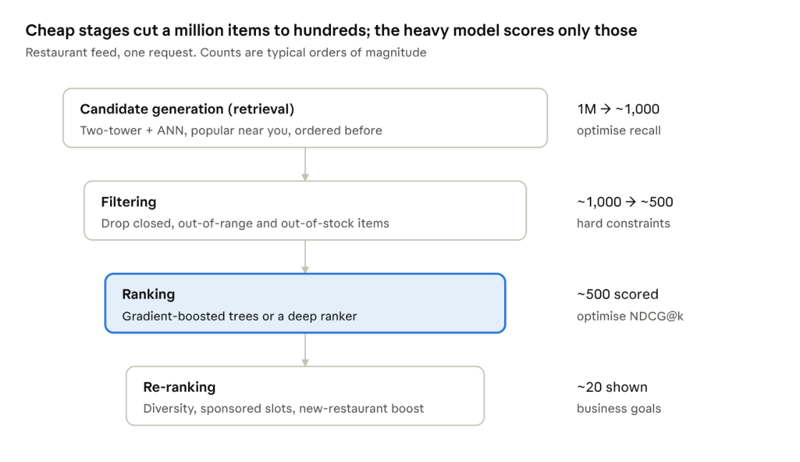
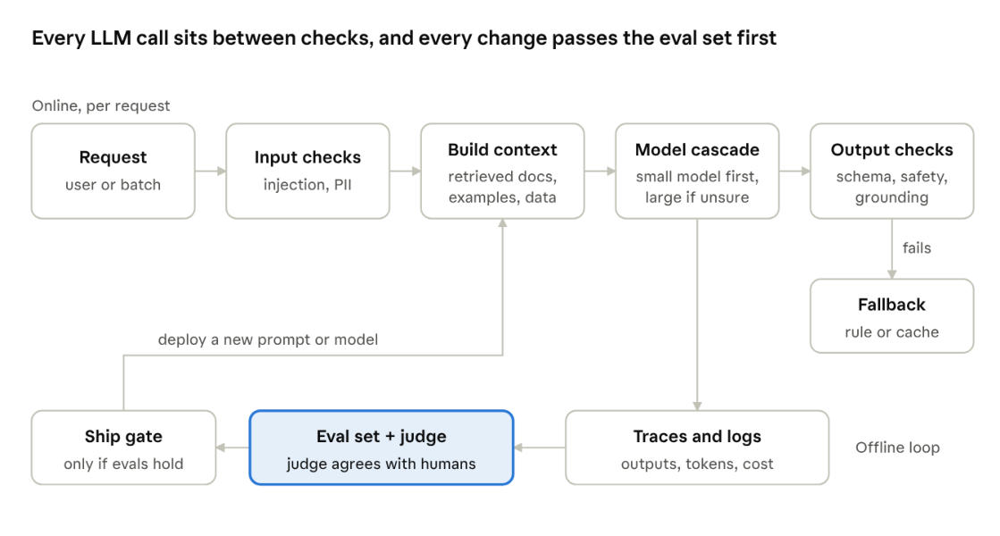

# 46 · ML system design: the method

Part XI · Applied ML systems (optional track).

This chapter teaches the method you use in every design round. The ten worked designs are in Appendix E. Try each one yourself, timed, before reading its answer.

## Why it matters

A system design round is not a test of whether you know the "right" architecture. It is a 45-minute simulation of how you would lead an ML project: can you turn a vague business ask into a measurable problem, choose sensible components, and reason about trade-offs out loud?

On the job this is the same skill as writing a design doc or scoping a quarter. You already do it; the interview format just compresses it.

### What interviewers score

Most companies use a rubric with four or five dimensions. The names vary, but the substance is consistent:

| Dimension | What a strong answer shows | What a weak answer shows |
|---|---|---|
| Problem framing | Asks about the business goal, users and constraints before designing; turns them into an ML objective and success metrics | Starts drawing models in the first two minutes |
| ML depth | Picks models and losses for stated reasons; knows the failure modes of each choice | Name-drops architectures without saying why |
| Data and evaluation | Knows where labels come from, their biases, and how offline metrics relate to the online goal | Treats data as given; evaluates only with accuracy or AUC |
| Production sense | Thinks about latency, scale, freshness, cost, monitoring and iteration | Stops at "train the model" |
| Communication | Structures the 45 minutes, checks in with the interviewer, states assumptions | Monologues, or waits to be led |

At mid-level the bar is a complete, sensible design with sound reasoning. At senior level the extra signal is trade-offs: why this and not that, what you would build first, and what you would cut.

## The framework at a glance


*the eight-step framework · 45-minute budget*

Use the eight steps as headings on the whiteboard or in your notes, in this order. If the interviewer pulls you deeper into one step, take the time from serving and monitoring, never from clarifying and framing. The dashed arrow is how you close: what V1 ships, and what V2 adds.

## Key concepts

- **ML system design interview**: a 45–60 minute open conversation where you design an end-to-end ML system and defend the trade-offs. Good overviews: [Chip Huyen's ML Interviews Book](https://huyenchip.com/ml-interviews-book/) and her [Designing Machine Learning Systems](https://www.oreilly.com/library/view/designing-machine-learning/9781098107956/).
- **Problem framing**: business goal → ML objective → label → offline metric → online metric and guardrails (Chapter 3).
- **Two-path architecture**: an online path for requests and an offline path for training and batch scoring (Chapter 42).
- **Candidate generation and ranking**: the standard shape for any "pick the best few out of millions" problem. [System Design for Recommendations and Search](https://eugeneyan.com/writing/system-design-for-discovery/).
- **Back-of-the-envelope estimation**: users, requests per second, storage and cost from rough numbers; Little's law for capacity (Chapter 42.9).
- **Baseline first**: heuristics and simple models before deep ones. [Rules of Machine Learning](https://developers.google.com/machine-learning/guides/rules-of-ml).
- **Deployment and monitoring**: release ladder, drift and feedback loops (Chapter 47).

## Step 1 · Clarify the problem

Spend the first 5–7 minutes asking questions and writing the answers where the interviewer can see them. Every later choice should trace back to something on this list.

**The checklist, in the order to ask:**

1. **Business goal.** What are we trying to move? ("More orders from the home feed", "fewer bad reviews published".) Is there one north-star metric?
2. **Users and surface.** Who sees the output, where, and what do they do with it? Mobile app, back-office tool, an API for another team?
3. **Scale.** Daily active users, requests per second at peak, size of the catalogue (restaurants, items, documents).
4. **Latency and freshness.** Is this real-time (under ~200 ms), near-real-time (seconds), or batch (hourly or daily)? How fresh must the data be?
5. **Constraints.** Markets and languages, privacy rules, budget (especially for LLMs), existing infrastructure, team size.
6. **What exists today.** A heuristic, a rule system, an older model? This becomes your baseline.

If the interviewer says "you decide", state an assumption out loud and write it down: "I'll assume 10 million daily users and a 150 ms budget for the feed." Stated assumptions are fine; silent ones are not.

## Step 2 · Frame it as an ML problem

Translate the business goal into four things: the **ML objective**, the **label**, the **prediction target at serving time**, and the **metrics**. This is where most candidates lose the round, because a wrong framing makes every later step wrong.

**Ask first: does this need ML?** A rule or a sorted list is sometimes the right answer for a first version. Saying so, then explaining when ML starts to pay off, is a strong senior signal.

### Framing examples

| Business ask | ML task | Label | Offline metric | Online metric |
|---|---|---|---|---|
| Order more from the home feed | Rank restaurants per user | Ordered (or clicked) after an impression | NDCG@10, recall@50 for retrieval | Orders per session, conversion |
| Find dishes in search | Rank items for a query | Clicked or ordered after the query | NDCG@10, MRR | Search conversion, null-result rate |
| Classify merchants into a taxonomy | Multi-class (or multi-label) classification | Human-labelled sample; LLM labels checked by humans | Macro F1, per-class precision | Filter usage, search success on filtered queries |
| Publish only safe reviews | Binary classification with a threshold | Moderator decisions | Precision at fixed recall, PR-AUC | Complaints, moderation cost |
| Delivery time estimate | Regression | Actual delivery time | MAE, share within ±5 min | Cancellation rate, customer contacts |
| Predict order cancellations | Binary classification, calibrated | Cancelled within X minutes | Log loss, calibration curve | Cancellations prevented, cost |

### Choosing the objective

- **Clicks are easy to get but cheap to fool.** Optimising clicks alone rewards clickbait and pictures, not orders. A common answer is a weighted combination, for example score = P(click) × P(order | click), or a multi-task model with one head per event.
- **Proxy vs true goal.** The label you can train on (an order within the session) is a proxy for the goal (long-term retention). Say so, and say how you would check the proxy does not drift from the goal: long-term holdouts, retention guardrails.
- **One metric to decide, several to guard.** Pick one primary online metric for the A/B test and name two or three guardrails (latency, cancellations, diversity, revenue per order).

## Step 3 · Data

Say where every label and feature comes from, and what is wrong with it. Interviewers care less about the volume of data than about whether you see its biases.

**Label sources, from cheapest to most expensive:**

- **Implicit feedback:** impressions, clicks, add-to-cart, orders, dwell time, skips. Plentiful, but biased: users can only click what you showed them, and they click higher positions more (**position bias**).
- **Explicit feedback:** ratings, reviews, thumbs up or down. Sparse, and skewed towards extremes.
- **Human labels:** annotators or moderators. Accurate but slow and expensive; check agreement between annotators before trusting them.
- **LLM labels:** fast and cheap at scale, but they need a human-labelled sample to measure their error rate. (Chapter 41.3 has a worked example.)

**The questions to answer for any dataset:**

1. **What counts as a negative?** For ranking, a shown-but-not-clicked item is a weak negative; a never-shown item is unknown, not negative. For retrieval, you usually sample negatives (random, popular, or "hard" negatives that look relevant).
2. **Label delay.** An order is known in minutes, a refund in days, churn in weeks. Training on recent data with incomplete labels biases the model.
3. **Class imbalance.** Conversion is often 1–5% of impressions. Options: downsample negatives (and correct the predicted probabilities afterwards), class weights, or focal loss. Evaluate with PR-AUC or precision at k, not accuracy.
4. **Splits.** Use time-based splits for anything that is deployed into the future. Random splits leak future behaviour into training.
5. **Privacy.** Personal data, retention limits, and consent across markets. One sentence is enough unless the interviewer probes.

## Step 4 · Features

Group features by entity, then say how fresh each group needs to be. This structure alone makes an answer sound senior.

| Group | Examples (restaurant feed) | Freshness |
|---|---|---|
| User | Order history, favourite cuisines, price sensitivity, user embedding | Daily batch, plus real-time session events |
| Item | Cuisine, rating, price level, prep time, item embedding | Daily, plus real-time availability (open, busy) |
| Context | Time of day, weekday, weather, location, device | Request time |
| User × item | Past orders from this restaurant, distance, similarity of embeddings | Mixed |
| Session | Items viewed in the last 10 minutes, current query | Real time |

**Point-in-time correctness.** The most common leakage in production ML: training rows joined with feature values that were only known later. Every training example must use the feature values as they were at the moment of the prediction. A feature store does this for you; in an interview, saying "point-in-time join" shows you know the trap.

In pandas, `merge_asof` does exactly this:

```python
import pandas as pd

# One row per impression we want to label and train on
impressions = pd.DataFrame({
    "user_id": [1, 1, 2],
    "ts": pd.to_datetime(["2026-11-01 12:00", "2026-11-03 19:00", "2026-11-02 13:00"]),
    "ordered": [0, 1, 0],
})

# A feature that changes over time: the user's order count, snapshotted when it changes
user_orders = pd.DataFrame({
    "user_id": [1, 1, 2],
    "ts": pd.to_datetime(["2026-10-30 09:00", "2026-11-02 20:00", "2026-10-15 10:00"]),
    "orders_to_date": [4, 5, 11],
})

# Point-in-time join: for each impression, take the latest feature value at or before ts
train = pd.merge_asof(
    impressions.sort_values("ts"),
    user_orders.sort_values("ts"),
    on="ts",
    by="user_id",
    direction="backward",  # never look into the future
)
print(train)
#   user_id                  ts  ordered  orders_to_date
# 0       1 2026-11-01 12:00:00        0               4
# 1       2 2026-11-02 13:00:00        0              11
# 2       1 2026-11-03 19:00:00        1               5
```

A naive `merge` on `user_id` with the latest value would have given the first impression `orders_to_date = 5`: a value from the future.

**Embeddings as features.** Learned user and item embeddings (from a two-tower model, matrix factorisation or a text encoder over menus) compress a lot of signal. Mention how they are refreshed, because a stale embedding table quietly hurts new items most.

## Step 5 · The model

Always start with a baseline, then climb a ladder of complexity, and say what each rung buys you. Jumping straight to a transformer is a weak signal; knowing when you would stop climbing is a strong one.

### The model ladder (ranking example)

| Rung | Model | Why stop here | Why go further |
|---|---|---|---|
| 0 | Heuristic: popularity in your area, distance, rating | No training, easy to explain, a fair baseline | Ignores the individual user |
| 1 | Logistic regression on hand-built features | Fast, calibrated, interpretable | Misses feature interactions |
| 2 | Gradient-boosted trees (LightGBM, XGBoost) | The strong default for tabular ranking; handles interactions and missing values | Struggles with very high-cardinality IDs and raw sequences |
| 3 | Deep model with embeddings (two-tower for retrieval, DLRM or DCN for ranking) | Learns from IDs and sequences, shares signal across users | More data, infrastructure and tuning |
| 4 | Sequence and transformer models over user history (e.g. SASRec), or LLM-based components | Captures order and intent within a session | Cost and latency; gains are often small at mid scale |

At a mid-sized marketplace, rung 2 for ranking plus rung 3 (a two-tower model) for retrieval is a credible, defensible design.

### The multi-stage architecture

When the catalogue is large (thousands to millions of items) you cannot score every item with a heavy model within the latency budget. So systems run a funnel: cheap stages that cut many items, then expensive stages over few. The diagram below shows it; the numbers are typical orders of magnitude, not a rule.



*multi-stage recommendation funnel · 4 stages*

**Each stage, in one line:**

- **Candidate generation (retrieval).** Several cheap sources in parallel: a two-tower model searched with approximate nearest neighbours, "popular near you", "ordered before", collaborative filtering. Optimise for **recall**.
- **Filtering.** Remove what cannot be served: closed, out of delivery range, out of stock, blocked.
- **Ranking.** A heavier model scores each surviving candidate with rich features. Optimise for **precision at the top** (NDCG@k).
- **Re-ranking.** Business rules and diversity: no five pizzas in a row, sponsored slots, freshness for new restaurants, fairness across partners.

### Choosing the loss

- **Pointwise** (binary cross-entropy on click or order): simple, gives calibrated probabilities you can combine and threshold.
- **Pairwise** (e.g. BPR, RankNet): learns that the ordered item should score above the skipped one; closer to what ranking needs.
- **Listwise** (e.g. LambdaRank, softmax over the list): optimises the order of the whole list; best for NDCG, more complex.
- **Multi-task:** one shared model with heads for click, add-to-cart and order, combined with weights at serving time. Common in production because business goals change faster than models.

## Step 6 · Evaluation

Evaluation is where you show you know offline numbers can lie. Cover three layers: offline metrics, the online experiment, and the guardrails.

**Offline.**

- Pick metrics that match the stage: recall@k for retrieval, NDCG@k or MAP for ranking, PR-AUC and calibration for classifiers, MAE for regression.
- Evaluate on a **time-based** holdout (train on weeks 1–4, test on week 5).
- **Slice** the results: new vs returning users, small vs large cities, cuisines, languages. An average improvement can hide a regression for new users.
- Know the limits of **logged data**: you only have labels for items that were shown, so a new model that surfaces different items is judged on incomplete data. Mention counterfactual evaluation (inverse propensity scoring) and that the final word belongs to an A/B test.

**Online.**

- An A/B test with a primary metric, a minimum detectable effect, and a duration long enough to cover weekly cycles (usually at least one or two full weeks).
- In two-sided marketplaces, users in treatment and control compete for the same couriers and restaurants, which biases a simple user-level A/B test. Mention **switchback** tests (randomise by city and time slot) or geo experiments when supply is shared.
- For ranking, **interleaving** (mixing results from both models in one list) detects differences with far less traffic.
- Variance reduction (CUPED) shortens tests (Chapter 2).

**Guardrails.** Latency, error rate, cancellations, delivery time, revenue per order, diversity, and complaints. The model should win the primary metric without breaking any of these.

## Step 7 · Serving

Describe how a request flows through the system, and where the time goes.

- **Batch vs online.** Precompute what you can: nightly candidate lists per user, item embeddings, daily features. Compute online only what depends on the request: context, session, real-time availability.
- **Latency budget.** Split it across stages, for example: retrieval 30 ms, feature fetch 30 ms, ranking 50 ms, re-ranking 10 ms, network and overhead the rest.
- **Approximate nearest-neighbour search** (HNSW, IVF, ScaNN, or a vector database) for embedding retrieval in milliseconds over millions of items.
- **Caching** for popular requests, and a **fallback** (popularity list) when the model or a feature service times out. Always mention the fallback.
- **Model updates.** How often do you retrain (daily is common for ranking), and how do new models reach production: shadow mode, then canary, then the A/B test.

## Step 8 · Monitoring and iteration

Close by showing the system keeps working after launch.

- **Data and feature drift:** distributions of inputs compared with training (population stability index, KL divergence), missing-value rates, freshness of feature tables.
- **Prediction drift:** the distribution of scores, and calibration over time.
- **Business metrics:** the online metric and guardrails on a dashboard, with alerts.
- **Feedback loops:** a recommender trains on what it showed, so it can narrow over time. Counter with exploration (a small share of random or bandit-chosen slots) and with diversity in re-ranking.
- **Iteration plan:** what you would build next, in order. Ending with "V1 is X, V2 adds Y because Z" is one of the clearest senior signals.

## Back-of-the-envelope maths

Two minutes of rough numbers make the serving discussion concrete and stop you from proposing something that cannot work. Round aggressively; the order of magnitude is what matters.

**Worked example: the restaurant feed.** Assume 10 million daily active users, 5 feed loads each, 1 million restaurants and dishes, 128-dimensional embeddings, 500 candidates ranked per request.

| Quantity | Calculation | Result |
|---|---|---|
| Average requests per second | 10M × 5 ÷ 86,400 | about 580 QPS |
| Peak (lunch and dinner, ×3) | 580 × 3 | about 1,700 QPS |
| Item embedding table | 1M × 128 × 4 bytes | about 0.5 GB: fits in memory on one machine |
| User embedding table (50M users) | 50M × 128 × 4 bytes | about 26 GB: needs a key-value store or sharding |
| Ranking work at peak | 1,700 × 500 candidates | about 850,000 scorings per second: needs batched inference across several replicas |

**Worked example: an LLM classification job.** 10 million products, about 300 input tokens and 50 output tokens each. The prices below are placeholders for illustration; check current pricing before quoting any.

| Quantity | Calculation | Result |
|---|---|---|
| Input tokens | 10M × 300 | 3 billion |
| Output tokens | 10M × 50 | 500 million |
| Cost at $0.15 per 1M input, $0.60 per 1M output | 3,000 × 0.15 + 500 × 0.60 | $750 |
| With a 50% batch discount | 750 × 0.5 | $375 |

The same arithmetic explains how teams reach 5–10× cost reductions: batch discounts, shorter prompts and fewer calls multiply.

**A small calculator to practise with:**

```python
SECONDS_PER_DAY = 86_400

def qps(daily_users: float, requests_per_user: float, peak_factor: float = 3.0) -> tuple[float, float]:
    """Average and peak requests per second."""
    avg = daily_users * requests_per_user / SECONDS_PER_DAY
    return avg, avg * peak_factor

def embedding_memory_gb(n_rows: float, dim: int, bytes_per_value: int = 4) -> float:
    """Memory for a dense embedding table (float32 = 4 bytes, float16 = 2)."""
    return n_rows * dim * bytes_per_value / 1e9

def llm_cost_usd(n_calls: float, in_tokens: float, out_tokens: float,
                 usd_per_m_in: float, usd_per_m_out: float,
                 batch_discount: float = 0.0) -> float:
    """Total cost of an LLM job; prices are per million tokens."""
    cost = n_calls * (in_tokens * usd_per_m_in + out_tokens * usd_per_m_out) / 1e6
    return cost * (1 - batch_discount)

avg, peak = qps(10e6, 5)
print(f"{avg:,.0f} QPS average, {peak:,.0f} at peak")       # 579 QPS average, 1,736 at peak
print(f"{embedding_memory_gb(1e6, 128):.2f} GB of item embeddings")  # 0.51 GB
print(f"${llm_cost_usd(10e6, 300, 50, 0.15, 0.60, batch_discount=0.5):,.0f}")
# $375
```

**Rough latency numbers worth remembering** (orders of magnitude, not benchmarks): an in-memory lookup takes well under a millisecond; a network call within a data centre about half a millisecond; a cache or key-value store read around 1 ms; a gradient-boosted model scoring a few hundred candidates a few milliseconds; an approximate nearest-neighbour search over millions of vectors a few milliseconds; an LLM call hundreds of milliseconds to seconds. That last one is why LLMs rarely sit in a 150 ms request path.

## Designing LLM systems

The eight steps still apply to an LLM design (a classifier, a RAG assistant, a judge). What changes is where the hard decisions sit: less in model architecture, much more in evaluation, cost and failure handling.

| Step | What changes for LLM systems |
|---|---|
| Clarify | Ask about volume and latency early: they decide between real-time calls, batch jobs, or a small distilled model. Ask what a wrong answer costs: a bad summary is annoying, a bad refund decision is expensive |
| Frame | Decide the adaptation level, cheapest first: prompting, then retrieval (RAG), then fine-tuning (LoRA), then training a small model on LLM-generated labels. Say why you stop where you stop |
| Data | The key dataset is the **evaluation set**: a few hundred real, labelled examples covering the hard cases, built before optimising anything. Training data may be synthetic or LLM-labelled, but checked against human labels |
| Features | Becomes **context**: what goes into the prompt (instructions, retrieved documents, user and item attributes, examples) and in what order |
| Model | Model choice is a cost, latency and quality trade-off: a large model for hard cases, a small one for volume, often both in a cascade (cheap model first, escalate when unsure). Use structured output (JSON schema) so downstream code does not parse free text |
| Evaluation | Offline: task metrics on the eval set, plus LLM-as-judge for open-ended outputs, with the judge itself checked against human labels. Online: A/B test on the business metric. Error analysis by hand comes first and never stops |
| Serving | Batch where possible (cheaper, often half price), caching of repeated prompts, timeouts, retries with backoff, rate limits, and a non-LLM fallback |
| Monitoring | Trace each call: input, output, tokens, latency, cost. Sample outputs for review, track judge scores over time, and watch for provider model updates that silently change behaviour |



*LLM system · online path and offline evaluation loop*

The top row runs on every request; the bottom row is how the system improves. Draw both in an LLM design round: most candidates draw only the top.

**Guardrails** belong in every LLM design: input checks (prompt injection, PII), output checks (schema validity, safety filters, grounding against sources), and human review for high-stakes decisions.

**A strong closing line for LLM designs:** "Every change to the prompt or model goes through the eval set before shipping, the same way code goes through tests."

## Pitfalls

These are the mistakes that most often cost candidates the round, roughly in order of frequency.

1. **Designing before clarifying.** Drawing a two-tower model in minute two. Fix: the first five minutes are questions, always.
2. **No baseline.** Without one, you cannot say whether the model is worth its cost. Fix: name the heuristic or current system first.
3. **Accuracy or AUC as the only metric.** They ignore the top of the list, calibration and business value. Fix: match the metric to the stage and add an online metric.
4. **Random train/test splits on time-dependent data.** The model sees the future. Fix: split by time.
5. **Ignoring position bias and logged-data bias.** Clicks on position 1 are not worth the same as clicks on position 20. Fix: mention it, and mention position as a training feature that is set to a constant at serving time, or inverse propensity weighting.
6. **Forgetting cold start.** New users and new restaurants have no history. Fix: content features, popularity in the area, exploration slots.
7. **One giant model and no funnel.** Scoring a million items with a deep model per request. Fix: the multi-stage architecture and the latency arithmetic.
8. **No fallback.** What happens when the feature store times out? Fix: a cached or popularity-based fallback.
9. **Monologue.** Talking for 20 minutes without checking in. Fix: after each step, ask "does this level of detail work, or should I go deeper on something?"
10. **Running out of time before serving and monitoring.** Fix: keep to the time budget, and say "I'll come back to this" when you go deep.

## Interview questions

These are the follow-ups interviewers use to probe a design. Answer each aloud in under two minutes before reading the model answer. Level: **M** = mid-level, **S** = senior.

**1. Why not rank every item with your best model? (M)** Latency and cost. Scoring a million items with a deep model per request is far beyond a 150 ms budget. A cheap retrieval stage cuts to a few hundred candidates with high recall; the expensive model then only needs to be precise at the top.

**2. Your offline NDCG improved by 3%, but the A/B test is flat. Why? (M)** Common causes: the offline metric is computed on logged data that only contains items the old model showed, so it cannot judge new items; the offline label (click) differs from the online goal (order); a train/serve skew (a feature computed differently online); or the improvement sits in a segment too small to move the total. I would check feature parity first, then slice both results.

**3. How do you handle position bias in training data? (M)** Add the position as a feature during training and set it to a fixed value at serving time, so the model learns the item's quality separately from where it was shown. Alternatives: weight examples by the inverse of the estimated probability of being examined at that position, or collect unbiased data from a small randomised slice of traffic.

**4. How would you deal with cold start for a new restaurant? (M)** Use content features that exist from day one (cuisine, price, menu text embeddings, location), borrow signal from similar restaurants, and reserve a few exploration slots in the feed so the new restaurant collects interactions. A bandit can decide how much exposure to give as evidence comes in.

**5. Pointwise, pairwise or listwise loss: which and why? (S)** Pointwise gives calibrated probabilities, which I need if I combine scores (P(click) × P(order)) or apply thresholds. Pairwise and listwise optimise order directly and usually do better on NDCG. In practice I often start pointwise with gradient boosting, then try LambdaRank and compare on NDCG and on the A/B test.

**6. How do you know the model isn't creating a feedback loop? (S)** Track catalogue coverage and the concentration of impressions over time (for example the share going to the top 1% of restaurants). Keep a small exploration share of traffic, and evaluate new models partly on that randomised data, which is free of the loop.

**7. When would you not use ML at all? (S)** When a rule captures most of the value, when there is too little data to beat it, when the decision must be fully explainable, or when the cost of maintenance outweighs the gain. I'd ship the rule first, log the data, and revisit when it stops scaling.

**8. How would you choose between real-time and batch inference? (M)** By how quickly the input changes and how much freshness is worth. Recommendations that depend on the current session or real-time availability need online scoring; a daily email or a nightly taxonomy classification can be batch. A common hybrid: batch-computed candidates, re-ranked online with session features.

**9. How do you evaluate an LLM-based component before launch? (M)** Build a labelled eval set of a few hundred real cases, including hard ones; measure task metrics; for open-ended outputs, use an LLM judge that has been checked against human labels on a sample; then run an A/B test on the business metric. Error analysis by hand comes before and after.

**10. Your LLM pipeline costs too much. What do you do? (S)** Measure where tokens go first. Then, in rough order of effort: shorten prompts and outputs, cache repeated calls, use batch APIs, route easy cases to a smaller model, and finally distil into a small fine-tuned model trained on the large model's outputs. Re-check quality on the eval set at each step.

**11. A key feature is computed differently in training and serving. How would you catch it? (S)** Log the features actually used at serving time and compare their distributions with the training features (train/serve skew checks). Better still, compute features once in a feature store used by both paths, so the logic cannot diverge.

**12. What would you build first, with a team of two and three months? (S)** A baseline with good logging: a simple retrieval (popularity plus "ordered before"), a gradient-boosted ranker on solid features, an offline evaluation pipeline and an A/B framework. Deep models and LLM components come after the data and evaluation loop works, because without them I cannot tell whether anything better is actually better.

## Practice

System design is practised by designing, out loud and against a clock. Do these in order, each in 40–45 minutes, written or spoken, then review it against this chapter.

1. **Warm-up, framing only (15 min each):** write the four framing items (objective, label, offline metric, online metric) for: "recommend add-on items at checkout", "detect fake restaurant reviews", "estimate courier arrival time".
2. **Week 1:** design a food-delivery app's restaurant recommendation feed, untimed. Use the eight steps as headings.
3. **Week 2:** dish and restaurant search ranking, timed.
4. **Week 3:** classify 10 million products into a taxonomy with LLMs, timed. Use the "Designing LLM systems" table.
5. **Back-of-the-envelope drills:** extend the calculator above with a function for storage per day of logged impressions, then estimate it for the feed.

**How to grade yourself:** did you ask at least five clarifying questions, name a baseline, give an offline and an online metric, draw the funnel, state a latency budget, name a fallback, and end with a V1 and V2 plan?

## Read next

- *Machine Learning System Design Interview* (Aminian and Xu), chapter 1: the framework, and chapter 6 (video recommendation) as the first worked example.
- *Designing Machine Learning Systems* (Huyen), chapters 2 (framing), 4 (training data), 6 (offline evaluation), 7 (deployment) and 8 (distribution shifts and monitoring), if you buy it.
- *AI Engineering* (Huyen), the evaluation chapters, for the LLM-system variant.
- [Eugene Yan, System design for recommendations and search](https://eugeneyan.com/writing/system-design-for-discovery/): how real companies split batch and online work.
- Covington, Adams and Sargin, *Deep Neural Networks for YouTube Recommendations* (RecSys 2016): the classic two-stage design, short and readable.

Check chapter numbers against each book's current edition.

## Done when

You can list the eight steps and their time budget without notes.

For any product ask, you can state objective, label, offline metric and online metric in two minutes.

You can draw the multi-stage funnel and say what each stage optimises. You can explain point-in-time correctness and position bias in one minute each. You can do the QPS and memory arithmetic for a feed in your head. You can say what changes when the system is built on an LLM, step by step. You have done at least one timed design and had it reviewed.

---

[← 27 · Marketplace and logistics ML](27-marketplace-and-logistics-ml.md) · [Contents](../README.md#contents) · [29 · MLOps and LLMOps →](29-mlops-and-llmops.md)
