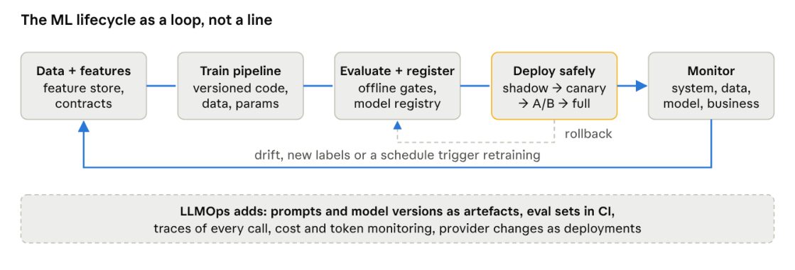
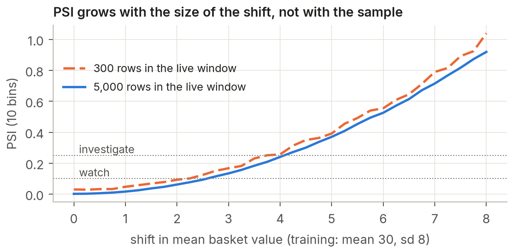

# 47 · MLOps and LLMOps

Part XI · Applied ML systems (optional track). Prerequisites: Chapter 42 (infrastructure primer). Written for readers who have trained models but never run one in production.

## Why it matters

Most of a model's life happens after the notebook. Data changes, the model has to be retrained, new versions must reach users without breaking anything, and someone must notice when predictions quietly go wrong. **MLOps** is the set of practices and tools that make this repeatable: versioned data and code, automated pipelines, safe releases, monitoring and quick rollback. **LLMOps** adds what is special about LLM features: prompts as code, evaluation sets in CI, traces of every call, and provider updates you did not schedule. Senior data scientists are expected to own a model end to end, or design it so a platform team can run it. Interviews probe failure modes ("accuracy dropped this week; what do you check?") and release discipline ("how do you ship a new prompt?").

The code below was run; outputs are quoted.

The chapter follows a model from notebook to production and through its life there. It starts with turning a notebook into a reproducible pipeline (47.1), then covers the components of a mature setup: feature stores against training–serving skew (47.2), a model registry with automated quality gates (47.3), a staged release ladder (47.4) and monitoring in four layers (47.5). Section 47.6 explains what changes for LLM features, 47.7 covers ownership and on-call, and 47.8 gives a realistic order for building all this. The chapter ends with operations for research-scale training (47.9) and a worked incident (47.10).

The same discipline applies whether the "model" is a feed ranker at a big-tech company, an LLM feature built on an API, or a frontier lab's training run. The ads and feeds version is about thousands of models retrained daily and guarded by automated gates. The LLM-product version is about prompts, providers and judges that change underneath you. The research version is about keeping a 10,000-GPU job healthy for weeks and knowing which checkpoint to trust. Interviewers in all three test the same instincts: can you tell a data bug from a real shift, can you release without fooling yourself statistically, and can you turn an incident into a test that stops it recurring.

Most production ML failures are silent: the service answers, the dashboards are green, and the predictions are wrong because an upstream feature changed or the world moved. MLOps is the practice of making those failures visible and cheap to reverse, and each component in the chapter closes one route by which a silent failure reaches users.

## Key concepts

- **ML lifecycle**: data → features → training → evaluation → registration → deployment → monitoring → back to data. Google's [MLOps levels guide](https://docs.cloud.google.com/architecture/mlops-continuous-delivery-and-automation-pipelines-in-machine-learning) describes how teams automate it step by step.
- **Technical debt in ML**: models create hidden maintenance costs through data dependencies and feedback loops. The classic paper: [Hidden Technical Debt in ML Systems](https://research.google/pubs/hidden-technical-debt-in-machine-learning-systems/).
- **Feature store**: one definition of each feature, served offline for training and online for prediction. [Feast documentation](https://docs.feast.dev/).
- **Training–serving skew**: a feature computed differently in training and in production.
- **Experiment tracking and model registry**: a record of every training run and every model version with its stage. [MLflow documentation](https://mlflow.org/docs/latest/index.html).
- **Shadow, canary and A/B releases**: ways to expose a new version gradually. [Canary release](https://martinfowler.com/bliki/CanaryRelease.html) (Martin Fowler).
- **Data drift and concept drift**: inputs change, or the relation between inputs and outcome changes. [Concept drift](https://en.wikipedia.org/wiki/Concept_drift).
- **Monitoring tools**: open-source libraries such as [Evidently](https://docs.evidentlyai.com/) compute drift and quality reports.
- **Behavioural tests**: checks of model behaviour such as invariance ("changing a name must not change the label"). [CheckList paper](https://arxiv.org/abs/2005.04118).
- **LLM tracing**: logging each LLM call, retrieval and tool call as a linked trace, with tokens, cost and prompt version.



*Every arrow is a place things break silently; MLOps is the practice of making each one visible and repeatable.*

## 47.1 Where MLOps starts: from notebook to pipeline

In a notebook you load data, train, look at a metric and save a file. That works once. It fails in production because nobody can rerun it the same way, it depends on your laptop's libraries, and nothing checks the data. The first step of MLOps is turning the notebook into a **pipeline**: a sequence of steps, each a function with clear inputs and outputs, run by a scheduler.

1. **Extract** the training data from the warehouse for a date range.
2. **Validate** it: schema, null rates, value ranges, row counts versus yesterday (Chapter 48.6). Stop here if it fails.
3. **Build features** with the same code used in production (47.2).
4. **Train** the model with a config file holding all hyper-parameters.
5. **Evaluate** on a fixed held-out set and on slices (city, language, new vs returning users).
6. **Register** the model with its metrics and lineage if it passes the gates (47.3).

An **orchestrator** (Airflow, Dagster, Prefect, Kubeflow, Metaflow, or the cloud's own) runs the steps in order, retries failures and alerts on errors. Each step runs in a container (Chapter 42), so it behaves the same everywhere.

For every run, record: the code version (git commit), the data snapshot or date range, the config, the container image, the metrics and the produced files. **Experiment tracking** tools (MLflow, Weights & Biases) do this with a few lines of logging. The test of reproducibility: can a colleague rebuild last month's production model from the registry entry alone?

## 47.2 Feature stores and training–serving skew

A model is only as good as the features it sees *at prediction time*. A common, silent bug: the training data computes "restaurant cancellation rate over 7 days" in SQL, while the production service computes it in Python with a slightly different window or a different treatment of missing values. Offline metrics look great; online results disappoint. This is **training–serving skew**.

A **feature store** fixes it by keeping one definition per feature and materialising it twice:

- an **offline store** (warehouse tables) for training, with **point-in-time** lookups so each training row only sees values that existed at that moment (Chapter 48.3);
- an **online store** (a fast key-value store such as Redis) that the prediction service reads in a millisecond.

Other benefits: features are reused across models (ETA, ranking and fraud can all use the same restaurant features), and there is a catalogue of what exists. Tools: Feast (open source), Tecton, and the feature stores in Databricks, SageMaker and Vertex AI. Without a feature store, the cheapest defence is to **log the exact features used at prediction time** with every prediction; that log becomes your best training data and your first debugging tool.

## 47.3 Model registry, CI/CD and quality gates

A **model registry** is a catalogue of model versions: the file location, the metrics, the training run that made it, and a **stage** (candidate, staging, production, archived). Promotion is a decision backed by evidence: the evaluation report, the comparison with the current production model, and a sign-off.

CI/CD (Chapter 42.10) for ML has three loops:

- **Code CI** on every pull request: unit tests for feature functions and pre-processing, linting, type checks.
- **Model CI**: train on a small sample to catch breakage; evaluate the candidate on fixed held-out sets with **gates**: no worse than production by more than x on the main metric, no slice worse by more than y, latency within budget, model size within memory limits.
- **CD**: build the serving container with the registered model, deploy behind a feature flag, then follow the release ladder (47.4).

**Behavioural tests** add checks that metrics miss: *invariance* (changing a restaurant's name must not change its cuisine label), *directional expectations* (a longer distance must not lower the ETA), and *minimum functionality* (obvious cases must be right).

### Versioning data and models, and model SLOs

Reproducibility needs the *data* pinned as well as the code. Lakehouse table formats (Delta Lake, Apache Iceberg, Apache Hudi) keep table snapshots, so a training run can record "orders table as of version 1,284" and re-read exactly that later ("time travel"). For file-based datasets, DVC or a content hash of each Parquet file does the same job. The registry entry for a model then points at code commit, data snapshot, config and container image together.

A model in production also needs a service-level objective, written down like any service's: "p99 latency under 50 ms, error rate under 0.1%, and calibration error under 0.02 on the weekly labelled sample, measured monthly". The first two are ordinary SLOs; the third is the model-specific part, and it is what turns "the model seems worse" into a page with a threshold. Keep the error budget idea too: if the model has burned its monthly budget of slow or failed requests, freeze risky releases until it recovers.

## 47.4 Releasing safely: the release ladder

Never switch 100% of traffic to a new model at once. Climb a ladder, stopping if anything looks wrong:

| Step | How | What it catches | Cost |
|---|---|---|---|
| 1. Shadow | The new model receives a copy of live traffic; its outputs are logged, not shown | Crashes, latency, strange output distributions, disagreement with production | Extra compute; no user impact |
| 2. Canary | 1–5% of real traffic uses it, with automatic rollback rules | Errors and guardrail breaks on real users, early | Small user risk |
| 3. A/B test | Randomised split, long enough to measure business metrics | Causal impact on orders, conversion, retention (Chapter 2) | Time and traffic |
| 4. Full rollout | 100%, old version kept ready for instant rollback | — | — |

For rankers, **interleaving** (mixing results of both rankers in one list and counting which get clicked) detects preference with far less traffic than an A/B test. **Bandits** shift traffic towards the better variant while still learning, useful with many variants.

A canary's automatic rollback rule is a pre-agreed statistical test. Example: is the canary's error rate worse than production's?

```python
import numpy as np
from scipy import stats

def two_prop(x1, n1, x2, n2):              # control errors/requests, canary errors/requests
    p = (x1 + x2) / (n1 + n2)
    se = np.sqrt(p * (1 - p) * (1 / n1 + 1 / n2))
    z = (x2 / n2 - x1 / n1) / se
    return z, 1 - stats.norm.cdf(z)         # one-sided: is the canary worse?

two_prop(120, 95_000, 21, 5_000)
# control 0.13% errors, canary 0.42% -> z = 5.39, p = 3e-8 -> roll back automatically
```

**Rollback** must take minutes: keep the previous container and model version deployed or one command away, and switch with a flag rather than a rebuild.

### Watching a canary continuously: sequential testing

The z-test above is a *fixed-horizon* test: it is valid if you look once, at a sample size chosen in advance. Canaries are watched continuously, and an automatic rule that runs the test every few minutes is looking dozens of times. Each look is another chance for noise to cross the threshold, so the false-rollback rate grows with the number of looks. In a simulation of a healthy canary (both arms at 0.13% errors, canary at 5% of traffic) tested at one-sided α = 1%, a single look at the end rolls back 1.1% of the time, as designed; checking every 2,000 canary requests for 25 looks rolls back 8.3% of the time. Each false rollback costs a release cycle and, worse, teaches the team to ignore the alarm.

**How much traffic does a canary need?** To detect a rise from 0.13% to 0.23% errors (a 0.10-point increase), one-sided α = 1% and 80% power, with the canary taking 1 request in 20, the standard two-proportion formula gives about 23,700 canary requests, about 474,000 requests in total, during which the canary will produce only about 55 errors. Small error-rate regressions need a lot of traffic; large ones (a crash path at 0.42%) show up within a few thousand requests.

**Sequential tests** are designed to be checked after every request. Wald's sequential probability ratio test (SPRT) compares a "healthy" rate p₀ with a "regressed" rate p₁ and accumulates the log-likelihood ratio after each request:

$$
\Lambda_n = x_n \ln\frac{p_1}{p_0} + (n - x_n)\ln\frac{1-p_1}{1-p_0}
$$

Here n is the number of canary requests so far and xₙ the number of errors among them. Roll back as soon as Λₙ ≥ ln((1 − β)/α), pass as soon as Λₙ ≤ ln(β/(1 − α)), and keep watching in between; α is the false-rollback rate and β the miss rate. With p₀ = 0.13%, p₁ = 0.23%, α = 1% and β = 20%, the bounds are +4.38 and −1.60: each error adds 0.571 and each success subtracts 0.001. In simulation the SPRT kept its 1% false-rollback rate while checking continuously, decided a healthy canary after about 7,600 requests on average, caught a 0.23% canary 86% of the time after about 13,400, and caught a 0.42% canary after about 3,900, all fewer than the fixed test's 23,700 (`code/ch47_check.py`).

The SPRT as written compares the canary with a fixed p₀. In practice the baseline drifts, so production systems use sequential tests that compare the two arms directly and produce **always-valid p-values** (the mixture SPRT, or the confidence sequences used in several experimentation platforms), which stay valid however often they are checked. The interview answer: "a canary is monitored continuously, so I'd use a sequential test, SPRT or an always-valid p-value, rather than re-running a z-test, which inflates false rollbacks."

## 47.5 Monitoring: four layers

A model can be "up" (the server answers) and badly wrong. Monitor four layers, from the fastest signal to the slowest:

1. **System health**: latency p50/p95/p99, error rate, throughput, CPU/GPU memory, cost. Standard service monitoring (Chapter 42.11).
2. **Data quality**: input schema, null rates, ranges, and the distribution of each feature compared with training.
3. **Model behaviour**: the distribution of predictions and confidence; once labels arrive, accuracy and calibration by slice.
4. **Business outcome**: the metric the model exists for: orders, on-time delivery rate, contact rate.

**Kinds of drift**, with delivery examples:

- **Covariate shift**: inputs change. Ramadan changes when and what people order; a new city launch brings new restaurants.
- **Prior (label) shift**: the base rate changes. Fraud attempts spike during a big promotion.
- **Concept drift**: the relation between inputs and outcome changes. A new delivery mode (bikes instead of cars) makes old ETA patterns wrong.

Labels often arrive late (an ETA label in an hour, a churn label in a month), so input and prediction drift are the early warnings. The **population stability index (PSI)** is the standard tabular drift score: bin the training distribution, compare the share of live data in each bin.

$$
\mathrm{PSI} = \sum_{i=1}^{B} (a_i - e_i)\,\ln\frac{a_i}{e_i}
$$

Here B is the number of bins (deciles of the training data, usually), eᵢ the share of training data in bin i and aᵢ the share of live data. Each term is non-negative, because aᵢ − eᵢ and ln(aᵢ/eᵢ) always have the same sign. Expanding the product shows PSI = KL(a‖e) + KL(e‖a): it is the symmetric (Jeffreys) KL divergence between the binned distributions, which is why it is zero only when the bins match and why the order of the two arguments does not matter. **Worked example:** four equal training bins (0.25 each) and live shares 0.20, 0.25, 0.25, 0.30 give (−0.05)·ln(0.8) + 0.05·ln(1.2) = 0.0112 + 0.0091 = 0.020, stable.

```python
def psi(expected, actual, bins=10):
    edges = np.quantile(expected, np.linspace(0, 1, bins + 1))   # bins from training data
    edges[0], edges[-1] = -np.inf, np.inf
    e = np.histogram(expected, edges)[0] / len(expected)
    a = np.histogram(actual, edges)[0] / len(actual)
    e, a = np.clip(e, 1e-6, None), np.clip(a, 1e-6, None)
    return float(np.sum((a - e) * np.log(a / e)))

# basket value, training distribution N(30, 8):
# same distribution         -> 0.0007
# mean +2                   -> 0.059
# mean +6 and wider spread  -> 0.453
```

Rule of thumb: below 0.1 stable, 0.1–0.25 watch, above 0.25 investigate. Avoid alerting on p-values of statistical tests: with large samples, a Kolmogorov–Smirnov test calls even the harmless +2 shift "significant" (p = 1e-27 on 5,000 rows each). Alert on effect size, and compare with the same season last year before raising alarms about Ramadan or summer.



*PSI of a live window against the training distribution as the mean basket value shifts, averaged over 40 windows. With 5,000 rows, PSI without any shift is 0.002. With 300 rows the noise floor is 0.03 and small windows read slightly high throughout, but both reach the 0.25 "investigate" line at a shift of about half a standard deviation.*

Two implementation details change the number. The bin count: more bins detect finer shape changes and read slightly higher for the same shift (the +2 shift scores 0.056 with 5 bins, 0.060 with 10, 0.065 with 50), so thresholds only transfer between features with the same binning. And the clip: a bin that is empty in training and non-empty live (a new category, a new default value) makes ln(aᵢ/eᵢ) infinite, so code clips shares at a small ε, and the choice of ε then dominates the result. A new category taking 5% of live traffic scores 0.55 with ε = 10⁻⁶ but 0.32 with ε = 10⁻⁴. For categorical features, alert on new categories directly rather than through PSI.

PSI measures the size of a shift, not its statistical significance, which is why it works as an alert. Two practical cautions follow from the figure. First, compute it on windows large enough that the no-shift value sits well below 0.1: a few hundred rows at least for 10 bins. Second, set thresholds per feature from a few weeks of history, because some features drift weekly by design (hour of day, for example).

### Estimating performance before labels arrive

Drift says the inputs moved; it does not say whether accuracy fell. Three techniques estimate performance without labels. **Confidence-based estimation** uses the model's own calibrated probabilities: if the model is calibrated, the expected accuracy on a batch is the mean of max-class probabilities (for a binary classifier, the mean of p for predicted positives and 1 − p for predicted negatives), and the same idea gives expected precision and recall. It holds under covariate shift as long as calibration holds, which it does not under concept drift. **Label-shift estimation** (black-box shift estimation, BBSE) assumes P(x | y) is fixed and only the class mix changed: from the confusion matrix on validation data and the distribution of predictions live, solve a linear system for the new class proportions, then re-weight. It is the right tool for "fraud attempts spiked during a promotion". **Early-label cohorts** buy real labels quickly: label a small random sample by hand each day, or use a fast proxy (a complaint within an hour as a proxy for a bad ETA) and check periodically that the proxy still tracks the real label.

**When to retrain**: on a schedule (simple and predictable), on a trigger (drift or performance past a threshold), or continuously for fast-moving targets. Always pass the new model through the same gates and release ladder. Fix data bugs before retraining; retraining on broken data just learns the bug.

## 47.6 LLMOps: what changes with LLM features

LLM features follow the same lifecycle, with new artefacts and new failure modes. The shift in mindset is that the "model" is now a bundle: weights you may not control, a prompt, decoding settings, retrieval and tools, and often a second model acting as judge. Any part of the bundle can change behaviour, and several of them can change without a deployment on your side.

**More things to version.** The prompt (system prompt, templates, few-shot examples), the model name and version, decoding settings, the retrieval configuration (embedding model, chunking, top-k), and tool definitions all belong to the release. A change to any of them is a deployment and goes through the release ladder, so store prompts as files in git, not as strings scattered in code. **Provider updates are deployments you did not schedule:** pin model versions where the API allows it, re-run your evaluation set when a provider announces changes, and keep a fallback model.

**Evaluation in CI.** A golden set of inputs with expected properties, scored automatically and with LLM-as-judge (Chapter 24), with thresholds that block a merge, including safety and prompt-injection tests (Chapter 28). **Tracing** logs every call as a span in a trace: inputs, retrieved documents, tool calls, outputs, tokens, latency, cost, prompt version, with personal data redacted (LangSmith, Langfuse, Arize Phoenix, MLflow tracing, or OpenTelemetry-based setups). **Online signals** close the loop: thumbs up/down, user edits of generated text, escalations to a human agent, retries, conversation length, and sampled LLM-as-judge scoring of live traffic. **Cost monitoring** tracks tokens per request by feature and prompt version, with alerts on spikes, because an agent stuck in a loop can burn a monthly budget overnight; Chapter 21 lists the levers.

### How big must the eval set be to gate a prompt change?

A gate that blocks merges on "accuracy fell" is a statistical test, and most teams' golden sets are too small for the changes they gate. At 80% accuracy, 500 items give a standard error of √(0.8 × 0.2 / 500) ≈ 1.8 points, so a single run cannot distinguish a 2-point regression from noise. Comparing two independent runs, detecting a 2-point change with 80% power at α = 5% needs (1.96 + 0.84)² × 2 × 0.8 × 0.2 / 0.02² ≈ 6,300 items. The comparison is far cheaper when it is **paired**: both prompts answer the same items, and only the items where they disagree carry information. If 10% of items flip between the prompts, McNemar's test needs about 1,960 items for the same 2-point change. Gate on the paired difference with its interval, set the gate's tolerance to what the set can resolve, and keep a small, hand-checked "must pass" set for behaviours that must never regress, where one failure blocks the merge. Chapter 23 derives the paired standard error.

### Non-deterministic evaluations

Two runs of the same prompt on the same eval set rarely give the same score. Sampling at temperature > 0 adds per-item variance, and even temperature 0 is not deterministic on most serving stacks: batched inference changes the order of floating-point reductions depending on what else is in the batch, so logits differ in the last bits and ties between tokens break differently. Treat an eval score as a random variable. Sample each item several times (k = 3–5) and average, report the run-to-run spread next to the score, and when comparing prompts, fix the item set and compare paired means. A gate that fails one run in ten on an unchanged prompt is a flaky test, and flaky gates get disabled.

### Judge drift

An LLM judge is a model with its own version, and changing it changes every score at once. When a judge model is upgraded, scores shift even though the system under test did not change, which looks like a regression or an improvement in every dashboard. Pin the judge's version like any dependency. Before switching judges, run old and new judges side by side on a few hundred items with human labels, measure each one's agreement with the humans (Cohen's kappa), and re-baseline the historical series. Re-check judge agreement with fresh human labels every few months anyway, because the outputs being judged drift too.

### Operating self-hosted models

Teams that serve open-weight models take on a second set of failure modes. Upgrading the serving engine (vLLM, SGLang, TensorRT-LLM) or its kernels changes numerics, batching and sometimes default sampling settings, so treat an engine upgrade as a model release: shadow it and compare outputs and eval scores. Rolling out a quantised model (FP8, INT4) is a quality change, not only a cost change, and needs the eval gate and a canary; quantisation errors concentrate in rare inputs, such as long contexts, other languages or code, so slice the evaluation. Memory is the usual operational failure: a burst of long prompts fills the KV cache, the engine pre-empts or rejects requests, and latency spikes, so alert on KV-cache utilisation and queue length, cap maximum input and output lengths, and autoscale on queue depth or KV usage rather than on CPU. GPU autoscaling is slow, because a new replica must load tens of gigabytes of weights, so keep warm spare capacity for peaks.

**Prompt-cache invalidation.** Provider and engine prompt caches reuse the KV cache of a shared prefix, which can cut input cost and time to first token for long system prompts by most of the cached part. Any change early in the prompt (a timestamp in the system prompt, a reordered tool list, a new few-shot example at the top) invalidates the cache for everything after it, so a harmless-looking prompt edit can multiply cost and latency. Keep stable content first and variable content last, and monitor the cache hit rate per prompt version.

## 47.7 Ownership and on-call

For each model in production, write down: owner, purpose, inputs and their sources, metrics and thresholds, dashboards, alert routes, retraining schedule, rollback procedure, and known limitations. This **model card plus runbook** fits on one page and is worth more than a perfect platform nobody reads. After each incident, run a short blameless post-mortem and add a test or monitor that would have caught it.

## 47.8 A maturity path

Teams rarely build everything at once. A practical order:

1. **Reproducible training**: code in git, a pipeline instead of a notebook, experiment tracking.
2. **Prediction logging** with model version and features, and basic system dashboards.
3. **A registry and evaluation gates** before deploy.
4. **Shadow and canary releases** with automatic rollback.
5. **Drift and business-metric monitoring** with alerts and a runbook.
6. **A feature store** once several models share features or skew bugs keep appearing.
7. **Automatic retraining** once the steps above are trusted.

Google's MLOps guide calls these levels 0 to 2; whatever the naming, saying where a team is and what you would add next is a strong interview answer.

## 47.9 Operations for research-scale training

Research teams run a different kind of production: long training jobs and large experiment fleets. The model is not serving users yet, but a month of a large cluster is worth more than most product models, and the failure modes are just as silent: a run that diverges slowly, a data loader that repeats a shard after a restart, an evaluation that changed code between checkpoints.

The foundations mirror product MLOps. **Run tracking** keeps every run's configuration, code commit, data version and metrics in one place, grouped by experiment. **Training-health monitoring** watches loss, gradient norms, logit statistics, throughput and MFU, with alerts on spikes, stalls and NaNs (Chapters 7 and 17). **Checkpoint management** writes sharded, asynchronous checkpoints, retained on a schedule, each evaluated automatically on a fixed suite. **Fault tolerance** means automatic restarts, node health checks, straggler detection and exact data-loader resumption. **Reproducibility** needs pinned environments (containers), fixed data snapshots and recorded seeds, with the remaining non-determinism documented. **Evaluation pipelines** score checkpoints automatically and publish dashboards, so model comparisons use the same code every time (Chapter 23). **Cost accounting** tracks GPU-hours per project and per experiment, to support the compute budgeting of Chapter 34.

### Failures are routine: how often to checkpoint

At large scale, hardware fails every few hours. Meta reported 419 unexpected interruptions during a 54-day period of Llama 3 405B pretraining on 16,384 H100s, about 7.8 a day, one every three hours, most of them attributed to hardware, GPUs above all ([Llama 3 paper](https://arxiv.org/abs/2407.21783)). Scaled linearly to 2,000 GPUs that is about one interruption a day, a mean time between failures M of about 25 hours.

Checkpointing trades two costs. Each checkpoint stalls training for C minutes; each failure loses, on average, half a checkpoint interval τ of work. Per unit of time the overhead is C/τ (checkpoint stalls) plus τ/(2M) (expected recomputation). Setting the derivative with respect to τ to zero gives the Young/Daly interval:

$$
\tau^{*} = \sqrt{2\,M\,C}
$$

With M = 1,520 minutes and C = 1 minute, τ* = √3,040 ≈ 55 minutes, and the overhead at the optimum is C/τ + τ/(2M) ≈ 3.6% before restart time. The formula explains why asynchronous checkpointing matters: the overhead at the optimum is √(2C/M), so cutting the stall by 4× halves it. Restart time (rescheduling, reloading, warming the data loader) adds directly per failure and is often the larger term, which is why teams invest in hot spares and fast restarts.

### The loss-spike playbook

A loss spike is a sudden jump in training loss, often with a gradient-norm spike just before. Some recover by themselves in a few hundred steps; others are the start of divergence. A standard response, in escalating order:

1. **Wait briefly** if the loss is already falling back and the gradient norm has recovered; many spikes are transient. Set the waiting budget in advance (say a few hundred steps).
2. **Roll back** to the last healthy checkpoint, a few hundred to a thousand steps before the spike, and **skip the data batches** that were consumed around it. If the spike recurs at the same data, the data is the cause (a corrupted shard, a long run of repeated tokens); if it recurs at a different point, the optimisation is.
3. **Lower the learning rate** or tighten gradient clipping for a stretch after the rollback, then return to the schedule.
4. **Fix the architecture** for the next run if spikes are frequent. Logit growth in attention is a common culprit; QK-norm (normalising queries and keys before the dot product) and a z-loss on the output logits are the usual remedies, and smaller Adam ε or β₂ settings are another lever (Chapter 7).

Log every intervention in the run's record, because "skipped batches 1.20M–1.21M and lowered the LR for 2,000 steps" is part of the model's provenance.

## 47.10 A worked incident: an ETA model drifts

Monday 09:00. The dashboard shows PSI on the "restaurant prep time" feature at 0.41 for the last 24 hours. Every other feature is below 0.08. The model's mean predicted ETA has risen by 3 minutes, and late-delivery complaints are up 12% since Saturday.

1. **Triage.** Is this the world changing or a data bug?
   - The feature's distribution shows a new spike at exactly 30 minutes, which did not exist before.
   - Real-world prep times do not jump to one value overnight. Suspect the data.
2. **Find the cause.** Join the feature's source table with the deployment log. On Saturday a partner-app release changed the default prep time for restaurants that had not set one from "missing" to 30 minutes. The model learned that missing meant "fast restaurant with no data" and now sees 30 minutes everywhere.
3. **Mitigate first, fix second.**
   - Roll back to treating the new default as missing with a one-line feature-pipeline change, behind a flag. This is faster than retraining and goes through the normal release ladder (47.4), shortened for an incident.
   - Name the cost of this mitigation: restaurants that genuinely set their prep time to 30 minutes are now also treated as missing, so their ETAs get worse. It is the right trade for a day, not a fix. The durable fix is a source-flag column ("prep time set by restaurant" vs "system default") in the partner data, so the feature pipeline can tell a real 30 from a default 30.
   - Watch the PSI and the prediction distribution return to normal.
4. **Confirm the impact.** Once the labels arrive, compare actual delivery times with predictions for the affected restaurants against the rest over the weekend. Quantify the extra late deliveries for the incident report.
5. **Prevent the class of bug.**
   - Add a data contract on that column (48.6): allowed values, and an alert if any single value exceeds 20% of rows.
   - Add a pre-release check in the partner app's pipeline.
   - Add "default-value spikes" to the drift dashboard as their own detector.
6. **Write the post-mortem.**
   - Timeline, impact, root cause, and why monitoring caught it on Monday rather than within an hour of the release.
   - The answer: PSI was computed daily. Move the critical features to hourly windows.

The lesson in most drift incidents is that "drift" is an upstream change in how data are produced, not a change in the world, and the fix belongs in the data contract, not in a retrained model.

## Pitfalls

- Different feature code for training and serving.
- Monitoring only system metrics: the model can be up and wrong.
- Alerting on p-values of drift tests with large samples.
- No seasonal baseline: comparing this week with last week across a holiday.
- Unpinned LLM versions and unversioned prompts.
- Unpinned judge models: a judge upgrade shifts every score at once.
- Re-running a fixed-horizon test on a continuously watched canary.
- Eval gates smaller than the change they are meant to detect, or run once on a non-deterministic system.
- A synchronous checkpoint so slow that the optimal interval leaves hours of work exposed to each failure.
- A release process that cannot roll back in minutes.
- Retraining automatically on data that failed validation.

## Interview questions

**Mid level**

**1. What is training–serving skew and how does a feature store help?** Skew is a feature computed differently in training and in production: the training SQL uses a 7-day window and the online service a rolling 168 hours, or missing values are filled with 0 in one and the mean in the other. Offline metrics look good and online results disappoint, with no error anywhere. A feature store keeps one definition per feature and materialises it twice, offline with point-in-time lookups for training and online in a low-latency store for serving, so the logic cannot diverge. Without one, log the exact features used at prediction time and train on those logs. Follow-up: "how would you detect skew today?" Recompute a sample of logged requests' features with the training pipeline and diff them value by value.

**2. Explain shadow, canary and A/B deployments.** Shadow sends a copy of live traffic to the new model and logs its outputs without showing them: it catches crashes, latency and odd output distributions at zero user risk, but says nothing about user behaviour. A canary serves 1–5% of real traffic with automatic rollback rules: it catches errors and guardrail breaks on real users early, at small risk. An A/B test is a randomised split run long enough to measure the business metric causally. They answer different questions, so a release climbs all three. Number to know: at 5% canary traffic, detecting a rise in error rate from 0.13% to 0.23% takes about 24,000 canary requests, so small regressions need hours of traffic, not minutes.

**3. What is PSI and how do you read it?** The population stability index bins a feature by training-data deciles and sums (aᵢ − eᵢ)·ln(aᵢ/eᵢ) over bins, where eᵢ and aᵢ are the training and live shares; it equals the symmetric KL divergence between the binned distributions. Below 0.1 is stable, 0.1–0.25 worth watching, above 0.25 worth investigating; a mean shift of half a standard deviation reaches about 0.25. It measures effect size, which is why it works as an alert where p-values fail (a KS test calls a harmless shift significant at p = 10⁻²⁷ with 5,000 rows). Caveats: it depends on the bin count and on the clip for empty bins, and it needs a few hundred rows per window to sit well below 0.1 without any shift.

**4. What would you log with every prediction?** A request id, timestamp, model version and prompt or config version; the exact feature values (or a hash plus a sample of full values); the prediction, its score or probability, and any threshold applied; latency; and, for LLM calls, tokens, cost and retrieved document ids. Later, join the outcome label by request id. This log is the best training set (it has the serving-time features, so no skew), the first debugging tool and the input to drift monitoring. The trade-off is storage and privacy: sample full feature vectors if volume is huge, and redact personal data before it lands.

**Senior level**

**5. Your ETA model's error jumped 20% this week. Walk through your investigation.** Check system health and recent deployments first (minutes): model, feature pipeline, upstream app releases. Then input pipelines (an hour): nulls, schema, a broken upstream feature, a new default value; PSI per feature points to the culprit fast. Then drift by feature and by city: is the error concentrated in one segment? Then external events: weather, a promotion, a new delivery mode. Then compare with the same season last year before calling it concept drift. Fix data bugs before retraining, because retraining on broken data learns the bug. The decision tree is ordered by likelihood and cost: most jumps are data bugs or deployments, and those are cheapest to rule out. Follow-up: "the inputs are clean and stable": then it is concept drift (the relation changed), so check recent labels by segment and retrain on recent data with a holdout from the new regime.

**6. Design the CI/CD process for a prompt-based classifier used by three teams.** Prompts as files in git with owners; a pinned model version; an evaluation set per team's use case with paired comparison against the current prompt and a tolerance the set can actually resolve (at 80% accuracy, a single 500-item run has a standard error near 2 points, so gate on the paired difference); a small must-pass set where any failure blocks; then shadow and canary with guardrails; traces tagged by prompt version; owners notified on change; rollback by flag. Run each eval item several times or at temperature 0 with repeats, because LLM evals are not deterministic and flaky gates get ignored. Follow-up: "a provider updates the model": re-run the full suite before switching the pin, and keep the old version as fallback.

**7. Labels arrive 30 days late. How do you monitor the model in the meantime?** Input and prediction drift as early warnings; proxy labels (early signals such as complaints or early repayment behaviour) whose relation to the real label you re-check monthly; a small fast-labelled random sample each week; and business metrics. Estimate performance without labels: if the model is calibrated, the expected accuracy of a batch is the mean confidence of its predictions (confidence-based estimation, valid under covariate shift but not concept drift); if only the class mix moved, black-box shift estimation recovers the new class proportions from the confusion matrix and the live prediction distribution. When the labels arrive, compare the estimates with the truth to learn how much to trust them next time.

**8. How would you decide when to retrain?** A schedule plus triggers: retrain when drift or performance crosses a threshold and the new model passes the gates. Choose the schedule from how fast performance decays: backtest by training on data up to week t and measuring error in weeks t + 1, t + 2, …, and retrain before the decay costs more than a training run. If a model loses 1% of its quality per week and retraining costs a few GPU-hours, weekly is cheap insurance; if it loses nothing for months, retraining only adds release risk. Never retrain automatically on data that failed validation.

**9. Why is re-running a z-test on a canary every five minutes a problem, and what do you do instead?** The z-test assumes one look at a pre-set sample size; checking repeatedly gives noise many chances to cross the threshold. In simulation, 25 looks at α = 1% roll back a healthy canary 8.3% of the time instead of 1%. Use a sequential test: Wald's SPRT accumulates the log-likelihood ratio of "regressed" vs "healthy" after each request and stops at pre-set bounds (ln((1 − β)/α) and ln(β/(1 − α))), or an always-valid p-value or confidence sequence comparing the two arms. These keep the false-rollback rate at α however often you look, and usually decide sooner: the SPRT caught a 0.42% error rate after about 3,900 canary requests, against 23,700 for the fixed test sized for a 0.23% rate.

**10. How large must an eval set be to gate a prompt change at a 2-point tolerance?** At 80% accuracy, two independent runs need about 6,300 items each for 80% power at α = 5%, because the standard error of a difference is √2 times that of each score. Pairing on the same items helps a lot: if the two prompts disagree on 10% of items, McNemar's test needs about 1,960. Most golden sets are a few hundred items, so either widen the tolerance to what the set can resolve (at 500 items, about 4 points paired with 10% discordance and 7 unpaired), grow the set, or gate on a smaller must-pass set and leave fine comparisons to online tests. Follow-up: sample each item a few times, because generation noise adds variance on top of item sampling.

**11. A 70B pretraining run shows a loss spike. What do you do?** First check whether it is recovering: many spikes are transient, so wait a pre-agreed budget of a few hundred steps while watching the gradient norm. If not, roll back to a checkpoint before the spike and skip the batches around it; if it recurs at the same data, inspect that data; if it recurs elsewhere, lower the learning rate or tighten clipping for a while. For frequent spikes, change the recipe for the next run: QK-norm and z-loss against attention-logit growth, a lower β₂ or a different ε for Adam. Log every intervention, because it is part of the model's provenance. Follow-up: "how do you tell a spike from a bug?" A bug (a corrupted shard, a bad node producing NaNs) reproduces deterministically at the same step after rollback.

**12. How often should a large training run checkpoint?** Balance checkpoint stalls against lost work: overhead per unit time is C/τ + τ/(2M), minimised at τ = √(2MC) (Young/Daly). With Llama 3's reported failure rate scaled to 2,000 GPUs, M ≈ 25 hours; with a 1-minute stall, τ ≈ 55 minutes and the overhead about 3.6% plus restart time. The overhead at the optimum is √(2C/M), so asynchronous checkpointing (smaller C) and fewer failures (larger M) both help, by square roots. Follow-up: retention: keep recent checkpoints densely for rollback, older ones sparsely for analysis, because storage for a large model's optimiser state adds up quickly.

**13. Your LLM-judge scores jumped 4 points overnight with no change to your system. What happened?** Most likely the judge changed: a provider updated the judge model behind an unpinned alias, or someone upgraded it. Other candidates: the judge prompt changed, the sampling temperature changed, or the eval data loader changed. Check the judge's version in the traces, re-score yesterday's outputs with today's judge (if the jump reproduces on old outputs, it is the judge), and compare both judges' agreement with human labels on a few hundred items. Then pin the judge, re-baseline the history, and add judge version to every score's metadata. Trade-off: a newer judge may be better aligned with humans; switch deliberately, not silently.

## Practice

1. **Pipeline:** turn one of your notebooks into a pipeline of functions with a config file, and log runs to MLflow.

<details><summary>Hint and expected result</summary>

The test is the one in 47.1: a colleague rebuilds your model from the logged run alone. Log the git commit, the data snapshot or date range, the config file and the environment; rerunning should reproduce the metric to within seed noise.

</details>

2. **Drift backfill:** add PSI monitoring to three features of a model and backfill it over a year; mark holidays and promotions.

<details><summary>Hint and expected result</summary>

Use training-data deciles as fixed bins and daily windows. Expect weekly cycles in time-related features and spikes at holidays; set per-feature thresholds from the backfill (for example its 99th percentile) instead of the generic 0.25.

</details>

3. **Model card and runbook:** write a one-page model card and runbook for a model you know.

<details><summary>Hint and expected result</summary>

It should answer, without asking anyone: who owns it, what it predicts, which inputs and sources, which thresholds page whom, how to roll back, and what it is known to get wrong.

</details>

4. **Prompt gate in CI:** build a tiny GitHub Actions job that runs a 100-example evaluation of a prompt and fails below a threshold.

<details><summary>Hint and expected result</summary>

With 100 items at 80% accuracy the standard error is 4 points, so a threshold set 2 points below the current score will fail on noise often. Run the unchanged prompt ten times and count how often the gate fails before trusting it; then switch to a paired comparison against the current prompt.

</details>

5. **Shadow comparison:** run a shadow comparison of two prompts over a day of logged inputs and analyse the disagreements.

<details><summary>Hint and expected result</summary>

Report the disagreement rate first; if it is under a few per cent, read every disagreement by hand. Group them into categories (format, refusal, genuinely different answers) before deciding which prompt is better.

</details>

6. **Sequential canary:** implement the SPRT of 47.4 and reproduce its behaviour on simulated traffic.

<details><summary>Hint and expected result</summary>

`code/ch47_check.py` is the reference: with p₀ = 0.13%, p₁ = 0.23%, α = 1% and β = 20%, a healthy canary is rolled back about 1% of the time and a 0.23% canary caught about 86% of the time, both with fewer requests on average than the fixed test's 23,700.

</details>

7. **Research exercise: how non-deterministic is your eval?** Take an open-weight model served with vLLM (or any LLM API) and a 200-item benchmark with exact-match scoring. Score it ten times at temperature 0 and ten times at temperature 0.7, with the same prompts, and with batch sizes 1 and 32 at temperature 0. Report the mean, the run-to-run standard deviation, and the number of items whose correctness changes across runs.

<details><summary>Hint and expected result</summary>

Expect temperature 0 to be nearly but not exactly reproducible: a handful of items flip between runs, more often when the batch size changes, because batched kernels change floating-point reduction order. At 0.7, expect a run-to-run standard deviation of the score of a point or more on 200 items. The conclusion to reach: an eval gate must account for this spread, and averaging several samples per item reduces it.

</details>

## Go deeper

- [MLOps: continuous delivery and automation pipelines in machine learning](https://docs.cloud.google.com/architecture/mlops-continuous-delivery-and-automation-pipelines-in-machine-learning) (Google Cloud): the maturity levels.
- Sculley et al., [Hidden Technical Debt in Machine Learning Systems](https://research.google/pubs/hidden-technical-debt-in-machine-learning-systems/) (2015).
- Chip Huyen, [Designing Machine Learning Systems](https://www.oreilly.com/library/view/designing-machine-learning/9781098107956/) (O'Reilly, 2022): deployment, monitoring and continual learning chapters.
- [Made With ML](https://madewithml.com/): a free end-to-end MLOps course.
- Ribeiro et al., [Beyond Accuracy: Behavioral Testing of NLP Models with CheckList](https://arxiv.org/abs/2005.04118) (2020).
- Tool docs: [MLflow](https://mlflow.org/docs/latest/index.html), [Feast](https://docs.feast.dev/), [Evidently](https://docs.evidentlyai.com/).
- [Canary release](https://martinfowler.com/bliki/CanaryRelease.html) (Martin Fowler).
- Wald, *Sequential Tests of Statistical Hypotheses* (1945), and Johari et al., *Always Valid Inference: Bringing Sequential Analysis to A/B Testing* ([arXiv:1512.04922](https://arxiv.org/abs/1512.04922)).
- Lipton, Wang and Smola, *Detecting and Correcting for Label Shift with Black Box Predictors* ([arXiv:1802.03916](https://arxiv.org/abs/1802.03916)): BBSE.
- Daly, *A higher order estimate of the optimum checkpoint interval for restart dumps* (2006); the Llama 3 paper's infrastructure section ([arXiv:2407.21783](https://arxiv.org/abs/2407.21783)) for failure rates at scale.

## Done when

You can draw the lifecycle loop and name what can break at each step. You can explain training–serving skew, feature stores and point-in-time correctness to a beginner in two minutes.

Without notes, you can write the canary two-proportion test and reproduce z = 5.39 for 120/95,000 vs 21/5,000; and you can explain in one sentence why re-running it continuously inflates false rollbacks (1% → 8.3% with 25 looks in the chapter's simulation).

You can write the SPRT statistic and its two stopping bounds, and compute them for α = 1%, β = 20%: +4.38 and −1.60.

You can write PSI as a formula, show it equals KL(a‖e) + KL(e‖a), and compute the four-bin example (0.020) by hand.

You can compute the eval-set size for a 2-point gate at 80% accuracy: about 6,300 items unpaired, about 1,960 paired with 10% discordance.

You can derive the Young/Daly interval τ = √(2MC) in three lines and compute it for M = 25 hours and C = 1 minute: about 55 minutes.

You can recite the loss-spike playbook in order and say which evidence separates a data problem from an optimisation problem.

You can place a team on the maturity path and say what to add next.

---

[← 46 · ML system design: the method](46-ml-system-design.md) · [Contents](../README.md#contents) · [48 · Data for ML →](48-data-for-ml.md)
