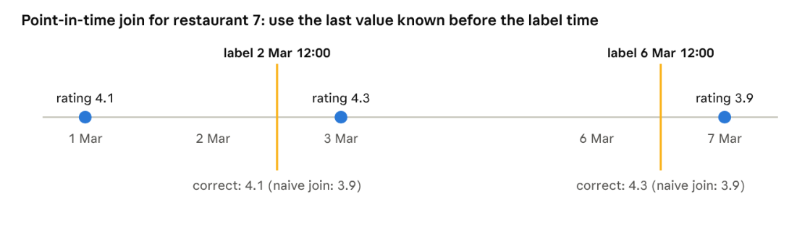

# 48 · Data for ML

Part XI · Applied ML systems (optional track). Assumes basic SQL and pandas. Chapter 3.7 explains the leakage that point-in-time joins prevent; Chapter 35 has interview-style SQL and pandas questions.

## Why it matters

Most model failures are data failures: leakage, wrong joins, bad labels, silent upstream changes. Senior data scientists at product and marketplace companies spend more time in SQL than in PyTorch, and many interview loops include a live SQL round (windows, sessions, retention) and questions on labelling. This chapter is the practical toolkit. Chapter 35 has the Python coding patterns; this one is about getting the data right.

The same skills carry across employers. Ads, feeds and e-commerce teams live on point-in-time feature joins over event logs, and their SQL rounds ask for sessions, funnels and cohort retention. LLM teams at labs spend their data effort on labels: preference comparisons for reward models, rubric grades for evaluations, and synthetic data filtered by verifiers. There the questions are about rater agreement, rater drift and what agreement implies for the best achievable reward-model accuracy (48.10). An interviewer in either setting is testing one thing: whether you can tell when the data, rather than the model, is the reason a number looks good or bad.

All SQL below ran in SQLite (it supports window functions); outputs are quoted. Syntax is close to BigQuery, Snowflake and Spark SQL, apart from date functions.

The chapter starts with the SQL tools that most feature and label queries need: window functions (48.1) and sessionisation (48.2), and the point-in-time join that keeps future information out of training data (48.3). It then covers working with data that outgrows a laptop, in pandas (48.4) and Spark (48.5), and keeping it trustworthy with data contracts (48.6). The last sections are about labels: running a labelling effort and measuring agreement (48.7), synthetic data (48.8), a worked labelling project from guidelines to a training set (48.9), and preference annotation for reward models, the labelling LLM teams run most (48.10).

The common thread is correctness under time. Almost every data bug in ML comes from using information that was not available when the prediction would have been made, or from labels that mean different things to different annotators. The techniques here are the routine defences against both.

## Key concepts

- **Window functions**: calculations over related rows (running totals, rankings, previous values) without collapsing them. [PostgreSQL tutorial: window functions](https://www.postgresql.org/docs/current/tutorial-window.html).
- **Sessionisation and gaps-and-islands**: grouping events into sessions or streaks by flagging gaps and taking a cumulative sum.
- **Point-in-time (as-of) joins**: joining each label to feature values as they were at prediction time, to avoid leakage. [pandas merge_asof](https://pandas.pydata.org/docs/reference/api/pandas.merge_asof.html).
- **Fast DataFrames and in-process SQL**: [Polars](https://docs.pola.rs/) and [DuckDB](https://duckdb.org/docs/) handle data that is slow in pandas.
- **Spark**: distributed data processing; shuffles, broadcast joins and skew are the concepts that matter. [Spark documentation](https://spark.apache.org/docs/latest/).
- **Data quality tests and contracts**: automated checks on schema, nulls, ranges, freshness and volume. [dbt data tests](https://docs.getdbt.com/docs/build/data-tests).
- **Inter-annotator agreement**: how consistently people label, corrected for chance. [Cohen's kappa](https://en.wikipedia.org/wiki/Cohen%27s_kappa).
- **Weak supervision**: combining noisy labelling rules into training labels. [Snorkel](https://arxiv.org/abs/1711.10160).

## 48.1 Window functions

A window function computes over a set of rows related to the current row without collapsing them like `GROUP BY` does. The pieces: `PARTITION BY` (groups), `ORDER BY` (order inside each group), and a frame (`ROWS BETWEEN …`).

```sql
SELECT order_id, restaurant_id, order_ts, amount,
  ROW_NUMBER() OVER (PARTITION BY restaurant_id ORDER BY order_ts) AS rn,
  SUM(amount)  OVER (PARTITION BY restaurant_id ORDER BY order_ts
                     ROWS BETWEEN UNBOUNDED PRECEDING AND 1 PRECEDING) AS spend_before,
  AVG(amount)  OVER (PARTITION BY restaurant_id ORDER BY order_ts
                     ROWS BETWEEN 1 PRECEDING AND CURRENT ROW) AS avg_last2
FROM orders ORDER BY restaurant_id, order_ts;
```

| order_id | restaurant | order_ts | amount | rn | spend_before | avg_last2 |
|---|---|---|---|---|---|---|
| 1 | 7 | 2026-03-01 | 50 | 1 | NULL | 50 |
| 2 | 7 | 2026-03-02 | 30 | 2 | 50 | 40 |
| 3 | 7 | 2026-03-05 | 80 | 3 | 80 | 55 |
| 4 | 8 | 2026-03-02 | 20 | 1 | NULL | 20 |
| 5 | 8 | 2026-03-03 | 40 | 2 | 20 | 30 |

Note `spend_before` ends at `1 PRECEDING`: a feature for order n must not include order n itself. That one frame clause is the difference between a valid feature and leakage.

**ROWS vs RANGE, and ties.** `ROWS … 1 PRECEDING` means "the previous *row*", not "the previous moment". When two orders share a timestamp (or a date, as here), the second one's "history" includes the first, even though both happened at the same time and neither was known when the other was predicted. A `RANGE` frame works on the values of the `ORDER BY` column instead, so all rows with the same value (peers) are treated alike. With a second order on 2 March:

```sql
SELECT order_id, order_ts, amount,
  SUM(amount) OVER (PARTITION BY restaurant_id ORDER BY order_ts
                    ROWS BETWEEN UNBOUNDED PRECEDING AND 1 PRECEDING) AS rows_before,
  SUM(amount) OVER (PARTITION BY restaurant_id ORDER BY julianday(order_ts)
                    RANGE BETWEEN UNBOUNDED PRECEDING AND 1 PRECEDING) AS range_before
FROM o ORDER BY order_ts, order_id;
```

| order_id | order_ts | amount | rows_before | range_before |
|---|---|---|---|---|
| 1 | 2026-03-01 | 50 | NULL | NULL |
| 2 | 2026-03-02 | 30 | 50 | 50 |
| 3 | 2026-03-02 | 20 | 80 | 50 |
| 4 | 2026-03-05 | 80 | 100 | 100 |

Order 3's `rows_before` of 80 includes order 2 from the same day: leakage that depends on the arbitrary order of tied rows. `RANGE … 1 PRECEDING` on a numeric day value includes only earlier days. Where numeric `RANGE` offsets are not supported, aggregate to one row per day first, or add a deterministic tie-breaker (`ORDER BY order_ts, order_id`) and accept that the result is still a choice you must document.

Patterns to know by heart:

- **Latest row per group**: `ROW_NUMBER() OVER (PARTITION BY user_id ORDER BY ts DESC) = 1` (in a subquery or with `QUALIFY` where supported).
- **Top-N per group**: same with `<= N`; use `RANK` or `DENSE_RANK` when ties matter.
- **Previous / next event**: `LAG(ts)`, `LEAD(ts)`; time between orders, churn gaps.
- **Running totals and moving averages**: `SUM` / `AVG` with a frame; `RANGE` frames for time-based windows where supported.
- **Share of total**: `amount / SUM(amount) OVER (PARTITION BY city)`.
- **Retention / cohorts**: first order month per user (`MIN(order_ts) OVER (PARTITION BY user_id)`), then count active users per cohort and month offset (written out below).
- **Funnel**: conditional aggregation, `COUNT(DISTINCT CASE WHEN event = 'checkout' THEN session_id END)`.

### Cohort retention, written out

The most common SQL-round question: "for each monthly cohort of new customers, what share ordered again in each later month?" The steps are always the same. Find each user's first month (the cohort). Compute each order's month offset from that cohort. Count distinct active users per cohort and offset. Divide by the cohort size.

```sql
WITH first AS (
  SELECT user_id, MIN(strftime('%Y-%m', order_ts)) AS cohort
  FROM orders GROUP BY user_id),
activity AS (
  SELECT DISTINCT o.user_id, f.cohort,
         (CAST(strftime('%Y', o.order_ts) AS INT) - CAST(substr(f.cohort, 1, 4) AS INT)) * 12
       + (CAST(strftime('%m', o.order_ts) AS INT) - CAST(substr(f.cohort, 6, 2) AS INT)) AS month_offset
  FROM orders o JOIN first f USING (user_id)),
sizes AS (SELECT cohort, COUNT(*) AS cohort_size FROM first GROUP BY cohort)
SELECT a.cohort, a.month_offset, COUNT(*) AS active_users, s.cohort_size,
       ROUND(1.0 * COUNT(*) / s.cohort_size, 2) AS retention
FROM activity a JOIN sizes s USING (cohort)
GROUP BY a.cohort, a.month_offset
ORDER BY a.cohort, a.month_offset;
```

On eleven orders from five users (three first ordering in January, two in February):

| cohort | month_offset | active_users | cohort_size | retention |
|---|---|---|---|---|
| 2026-01 | 0 | 3 | 3 | 1.00 |
| 2026-01 | 1 | 2 | 3 | 0.67 |
| 2026-01 | 2 | 2 | 3 | 0.67 |
| 2026-02 | 0 | 2 | 2 | 1.00 |
| 2026-02 | 1 | 1 | 2 | 0.50 |

Three details interviewers check. `DISTINCT` in `activity`, so a user with three orders in a month counts once. The month offset computed from year and month, not from day differences divided by 30. And the cohort size taken from `first`, not from offset 0 of the activity table (the same here, but not when the cohort definition is "signed up" rather than "first ordered"). In BigQuery the offset is `DATE_DIFF(DATE_TRUNC(order_date, MONTH), cohort_month, MONTH)`. Present the result as a triangle (cohorts as rows, offsets as columns), and remember that the most recent cohorts have not had time to reach the later offsets.

## 48.2 Sessionisation

Split a user's events into sessions with a 30-minute inactivity gap: flag rows where the gap from the previous event exceeds 30 minutes (or there is no previous event), then take a running sum of the flags.

```sql
WITH g AS (
  SELECT user_id, ts,
    CASE WHEN (julianday(ts) - julianday(LAG(ts) OVER (PARTITION BY user_id ORDER BY ts))) * 1440 > 30
           OR LAG(ts) OVER (PARTITION BY user_id ORDER BY ts) IS NULL
         THEN 1 ELSE 0 END AS new_session
  FROM events)
SELECT user_id, ts,
  SUM(new_session) OVER (PARTITION BY user_id ORDER BY ts) AS session_id
FROM g ORDER BY user_id, ts;
-- user 1: 10:00, 10:10 -> session 1; 11:00, 11:05 -> session 2 (50-minute gap)
-- user 2: 09:00 -> 1; 09:50 -> 2
```

In BigQuery replace the `julianday` arithmetic with `TIMESTAMP_DIFF(ts, prev_ts, MINUTE)`. "Gaps and islands" problems (consecutive days with an order, streaks) use the same flag-then-cumulative-sum trick.

## 48.3 Point-in-time joins

The most common source of leakage in tabular ML: joining each training label to the *latest* value of a feature table, which includes information from after the prediction moment.



*Joining on the latest feature value leaks the future into training. merge_asof (or an AS OF join) picks the last value at or before each label time.*

```python
import pandas as pd

# labels: (restaurant_id, ts) = prediction moments; feats: (restaurant_id, feature_ts, rating_7d)
pit = pd.merge_asof(labels.sort_values("ts"), feats.sort_values("feature_ts"),
                    left_on="ts", right_on="feature_ts",
                    by="restaurant_id", direction="backward")
# restaurant 7 @ 2 Mar 12:00 -> 4.1 (snapshot of 1 Mar)
# restaurant 7 @ 6 Mar 12:00 -> 4.3 (snapshot of 3 Mar)
# restaurant 8 @ 2 Mar 12:00 -> NaN (no snapshot existed yet: correct, not a bug)
# A naive join on the latest snapshot gave 3.9, 3.9 and 4.6: all from the future.
```

In SQL: join on `f.feature_ts <= l.ts` and keep the latest with `ROW_NUMBER() OVER (PARTITION BY l.label_id ORDER BY f.feature_ts DESC) = 1`, or use an `ASOF JOIN` where the engine has one (Snowflake, DuckDB). Also account for **availability lag**: a daily table built at 03:00 for yesterday's data is not available at 01:00, so join on when the value was *available*, not the date it describes. Feature stores handle this for you (Chapter 47).

Other leakage sources to check: target-derived features ("was refunded" when predicting complaints), post-outcome timestamps (delivery-time features in an ETA model), aggregates computed over the whole dataset including the test period, duplicates across train and test, and random splits on data with time or user structure (use time-based or grouped splits, Chapter 3).

### Testing for leakage

Leakage cannot be found by looking at accuracy alone, and some intuitive tests do not work. Shuffling the timestamps and checking whether accuracy drops, for example, tests whether the model uses time, not whether a feature was available at prediction time: a leaky feature keeps leaking after the shuffle. Four tests do work:

1. **Assert availability in the pipeline.** Store, for every feature value, the time it became available (not the time it describes), and assert feature_available_ts ≤ prediction_ts for every training row. With a daily table built at 03:00, the availability lag is part of the check: feature_ts + lag ≤ label_ts.
2. **Recompute from raw logs.** For a random sample of training rows, recompute each feature from the raw event logs using only events before the prediction time, and diff against the training table. Any systematic difference is a pipeline bug.
3. **Compare with serving.** If predictions are logged with their features, compare the offline features for the same requests with the logged serving values. Offline values that are "better" than serving values (fewer nulls, fresher) are a sign of leakage or skew.
4. **Distrust a feature that is too good.** If one feature carries most of the importance, or a model jumps from AUC 0.75 to 0.95 when it is added, trace exactly how and when that feature is computed before celebrating.

## 48.4 pandas at scale

- Load only what you need: `usecols`, `dtype` (category for strings with few values, `int32` / `float32`), Parquet instead of CSV.
- Vectorise: no `apply` with Python functions on millions of rows if a column operation exists; use `np.where`, `.str` methods, `groupby().transform`.
- `groupby` patterns: `agg` with named aggregations, `transform` for per-row group statistics, `rolling` / `expanding` on a time index, `merge_asof` for time joins.
- Check joins: `validate="many_to_one"` in `merge` raises if the right side has duplicate keys (silent row explosion is a classic bug); compare row counts before and after.
- When it does not fit in memory: push the work to the warehouse in SQL, or use **Polars** (multi-threaded, lazy, often 5–20× faster) or **DuckDB** (SQL on Parquet and DataFrames, in-process). Both are worth learning; they remove most "I need Spark" moments.

## 48.5 Spark basics

When data is too big for one machine. Concepts interviewers ask about:

- **Lazy evaluation**: transformations build a plan; actions (`count`, `write`, `collect`) run it. The optimiser (Catalyst) reorders filters and projections.
- **Narrow vs wide transformations**: `filter` / `select` stay within partitions; `groupBy` / `join` / `distinct` need a **shuffle** across the network, the expensive part.
- **Joins**: broadcast the small table (`F.broadcast(df_small)`) to avoid shuffling the big one; sort-merge join for two large tables.
- **Skew**: one key (a huge city or a popular restaurant) gets most rows, so one task runs for an hour. Fixes: salting the key, adaptive query execution (AQE) skew handling, separate handling of hot keys.
- **Partitioning**: write partitioned by date; read with filters on the partition column so whole folders are skipped.
- Avoid `collect()` on big data and Python UDFs where built-in functions exist (or use pandas UDFs).

```python
# PySpark sketch (not run here): 7-day order count per restaurant, as of each day
from pyspark.sql import functions as F, Window
w = Window.partitionBy("restaurant_id").orderBy(F.col("day").cast("timestamp").cast("long")) \
          .rangeBetween(-7 * 86400, -1)          # previous 7 days, excluding today
daily = orders.groupBy("restaurant_id", "day").agg(F.count("*").alias("n"))
feat = daily.withColumn("orders_7d", F.sum("n").over(w))
```

## 48.6 Data quality and contracts

A **data contract** is an agreement between the producer of a table and its consumers: schema, types, semantics ("amount is in AED including VAT"), freshness, volume ranges, allowed nulls, ownership and how changes are announced. Checks run at the boundary and fail loudly:

```python
def check_contract(df):
    errs = []
    if df["amount"].isna().mean() > 0.01: errs.append("amount nulls")
    if (df["amount"] < 0).any():         errs.append("negative amount")
    if df["order_id"].duplicated().any(): errs.append("duplicate order_id")
    return errs
# clean table -> []; with a duplicated id and a -3 amount -> ['negative amount', 'duplicate order_id']
```

In production use dbt tests, Great Expectations, Soda or pandera rather than hand-written checks, and add: freshness (latest partition is today's), volume (row count within ±x% of the same weekday last week), distribution checks (Chapter 47's PSI), and referential integrity. Most painful incidents come from upstream semantic changes nobody announced (a currency change, a new order status), so the contract is partly a social agreement: know who owns each source table.

## 48.7 Labelling and annotator agreement

Good labels need: clear guidelines with examples and edge cases; a pilot round to find ambiguities; two or more annotators on a sample; adjudication of disagreements; and tracked agreement over time.

Raw agreement is misleading when one class dominates. If 80% of reviews are positive and two annotators label at random with that rate, they still agree 0.8² + 0.2² = 68% of the time. **Cohen's kappa** measures agreement beyond that chance level:

$$
\kappa = \frac{p_o - p_e}{1 - p_e}
$$

p_o is the observed agreement, the share of items both annotators labelled the same. p_e is the agreement expected by chance if each annotator labelled independently at their own class rates: p_e = Σ_k p_{A,k}·p_{B,k}, summed over classes k, where p_{A,k} is the share of items annotator A put in class k. The denominator 1 − p_e is the most agreement beyond chance that was possible, so κ is the share of it achieved: 1 is perfect, 0 is chance, negative is worse than chance.

```python
from sklearn.metrics import cohen_kappa_score
# two annotators, 20 reviews, mostly "P" (positive)
# raw agreement 0.90, kappa 0.688
```

**Worked by hand.** Each annotator labels 16 of the 20 reviews "P", so p_A,P = p_B,P = 0.8 and p_e = 0.8 × 0.8 + 0.2 × 0.2 = 0.68. They agree on 18 of 20, p_o = 0.90. So κ = (0.90 − 0.68) / (1 − 0.68) = 0.22 / 0.32 = 0.69. 90% agreement sounds great, but kappa 0.69 is only "substantial": much of that agreement would happen by chance with this class balance.

**Weighted kappa for ordinal labels.** For a 0–3 relevance or quality scale, a disagreement of 2 vs 3 is milder than 0 vs 3, and plain kappa treats them the same. Weighted kappa gives partial credit by distance: linear weights penalise a disagreement in proportion to |i − j|, quadratic weights in proportion to (i − j)². On ten items rated 0–3 where the two raters agree exactly on six and differ by one grade on the other four, unweighted κ = 0.46, linear-weighted 0.64 and quadratic-weighted 0.80 (`code/ch48_check.py`). Report which weighting you used; quadratic-weighted kappa is close to an intraclass correlation and is the common choice for ordinal grades. Rough reading: below 0.4 poor, 0.4–0.6 moderate, 0.6–0.8 substantial, above 0.8 strong. Use Fleiss' kappa or Krippendorff's alpha for more than two annotators or missing labels.


*Cohen's kappa for two annotators with the same raw agreement, as the majority class grows (both annotators labelling the majority class at the same rate). At 90% raw agreement, kappa is 0.80 with balanced classes and 0.44 when 90% of items are the majority class.*

The practical consequence: for rare-class labelling tasks (harmful content, fraud, defects), report agreement on the rare class itself, such as each annotator's recall of the other's positives, alongside kappa. A 95% raw agreement can hide annotators who agree on almost none of the positives.

Useful practices:

- Low agreement usually means unclear guidelines or a genuinely ambiguous task, not lazy annotators. Fix the definition first.
- **The noise ceiling, stated carefully.** Measured against one annotator's noisy labels, a model's accuracy is capped: if annotators agree with each other 85% of the time, a model that scores 85% against a single annotator's labels is as good as another annotator, and gains beyond that are hard to measure. But the model's *true* accuracy can exceed any single annotator's, because training on many noisy labels averages out their independent errors. So evaluate against adjudicated or consensus labels (several annotators per item, disagreements resolved by an expert), and use inter-annotator agreement to say how much of the remaining error is measurement noise.
- **Active learning**: label the examples the model is least sure about, not random ones. The labelled set it produces is deliberately unrepresentative, concentrated near the decision boundary, so never evaluate on it; keep a separate random sample as the evaluation set, and record the selection so that class rates can be re-weighted.
- **Weak supervision**: combine heuristic labelling functions (keywords, rules, existing systems) into noisy labels (Snorkel-style), then train on them. The key idea is the **label model**: rather than a majority vote, it estimates each labelling function's accuracy from the pattern of agreements and disagreements among them (without ground truth, assuming their errors are roughly independent given the true label), and weights them accordingly. The end model trained on its probabilistic labels then generalises beyond the rules, because it learns from features the rules never looked at.
- **LLM as annotator**: label with a strong model, measure its agreement with humans on a sample (treat it as another annotator, with kappa), send disagreements and low-confidence cases to humans. This is how dish attributes and merchant categories can be labelled at scale.
- For Arabic and dialect data, use annotators who know the dialects, and track agreement by language.

## 48.8 Synthetic data

Uses: bootstrapping a classifier when no labels exist, covering rare classes, generating evaluation sets for RAG (questions from documents), red-team attacks (Chapter 28), and privacy-safe test data. Risks: synthetic data reflects the generator's biases and style, it lacks real-world messiness (typos, Arabizi, code-switching), and evaluating on data from the same generator inflates scores. Rules: mix with real data, generate with diversity prompts (personas, dialects, lengths), deduplicate, validate a sample by hand, and always keep a real-data test set as the final judge.

**Filtering is where synthetic data gets its quality.** Generation is cheap; selection is the work. **Rejection sampling** generates several candidates per prompt and keeps only those that pass a check. Where the task is verifiable (maths with a known answer, code with tests, extraction that must match the source), a programmatic **verifier** is the check, and the kept samples are close to guaranteed correct; this is how much of the reasoning data for post-training is made (Chapters 18 and 19). Where it is not verifiable, a reward model or LLM judge filters instead, which is weaker, because the generator's errors and the judge's blind spots can be correlated. **Distillation** is the same pattern with a stronger teacher: the teacher generates, a filter selects, and a smaller student is trained on the result.

**Model collapse.** Training a model on its own outputs, or a chain of models each on the previous one's outputs, gradually loses the tails of the distribution: rare words, unusual styles and minority cases disappear first, because each generation samples them less often than the real data contained them. The defence is to keep real data in every training mix and to accumulate data rather than replace it. **Licences and terms.** Many model providers' terms restrict using their outputs to train competing models, and open-weight licences carry their own conditions, so check before building a dataset from a model's outputs. Chapter 16 covers synthetic data in pretraining and Chapter 18 in post-training.

## 48.9 A worked labelling project: 10,000 reviews for a complaint classifier

1. **Write the guidelines.** Define the eight complaint categories, each with:
   - a one-line definition;
   - two positive and two negative examples;
   - a rule for multiple categories ("label every category that applies").
   - Also list explicit edge cases: sarcasm, complaints about a previous order, mixed Arabic and English.
2. **Pilot.** Two annotators label the same 200 reviews.
   - Measure kappa per category and read every disagreement.
   - Suppose "late delivery" and "courier behaviour" are confused 30% of the time, because a late courier is often also rude. Clarify the rule (both labels apply) and add the case to the guidelines.
   - Re-pilot on 100 new reviews until kappa per category is above about 0.7.
3. **Budget.** At 30 seconds per review, 10,000 reviews take 83 annotator-hours. Double-labelling 20% of them for quality control adds 17 hours. Adjudicating the roughly 10% of double-labelled items where annotators disagree adds about 2 hours of an expert's time.
4. **Pre-label with an LLM.** Run a strong model with the guidelines as its prompt. Measure its agreement with the adjudicated pilot labels as if it were a third annotator.
   - If it matches the humans' agreement on the common categories, have annotators review its labels instead of labelling from scratch. That is often 2–3 times faster.
   - Keep labelling from scratch for the rare categories, where it is weakest.
5. **Sample deliberately.**
   - Random sampling gives few examples of rare categories, so oversample with keyword and model-score filters until each category has at least 300 positives.
   - Record the sampling weights, so evaluation on a random held-out set stays unbiased.
6. **Track quality over time.** Seed 2% of each batch with gold items whose labels are known, and watch each annotator's accuracy on them. Revisit the guidelines whenever a new disagreement pattern appears.

The deliverable is not only 10,000 labels. It is also the guidelines, the agreement numbers per category, and the label noise ceiling they imply. Those tell the modelling team how good a classifier can reasonably get.

## 48.10 Preference and RLHF annotation

The labelling an LLM scientist actually runs is rarely "which class?". It is "which of these two responses is better?", collected by the tens of thousands to train a reward model or to evaluate a model release (Chapter 18). Preference labels have their own design choices and their own, lower, ceiling on agreement.

**The task design.** Show a prompt and two responses, in random left-right order (raters favour one side otherwise), and ask for a choice, usually on a graded scale ("A much better", "A slightly better", "about the same", "B slightly better", "B much better"). The graded scale lets you drop or down-weight near-ties, which are mostly noise, and use the strength of preference as a margin. A rubric makes "better" concrete: correctness first, then following the instructions, then helpfulness, then style, with explicit rules for conflicts (a polite wrong answer loses to a blunt right one) and for safety (a refusal of a harmless request is a failure, not a safe default). Without a rubric, raters fall back on length and confidence: longer, more assured answers win, and the reward model learns that bias.

**Agreement is low, and that is expected.** On open-ended chat, trained raters agree on the better response roughly 60–75% of the time; InstructGPT reported about 73% agreement among its trained labellers. That ceiling has a clean interpretation. Suppose each rater independently matches a hidden "true" preference with probability q. Two raters agree when both are right or both are wrong:

$$
P(\mathrm{agree}) = q^2 + (1-q)^2
$$

Agreement of 0.70 gives q = (1 + √(1 − 2 × 0.30)) / 2 ≈ 0.82: each rater matches the consensus preference about 82% of the time. A reward model scored against single-rater labels therefore tops out near 82% accuracy even if it learns the consensus perfectly, and measured reward-model accuracies on held-out human comparisons, typically in the high 60s to low 70s, should be read against that ceiling, not against 100%.

**Keeping raters calibrated.** Seed each batch with gold comparisons whose answer experts agreed on (a few per cent of items), and track each rater's accuracy on them over time. Raters drift: they get faster, adopt shortcuts and shift their standards as the model's responses improve. Run calibration sessions where raters discuss disagreements on the same items, and update the rubric with each new disagreement pattern. Measure agreement per category (coding, safety, creative writing), because it differs widely, and route specialised prompts (code, medicine, other languages) to raters who can judge correctness. For safety-relevant comparisons, double-label and adjudicate.

**AI feedback.** Labelling preferences with an LLM judge (RLAIF, constitutional-AI-style critiques) scales cheaply and is often more consistent than humans. Treat the judge as another rater: measure its agreement with the human consensus on the gold set, check it for position bias (ask both orders) and for length and self-preference bias, and keep humans on the categories where it agrees least. Chapter 18 covers how the labels become a reward model and a DPO dataset; Chapter 24 covers judges.

## Pitfalls

- Window frames that include the current row in a "history" feature.
- Joining features on the latest snapshot instead of point in time.
- `merge` without `validate`, silently duplicating rows.
- Random train/test splits on time-ordered or user-grouped data.
- Trusting raw agreement on imbalanced labels.
- Evaluating on synthetic data made by the same model you are testing.
- `ROWS` frames over tied timestamps, which let same-time rows leak into each other's history.
- Evaluating on the active-learning set instead of a random sample.
- Preference comparisons shown in a fixed order, or without a rubric, so position and length bias end up in the reward model.
- Reading reward-model accuracy against 100% instead of against the ceiling set by rater agreement.

## Interview questions

**Mid level**

**1. Write SQL for each user's latest order and their order count in the last 30 days.** Two pieces joined on user: the latest order by `ROW_NUMBER() OVER (PARTITION BY user_id ORDER BY order_ts DESC, order_id DESC) = 1` (the second sort key breaks timestamp ties deterministically), and a 30-day count by `COUNT(*) … WHERE order_ts >= datetime(:as_of, '-30 days') AND order_ts < :as_of GROUP BY user_id`, left-joined so users with no recent orders get 0 through `COALESCE`. As of 2 March 2026 on the sample data, user 1's latest order is 4 with 3 orders in 30 days, user 2's is 6 with 1, and user 3's is 9 with 3, where orders 8 and 9 share a timestamp and the tie-breaker picks 9 (`code/ch48_check.py` has the full query). The traps interviewers watch for: a filter on the 30-day window applied before finding the latest order (users whose latest order is older disappear), an inner join that drops users with zero recent orders, and an "as of" date taken from `now()`, which makes the query unreproducible. Follow-up: "do it in one pass" with `COUNT(*) FILTER (WHERE …)` or a conditional `SUM(CASE …)` inside the ranked subquery.

**2. What is the difference between `ROW_NUMBER`, `RANK` and `DENSE_RANK`?** They differ only on ties. `ROW_NUMBER` gives every row a distinct number, breaking ties arbitrarily unless you add a tie-breaker. `RANK` gives tied rows the same rank and then skips. `DENSE_RANK` gives tied rows the same rank without skipping. For ratings 4.8, 4.6, 4.6, 4.5, 4.4: ROW_NUMBER gives 1, 2, 3, 4, 5; RANK gives 1, 2, 2, 4, 5; DENSE_RANK gives 1, 2, 2, 3, 4. Use ROW_NUMBER for "exactly one row per group", RANK for "top 3 including ties, as in a sports table", and DENSE_RANK for "the second-highest distinct value". Follow-up: ROW_NUMBER without a deterministic tie-breaker returns different rows on different runs, which makes training sets irreproducible.

**3. How would you sessionise clickstream events?** Order each user's events by time, flag an event as a new session when the gap from the previous event (from `LAG(ts)`) exceeds the threshold or there is no previous event, then take a running `SUM` of the flags per user: the running sum is the session id. With a 30-minute threshold, events at 10:00, 10:10, 11:00 and 11:05 form two sessions because of the 50-minute gap. The threshold is a modelling choice: check the distribution of gaps, which usually has a clear valley between within-session and between-session gaps. The same flag-then-cumulative-sum pattern solves streaks and other gaps-and-islands problems.

**4. What is Cohen's kappa and why not just use percentage agreement?** Kappa measures agreement beyond chance: κ = (p_o − p_e)/(1 − p_e), where p_e is the agreement expected if both annotators labelled at random with their own class rates. With imbalanced classes chance agreement is high: if both annotators label 80% of items positive, p_e = 0.8² + 0.2² = 0.68, so 90% raw agreement is only κ = 0.22/0.32 = 0.69. Rough reading: below 0.4 poor, 0.4–0.6 moderate, 0.6–0.8 substantial, above 0.8 strong. Use weighted kappa for ordinal scales and Fleiss' kappa or Krippendorff's alpha for more than two annotators. Follow-up: for rare classes, also report agreement on the positives themselves, which kappa can hide.

**Senior level**

**5. Your model looked great offline and failed online. List the data causes you would check.** Leakage (future features, target-derived features), training-serving skew, different populations or time periods, label definition mismatch, missing values handled differently online. In order of how I would check them: first compare offline features with logged serving features for the same requests (skew shows up immediately); then audit the top features' availability times (leakage usually hides in the most important feature); then compare the offline test period and population with the live one (a random split over time, a city mix that changed); then confirm that the offline label means what the online metric measures (a click label for an order goal). A tell-tale number: an offline AUC far above anything the team has seen before (0.95 where 0.75 was normal) is more often leakage than genius.

**6. Explain point-in-time correctness and how you would guarantee it in a feature pipeline.** Every training row may use only feature values that were *available* at its prediction moment. Store features with valid-from timestamps and the time each value became available (a daily table built at 03:00 is not available at 01:00), and join with an as-of join on prediction time (`merge_asof`, `ASOF JOIN`, or a feature store's point-in-time lookup). To test it: assert feature_available_ts ≤ prediction_ts on every training row; recompute a random sample of features from raw logs using only earlier events and diff them against the training table; compare offline features with the values logged at serving time for the same requests; and investigate any feature whose importance is suspiciously high. Shuffling timestamps and watching accuracy is not a valid leakage test: a leaky feature still leaks after the shuffle. Follow-up: ties at the prediction timestamp need an explicit rule (strictly before, or before with a lag).

**7. A Spark job joining orders to restaurants takes three hours. What do you look at?** The query plan and the stage timeline: skew on hot keys, a missing broadcast of the small restaurants table, too few or too many partitions, Python UDFs, reading unpartitioned data. Concretely: 100,000 restaurants at a few hundred bytes each is tens of megabytes, small enough to broadcast, which removes the shuffle of the large orders table entirely. If one task runs for hours while the rest finish in minutes, it is skew (one giant city or chain): salt the key, or let adaptive query execution split the skewed partition. If the job reads every date to use one week, add a partition filter. Follow-up: check whether the job needs Spark at all; a week of orders may fit in DuckDB on one machine.

**8. Design a labelling process for 300 food attributes across 2M menu items in Arabic and English.** Guidelines and a clear attribute taxonomy; an LLM first pass with confidence; human review of a stratified sample and low-confidence items by bilingual annotators; kappa per attribute; adjudication; active learning to pick the next batch; a frozen gold set for evaluation. The budget forces the design: 2M items × 300 attributes is 600M decisions, impossible by hand, so humans can only calibrate and correct. Measure the LLM against adjudicated human labels per attribute and per language, accept it where it matches human agreement, and route the rest. Keep the gold set random and separate from the active-learning batches, which are biased towards hard items by design. Follow-up: attributes such as "spicy" are partly subjective, so expect lower kappa and decide whether a probabilistic label is acceptable.

**9. How would you collect preference data for a reward model, and how good can the reward model get?** Pairwise comparisons of two responses to the same prompt, shown in random order, on a graded scale, with a rubric that puts correctness before helpfulness and style, plus gold items to track each rater and regular calibration sessions. Trained raters agree on roughly 60–75% of open-ended comparisons (InstructGPT reported about 73%). If two independent raters each match the true preference with probability q, agreement is q² + (1 − q)², so 70% agreement implies q ≈ 0.82: a perfect model of the consensus would still score only about 82% against single-rater labels. So judge reward-model accuracy against that ceiling, evaluate on multiply-labelled comparisons, and drop or down-weight near-ties. Follow-up: length bias, since raters without a rubric prefer longer answers and the reward model learns it.

**10. Write the cohort-retention query.** Find each user's first month as their cohort; for every order compute the month offset from the cohort using year and month (not days / 30); count distinct users per (cohort, offset); divide by the cohort size from the first-order table. On the chapter's data, the January cohort of 3 retains 0.67 in months 1 and 2, and the February cohort of 2 retains 0.50 in month 1. The traps: counting orders instead of distinct users, and taking the denominator from the activity table, which goes wrong when the cohort is defined by sign-up. Follow-up: the newest cohorts have not reached the later offsets, so plot the triangle rather than averaging across cohorts.

**11. When is synthetic data safe to train on?** When it is filtered by a check that does not share the generator's blind spots: a verifier for maths and code, tests, or agreement with a source document, and when real data stays in the mix. Rejection sampling with a verifier (generate eight candidates, keep those that pass) can produce near-guaranteed-correct reasoning traces; filtering with an LLM judge is weaker, because the generator and the judge can make correlated errors. Training repeatedly on a model's own outputs loses the tails of the distribution (model collapse), so accumulate rather than replace real data. Never evaluate on data from the same generator, and check the provider's terms before training on its outputs.

## Practice

1. **SQL drills:** solve 20 SQL window-function problems (LeetCode database section, DataLemur, StrataScratch), timing yourself.

<details><summary>Hint and expected result</summary>

Aim for under 10 minutes each, and include latest-per-group, top-N with ties, sessionisation, a running total with the right frame, and cohort retention. Check your cohort query against the table in 48.1 by loading the same eleven orders (`code/ch48_check.py`).

</details>

2. **Point-in-time rebuild:** rebuild one of your training sets with an explicit point-in-time join and compare model metrics with the old version.

<details><summary>Hint and expected result</summary>

Expect the offline metric to fall, sometimes a lot; that drop is the leakage the old set had, and the new number is the one that predicts online performance. Run the four leakage tests of 48.3 on the new set.

</details>

3. **Faster DataFrames:** rewrite a slow pandas job in Polars or DuckDB and measure the speed-up.

<details><summary>Hint and expected result</summary>

On group-bys and joins over a few million rows, expect several times faster, more when the job used `apply` with Python functions. Report wall time and peak memory for both.

</details>

4. **Agreement study:** have two colleagues label 100 reviews with your guidelines; compute kappa and revise the guidelines.

<details><summary>Hint and expected result</summary>

First-round kappa below 0.6 is normal. Read every disagreement, group them into causes (unclear definition, genuinely ambiguous, mistake), revise the definitions, and re-pilot on new items; a second round above 0.7 means the guidelines work.

</details>

5. **Research exercise: what does label noise cost, and can consensus recover it?** Take a clean labelled dataset (for example a sentiment dataset with gold labels). Simulate annotators who flip each label independently with probability 0.2. Train the same classifier on (a) single noisy labels, (b) the majority vote of three noisy annotators and (c) the clean labels, with five seeds each. Evaluate every model against both the clean test labels and single-noisy test labels.

<details><summary>Hint and expected result</summary>

Against noisy test labels, every model's measured accuracy is capped near 80% (the annotator accuracy), so the three training regimes look closer than they are. Against clean test labels, the model trained on single noisy labels can still score well above 80%, because independent noise averages out in training; the majority vote of three (accuracy 0.8³ + 3 × 0.8² × 0.2 = 0.896 per label) closes most of the gap to clean labels. The lesson: evaluate against consensus labels, and noise in training labels costs less than noise in evaluation labels.

</details>

## Read next

- Kaufman et al., "Leakage in Data Mining: Formulation, Detection, and Avoidance" (2012).
- Polyzotis et al., "Data Validation for Machine Learning" (2019).
- The pandas `merge_asof` documentation and the Polars user guide.
- Holden Karau et al., *High Performance Spark* (O'Reilly).
- Ratner et al., "Snorkel: Rapid Training Data Creation with Weak Supervision" (2017).
- Artstein and Poesio, "Inter-Coder Agreement for Computational Linguistics" (2008).
- Ouyang et al., "Training language models to follow instructions with human feedback" ([arXiv:2203.02155](https://arxiv.org/abs/2203.02155)): the labelling set-up and labeller agreement behind InstructGPT.
- Shumailov et al., "AI models collapse when trained on recursively generated data" (Nature, 2024).
- Links to the documentation and papers are in the Key concepts section at the top of this chapter.

## Done when

Without notes, in under 10 minutes each, you can write latest-per-group with a tie-breaker, the 30-day order count with a left join, sessionisation, and the cohort-retention query, and reproduce the chapter's outputs (January cohort retention 1.00, 0.67, 0.67).

You can state the ROW_NUMBER, RANK and DENSE_RANK results for the ratings 4.8, 4.6, 4.6, 4.5, 4.4, and explain why `ROWS 1 PRECEDING` leaks on tied timestamps while `RANGE` does not.

You can implement a point-in-time join in SQL and pandas, and list the four leakage tests of 48.3, explaining why shuffling timestamps is not one of them.

You can compute Cohen's kappa by hand for 90% agreement with both annotators at 80% positive (p_e = 0.68, κ = 0.69), and say when to use weighted kappa.

You can derive q from preference agreement with q² + (1 − q)² and compute it for 70% agreement (q ≈ 0.82), and explain what it implies for reward-model accuracy.

You can explain shuffles, broadcast joins and skew in Spark. You can define a data contract and the checks that enforce it. You can design a labelling process, classification or preference, and judge its quality with agreement statistics and gold items.

---

[← 47 · MLOps and LLMOps](47-mlops-and-llmops.md) · [Contents](../README.md#contents) · [A · Glossary →](A-glossary.md)
