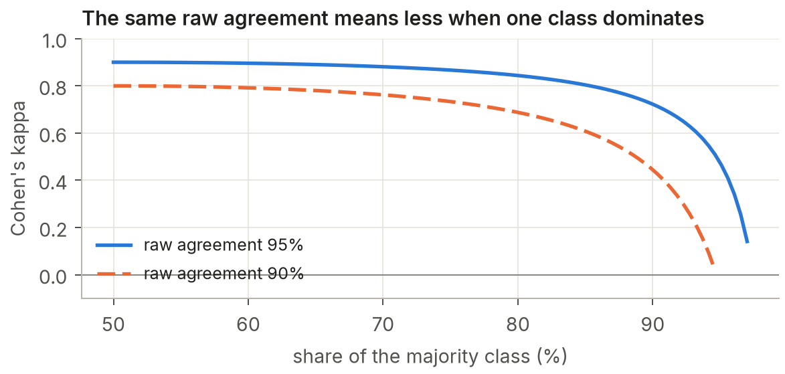

# 48 · Data for ML

Part XI · Applied ML systems (optional track).

## Why it matters

Most model failures are data failures: leakage, wrong joins, bad labels, silent upstream changes. Senior data scientists at product and marketplace companies spend more time in SQL than in PyTorch, and many interview loops include a live SQL round (windows, sessions, retention) and questions on labelling. This chapter is the practical toolkit. Chapter 35 has the Python coding patterns; this one is about getting the data right.

All SQL below ran in SQLite (it supports window functions); outputs are quoted. Syntax is close to BigQuery, Snowflake and Spark SQL, apart from date functions.

## Key concepts

- **Window functions**: calculations over related rows (running totals, rankings, previous values) without collapsing them. [PostgreSQL tutorial: window functions](https://www.postgresql.org/docs/current/tutorial-window.html).
- **Sessionisation and gaps-and-islands**: grouping events into sessions or streaks by flagging gaps and taking a cumulative sum.
- **Point-in-time (as-of) joins**: joining each label to feature values as they were at prediction time, to avoid leakage. [pandas merge_asof](https://pandas.pydata.org/docs/reference/api/pandas.merge_asof.html).
- **Fast DataFrames and in-process SQL**: [Polars](https://docs.pola.rs/) and [DuckDB](https://duckdb.org/docs/) handle data that is slow in pandas.
- **Spark**: distributed data processing; shuffles, broadcast joins and skew are the concepts that matter. [Spark documentation](https://spark.apache.org/docs/latest/).
- **Data quality tests and contracts**: automated checks on schema, nulls, ranges, freshness and volume. [dbt data tests](https://docs.getdbt.com/docs/build/data-tests).
- **Inter-annotator agreement**: how consistently people label, corrected for chance. [Cohen's kappa](https://en.wikipedia.org/wiki/Cohen%27s_kappa).
- **Weak supervision**: combining noisy labelling rules into training labels. [Snorkel](https://arxiv.org/abs/1711.10160).

## 48.1 Window functions

A window function computes over a set of rows related to the current row without collapsing them like `GROUP BY` does. The pieces: `PARTITION BY` (groups), `ORDER BY` (order inside each group), and a frame (`ROWS BETWEEN …`).

```sql
SELECT order_id, restaurant_id, order_ts, amount,
  ROW_NUMBER() OVER (PARTITION BY restaurant_id ORDER BY order_ts) AS rn,
  SUM(amount)  OVER (PARTITION BY restaurant_id ORDER BY order_ts
                     ROWS BETWEEN UNBOUNDED PRECEDING AND 1 PRECEDING) AS spend_before,
  AVG(amount)  OVER (PARTITION BY restaurant_id ORDER BY order_ts
                     ROWS BETWEEN 1 PRECEDING AND CURRENT ROW) AS avg_last2
FROM orders ORDER BY restaurant_id, order_ts;
```

| order_id | restaurant | order_ts | amount | rn | spend_before | avg_last2 |
|---|---|---|---|---|---|---|
| 1 | 7 | 2026-03-01 | 50 | 1 | NULL | 50 |
| 2 | 7 | 2026-03-02 | 30 | 2 | 50 | 40 |
| 3 | 7 | 2026-03-05 | 80 | 3 | 80 | 55 |
| 4 | 8 | 2026-03-02 | 20 | 1 | NULL | 20 |
| 5 | 8 | 2026-03-03 | 40 | 2 | 20 | 30 |

Note `spend_before` ends at `1 PRECEDING`: a feature for order n must not include order n itself. That one frame clause is the difference between a valid feature and leakage.

Patterns to know by heart:

- **Latest row per group**: `ROW_NUMBER() OVER (PARTITION BY user_id ORDER BY ts` `DESC) = 1` (in a subquery or with `QUALIFY` where supported).
- **Top-N per group**: same with `<= N`; use `RANK` or `DENSE_RANK` when ties matter.
- **Previous / next event**: `LAG(ts)`, `LEAD(ts)`; time between orders, churn gaps.
- **Running totals and moving averages**: `SUM` / `AVG` with a frame; `RANGE` frames for time-based windows where supported.
- **Share of total**: `amount / SUM(amount) OVER (PARTITION BY city)`.
- **Retention / cohorts**: first order month per user (`MIN(order_ts) OVER (PARTITION BY` `user_id)`), then count active users per cohort and month offset.
- **Funnel**: conditional aggregation, `COUNT(DISTINCT CASE WHEN event = 'checkout'` `THEN session_id END)`.

## 48.2 Sessionisation

Split a user's events into sessions with a 30-minute inactivity gap: flag rows where the gap from the previous event exceeds 30 minutes (or there is no previous event), then take a running sum of the flags.

```sql
WITH g AS (
  SELECT user_id, ts,
    CASE WHEN (julianday(ts) - julianday(LAG(ts) OVER (PARTITION BY user_id ORDER BY ts))) * 1440 > 30
           OR LAG(ts) OVER (PARTITION BY user_id ORDER BY ts) IS NULL
         THEN 1 ELSE 0 END AS new_session
  FROM events)
SELECT user_id, ts,
  SUM(new_session) OVER (PARTITION BY user_id ORDER BY ts) AS session_id
FROM g ORDER BY user_id, ts;
-- user 1: 10:00, 10:10 -> session 1; 11:00, 11:05 -> session 2 (50-minute gap)
-- user 2: 09:00 -> 1; 09:50 -> 2
```

In BigQuery replace the `julianday` arithmetic with `TIMESTAMP_DIFF(ts, prev_ts,` `MINUTE)`. "Gaps and islands" problems (consecutive days with an order, streaks) use the same flag-then-cumulative-sum trick.

## 48.3 Point-in-time joins

The most common source of leakage in tabular ML: joining each training label to the *latest* value of a feature table, which includes information from after the prediction moment.


*Joining on the latest feature value leaks the future into training. merge_asof (or an AS OF join) picks the last value at or before each label time.*

```python
import pandas as pd

# labels: (restaurant_id, ts) = prediction moments; feats: (restaurant_id, feature_ts, rating_7d)
pit = pd.merge_asof(labels.sort_values("ts"), feats.sort_values("feature_ts"),
                    left_on="ts", right_on="feature_ts",
                    by="restaurant_id", direction="backward")
# restaurant 7 @ 2 Mar 12:00 -> 4.1 (snapshot of 1 Mar)
# restaurant 7 @ 6 Mar 12:00 -> 4.3 (snapshot of 3 Mar)
# restaurant 8 @ 2 Mar 12:00 -> NaN (no snapshot existed yet: correct, not a bug)
# A naive join on the latest snapshot gave 3.9, 3.9 and 4.6: all from the future.
```

In SQL: join on `f.feature_ts <= l.ts` and keep the latest with `ROW_NUMBER() OVER` `(PARTITION BY l.label_id ORDER BY f.feature_ts DESC) = 1`, or use an `ASOF JOIN` where the engine has one (Snowflake, DuckDB). Also account for **availability lag**: a daily table built at 03:00 for yesterday's data is not available at 01:00, so join on when the value was *available*, not the date it describes. Feature stores handle this for you (Chapter 47).

Other leakage sources to check: target-derived features ("was refunded" when predicting complaints), post-outcome timestamps (delivery-time features in an ETA model), aggregates computed over the whole dataset including the test period, duplicates across train and test, and random splits on data with time or user structure (use time-based or grouped splits, Chapter 3).

## 48.4 pandas at scale

- Load only what you need: `usecols`, `dtype` (category for strings with few values, `int32` / `float32`), Parquet instead of CSV.
- Vectorise: no `apply` with Python functions on millions of rows if a column operation exists; use `np.where`, `.str` methods, `groupby().transform`.
- `groupby` patterns: `agg` with named aggregations, `transform` for per-row group statistics, `rolling` / `expanding` on a time index, `merge_asof` for time joins.
- Check joins: `validate="many_to_one"` in `merge` raises if the right side has duplicate keys (silent row explosion is a classic bug); compare row counts before and after.
- When it does not fit in memory: push the work to the warehouse in SQL, or use **Polars** (multi-threaded, lazy, often 5–20× faster) or **DuckDB** (SQL on Parquet and DataFrames, in-process). Both are worth learning; they remove most "I need Spark" moments.

## 48.5 Spark basics

When data is too big for one machine. Concepts interviewers ask about:

- **Lazy evaluation**: transformations build a plan; actions (`count`, `write`, `collect`) run it. The optimiser (Catalyst) reorders filters and projections.
- **Narrow vs wide transformations**: `filter` / `select` stay within partitions; `groupBy` / `join` / `distinct` need a **shuffle** across the network, the expensive part.
- **Joins**: broadcast the small table (`F.broadcast(df_small)`) to avoid shuffling the big one; sort-merge join for two large tables.
- **Skew**: one key (a huge city or a popular restaurant) gets most rows, so one task runs for an hour. Fixes: salting the key, adaptive query execution (AQE) skew handling, separate handling of hot keys.
- **Partitioning**: write partitioned by date; read with filters on the partition column so whole folders are skipped.
- Avoid `collect()` on big data and Python UDFs where built-in functions exist (or use pandas UDFs).

```python
# PySpark sketch (not run here): 7-day order count per restaurant, as of each day
from pyspark.sql import functions as F, Window
w = Window.partitionBy("restaurant_id").orderBy(F.col("day").cast("timestamp").cast("long")) \
          .rangeBetween(-7 * 86400, -1)          # previous 7 days, excluding today
daily = orders.groupBy("restaurant_id", "day").agg(F.count("*").alias("n"))
feat = daily.withColumn("orders_7d", F.sum("n").over(w))
```

## 48.6 Data quality and contracts

A **data contract** is an agreement between the producer of a table and its consumers: schema, types, semantics ("amount is in AED including VAT"), freshness, volume ranges, allowed nulls, ownership and how changes are announced. Checks run at the boundary and fail loudly:

```python
def check_contract(df):
    errs = []
    if df["amount"].isna().mean() > 0.01: errs.append("amount nulls")
    if (df["amount"] < 0).any():         errs.append("negative amount")
    if df["order_id"].duplicated().any(): errs.append("duplicate order_id")
    return errs
# clean table -> []; with a duplicated id and a -3 amount -> ['negative amount', 'duplicate order_id']
```

In production use dbt tests, Great Expectations, Soda or pandera rather than hand-written checks, and add: freshness (latest partition is today's), volume (row count within ±x% of the same weekday last week), distribution checks (Chapter 47's PSI), and referential integrity. Most painful incidents come from upstream semantic changes nobody announced (a currency change, a new order status), so the contract is partly a social agreement: know who owns each source table.

## 48.7 Labelling and annotator agreement

Good labels need: clear guidelines with examples and edge cases; a pilot round to find ambiguities; two or more annotators on a sample; adjudication of disagreements; and tracked agreement over time.

Raw agreement is misleading when one class dominates; **Cohen's kappa** corrects for chance: κ = (p_o − p_e) / (1 − p_e).

```python
from sklearn.metrics import cohen_kappa_score
# two annotators, 20 reviews, mostly "P" (positive)
# raw agreement 0.90, kappa 0.688
```

90% agreement sounds great, but kappa 0.69 is only "substantial": much of that agreement would happen by chance with this class balance. Rough reading: below 0.4 poor, 0.4–0.6 moderate, 0.6–0.8 substantial, above 0.8 strong. Use Fleiss' kappa or Krippendorff's alpha for more than two annotators or missing labels.



*Cohen's kappa for two annotators with the same raw agreement, as the majority class grows (both annotators labelling the majority class at the same rate). At 90% raw agreement, kappa is 0.80 with balanced classes and 0.44 when 90% of items are the majority class.*

The practical consequence: for rare-class labelling tasks (harmful content, fraud, defects), report agreement on the rare class itself, such as each annotator's recall of the other's positives, alongside kappa. A 95% raw agreement can hide annotators who agree on almost none of the positives.

Useful practices:

- Low agreement usually means unclear guidelines or a genuinely ambiguous task, not lazy annotators. Fix the definition first.
- Your model cannot beat the label noise ceiling; agreement tells you what accuracy is realistic.
- **Active learning**: label the examples the model is least sure about, not random ones.
- **Weak supervision**: combine heuristic labelling functions (keywords, rules, existing systems) into noisy labels (Snorkel-style), then train on them.
- **LLM as annotator**: label with a strong model, measure its agreement with humans on a sample (treat it as another annotator, with kappa), send disagreements and low-confidence cases to humans. This is how dish attributes and merchant categories can be labelled at scale.
- For Arabic and dialect data, use annotators who know the dialects, and track agreement by language.

## 48.8 Synthetic data

Uses: bootstrapping a classifier when no labels exist, covering rare classes, generating evaluation sets for RAG (questions from documents), red-team attacks (Chapter 28), and privacy-safe test data. Risks: synthetic data reflects the generator's biases and style, it lacks real-world messiness (typos, Arabizi, code-switching), and evaluating on data from the same generator inflates scores. Rules: mix with real data, generate with diversity prompts (personas, dialects, lengths), deduplicate, validate a sample by hand, and always keep a real-data test set as the final judge.

## 48.9 A worked labelling project: 10,000 reviews for a complaint classifier

1. **Write the guidelines.** Define the eight complaint categories, each with:
   - a one-line definition;
   - two positive and two negative examples;
   - a rule for multiple categories ("label every category that applies").
   - Also list explicit edge cases: sarcasm, complaints about a previous order, mixed Arabic and English.
2. **Pilot.** Two annotators label the same 200 reviews.
   - Measure kappa per category and read every disagreement.
   - Suppose "late delivery" and "courier behaviour" are confused 30% of the time, because a late courier is often also rude. Clarify the rule (both labels apply) and add the case to the guidelines.
   - Re-pilot on 100 new reviews until kappa per category is above about 0.7.
3. **Budget.** At 30 seconds per review, 10,000 reviews take 83 annotator-hours. Double-labelling 20% of them for quality control adds 17 hours. Adjudicating the roughly 10% of double-labelled items where annotators disagree adds about 2 hours of an expert's time.
4. **Pre-label with an LLM.** Run a strong model with the guidelines as its prompt. Measure its agreement with the adjudicated pilot labels as if it were a third annotator.
   - If it matches the humans' agreement on the common categories, have annotators review its labels instead of labelling from scratch. That is often 2–3 times faster.
   - Keep labelling from scratch for the rare categories, where it is weakest.
5. **Sample deliberately.**
   - Random sampling gives few examples of rare categories, so oversample with keyword and model-score filters until each category has at least 300 positives.
   - Record the sampling weights, so evaluation on a random held-out set stays unbiased.
6. **Track quality over time.** Seed 2% of each batch with gold items whose labels are known, and watch each annotator's accuracy on them. Revisit the guidelines whenever a new disagreement pattern appears.

The deliverable is not only 10,000 labels. It is also the guidelines, the agreement numbers per category, and the label noise ceiling they imply. Those tell the modelling team how good a classifier can reasonably get.

## Pitfalls

- Window frames that include the current row in a "history" feature.
- Joining features on the latest snapshot instead of point in time.
- `merge` without `validate`, silently duplicating rows.
- Random train/test splits on time-ordered or user-grouped data.
- Trusting raw agreement on imbalanced labels.
- Evaluating on synthetic data made by the same model you are testing.

## Interview questions

**Mid level**

1. Write SQL for each user's latest order and their order count in the last 30 days.
2. What is the difference between `ROW_NUMBER`, `RANK` and `DENSE_RANK` ?
3. How would you sessionise clickstream events?
4. What is Cohen's kappa and why not just use percentage agreement?

**Senior level**

5. Your model looked great offline and failed online. List the data causes you would check.
6. Explain point-in-time correctness and how you would guarantee it in a feature pipeline.
7. A Spark job joining orders to restaurants takes three hours. What do you look at?
8. Design a labelling process for 300 food attributes across 2M menu items in Arabic and English.

Short answers: (5) Leakage (future features, target-derived features), training-serving skew, different populations or time periods, label definition mismatch, missing values handled differently online. (6) Store features with valid-from timestamps (and availability time); join with an as-of join on prediction time; test it with a leakage check (shuffle the timestamps and see whether accuracy drops). (7) The query plan: skew on hot keys, a missing broadcast of the small restaurants table, too few or too many partitions, Python UDFs, reading unpartitioned data. (8) Guidelines and a clear attribute taxonomy; an LLM first pass with confidence; human review of a stratified sample and low-confidence items by bilingual annotators; kappa per attribute; adjudication; active learning to pick the next batch; a frozen gold set for evaluation.

## Practice

- Solve 20 SQL window-function problems (LeetCode database section, DataLemur, StrataScratch), timing yourself.
- Rebuild one of your training sets with an explicit point-in-time join and compare model metrics with the old version.
- Rewrite a slow pandas job in Polars or DuckDB and measure the speed-up.
- Have two colleagues label 100 reviews with your guidelines; compute kappa and revise the guidelines.

## Read next

- Kaufman et al., "Leakage in Data Mining: Formulation, Detection, and Avoidance" (2012).
- Polyzotis et al., "Data Validation for Machine Learning" (2019).
- The pandas `merge_asof` documentation and the Polars user guide.
- Holden Karau et al., *High Performance Spark* (O'Reilly).
- Ratner et al., "Snorkel: Rapid Training Data Creation with Weak Supervision" (2017).
- Artstein and Poesio, "Inter-Coder Agreement for Computational Linguistics" (2008).
- Links to the documentation and papers are in the Key concepts section at the top of this chapter.

## Done when

You can write latest-per-group, running totals, sessionisation and cohort retention in SQL without notes. You can explain and implement a point-in-time join in SQL and pandas.

You can explain shuffles, broadcast joins and skew in Spark. You can define a data contract and the checks that enforce it. You can design a labelling process and judge label quality with kappa.

---

[← 47 · MLOps and LLMOps](47-mlops-and-llmops.md) · [Contents](../README.md#contents) · [A · Glossary →](A-glossary.md)
